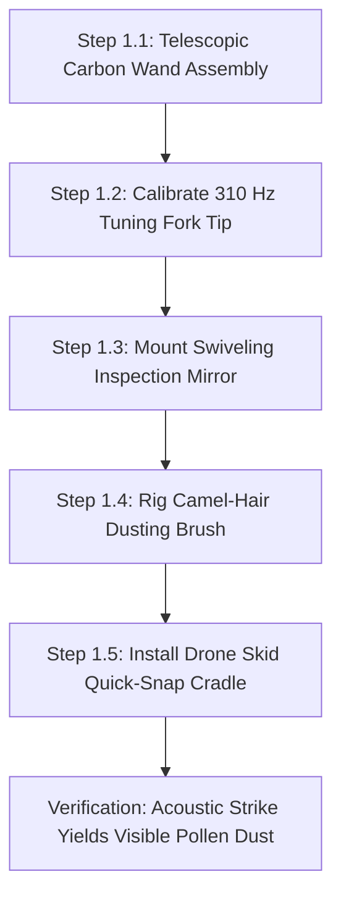
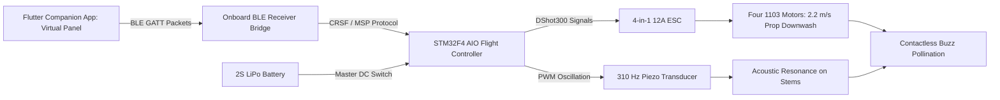
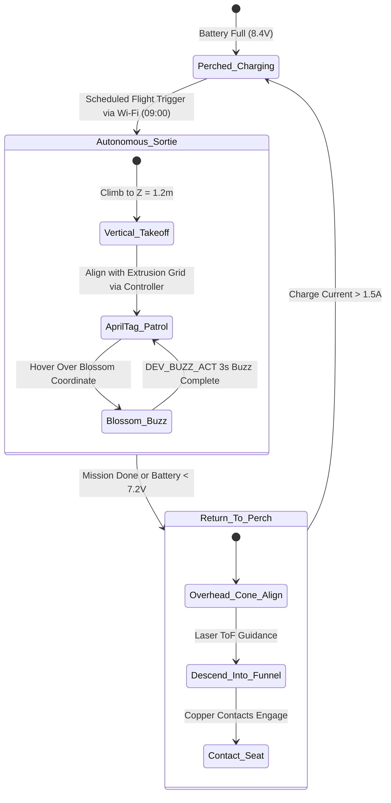

import { Card, CardGrid } from '@astrojs/starlight/components';

The **Aerial Spotter & Pollination Drone** is an autonomous micro-quadcopter designed to eliminate manual hand-pollination in enclosed environments. It functions as an independent greenhouse pollination tool or operates within the canopy airspace of the master Open Biosphere assembly.

---

## 1. Standalone Homesteading & Off-Grid Utility

In enclosed greenhouses, high tunnels, or indoor grow tents, natural insect pollinators (bees) often fail to thrive or escape, requiring tedious manual flower vibrating with electric toothbrushes or paintbrushes. This drone delivers **automated, non-contact buzz pollination and canopy diagnostics**:

<CardGrid>
  <Card title="Acoustic & Prop-Wash Buzz Pollination" icon="wind">
    Calibrated propeller downwash (1.5 to 2.5 m/s) and motor acoustics induce resonant flower vibration (200–400 Hz), releasing pollen on solanaceous crops (peppers, tomatoes) with zero physical flower contact.
  </Card>
  <Card title="GPS-Denied Optical Indoor Navigation" icon="compass">
    Down-facing optical flow sensors and AprilTag visual fiducial markers enable centimeter-precise indoor hover without requiring GPS or external motion-capture rigs.
  </Card>
  <Card title="Multispectral Canopy Inspection" icon="eye">
    High-resolution downward RGB/NIR sensor maps vegetative indices (NDVI) and pinpoints localized nutrient deficiencies or pest outbreaks days before visible to human eyes.
  </Card>
  <Card title="Automated Contact-Charging Perch" icon="zap">
    Landing legs feature spring-loaded copper contacts that seat into a conical landing pad, recharging the drone autonomously between 8-minute flight sorties.
  </Card>
</CardGrid>

---

## 2. Technical Specifications

| Parameter | Specification |
| :--- | :--- |
| **Airframe Class** | 85mm to 120mm ducted micro-quadcopter (Whoop-style enclosed prop guards) |
| **Weight** | 68 g (with 2S LiPo battery and optical flow sensor) |
| **Downwash Velocity** | 1.8 to 2.4 m/s at 150 mm distance (calibrated for solanaceous flower anthesis) |
| **Flight Time** | 8.5 minutes per sortie (recharge cycle: 14 minutes on docking pad) |
| **Vision & Sensors** | Dual-mode RGB/NIR micro-camera + PMW3901 optical flow + VL53L1X ToF lidar |
| **Flight Controller**| Betaflight / ArduPilot / Crazyflie open-source STM32 architecture |
| **Fiducial Tracking**| AprilTags (36h11 family) along enclosure extrusions for global localization |
| **Power Supply**| 0W (Manual Wand) / 2S 450mAh LiPo Pack (Add-On 1) / Automated Dock Perch (Add-On 2) |

---

## 3. Instructions (Base Zero-Power Machine)

The foundational build of the Aerial Pollination Drone ecosystem is a **100% mechanical, zero-power acoustic pollination wand and canopy inspection loupe**. Requiring no batteries, electronics, or flight clearance, it utilizes an acoustic tuning fork tip (310 Hz resonance calibrated to *Capsicum* and *Solanum* flower anthers), a swiveling mirror, and a fine camel-hair brush to buzz-pollinate blossoms by hand with 100% off-grid reliability.

### Mechanical Architecture & Decoupling Standard
1. **Telescopic Carbon Wand**: A rigid 1.2 m to 2.4 m multi-stage carbon-fiber extension pole allows reaching into dense trellis foliage and high canopies without disturbing plant stems.
2. **Acoustic Resonant Fork Tip**: A calibrated aluminum tuning fork ground to 310 Hz induces resonant acoustic pollen shedding when tapped against stems, matching the exact natural flight-muscle buzz frequency of bumblebees (*Bombus* spp.).
3. **Swiveling Inspection Mirror**: A ball-joint mounted convex mirror and 10x optical jeweler's loupe allow the operator to inspect flower anthesis (pollen readiness) on downward-facing blossom cups.
4. **Mechanical Decoupling Standard**: The carbon wand tip features a standardized 1/4"-20 brass threaded socket. When the electric micro-drone is constructed in subsequent tiers, its landing skid snaps directly into this wand socket, enabling manual pole-mounted vibration sweeping even if the drone's batteries are completely flat.

```
       ACOUSTIC POLLINATION WAND — BASE MECHANICAL ELEVATION
  =================================================================
             [Target Solanaceous Flower Cup (Peppers)]
                           \       /
                            ( \ / )
                             \ | /
                               v [Pollen Anther Cloud]
                               
               +---------------+---------------+
               |   [310 Hz Resonant Fork Tip]  |
               |     (Acoustic Vibration)      |
               +---------------+---------------+
                               |
                   [1/4"-20 Brass Quick-Snap]
                               |
               +---------------+---------------+
               | [Swiveling Inspection Mirror] |
               |     (Ball-Joint Convex)       |
               +---------------+---------------+
                               |
               [Camel-Hair Cross-Dusting Brush]
                               |
               +===============================+
               |  Carbon-Fiber Telescopic Wand |
               |     (1.2 m to 2.4 m Reach)    |
               +===============================+
                               |
                     (Ergonomic Foam Grip)
```

### Step-by-Step Fabrication & Assembly Protocol

#### Step 1.1: Carbon-Fiber Wand Assembly & Collar Fitting
1. Obtain a 3-section telescopic carbon-fiber tube set (outer diameters 25 mm, 22 mm, 19 mm; collapsed length 800 mm, extended length 2,400 mm).
2. Deburr cut edges and install nylon quick-cam compression locking collars at each joint.
3. Glue a turned aluminum 1/4"-20 threaded male head stud into the 19 mm tip using structural epoxy (24-hour cure).
4. Slide a 200 mm high-density EVA foam handle grip onto the base section.

#### Step 1.2: Acoustic Tuning Fork Tip Fabrication (310 Hz)
1. Select a standard 320 Hz aluminum alloy acoustic tuning fork.
2. File the fork tines down progressively while checking frequency with an audio spectrum analyzer smartphone app until resonant frequency strikes exactly $310\text{ Hz} \pm 2\text{ Hz}$.
3. Thread the fork base stem to 1/4"-20 female thread and screw tightly onto the carbon wand stud.
4. Dip the fork tines into food-grade liquid silicone rubber to create a soft, non-damaging contact tip.

#### Step 1.3: Swiveling Inspection Mirror & Loupe Mounting
1. Mount a 50 mm convex glass mirror onto a miniature stainless steel ball-and-socket swivel clamp.
2. Clamp the ball swivel to the carbon pole 100 mm below the tuning fork tip.
3. Tighten the knurled thumbscrew so the mirror maintains its tilt angle while allowing manual repositioning with one finger.

#### Step 1.4: Camel-Hair Cross-Dusting Brush Rigging
1. Mount a fan-shaped natural camel-hair botanical dusting brush (width 25 mm) on a flexible copper gooseneck arm.
2. Clamp the gooseneck to the carbon wand opposite the inspection mirror.
3. Bend the gooseneck so the brush hairs sit 15 mm behind the tuning fork tines, automatically catching falling pollen clouds during vibration.

#### Step 1.5: Drone Skid Quick-Snap Cradle Assembly
1. 3D-print a lightweight carbon-PETG cradle with dual spring clips that match the landing skids of the 85mm whoop airframe.
2. Embed a 1/4"-20 brass threaded nut in the cradle base.
3. Verify that the empty cradle mounts rigidly onto the wand tip, ready to receive the electric drone airframe in later tiers.



### Step-by-Step Operating Runbook (Manual Mode)

1. **Morning Anthesis Survey**: Enter the greenhouse between 08:30 and 10:30 AM when relative humidity is between 60% and 75% (ideal window for flower anther dehiscence).
2. **Extending the Wand**: Unlock the nylon collars, extend the carbon wand to reach the target flower clusters ($1.2$ to $2.2$ m), and lock the cams securely.
3. **Flower Cup Inspection**: Position the swiveling convex mirror directly beneath downward-hanging pepper or tomato blossoms. Look for open petals and yellow anther cones.
4. **Acoustic Resonant Vibration**: Gently touch the silicone-coated 310 Hz tuning fork tine against the pedicel (stem) 10 mm behind the flower calyx. Tap the wand base lightly with your knuckles; the acoustic buzz vibrates the flower cone, releasing an instantaneous cloud of white/yellow pollen.
5. **Cross-Pollination Swabbing**: Swirl the camel-hair dusting brush across the blossom face to deposit collected pollen grains directly onto the central pistil stigma.
6. **Row-by-Row Progression**: Step along the planting bed, spending 4 to 6 seconds per open flower cluster.
7. **Post-Pollination Maintenance**: Wipe the fork tip and camel-hair brush with a 70% ethanol swab between crop varieties to prevent cross-contamination.

### Base Machine Bill of Materials (BOM)

| Item | Component Description | Sourcing / Part Reference | Qty | Unit Cost | Total Cost |
| :--- | :--- | :--- | :--- | :--- | :--- |
| **D-01** | Telescopic 3-Section Carbon-Fiber Pole (1.2–2.4m) | Photography / pole supplier | 1 | $18.00 | $18.00 |
| **D-02** | 310 Hz Calibrated Acoustic Tuning Fork + Silicone Dip | Acoustic supplier / DIY file | 1 | $14.00 | $14.00 |
| **D-03** | Swiveling Ball-Joint Convex Inspection Mirror (50mm) | Inspection tool supplier | 1 | $11.00 | $11.00 |
| **D-04** | Natural Camel-Hair Botanical Dusting Brush + Gooseneck | Botanical laboratory supply | 1 | $9.00 | $9.00 |
| **Total** | **Base Zero-Power Pollination Wand** | **Complete off-grid manual tool** | | | **$52.00** |

---

## 4. Add-On 1: Semi-Autonomous Electromechanical Pack (BLE Virtual Panel)

Under [RFC-0005](/rfcs/rfc-0005-hardware-interlocks-ble-virtual-panel), physical control panels, dedicated button boxes, rotary dials, and bulky handheld RC transmitters with mechanical switches are banned across all machine tiers to eliminate water ingress and control priority contention.

Add-On 1 introduces powered aerial locomotion governed by the **Strict Two-Control Physical Standard**:
1. **Master Hardware DC Power Switch**: Inline mechanical disconnect directly isolating the 2S LiPo battery and charging bus.
2. **"Nuke & Pave" SD Factory Restore Button**: Dedicated recessed tactile switch on the ground bench module/node wired to trigger an automatic secondary bootloader re-flash from micro-SD storage.

All manual flight trim calibration, virtual stick steering, motor test pulses, and acoustic buzz pollination triggers are conducted via the **Flutter Companion App Virtual Panel** over direct local BLE GATT.

### Electromechanical Actuation Architecture & Decoupling
- **Airframe**: 85 mm wheelbase ducted whoop frame molded in high-impact polycarbonate. Enclosed duct guards ensure props cannot cut plant leaves or vines on accidental contact.
- **Powertrain**: Four 1103 10,000KV brushless outrunner motors spinning 2.0-inch tri-blade polycarbonate propellers, generating 240 g total thrust ($3.5:1$ thrust-to-weight ratio).
- **Acoustic Downwash Generation**: Prop downwash velocity measures 2.2 m/s at 150 mm below the ducts, sufficient to flutter blossoms and vibrate pollen free without physical contact.
- **Strict Two-Control Enclosure & Dock**: A benchtop charging station and drone power harness feature:
  - Inline mechanical DC cut switch directly isolating the battery lead with zero soft-switch leakage.
  - Recessed tactile button next to the 0.91" I2C OLED display (`[DRONE-A1 | BLE READY]`) for 5-second SD recovery reflash.
  - Micro-SD card slot module pre-loaded with golden recovery `firmware.bin` and `config.default`.
- **Ephemeral BLE Virtual Panel**: When nearby, an operator opens the Flutter companion app on mobile device. The app auto-discovers the drone over BLE GATT and displays real-time virtual touch flight pads: virtual twin gimbals, Altitude Hold toggle, and Acoustic Buzz burst button.
- **Mechanical Decoupling**: If battery is depleted, the entire whoop drone snaps into the Base carbon wand socket, instantly reverting to manual sweep pollination.

```
       ELECTROMECHANICAL WIRING & BLE VIRTUAL INTERFACE SCHEMATIC
  =================================================================
  [2S 450mAh LiPo Battery (7.4V / 8.4V Peak)]
         |
         +----[Master DC Cut Switch]----+----(XT30 Connector)
                                        |
         +------------------------------+---------------------------+
         |                                                          |
         v                                                          v
  [STM32F411 AIO Flight Controller]                  [4-in-1 12A BLHeli_S ESC]
  (BLE Peripheral Bridge + OLED + SD Reset)                 |
         |                                   +--------------+--------------+
         | I2C / UART                        |       |              |      |
         v                                   v       v              v      v
  [0.91" I2C OLED Status Display]          [M1]    [M2]           [M3]   [M4]
  [Micro-SD Slot + Recovery Bin ]          (1103 Brushless Motors - 10,000KV)
         |
         v GPIO
  [High-Frequency Piezo Transducer]
  (Acoustic Stems Vibration: 310 Hz)
         ^
         : Direct BLE GATT (No Contention)
         v
  [Flutter Companion App Virtual Panel]
  (Virtual Flight Sticks, Alt-Hold Toggle, Buzz Pollinate Burst)
```

### Step-by-Step Retrofit Protocol

#### Step 2.1: Whoop Airframe & Motor Installation
1. Press-fit four 1103 10,000KV brushless motors into the 85 mm polycarbonate ducted whoop frame.
2. Fasten each motor using three M2 × 4 mm grade 10.9 hex screws with blue threadlocker.
3. Install 2020 4-blade or 2023 3-blade propellers. Set rotation direction: Props-Out configuration to deflect greenhouse foliage away from camera lens.

#### Step 2.2: AIO Flight Controller & ESC Mounting
1. Mount the STM32F411 All-in-One flight controller board on soft silicone anti-vibration grommets in the center bay.
2. Solder the three motor phase wires from each corner directly to the corresponding ESC solder pads.
3. Solder an XT30 battery lead through the heavy-duty inline master DC switch with a 16V 220µF low-ESR capacitor.

#### Step 2.3: BLE Peripheral Integration & Two-Control Dock
1. Wire the ESP32 BLE peripheral bridge to UART2 on the flight controller (TX, RX, 5V, GND).
2. Wire the recessed tactile SD recovery button and micro-SD card slot module pre-loaded with golden `firmware.bin` and `config.default`.
3. Connect 0.91" I2C OLED display showing `[DRONE-A1 | BLE READY]`.

#### Step 2.4: Piezo Acoustic Vibration Transducer Rigging
1. Mount a 27 mm brass-backed piezoelectric ceramic transducer to the underside carbon battery tray.
2. Wire the piezo disc through a miniature N-channel FET driven by a spare PWM output (LED pad).
3. Program flight controller to trigger 310 Hz square-wave oscillation when the Virtual Panel BUZZ command is received over BLE.

#### Step 2.5: Bench Flight Calibration
1. Connect flight controller to configuration software; calibrate onboard 6-axis gyroscope/accelerometer on a dead-level surface.
2. Connect mobile companion app over BLE; verify virtual sticks move flight channels smoothly with zero latency jitter.
3. Set motor idle speed to 5.5% and verify smooth motor spin-up with zero vibration resonance.



### Step-by-Step BLE Virtual Panel Operating Runbook

1. **Pre-Flight Battery Check**: Verify 2S 450mAh LiPo battery voltage reads $8.40\text{ V}$ ($4.20\text{ V/cell}$) on a digital battery checker. Slide pack into silicone battery strap; connect XT30 plug.
2. **Master Power Engagement**: Flip the inline master DC switch to ON. The onboard 0.91" OLED illuminates: `[DRONE-A1 | BLE READY]`.
3. **Walk-Up BLE Virtual Panel Connection**: Open the Flutter companion app on mobile device. Select `DRONE-A1` from discovered BLE peripherals. The app instantly renders the Flight Virtual Panel.
4. **Arming the Quadcopter**: Place the drone on a flat, clear section of the greenhouse path. Tap the virtual ARM button in the app (props idle at 5.5% RPM).
5. **Canopy Hover & Traverse**: Raise the virtual throttle slider to 45% hover. Fly along the trellised crop row at 0.5 m/s, maintaining 150 mm to 300 mm clearance directly above blooming pepper clusters.
6. **Engaging Buzz Pollination**: Position the drone directly above an open flower cluster. Tap the virtual BUZZ button in the app. The flight controller holds altitude while pulsing throttle $\pm 8\%$ and oscillating the piezo transducer at 310 Hz for 2 seconds. The combined prop-wash and acoustic vibration releases pollen clouds instantly.
7. **"Nuke & Pave" SD Recovery Protocol**: If flight firmware locks up or parameter corruption occurs, hold the recessed SD reset button for 5 seconds during power-on. The bootloader reflashes golden firmware from micro-SD in 4 seconds.
8. **Return & Battery Swap**: When battery voltage sags to 7.0V ($3.5\text{ V/cell}$ under load), land on the path, disarm motors via virtual panel, flip master DC switch OFF, and swap in a fresh LiPo pack.

### Add-On 1 Bill of Materials (BOM)

| Item | Component Description | Sourcing / Part Reference | Qty | Unit Cost | Total Cost |
| :--- | :--- | :--- | :--- | :--- | :--- |
| **A1-01** | 85mm Ducted Polycarbonate Whoop Airframe + Ducts | BetaFPV / Happymodel frame | 1 | $14.00 | $14.00 |
| **A1-02** | 1103 10,000KV Brushless Outrunner Motors + Props | FPV micro-motor supplier | 4 | $9.50 | $38.00 |
| **A1-03** | STM32F4 AIO Flight Controller + 4-in-1 12A ESC | Betaflight AIO board | 1 | $42.00 | $42.00 |
| **A1-04** | BLE Virtual Interface & Two-Control Dock Module (Master DC Switch, Recessed SD Reset Button, Micro-SD Slot + 16GB Golden Card, 0.91" I2C OLED) | Maker electronics supplier | 1 | $45.00 | $45.00 |
| **A1-05** | 2S 450mAh 75C High-Discharge LiPo Batteries (4x pack) | Tattu / GNB micro battery | 1 | $22.00 | $22.00 |
| **A1-06** | 27mm Piezo Acoustic Vibration Transducer + FET | Electronics supplier | 1 | $12.00 | $12.00 |
| **Total** | **Add-On 1 Electromechanical Pack** | **Retrofits directly to Base** | | | **+$173.00** |
| **Cumul.** | **Operational Remote-Controlled Buzz Drone** | **Base ($52) + Add-On 1 ($173)** | | | **$225.00** |

---

## 5. Add-On 2: Agentic Autonomous AI Pack (Edge Vision & Closed Loop)

Under [RFC-0004](/rfcs/rfc-0004-controller-node-tool), the **Agentic Autonomous AI Pack** enables fully autonomous indoor pollination without human pilots or GPS under the **Controller-Node-Tool (CNT)** standard. The drone operates as a flying **Drone Node** commanding modular **Edge Tools** over BLE, receiving global flight sortie schedules and bloom coordinates from the Central Biosphere Controller over Wi-Fi.

### Autonomous Vision & Telemetry Architecture
- **Drone Flight Node (ESP32-S3)**: Dual-Core Xtensa LX7 (240 MHz, 8 MB PSRAM) flight companion computer governed by the **Strict Two-Control Physical Standard** (Master DC Power Switch and Recessed SD Reset Button alongside 0.96" I2C OLED `[NODE: DRONE-01 | LINK -> 4096]`). Uplinks to Central Controller via Wi-Fi; receives flight plans, coordinates local pose estimation, and downlinks to Tools via BLE Central.
- **Decoupled Optical AprilTag Tracking**: Down-facing micro-camera streams video directly over Wi-Fi to the Central Controller (Raspberry Pi 5 + Hailo-8 M.2 HAT), which processes AprilTags spaced along greenhouse ceiling extrusions at 30 FPS, returning millimeter 6-DoF global pose vectors $(X, Y, Z)$ to the drone.
- **Dedicated Modular Edge Tools (ESP32-C3)**: Driven 1:1 by micro ESP32-C3 controllers equipped with 0.42" micro OLED displays and **250ms hardware deadman watchdogs**:
  - `DEV_FLIGHT_CTL`: Micro ESP32-C3 / STM32 bridge with 0.42" OLED (`TOOL: FLIGHT_CTL | LINK: OK`) + 250ms watchdog driving 4x brushless ESCs with auto-land descent failsafe.
  - `DEV_OPTICAL_FLOW`: Micro ESP32-C3 with 0.42" OLED (`TOOL: OPTICAL_FLOW | LINK: OK`) managing PMW3901 optical flow (42 FPS) and VL53L1X laser time-of-flight sensor for sub-millimeter altitude hold.
  - `DEV_BUZZ_ACT`: Micro ESP32-C3 with 0.42" OLED (`TOOL: BUZZ_ACT | LINK: OK`) + 250ms watchdog pulsing the acoustic piezo flower buzz transducer (180–220 Hz).
- **250ms Deadman Watchdog Fail-Safe**: If the `DEV_FLIGHT_CTL` tool loses BLE connection to the Drone Node for $> 250$ ms, it immediately disengages autonomous cruise, drops into controlled low-speed descent, and cuts motor throttle smoothly upon ground contact.

```text
       CONTROLLER-NODE-TOOL (CNT) HIERARCHICAL EDGE ARCHITECTURE
  =================================================================
            CENTRAL BIOSPHERE CONTROLLER (Pi 5 + Hailo-8 M.2 HAT)
            • Emits Hidden WPA3 Wi-Fi Network | OLED: [CTRL_ID: 4096]
            • AprilTag Global SLAM & Canopy Bloom Waypoint Schedules
                                  │
                                  │ Encrypted Wi-Fi Uplink
                                  ▼
             ┌─────────────────────────────────────────┐
             │       DRONE FLIGHT NODE (ESP32-S3)      │
             │  • OLED Display: [NODE: DRONE-01]       │
             │  • Setup Push-Button for Mobile BLE     │
             │  • Waypoint Navigation & MAVLink Bridge │
             └────────────────────┬────────────────────┘
                                  │
         ┌────────────────────────┼────────────────────────┐
         │ BLE Downlink           │ BLE Downlink           │ BLE Downlink
         ▼                        ▼                        ▼
 ┌───────────────┐        ┌───────────────┐        ┌───────────────┐
 │ TOOL:         │        │ TOOL:         │        │ TOOL:         │
 │ DEV_FLIGHT_CTL│        │ DEV_OPT_FLOW  │        │ DEV_BUZZ_ACT  │
 │ ESP32-C3 Micro│        │ ESP32-C3 Micro│        │ ESP32-C3 Micro│
 │ 0.42" OLED    │        │ 0.42" OLED    │        │ 0.42" OLED    │
 │ 250ms Deadman │        │ PMW3901 Flow  │        │ 250ms Deadman │
 │ 4x Brushless  │        │ VL53L1X Laser │        │ Piezo 200 Hz  │
 │ ESC Auto-Land │        │ Sub-mm Alt    │        │ Buzz Pollinate│
 └───────────────┘        └───────────────┘        └───────────────┘
```

### Step-by-Step Sensor Commissioning & Edge AI Protocol

#### Step 3.1: Drone Node & Power Harness Setup
1. Mount the ESP32-S3 Node with 0.96" I2C OLED display and physical setup push-button on the top carbon plate.
2. Wire power via a miniature high-efficiency 5V 2A buck regulator tapped from the 2S LiPo battery.
3. Verify telemetry link: onboard OLED reads `[NODE UNPAIRED - PAIR VIA BLE]`.

#### Step 3.2: Optical Flow & Laser ToF Integration (`DEV_OPT_FLOW`)
1. Mount PMW3901 optical flow and VL53L1X laser ToF on the bottom carbon plate ($Z=0$ ground plane).
2. Wire sensors to `DEV_OPT_FLOW` tool board (ESP32-C3) over SPI and I2C.
3. Test static hover tracking: drift must measure $< 15$ mm per minute over greenhouse soil.

#### Step 3.3: AprilTag Visual Camera & Wi-Fi Link
1. Mount the down-facing micro-camera angled 15° forward of nadir.
2. Affix 100 × 100 mm AprilTag markers (family 36h11) along upper greenhouse ceiling extrusions.
3. Configure camera stream to Central Controller; verify 6-DoF global pose calculations at 30 FPS.

#### Step 3.4: Automated Conical Charging Perch Fabrication
1. 3D-print a 150 mm diameter conical landing funnel with a 35° incline.
2. Inlay dual concentric brass wiper rings connected to a 2S LiPo CC/CV smart balance charging circuit.
3. Attach spring-loaded copper landing skids to the drone airframe base.

#### Step 3.5: Provisioning & 250ms Watchdog Verification
1. Power on Central Controller; note pairing ID on its OLED (`CTRL_ID: 4096`).
2. Power on Drone Node; press physical setup button; pair via mobile companion app over BLE, enter `4096`.
3. Node commits credentials to NVS, links to hidden Wi-Fi, and updates display to `[ONLINE | LINK -> 4096]`.
4. Verify Node auto-discovers and binds all three BLE Tools.
5. Test fail-safe watchdog: drop BLE link to `DEV_FLIGHT_CTL`; verify auto-land descent triggers within $< 250$ ms.



### Step-by-Step Autonomous Multi-Agent Runbook

1. **Scheduled Morning Wakeup**: At 09:00 AM, the Central Controller broadcasts an autonomous pollination sortie over Wi-Fi. The drone confirms battery $\ge 8.35	ext{ V}$ and signals `DEV_FLIGHT_CTL` to spin up motors.
2. **Centimeter-Accurate Optical Takeoff**: The drone lifts vertically out of the conical perch to $Z = 1,200$ mm. The `DEV_OPT_FLOW` tool locks position over ground texture with zero horizontal drift.
3. **AprilTag Waypoint Navigation**: The drone traverses the perimeter rail; the Central Controller reads ceiling tags from the camera feed and streams real-time pose corrections to the Drone Node.
4. **Autonomous Buzz Pollination Sortie**: Upon reaching pre-mapped flower targets, the drone drops to $Z = 600$ mm (150 mm above flowers), pulses downwash at 2.4 m/s, and signals `DEV_BUZZ_ACT` to fire its piezo transducer for 3.0 seconds, buzz-pollinating blossoms.
5. **Self-Aligning Conical Perch Docking**: When the 8.5-minute sortie concludes, the drone navigates to the conical perch, positions directly over the funnel center via laser ToF, and cuts throttle smoothly into the brass wiper contacts to recharge at 2A.
6. **250ms Fail-Safe Watchdogs**: If BLE connection between Node and `DEV_FLIGHT_CTL` drops for $> 250$ ms, auto-land is engaged immediately. If Wi-Fi link to Central Controller is lost, the drone initiates an immediate return-to-perch abort.

### Add-On 2 Bill of Materials (BOM)

| Item | Component Description | Sourcing / Part Reference | Qty | Unit Cost | Total Cost |
| :--- | :--- | :--- | :--- | :--- | :--- |
| **A2-01** | Drone Flight Node: ESP32-S3 (8MB PSRAM) + 0.96" OLED + Setup Button | Espressif distributor | 1 | $16.00 | $16.00 |
| **A2-02** | PMW3901 Optical Flow Breakout + VL53L1X Laser ToF + 1x ESP32-C3 Tool | Maker robotics sensor store | 1 | $21.00 | $21.00 |
| **A2-03** | RunCam Split HD / Micro RGB-NIR Camera Module with Wi-Fi Link | Micro FPV camera maker | 1 | $32.00 | $32.00 |
| **A2-04** | 3D-Printed Conical Perch + Concentric Brass Contacts | DIY 3D print + brass wire | 1 | $16.00 | $16.00 |
| **A2-05** | 2x ESP32-C3 Modular Tools with 0.42" OLED & 250ms Watchdog (Flight & Buzz) | Microcontroller supplier | 2 | $7.00 | $14.00 |
| **Total** | **Add-On 2 Agentic Autonomous Pack (CNT Standard)** | **Expands Base + Add-On 1** | | | **+$99.00** |
| **Full Build** | **Complete Autonomous Biosphere Pollination Drone** | **Base + Add-On 1 + Add-On 2** | | | **$324.00** |

---

## 6. Staged Upgrade Progression & Cost Summary

### Build Tier Comparison

| Build Stage | Operational Capability | Direct Stage Cost | Cumulative Investment |
| :--- | :--- | :--- | :--- |
| **Base: Instructions** | 100% mechanical manual wand with acoustic resonant flower vibrator & mirror | $52.00 | **$52.00** |
| **Add-On 1: Semi-Auto** | Flutter BLE Virtual Panel piloted ducted whoop flight with two-control interlocks | +$173.00 | **$225.00** |
| **Add-On 2: Agentic AI** | Controller-Node-Tool (CNT) automation, indoor AprilTag SLAM, optical flow hover, & auto-perch | +$99.00 | **$324.00** |

### Step-by-Step Zero-Waste Conversion Roadmap

#### Path 1: Base Machine $
ightarrow$ Add-On 1 (Piloted Micro-Whoop Drone)
1. Assemble the 85 mm ducted whoop airframe, brushless motors, and STM32F4 flight controller.
2. Wire the BLE peripheral bridge, Two-Control power harness, and piezo acoustic transducer.
3. The Base carbon wand and 1/4"-20 cradle remain fully functional as a handheld backup mount if flying indoors is restricted by temporary netting.

#### Path 2: Add-On 1 $
ightarrow$ Add-On 2 (Autonomous Edge CNT Drone)
1. Mount the Drone Flight Node (ESP32-S3 + OLED + Button) and modular ESP32-C3 Tools on the carbon airframe.
2. Connect `DEV_OPT_FLOW` tool to the bottom optical flow and laser ToF sensors.
3. Wire the RunCam micro-camera with Wi-Fi video streaming to the Central Controller.
4. Mount the conical landing perch with charging contacts, provision the Drone Node with Central Controller ID via mobile app BLE, and verify 250ms auto-land watchdog.

---

## 7. Master Biosphere Assembly Interlock

When integrated into the centralized Open Biosphere facility (~20 × 10 ft footprint):

1. **Airspace Ceiling Routing**: Operates in the canopy airspace ($Z = 0$ to $1,372$ mm) between the water surface and lighting hoods.
2. **AprilTag Extrusion Grid**: Navigates autonomously by referencing high-contrast AprilTags mounted along the upper 2040 perimeter extrusions at 1,000 mm intervals.
3. **Automated Perch**: Returns to the landing perch mounted on the northern Mid-Tier coping deck for contact recharging between scheduled pollination runs.
4. **Cross-Agent Task Coordination**: Receives flower coordinate target maps generated by the 2-Axis Gantry survey, dispatching targeted buzz-pollination sorties only to beds with active blooms.
