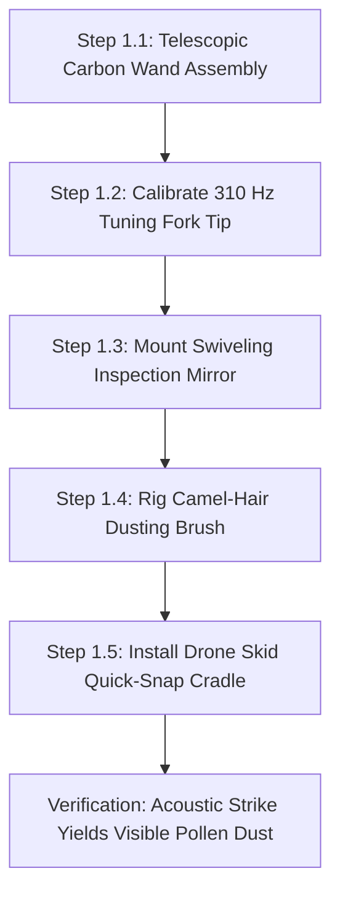
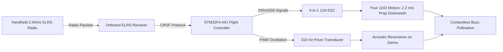
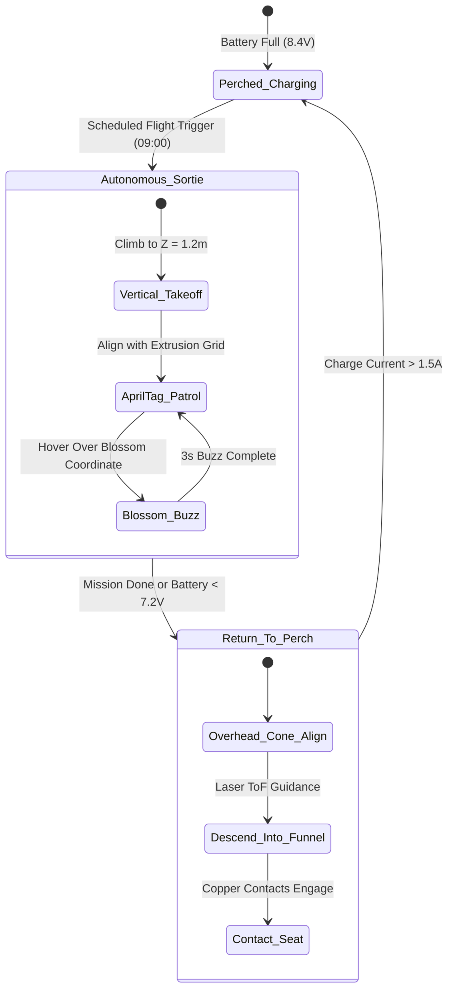

import { Card, CardGrid } from '@astrojs/starlight/components';

The **Aerial Spotter & Pollination Drone** is an autonomous micro-quadcopter designed to eliminate manual hand-pollination in enclosed environments. It functions as an independent greenhouse pollination tool or operates within the canopy airspace of the master Open Biosphere assembly.

---

## 1. Standalone Homesteading & Off-Grid Utility

In enclosed greenhouses, high tunnels, or indoor grow tents, natural insect pollinators (bees) often fail to thrive or escape, requiring tedious manual flower vibrating with electric toothbrushes or paintbrushes. This drone delivers **automated, non-contact buzz pollination and canopy diagnostics**:

<CardGrid>
  <Card title="Acoustic & Prop-Wash Buzz Pollination" icon="wind">
    Calibrated propeller downwash (1.5 to 2.5 m/s) and motor acoustics induce resonant flower vibration (200–400 Hz), releasing pollen on solanaceous crops (peppers, tomatoes) with zero physical flower contact.
  </Card>
  <Card title="GPS-Denied Optical Indoor Navigation" icon="compass">
    Down-facing optical flow sensors and AprilTag visual fiducial markers enable centimeter-precise indoor hover without requiring GPS or external motion-capture rigs.
  </Card>
  <Card title="Multispectral Canopy Inspection" icon="eye">
    High-resolution downward RGB/NIR sensor maps vegetative indices (NDVI) and pinpoints localized nutrient deficiencies or pest outbreaks days before visible to human eyes.
  </Card>
  <Card title="Automated Contact-Charging Perch" icon="zap">
    Landing legs feature spring-loaded copper contacts that seat into a conical landing pad, recharging the drone autonomously between 8-minute flight sorties.
  </Card>
</CardGrid>

---

## 2. Technical Specifications

| Parameter | Specification |
| :--- | :--- |
| **Airframe Class** | 85mm to 120mm ducted micro-quadcopter (Whoop-style enclosed prop guards) |
| **Weight** | 68 g (with 2S LiPo battery and optical flow sensor) |
| **Downwash Velocity** | 1.8 to 2.4 m/s at 150 mm distance (calibrated for solanaceous flower anthesis) |
| **Flight Time** | 8.5 minutes per sortie (recharge cycle: 14 minutes on docking pad) |
| **Vision & Sensors** | Dual-mode RGB/NIR micro-camera + PMW3901 optical flow + VL53L1X ToF lidar |
| **Flight Controller**| Betaflight / ArduPilot / Crazyflie open-source STM32 architecture |
| **Fiducial Tracking**| AprilTags (36h11 family) along enclosure extrusions for global localization |
| **Power Supply**| 0W (Manual Wand) / 2S 450mAh LiPo Pack (Add-On 1) / Automated Dock Perch (Add-On 2) |

---

## 3. Instructions (Base Zero-Power Machine)

The foundational build of the Aerial Pollination Drone ecosystem is a **100% mechanical, zero-power acoustic pollination wand and canopy inspection loupe**. Requiring no batteries, electronics, or flight clearance, it utilizes an acoustic tuning fork tip (310 Hz resonance calibrated to *Capsicum* and *Solanum* flower anthers), a swiveling mirror, and a fine camel-hair brush to buzz-pollinate blossoms by hand with 100% off-grid reliability.

### Mechanical Architecture & Decoupling Standard
1. **Telescopic Carbon Wand**: A rigid 1.2 m to 2.4 m multi-stage carbon-fiber extension pole allows reaching into dense trellis foliage and high canopies without disturbing plant stems.
2. **Acoustic Resonant Fork Tip**: A calibrated aluminum tuning fork ground to 310 Hz induces resonant acoustic pollen shedding when tapped against stems, matching the exact natural flight-muscle buzz frequency of bumblebees (*Bombus* spp.).
3. **Swiveling Inspection Mirror**: A ball-joint mounted convex mirror and 10x optical jeweler's loupe allow the operator to inspect flower anthesis (pollen readiness) on downward-facing blossom cups.
4. **Mechanical Decoupling Standard**: The carbon wand tip features a standardized 1/4"-20 brass threaded socket. When the electric micro-drone is constructed in subsequent tiers, its landing skid snaps directly into this wand socket, enabling manual pole-mounted vibration sweeping even if the drone's batteries are completely flat.

```
       ACOUSTIC POLLINATION WAND — BASE MECHANICAL ELEVATION
  =================================================================
             [Target Solanaceous Flower Cup (Peppers)]
                           \       /
                            ( \ / )
                             \ | /
                               v [Pollen Anther Cloud]
                               
               +---------------+---------------+
               |   [310 Hz Resonant Fork Tip]  |
               |     (Acoustic Vibration)      |
               +---------------+---------------+
                               |
                   [1/4"-20 Brass Quick-Snap]
                               |
               +---------------+---------------+
               | [Swiveling Inspection Mirror] |
               |     (Ball-Joint Convex)       |
               +---------------+---------------+
                               |
               [Camel-Hair Cross-Dusting Brush]
                               |
               +===============================+
               |  Carbon-Fiber Telescopic Wand |
               |     (1.2 m to 2.4 m Reach)    |
               +===============================+
                               |
                     (Ergonomic Foam Grip)
```

### Step-by-Step Fabrication & Assembly Protocol

#### Step 1.1: Carbon-Fiber Wand Assembly & Collar Fitting
1. Obtain a 3-section telescopic carbon-fiber tube set (outer diameters 25 mm, 22 mm, 19 mm; collapsed length 800 mm, extended length 2,400 mm).
2. Deburr cut edges and install nylon quick-cam compression locking collars at each joint.
3. Glue a turned aluminum 1/4"-20 threaded male head stud into the 19 mm tip using structural epoxy (24-hour cure).
4. Slide a 200 mm high-density EVA foam handle grip onto the base section.

#### Step 1.2: Acoustic Tuning Fork Tip Fabrication (310 Hz)
1. Select a standard 320 Hz aluminum alloy acoustic tuning fork.
2. File the fork tines down progressively while checking frequency with an audio spectrum analyzer smartphone app until resonant frequency strikes exactly $310\text{ Hz} \pm 2\text{ Hz}$.
3. Thread the fork base stem to 1/4"-20 female thread and screw tightly onto the carbon wand stud.
4. Dip the fork tines into food-grade liquid silicone rubber to create a soft, non-damaging contact tip.

#### Step 1.3: Swiveling Inspection Mirror & Loupe Mounting
1. Mount a 50 mm convex glass mirror onto a miniature stainless steel ball-and-socket swivel clamp.
2. Clamp the ball swivel to the carbon pole 100 mm below the tuning fork tip.
3. Tighten the knurled thumbscrew so the mirror maintains its tilt angle while allowing manual repositioning with one finger.

#### Step 1.4: Camel-Hair Cross-Dusting Brush Rigging
1. Mount a fan-shaped natural camel-hair botanical dusting brush (width 25 mm) on a flexible copper gooseneck arm.
2. Clamp the gooseneck to the carbon wand opposite the inspection mirror.
3. Bend the gooseneck so the brush hairs sit 15 mm behind the tuning fork tines, automatically catching falling pollen clouds during vibration.

#### Step 1.5: Drone Skid Quick-Snap Cradle Assembly
1. 3D-print a lightweight carbon-PETG cradle with dual spring clips that match the landing skids of the 85mm whoop airframe.
2. Embed a 1/4"-20 brass threaded nut in the cradle base.
3. Verify that the empty cradle mounts rigidly onto the wand tip, ready to receive the electric drone airframe in later tiers.



### Step-by-Step Operating Runbook (Manual Mode)

1. **Morning Anthesis Survey**: Enter the greenhouse between 08:30 and 10:30 AM when relative humidity is between 60% and 75% (ideal window for flower anther dehiscence).
2. **Extending the Wand**: Unlock the nylon collars, extend the carbon wand to reach the target flower clusters ($1.2$ to $2.2$ m), and lock the cams securely.
3. **Flower Cup Inspection**: Position the swiveling convex mirror directly beneath downward-hanging pepper or tomato blossoms. Look for open petals and yellow anther cones.
4. **Acoustic Resonant Vibration**: Gently touch the silicone-coated 310 Hz tuning fork tine against the pedicel (stem) 10 mm behind the flower calyx. Tap the wand base lightly with your knuckles; the acoustic buzz vibrates the flower cone, releasing an instantaneous cloud of white/yellow pollen.
5. **Cross-Pollination Swabbing**: Swirl the camel-hair dusting brush across the blossom face to deposit collected pollen grains directly onto the central pistil stigma.
6. **Row-by-Row Progression**: Step along the planting bed, spending 4 to 6 seconds per open flower cluster.
7. **Post-Pollination Maintenance**: Wipe the fork tip and camel-hair brush with a 70% ethanol swab between crop varieties to prevent cross-contamination.

### Base Machine Bill of Materials (BOM)

| Item | Component Description | Sourcing / Part Reference | Qty | Unit Cost | Total Cost |
| :--- | :--- | :--- | :--- | :--- | :--- |
| **D-01** | Telescopic 3-Section Carbon-Fiber Pole (1.2–2.4m) | Photography / pole supplier | 1 | $18.00 | $18.00 |
| **D-02** | 310 Hz Calibrated Acoustic Tuning Fork + Silicone Dip | Acoustic supplier / DIY file | 1 | $14.00 | $14.00 |
| **D-03** | Swiveling Ball-Joint Convex Inspection Mirror (50mm) | Inspection tool supplier | 1 | $11.00 | $11.00 |
| **D-04** | Natural Camel-Hair Botanical Dusting Brush + Gooseneck | Botanical laboratory supply | 1 | $9.00 | $9.00 |
| **Total** | **Base Zero-Power Pollination Wand** | **Complete off-grid manual tool** | | | **$52.00** |

---

## 4. Add-On 1: Semi-Autonomous Electromechanical Pack (Buttons & Dials)

The **Semi-Autonomous Pack** adds powered aerial locomotion: an 85 mm ducted polycarbonate whoop airframe with integrated propeller guards, four 1103 10,000KV brushless motors, an STM32F4 AIO flight controller with 12A ESC, a 2.4 GHz ExpressLRS receiver, and a high-frequency piezo flower vibrator. The pilot flies the drone via a handheld RC radio, engaging altitude hold and burst-throttle buzz pollination over crop rows.

### Electromechanical Actuation Architecture & Decoupling
- **Airframe**: 85 mm wheelbase ducted whoop frame molded in high-impact polycarbonate. Enclosed duct guards ensure props cannot cut plant leaves or vines on accidental contact.
- **Powertrain**: Four 1103 10,000KV brushless outrunner motors spinning 2.0-inch tri-blade polycarbonate propellers, generating 240 g total thrust ($3.5:1$ thrust-to-weight ratio).
- **Acoustic Downwash Generation**: Prop downwash velocity measures 2.2 m/s at 150 mm below the ducts, sufficient to flutter blossoms and vibrate pollen free without physical contact.
- **Pilot Radio Interface**: 2.4 GHz ExpressLRS handheld transmitter with dual hall-effect gimbals, a 3-position flight mode switch (Angle, Altitude Hold, Buzz Burst), and an emergency throttle disarm toggle.
- **Mechanical Decoupling**: If battery is depleted, the entire whoop drone snaps into the Base carbon wand socket, instantly reverting to manual sweep pollination.

```
       ELECTROMECHANICAL WIRING & MICRO-WHOOP SCHEMATIC
  =================================================================
  [2S 450mAh LiPo Battery (7.4V / 8.4V Peak)]
         |
         +----[20A Solid XT30 Connector]----+----(Current Sensor)
                                            |
         +----------------------------------+-------------------+
         |                                                      |
         v                                                      v
  [STM32F411 AIO Flight Controller]              [4-in-1 12A BLHeli_S ESC]
  (Betaflight / ArduPilot Firmware)                      |
         |                               +---------------+---------------+
         | SPI / UART                    |       |               |       |
         v                               v       v               v       v
  [ExpressLRS 2.4GHz RX]               [M1]    [M2]            [M3]    [M4]
  (From Handheld Radio)                (1103 Brushless Motors - 10,000KV)
         |
         v GPIO
  [High-Frequency Piezo Transducer]
  (Acoustic Stems Vibration: 310 Hz)
```

### Step-by-Step Retrofit Protocol

#### Step 2.1: Whoop Airframe & Motor Installation
1. Press-fit four 1103 10,000KV brushless motors into the 85 mm polycarbonate ducted whoop frame.
2. Fasten each motor using three M2 × 4 mm grade 10.9 hex screws with blue threadlocker.
3. Install 2020 4-blade or 2023 3-blade propellers. Set rotation direction: Props-Out configuration to deflect greenhouse foliage away from camera lens.

#### Step 2.2: AIO Flight Controller & ESC Mounting
1. Mount the STM32F411 All-in-One flight controller board on soft silicone anti-vibration grommets in the center bay.
2. Solder the three motor phase wires from each corner directly to the corresponding ESC solder pads.
3. Solder an XT30 battery lead with a 16V 220µF low-ESR electrolytic capacitor to damp voltage spikes.

#### Step 2.3: ExpressLRS Radio Receiver Integration
1. Solder a 2.4 GHz ExpressLRS (ELRS) serial receiver to UART2 on the flight controller (TX, RX, 5V, GND).
2. Route the ceramic tower antenna vertically through the protective top canopy.
3. Bind the receiver to your handheld 2.4 GHz ELRS radio transmitter.

#### Step 2.4: Piezo Acoustic Vibration Transducer Rigging
1. Mount a 27 mm brass-backed piezoelectric ceramic transducer to the underside carbon battery tray.
2. Wire the piezo disc through a miniature N-channel FET driven by a spare PWM output (LED pad).
3. Program Betaflight resource remapping to trigger 310 Hz square-wave oscillation when Radio Switch SD is toggled.

#### Step 2.5: Bench Flight Calibration
1. Connect flight controller to Betaflight Configurator via USB-C.
2. Calibrate onboard 6-axis gyroscope/accelerometer on a dead-level surface.
3. Set motor idle speed to 5.5% and verify smooth motor spin-up with zero vibration resonance.



### Step-by-Step Push-Button Operating Runbook

1. **Pre-Flight Battery Check**: Verify 2S 450mAh LiPo battery voltage reads $8.40\text{ V}$ ($4.20\text{ V/cell}$) on a digital battery checker. Slide pack into silicone battery strap; connect XT30 plug.
2. **Transmitter Initialization**: Power on the handheld ELRS radio transmitter. Verify telemetry signal strength (RSSI $> -75\text{ dBm}$).
3. **Arming the Quadcopter**: Place the drone on a flat, clear section of the greenhouse path. Flip the left 2-position switch to ARM (props idle at 5.5% RPM).
4. **Canopy Hover & Traverse**: Raise throttle to 45% hover. Fly along the trellised crop row at 0.5 m/s, maintaining 150 mm to 300 mm clearance directly above blooming pepper clusters.
5. **Engaging Buzz Pollination**: Position the drone directly above an open flower cluster. Flip the 3-position auxiliary switch to BUZZ. The flight controller holds altitude while pulsing throttle $\pm 8\%$ and oscillating the piezo transducer at 310 Hz for 2 seconds. The combined prop-wash and acoustic vibration releases pollen clouds instantly.
6. **Return & Battery Swap**: When battery voltage sags to 7.0V ($3.5\text{ V/cell}$ under load), navigate back to the landing pad, disarm motors, and swap in a fresh LiPo pack.

### Add-On 1 Bill of Materials (BOM)

| Item | Component Description | Sourcing / Part Reference | Qty | Unit Cost | Total Cost |
| :--- | :--- | :--- | :--- | :--- | :--- |
| **A1-01** | 85mm Ducted Polycarbonate Whoop Airframe + Ducts | BetaFPV / Happymodel frame | 1 | $14.00 | $14.00 |
| **A1-02** | 1103 10,000KV Brushless Outrunner Motors + Props | FPV micro-motor supplier | 4 | $9.50 | $38.00 |
| **A1-03** | STM32F4 AIO Flight Controller + 4-in-1 12A ESC | Betaflight AIO board | 1 | $42.00 | $42.00 |
| **A1-04** | 2.4 GHz ExpressLRS Radio Receiver + Transmitter | RadioMaster Pocket / ELRS | 1 | $45.00 | $45.00 |
| **A1-05** | 2S 450mAh 75C High-Discharge LiPo Batteries (4x pack) | Tattu / GNB micro battery | 1 | $22.00 | $22.00 |
| **A1-06** | 27mm Piezo Acoustic Vibration Transducer + FET | Electronics supplier | 1 | $12.00 | $12.00 |
| **Total** | **Add-On 1 Electromechanical Pack** | **Retrofits directly to Base** | | | **+$173.00** |
| **Cumul.** | **Operational Remote-Controlled Buzz Drone** | **Base ($52) + Add-On 1 ($173)** | | | **$225.00** |

---

## 5. Add-On 2: Agentic Autonomous AI Pack (Edge Vision & Closed Loop)

The **Agentic Autonomous AI Pack** enables fully autonomous indoor pollination without human pilots or GPS. Equipped with a down-facing PMW3901 optical flow sensor, a VL53L1X time-of-flight laser altimeter, a RunCam Split HD camera with AprilTag fiducial tracking, and a self-aligning conical charging perch, the drone takes off on automated schedules, buzz-pollinates blossoms, streams multispectral canopy NDVI maps, and auto-perches to recharge.

### Autonomous Vision & Telemetry Architecture
- **Autonomous Navigation Stack**: ESP32-S3 / Raspberry Pi Zero 2W running optical flow visual odometry linked to ArduPilot / Crazyflie autonomous flight firmwares over MAVLink.
- **GPS-Denied Optical Flow**: PMW3901 optical flow sensor (42 FPS tracking at down to 10 lux) paired with a VL53L1X laser time-of-flight sensor ($< 2$ mm altitude accuracy up to 4.0 m).
- **AprilTag Global Localization**: Down-facing micro-camera tracks 36h11 family AprilTags spaced at 1,000 mm intervals along the upper greenhouse aluminum extrusions, eliminating drift over long indoor flights.
- **Automated Conical Charging Perch**: Inverted cone landing pad with concentric brass wiper contacts that seat against the drone's spring-loaded copper landing legs, providing automated 2S 2A balance charging without human plugs.

```
       CYBER-PHYSICAL EDGE AI ARCHITECTURE & OPTICAL SLAM
  =================================================================
               +--------------------------------------+
               |  ESP32-S3 / Pi Zero 2W SLAM Engine   |
               | (AprilTag Fiducial + Optical Flow)   |
               +---+--------------------+---------+---+
                   |                    |         |
         +---------+----+               | SPI     | I2C
         | MAVLink UART |               v         v
         v              v       [PMW3901 Flow]    [VL53L1X ToF Lidar]
  [STM32F4 Flight Ctrl] [Master (Ground Texture)  (Laser Altitude Hold)
         |             Biosphere]       |                 |
         v                              v                 v
   [4x Motors]                  [Centimeter Hover] [Sub-Millimeter Z]
```

### Step-by-Step Sensor Commissioning & Edge AI Protocol

#### Step 3.1: Optical Flow & Laser ToF Board Assembly
1. Mount the PMW3901 optical flow breakout and VL53L1X ToF sensor on a carbon bottom plate ($Z = 0$ ground plane).
2. Wire optical flow over SPI (MOSI, MISO, SCK, CS) and laser ToF over I2C (SDA, SCL) to the companion compute board.
3. Test optical tracking over rough greenhouse soil and concrete pathways: drift must measure $< 15$ mm per minute of static hover.

#### Step 3.2: AprilTag Visual Fiducial Camera Setup
1. Mount the down-facing RunCam Split micro-camera with its lens angled 15° forward of nadir.
2. Affix 100 × 100 mm AprilTag markers (family 36h11, IDs 0–15) along the upper greenhouse 2040 extrusions.
3. Calibrate tag recognition pipeline: the companion board must detect and calculate 6-DoF pose relative to tags at 30 FPS.

#### Step 3.3: Automated Conical Charging Perch Fabrication
1. 3D-print a 150 mm diameter conical landing funnel with a 35° incline.
2. Inlay dual concentric brass wiper rings connected to a 2S LiPo CC/CV smart balance charging circuit.
3. Attach spring-loaded copper landing skids to the drone's airframe base.

#### Step 3.4: Firmware Flashing & Autonomous Mission Tuning
1. Flash the flight controller with autonomous ArduPilot / Crazyflie firmware with optical flow navigation enabled.
2. Configure waypoint mission: Takeoff to 1,200 mm $\rightarrow$ Traverse Row 1 at 0.3 m/s $\rightarrow$ Hover 3 sec over tag-registered blooms $\rightarrow$ Return to Conical Perch.
3. Tune PID gains: stabilize position error to $\pm 25$ mm under turbulent greenhouse fan airflow.

#### Step 3.5: Master Biosphere CAN/WiFi Telemetry Link
1. Connect companion board to greenhouse local WiFi / ESPHome mesh network.
2. Stream live canopy health tiles, flower bloom heatmaps, and battery telemetry to the central biosphere dashboard.



### Step-by-Step Autonomous Multi-Agent Runbook

1. **Scheduled Morning Wakeup**: At 09:00 AM, the central biosphere orchestrator broadcasts an autonomous pollination dispatch. The drone confirms battery voltage $\ge 8.35\text{ V}$ and spins up motors.
2. **Centimeter-Accurate Optical Takeoff**: The drone lifts vertically out of the conical perch to $Z = 1,200$ mm. PMW3901 optical flow locks position over the ground texture with zero horizontal drift.
3. **AprilTag Waypoint Navigation**: The drone flies along the upper perimeter extrusion rail, reading ceiling AprilTags to update its global position vector $(X, Y, Z)$ at 30 Hz.
4. **Autonomous Buzz Pollination Sortie**: Upon reaching pre-mapped flower coordinates (provided by the 2-Axis Gantry survey), the drone drops to $Z = 600$ mm (150 mm above flowers), pulses downwash at 2.4 m/s, and fires its piezo transducer for 3.0 seconds, releasing pollen across the blossom cluster.
5. **Multispectral Canopy Health Logging**: While traversing between flower targets, the camera logs high-resolution canopy frames, extracting vegetative NDVI health indices and detecting early mite webs.
6. **Self-Aligning Conical Perch Docking**: When the 8.5-minute sortie concludes, the drone navigates to the conical perch, positions directly over the funnel center via laser ToF, and cuts throttle. The angled cone guides the copper landing skids into concentric brass wipers, initiating a 14-minute 2A fast charge.

### Add-On 2 Bill of Materials (BOM)

| Item | Component Description | Sourcing / Part Reference | Qty | Unit Cost | Total Cost |
| :--- | :--- | :--- | :--- | :--- | :--- |
| **A2-01** | PMW3901 Optical Flow Breakout + VL53L1X Laser ToF Sensor | Maker robotics sensor store | 1 | $19.00 | $19.00 |
| **A2-02** | RunCam Split HD / Micro RGB-NIR Camera Module | Micro FPV camera maker | 1 | $32.00 | $32.00 |
| **A2-03** | Raspberry Pi Zero 2W / ESP32-S3 Visual Tracker Board | Maker single board store | 1 | $22.00 | $22.00 |
| **A2-04** | 3D-Printed Conical Perch + Concentric Brass Contacts | DIY 3D print + brass wire | 1 | $16.00 | $16.00 |
| **A2-05** | Automated 2S LiPo 2A Smart CC/CV Balance Charger Board | Maker charger electronics | 1 | $10.00 | $10.00 |
| **Total** | **Add-On 2 Agentic Autonomous Pack** | **Expands Base + Add-On 1** | | | **+$99.00** |
| **Full Build** | **Complete Autonomous Biosphere Pollination Drone** | **Base + Add-On 1 + Add-On 2** | | | **$324.00** |

---

## 6. Staged Upgrade Progression & Cost Summary

### Build Tier Comparison

| Build Stage | Operational Capability | Direct Stage Cost | Cumulative Investment |
| :--- | :--- | :--- | :--- |
| **Base: Instructions** | 100% mechanical manual wand with acoustic resonant flower vibrator & mirror | $52.00 | **$52.00** |
| **Add-On 1: Semi-Auto** | Handheld RC radio-piloted ducted whoop flight with push-button buzz pollination | +$173.00 | **$225.00** |
| **Add-On 2: Agentic AI** | Autonomous indoor AprilTag navigation, optical flow hover, and contact auto-recharge | +$99.00 | **$324.00** |

### Step-by-Step Zero-Waste Conversion Roadmap

#### Path 1: Base Machine $\rightarrow$ Add-On 1 (Piloted Micro-Whoop Drone)
1. Assemble the 85 mm ducted whoop airframe, brushless motors, and STM32F4 flight controller.
2. Solder the ExpressLRS receiver and piezo acoustic transducer.
3. The Base carbon wand and 1/4"-20 cradle remain fully functional as a handheld backup mount if flying indoors is restricted by temporary netting.

#### Path 2: Add-On 1 $\rightarrow$ Add-On 2 (Autonomous Optical SLAM Platform)
1. Mount the PMW3901 optical flow and laser ToF sensor board beneath the airframe.
2. Install the companion compute board and down-facing AprilTag camera.
3. Assemble the conical landing perch with brass contacts on the greenhouse coping deck and flash ArduPilot autonomous navigation firmware.

---

## 7. Master Biosphere Assembly Interlock

When integrated into the centralized Open Biosphere facility (~20 × 10 ft footprint):

1. **Airspace Ceiling Routing**: Operates in the canopy airspace ($Z = 0$ to $1,372$ mm) between the water surface and lighting hoods.
2. **AprilTag Extrusion Grid**: Navigates autonomously by referencing high-contrast AprilTags mounted along the upper 2040 perimeter extrusions at 1,000 mm intervals.
3. **Automated Perch**: Returns to the landing perch mounted on the northern Mid-Tier coping deck for contact recharging between scheduled pollination runs.
4. **Cross-Agent Task Coordination**: Receives flower coordinate target maps generated by the 2-Axis Gantry survey, dispatching targeted buzz-pollination sorties only to beds with active blooms.
