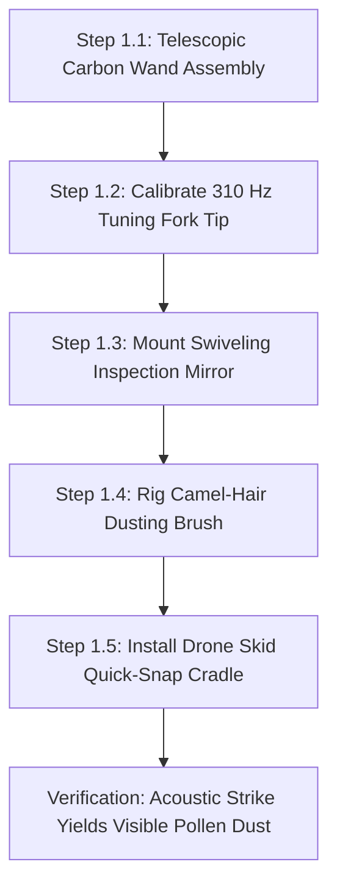

import { Card, CardGrid, LinkButton } from '@astrojs/starlight/components';

## Part 1: Stage Header & Executive Summary

> [!NOTE]
> **Stage Designation:** Stage 0 (Zero-Power Baseline)  
> **Operating Mode:** 100% Mechanical Manual Fallback  
> **Power Consumption:** 0 Watts (Zero Electrical Input Required)  
> **Resilience Rating:** Continuous Off-Grid / EMP / Submersion Proof  
> **Decoupling Standard:** Friction Slip-Clutch / Quick-Release Cam Linkage  

The Stage 0 baseline build of the **Aerial Spotter & Pollination Drone** is a **100% mechanical, zero-power agricultural machine**. It operates entirely by human leverage, manual hand cranks, counterweights, and gravity flows—providing complete food security and operational continuity during total grid blackouts.

---

## Part 2: Capability Delta (Features Introduced)

* **Zero-Power Resilience**: Operates indefinitely without batteries, solar controllers, or power supplies.
* **Direct Mechanical Leverage**: All actuation performed via hand cranks, manual levers, counterweights, or gravity siphoning.
* **Inherent Decoupling**: Built from the ground up with mechanical slip-clutches, quick-release clamps, or bypass valves to ensure motor upgrades never bind.

---

## Part 3: Isolated Stage 0 Bill of Materials (BOM)

### Base Machine Bill of Materials (BOM)

| Item | Component Description | Sourcing / Part Reference | Qty | Unit Cost | Total Cost |
| :--- | :--- | :--- | :--- | :--- | :--- |
| **D-01** | Telescopic 3-Section Carbon-Fiber Pole (1.2–2.4m) | Photography / pole supplier | 1 | $18.00 | $18.00 |
| **D-02** | 310 Hz Calibrated Acoustic Tuning Fork + Silicone Dip | Acoustic supplier / DIY file | 1 | $14.00 | $14.00 |
| **D-03** | Swiveling Ball-Joint Convex Inspection Mirror (50mm) | Inspection tool supplier | 1 | $11.00 | $11.00 |
| **D-04** | Natural Camel-Hair Botanical Dusting Brush + Gooseneck | Botanical laboratory supply | 1 | $9.00 | $9.00 |
| **Total** | **Base Zero-Power Pollination Wand** | **Complete off-grid manual tool** | | | **$52.00** |

---

---

## Part 4: Standalone Full SVG Blueprint


---

## Part 5: Step-by-Step Assembly & Operating Protocol

The foundational build of the Aerial Pollination Drone ecosystem is a **100% mechanical, zero-power acoustic pollination wand and canopy inspection loupe**. Requiring no batteries, electronics, or flight clearance, it utilizes an acoustic tuning fork tip (310 Hz resonance calibrated to *Capsicum* and *Solanum* flower anthers), a swiveling mirror, and a fine camel-hair brush to buzz-pollinate blossoms by hand with 100% off-grid reliability.

### Mechanical Architecture & Decoupling Standard
1. **Telescopic Carbon Wand**: A rigid 1.2 m to 2.4 m multi-stage carbon-fiber extension pole allows reaching into dense trellis foliage and high canopies without disturbing plant stems.
2. **Acoustic Resonant Fork Tip**: A calibrated aluminum tuning fork ground to 310 Hz induces resonant acoustic pollen shedding when tapped against stems, matching the exact natural flight-muscle buzz frequency of bumblebees (*Bombus* spp.).
3. **Swiveling Inspection Mirror**: A ball-joint mounted convex mirror and 10x optical jeweler's loupe allow the operator to inspect flower anthesis (pollen readiness) on downward-facing blossom cups.
4. **Mechanical Decoupling Standard**: The carbon wand tip features a standardized 1/4"-20 brass threaded socket. When the electric micro-drone is constructed in subsequent tiers, its landing skid snaps directly into this wand socket, enabling manual pole-mounted vibration sweeping even if the drone's batteries are completely flat.

```
       ACOUSTIC POLLINATION WAND — BASE MECHANICAL ELEVATION
  =================================================================
             [Target Solanaceous Flower Cup (Peppers)]
                           \       /
                            ( \ / )
                             \ | /
                               v [Pollen Anther Cloud]
                               
               +---------------+---------------+
               |   [310 Hz Resonant Fork Tip]  |
               |     (Acoustic Vibration)      |
               +---------------+---------------+
                               |
                   [1/4"-20 Brass Quick-Snap]
                               |
               +---------------+---------------+
               | [Swiveling Inspection Mirror] |
               |     (Ball-Joint Convex)       |
               +---------------+---------------+
                               |
               [Camel-Hair Cross-Dusting Brush]
                               |
               +===============================+
               |  Carbon-Fiber Telescopic Wand |
               |     (1.2 m to 2.4 m Reach)    |
               +===============================+
                               |
                     (Ergonomic Foam Grip)
```

### Step-by-Step Fabrication & Assembly Protocol

#### Step 1.1: Carbon-Fiber Wand Assembly & Collar Fitting
1. Obtain a 3-section telescopic carbon-fiber tube set (outer diameters 25 mm, 22 mm, 19 mm; collapsed length 800 mm, extended length 2,400 mm).
2. Deburr cut edges and install nylon quick-cam compression locking collars at each joint.
3. Glue a turned aluminum 1/4"-20 threaded male head stud into the 19 mm tip using structural epoxy (24-hour cure).
4. Slide a 200 mm high-density EVA foam handle grip onto the base section.

#### Step 1.2: Acoustic Tuning Fork Tip Fabrication (310 Hz)
1. Select a standard 320 Hz aluminum alloy acoustic tuning fork.
2. File the fork tines down progressively while checking frequency with an audio spectrum analyzer smartphone app until resonant frequency strikes exactly 310 Hz ± 2 Hz.
3. Thread the fork base stem to 1/4"-20 female thread and screw tightly onto the carbon wand stud.
4. Dip the fork tines into food-grade liquid silicone rubber to create a soft, non-damaging contact tip.

#### Step 1.3: Swiveling Inspection Mirror & Loupe Mounting
1. Mount a 50 mm convex glass mirror onto a miniature stainless steel ball-and-socket swivel clamp.
2. Clamp the ball swivel to the carbon pole 100 mm below the tuning fork tip.
3. Tighten the knurled thumbscrew so the mirror maintains its tilt angle while allowing manual repositioning with one finger.

#### Step 1.4: Camel-Hair Cross-Dusting Brush Rigging
1. Mount a fan-shaped natural camel-hair botanical dusting brush (width 25 mm) on a flexible copper gooseneck arm.
2. Clamp the gooseneck to the carbon wand opposite the inspection mirror.
3. Bend the gooseneck so the brush hairs sit 15 mm behind the tuning fork tines, automatically catching falling pollen clouds during vibration.

#### Step 1.5: Drone Skid Quick-Snap Cradle Assembly
1. 3D-print a lightweight carbon-PETG cradle with dual spring clips that match the landing skids of the 85mm whoop airframe.
2. Embed a 1/4"-20 brass threaded nut in the cradle base.
3. Verify that the empty cradle mounts rigidly onto the wand tip, ready to receive the electric drone airframe in later tiers.



### Step-by-Step Operating Runbook (Manual Mode)

1. **Morning Anthesis Survey**: Enter the greenhouse between 08:30 and 10:30 AM when relative humidity is between 60% and 75% (ideal window for flower anther dehiscence).
2. **Extending the Wand**: Unlock the nylon collars, extend the carbon wand to reach the target flower clusters ($1.2$ to $2.2$ m), and lock the cams securely.
3. **Flower Cup Inspection**: Position the swiveling convex mirror directly beneath downward-hanging pepper or tomato blossoms. Look for open petals and yellow anther cones.
4. **Acoustic Resonant Vibration**: Gently touch the silicone-coated 310 Hz tuning fork tine against the pedicel (stem) 10 mm behind the flower calyx. Tap the wand base lightly with your knuckles; the acoustic buzz vibrates the flower cone, releasing an instantaneous cloud of white/yellow pollen.
5. **Cross-Pollination Swabbing**: Swirl the camel-hair dusting brush across the blossom face to deposit collected pollen grains directly onto the central pistil stigma.
6. **Row-by-Row Progression**: Step along the planting bed, spending 4 to 6 seconds per open flower cluster.
7. **Post-Pollination Maintenance**: Wipe the fork tip and camel-hair brush with a 70% ethanol swab between crop varieties to prevent cross-contamination.

---

## Part 6: Guided Stage Navigation

<CardGrid>
  <Card title="Subsystem Overview" icon="left-arrow">
    Return to the machine overview, crop affinity matrix, and multi-stage comparison.
    <br/><br/>
    <LinkButton href="/open-biosphere/hardware/aerial-pollination-drone/" variant="minimal">← Return to Overview</LinkButton>
  </Card>
  <Card title="Stage 1: BLE Electromechanical Pack" icon="right-arrow">
    Ready to motorize this machine? Upgrade with DC actuation and Flutter BLE Virtual Panel controls.
    <br/><br/>
    <LinkButton href="/open-biosphere/hardware/aerial-pollination-drone/stage-1/" variant="primary">Proceed to Stage 1 Upgrade →</LinkButton>
  </Card>
</CardGrid>
