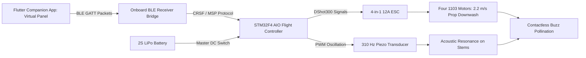

import { Card, CardGrid, LinkButton } from '@astrojs/starlight/components';

## Part 1: Stage Header & Executive Summary

> [!NOTE]
> **Stage Designation:** Stage 1 (Semi-Autonomous Electromechanical Pack)  
> **Operating Mode:** DC Motorized Continuous Duty with Ephemeral BLE Virtual Panel  
> **Power Requirement:** 12V / 24V DC Industrial Bus  
> **Physical Interlocks:** Strict Two-Control Standard (Master DC Cut + Recessed SD Factory Restore)  
> **Operator Interface:** Ephemeral Flutter Mobile Companion App over BLE GATT  

The Stage 1 electromechanical pack motorizes the **Aerial Spotter & Pollination Drone**, adding continuous DC motor/pump drive governed by the **Strict Two-Control Physical Standard** (RFC-0005) and an ephemeral **Flutter Companion App Virtual Panel** over direct local BLE.

---

## Part 2: Capability Delta (Features Introduced)

* **Continuous Motorized Actuation**: Replaces human manual cranking with high-efficiency DC gearmotors, steppers, or booster pumps.
* **Strict Two-Control Physical Standard**: Eliminates physical jog buttons and potentiometer dials to prevent moisture breach and priority race conditions. Only Master DC Switch and Recessed SD Reset Button are permitted on hardware.
* **Ephemeral BLE Virtual Panel**: Jogging, speed sliders, and priming pulses execute via the Flutter companion app over direct local BLE GATT.
* **100% Preserved Manual Fallback**: Slip-clutches, bypass valves, or belt releases guarantee instant zero-power manual hand operation without disassembly.

---

## Part 3: Isolated Stage 1 Bill of Materials (BOM)


### Add-On 1 Bill of Materials (BOM)

| Item | Part ID & Registry Link | Component & Specification | Sourcing / Supplier | Fab Type | Qty | Unit Cost | CAD Asset | Total Cost |
| :--- | :--- | :--- | :--- | :--- | :--- | :--- | :--- | :--- |
| **A1-01** | [`PART-FAB-FRAME-WHOOP-85MM`](/open-biosphere/parts/custom-fab/PART-FAB-FRAME-WHOOP-85MM/) | 85mm Ducted Polycarbonate Whoop Airframe + Ducts | [BetaFPV / Happymodel frame](https://betafpv.com) | Molded Polycarbonate Frame | 1 | $14.00 | [Download .3DS](/open-biosphere/assets/parts/PART-FAB-FRAME-WHOOP-85MM/model.3ds) | $14.00 |
| **A1-02** | [`PART-ELEC-MTR-BLDC-1103`](/open-biosphere/parts/electrical/PART-ELEC-MTR-BLDC-1103/) | 1103 10,000KV Brushless Outrunner Motors + Props | [FPV micro-motor supplier](https://betafpv.com) | Stock Motor | 4 | $9.50 | [Download .3DS](/open-biosphere/assets/parts/PART-ELEC-MTR-BLDC-1103/model.3ds) | $38.00 |
| **A1-03** | [`PART-ELEC-FC-STM32F4-AIO`](/open-biosphere/parts/electrical/PART-ELEC-FC-STM32F4-AIO/) | STM32F4 AIO Flight Controller + 4-in-1 12A ESC | [Betaflight AIO board](https://betafpv.com) | Stock Electronics | 1 | $42.00 | [Download .3DS](/open-biosphere/assets/parts/PART-ELEC-FC-STM32F4-AIO/model.3ds) | $42.00 |
| **A1-04** | [`PART-ELEC-TWO-CTRL-PACK`](/open-biosphere/parts/electrical/PART-ELEC-TWO-CTRL-PACK/) | BLE Virtual Interface & Two-Control Dock Module (Master DC Switch, Recessed SD Reset Button, Micro-SD Slot + 16GB Golden Card, 0.91" I2C OLED) | [Maker electronics supplier](https://open-biosphere.org/parts/PART-ELEC-TWO-CTRL-PACK) | 3D Print / Assembly | 1 | $45.00 | [Download .3DS](/open-biosphere/assets/parts/PART-ELEC-TWO-CTRL-PACK/model.3ds) | $45.00 |
| **A1-05** | [`PART-ELEC-BAT-LIPO-2S450`](/open-biosphere/parts/electrical/PART-ELEC-BAT-LIPO-2S450/) | 2S 450mAh 75C High-Discharge LiPo Batteries (4x pack) | [Tattu / GNB micro battery](https://gensace.de) | Stock Battery | 1 | $22.00 | [Download .3DS](/open-biosphere/assets/parts/PART-ELEC-BAT-LIPO-2S450/model.3ds) | $22.00 |
| **A1-06** | [`PART-ELEC-PZO-BUZZ-27MM`](/open-biosphere/parts/electrical/PART-ELEC-PZO-BUZZ-27MM/) | 27mm Piezo Acoustic Vibration Transducer + FET | [Electronics supplier](https://mouser.com) | Stock Component | 1 | $12.00 | [Download .3DS](/open-biosphere/assets/parts/PART-ELEC-PZO-BUZZ-27MM/model.3ds) | $12.00 |
| **Total** | **Add-On 1 Electromechanical Pack** | **Retrofits directly to Base** | | | | | | **+$173.00** |
| **Cumul.** | **Operational Remote-Controlled Buzz Drone** | **Base ($52) + Add-On 1 ($173)** | | | | | | **$225.00** |

---

## Part 4: Standalone Full SVG Blueprint


---

## Part 5: Step-by-Step Retrofit, Wiring & Operating Protocol

Under [RFC-0005](/rfcs/rfc-0005-hardware-interlocks-ble-virtual-panel), physical control panels, dedicated button boxes, rotary dials, and bulky handheld RC transmitters with mechanical switches are banned across all machine tiers to eliminate water ingress and control priority contention.

Add-On 1 introduces powered aerial locomotion governed by the **Strict Two-Control Physical Standard**:
1. **Master Hardware DC Power Switch**: Inline mechanical disconnect directly isolating the 2S LiPo battery and charging bus.
2. **"Nuke & Pave" SD Factory Restore Button**: Dedicated recessed tactile switch on the ground bench module/node wired to trigger an automatic secondary bootloader re-flash from micro-SD storage.

All manual flight trim calibration, virtual stick steering, motor test pulses, and acoustic buzz pollination triggers are conducted via the **Flutter Companion App Virtual Panel** over direct local BLE GATT.

### Electromechanical Actuation Architecture & Decoupling
- **Airframe**: 85 mm wheelbase ducted whoop frame molded in high-impact polycarbonate. Enclosed duct guards ensure props cannot cut plant leaves or vines on accidental contact.
- **Powertrain**: Four 1103 10,000KV brushless outrunner motors spinning 2.0-inch tri-blade polycarbonate propellers, generating 240 g total thrust ($3.5:1$ thrust-to-weight ratio).
- **Acoustic Downwash Generation**: Prop downwash velocity measures 2.2 m/s at 150 mm below the ducts, sufficient to flutter blossoms and vibrate pollen free without physical contact.
- **Strict Two-Control Enclosure & Dock**: A benchtop charging station and drone power harness feature:
  - Inline mechanical DC cut switch directly isolating the battery lead with zero soft-switch leakage.
  - Recessed tactile button next to the 0.91" I2C OLED display (`[DRONE-A1 | BLE READY]`) for 5-second SD recovery reflash.
  - Micro-SD card slot module pre-loaded with golden recovery `firmware.bin` and `config.default`.
- **Ephemeral BLE Virtual Panel**: When nearby, an operator opens the Flutter companion app on mobile device. The app auto-discovers the drone over BLE GATT and displays real-time virtual touch flight pads: virtual twin gimbals, Altitude Hold toggle, and Acoustic Buzz burst button.
- **Mechanical Decoupling**: If battery is depleted, the entire whoop drone snaps into the Base carbon wand socket, instantly reverting to manual sweep pollination.

```
       ELECTROMECHANICAL WIRING & BLE VIRTUAL INTERFACE SCHEMATIC
  =================================================================
  [2S 450mAh LiPo Battery (7.4V / 8.4V Peak)]
         |
         +----[Master DC Cut Switch]----+----(XT30 Connector)
                                        |
         +------------------------------+---------------------------+
         |                                                          |
         v                                                          v
  [STM32F411 AIO Flight Controller]                  [4-in-1 12A BLHeli_S ESC]
  (BLE Peripheral Bridge + OLED + SD Reset)                 |
         |                                   +--------------+--------------+
         | I2C / UART                        |       |              |      |
         v                                   v       v              v      v
  [0.91" I2C OLED Status Display]          [M1]    [M2]           [M3]   [M4]
  [Micro-SD Slot + Recovery Bin ]          (1103 Brushless Motors - 10,000KV)
         |
         v GPIO
  [High-Frequency Piezo Transducer]
  (Acoustic Stems Vibration: 310 Hz)
         ^
         : Direct BLE GATT (No Contention)
         v
  [Flutter Companion App Virtual Panel]
  (Virtual Flight Sticks, Alt-Hold Toggle, Buzz Pollinate Burst)
```

### Step-by-Step Retrofit Protocol

#### Step 2.1: Whoop Airframe & Motor Installation
1. Press-fit four 1103 10,000KV brushless motors into the 85 mm polycarbonate ducted whoop frame.
2. Fasten each motor using three M2 × 4 mm grade 10.9 hex screws with blue threadlocker.
3. Install 2020 4-blade or 2023 3-blade propellers. Set rotation direction: Props-Out configuration to deflect greenhouse foliage away from camera lens.

#### Step 2.2: AIO Flight Controller & ESC Mounting
1. Mount the STM32F411 All-in-One flight controller board on soft silicone anti-vibration grommets in the center bay.
2. Solder the three motor phase wires from each corner directly to the corresponding ESC solder pads.
3. Solder an XT30 battery lead through the heavy-duty inline master DC switch with a 16V 220µF low-ESR capacitor.

#### Step 2.3: BLE Peripheral Integration & Two-Control Dock
1. Wire the ESP32 BLE peripheral bridge to UART2 on the flight controller (TX, RX, 5V, GND).
2. Wire the recessed tactile SD recovery button and micro-SD card slot module pre-loaded with golden `firmware.bin` and `config.default`.
3. Connect 0.91" I2C OLED display showing `[DRONE-A1 | BLE READY]`.

#### Step 2.4: Piezo Acoustic Vibration Transducer Rigging
1. Mount a 27 mm brass-backed piezoelectric ceramic transducer to the underside carbon battery tray.
2. Wire the piezo disc through a miniature N-channel FET driven by a spare PWM output (LED pad).
3. Program flight controller to trigger 310 Hz square-wave oscillation when the Virtual Panel BUZZ command is received over BLE.

#### Step 2.5: Bench Flight Calibration
1. Connect flight controller to configuration software; calibrate onboard 6-axis gyroscope/accelerometer on a dead-level surface.
2. Connect mobile companion app over BLE; verify virtual sticks move flight channels smoothly with zero latency jitter.
3. Set motor idle speed to 5.5% and verify smooth motor spin-up with zero vibration resonance.



### Step-by-Step BLE Virtual Panel Operating Runbook

1. **Pre-Flight Battery Check**: Verify 2S 450mAh LiPo battery voltage reads 8.40 V (4.20 V/cell) on a digital battery checker. Slide pack into silicone battery strap; connect XT30 plug.
2. **Master Power Engagement**: Flip the inline master DC switch to ON. The onboard 0.91" OLED illuminates: `[DRONE-A1 | BLE READY]`.
3. **Walk-Up BLE Virtual Panel Connection**: Open the Flutter companion app on mobile device. Select `DRONE-A1` from discovered BLE peripherals. The app instantly renders the Flight Virtual Panel.
4. **Arming the Quadcopter**: Place the drone on a flat, clear section of the greenhouse path. Tap the virtual ARM button in the app (props idle at 5.5% RPM).
5. **Canopy Hover & Traverse**: Raise the virtual throttle slider to 45% hover. Fly along the trellised crop row at 0.5 m/s, maintaining 150 mm to 300 mm clearance directly above blooming pepper clusters.
6. **Engaging Buzz Pollination**: Position the drone directly above an open flower cluster. Tap the virtual BUZZ button in the app. The flight controller holds altitude while pulsing throttle $\pm 8\%$ and oscillating the piezo transducer at 310 Hz for 2 seconds. The combined prop-wash and acoustic vibration releases pollen clouds instantly.
7. **"Nuke & Pave" SD Recovery Protocol**: If flight firmware locks up or parameter corruption occurs, hold the recessed SD reset button for 5 seconds during power-on. The bootloader reflashes golden firmware from micro-SD in 4 seconds.
8. **Return & Battery Swap**: When battery voltage sags to 7.0V (3.5 V/cell under load), land on the path, disarm motors via virtual panel, flip master DC switch OFF, and swap in a fresh LiPo pack.

---

## Part 6: Guided Stage Navigation

<CardGrid>
  <Card title="Stage 0: Zero-Power Baseline" icon="left-arrow">
    Review the underlying manual chassis, fabrication tolerances, and mechanical fallback linkage.
    <br/><br/>
    <LinkButton href="/open-biosphere/hardware/aerial-pollination-drone/stage-0/" variant="minimal">← Previous: Stage 0 Baseline</LinkButton>
  </Card>
  <Card title="Stage 2: Agentic Autonomous AI Pack" icon="right-arrow">
    Ready for full closed-loop autonomy? Integrate the Controller-Node-Tool mesh and local neural vision.
    <br/><br/>
    <LinkButton href="/open-biosphere/hardware/aerial-pollination-drone/stage-2/" variant="primary">Proceed to Stage 2 Upgrade →</LinkButton>
  </Card>
</CardGrid>
