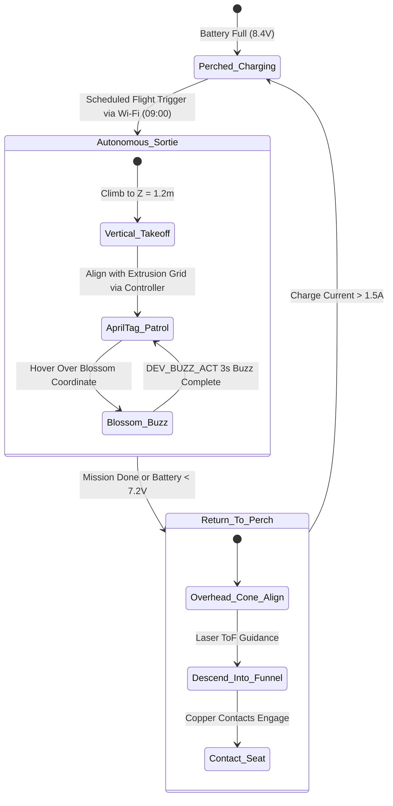

import { Card, CardGrid, LinkButton } from '@astrojs/starlight/components';

## Part 1: Stage Header & Executive Summary

> [!NOTE]
> **Stage Designation:** Stage 2 (Agentic Autonomous AI Pack)  
> **Operating Mode:** 24/7 Closed-Loop Autonomous Neural Telemetry & Robotics  
> **Network Mesh:** Encrypted Isolated Farm Wi-Fi (<code>POTFRM-4096</code> on 192.168.42.0/24) + BLE Tool Downlinks  
> **Safety Interlocks:** 250ms Hardware Deadman Watchdogs on all Edge Tools  
> **Edge AI Engine:** <code>llama-cpp-python</code> Local GGUF Multimodal Vision (Zero Cloud Dependence)  

The Stage 2 agentic pack elevates the **Aerial Spotter & Pollination Drone** into a fully autonomous cyber-physical robotics cell operating under the **Controller-Node-Tool (CNT)** standard (RFC-0004) and **Agnostic Controller Runtime** (RFC-0006).

---

## Part 2: Capability Delta (Features Introduced)

* **Controller-Node-Tool (CNT) Hierarchy**: Heavy neural perception runs on the Central Biosphere Controller; the Machine Node coordinates local kinematics; tiny Edge Tools drive motors 1:1.
* **Isolated Farm AP Mesh**: Secure, air-gapped local Wi-Fi (<code>POTFRM-&lt;CLUSTER_ID&gt;</code> on <code>192.168.42.0/24</code>) with WebSocket node registration at <code>ws://192.168.42.1:8443/register</code>.
* **250ms Hardware Deadman Watchdogs**: Every Tool trips into safe, high-Z, zero-power state within 250 ms if signal is interrupted.
* **Local Zero-Cloud Edge AI**: Multi-agent perception via <code>llama-cpp-python</code> local vision models without internet dependencies.

---

## Part 3: Isolated Stage 2 Bill of Materials (BOM)

### Add-On 2 Bill of Materials (BOM)

| Item | Component Description | Sourcing / Part Reference | Qty | Unit Cost | Total Cost |
| :--- | :--- | :--- | :--- | :--- | :--- |
| **A2-01** | Drone Flight Node: ESP32-S3 (8MB PSRAM) + 0.96" OLED + Setup Button | Espressif distributor | 1 | $16.00 | $16.00 |
| **A2-02** | PMW3901 Optical Flow Breakout + VL53L1X Laser ToF + 1x ESP32-C3 Tool | Maker robotics sensor store | 1 | $21.00 | $21.00 |
| **A2-03** | RunCam Split HD / Micro RGB-NIR Camera Module with Wi-Fi Link | Micro FPV camera maker | 1 | $32.00 | $32.00 |
| **A2-04** | 3D-Printed Conical Perch + Concentric Brass Contacts | DIY 3D print + brass wire | 1 | $16.00 | $16.00 |
| **A2-05** | 2x ESP32-C3 Modular Tools with 0.42" OLED & 250ms Watchdog (Flight & Buzz) | Microcontroller supplier | 2 | $7.00 | $14.00 |
| **Total** | **Add-On 2 Agentic Autonomous Pack (CNT Standard)** | **Expands Base + Add-On 1** | | | **+$99.00** |
| **Full Build** | **Complete Autonomous Biosphere Pollination Drone** | **Base + Add-On 1 + Add-On 2** | | | **$324.00** |

---

---

## Part 4: Standalone Full SVG Blueprint


---

## Part 5: Step-by-Step Commissioning, Provisioning & Autonomous Runbook

Under [RFC-0004](/rfcs/rfc-0004-controller-node-tool) and [RFC-0006](/rfcs/rfc-0006-agnostic-controller-runtime), the **Agentic Autonomous AI Pack** enables fully autonomous indoor pollination without human pilots or GPS under the **Controller-Node-Tool (CNT)** standard. The drone operates as a flying **Drone Node** commanding modular **Edge Tools** over BLE, receiving global flight sortie schedules and bloom coordinates from the Central Biosphere Controller over Wi-Fi.

### Autonomous Vision & Telemetry Architecture
- **Drone Flight Node (ESP32-S3)**: Dual-Core Xtensa LX7 (240 MHz, 8 MB PSRAM) flight companion computer governed by the **Strict Two-Control Physical Standard** (Master DC Power Switch and Recessed SD Reset Button alongside 0.96" I2C OLED `[NODE: DRONE-01 | LINK -> 4096]`). Uplinks to Central Controller via Wi-Fi; receives flight plans, coordinates local pose estimation, and downlinks to Tools via BLE Central.
- **Decoupled Optical AprilTag Tracking**: Down-facing micro-camera streams video directly over Wi-Fi to the Central Controller (Agnostic Runtime, e.g. Raspberry Pi 5 + Hailo-8 or x86 Host), which processes AprilTags spaced along greenhouse ceiling extrusions at 30 FPS, returning millimeter 6-DoF global pose vectors $(X, Y, Z)$ to the drone.
- **Dedicated Modular Edge Tools (ESP32-C3)**: Driven 1:1 by micro ESP32-C3 controllers equipped with 0.42" micro OLED displays and **250ms hardware deadman watchdogs**:
  - `DEV_FLIGHT_CTL`: Micro ESP32-C3 / STM32 bridge with 0.42" OLED (`TOOL: FLIGHT_CTL | LINK: OK`) + 250ms watchdog driving 4x brushless ESCs with auto-land descent failsafe.
  - `DEV_OPTICAL_FLOW`: Micro ESP32-C3 with 0.42" OLED (`TOOL: OPTICAL_FLOW | LINK: OK`) managing PMW3901 optical flow (42 FPS) and VL53L1X laser time-of-flight sensor for sub-millimeter altitude hold.
  - `DEV_BUZZ_ACT`: Micro ESP32-C3 with 0.42" OLED (`TOOL: BUZZ_ACT | LINK: OK`) + 250ms watchdog pulsing the acoustic piezo flower buzz transducer (180–220 Hz).
- **250ms Deadman Watchdog Fail-Safe**: If the `DEV_FLIGHT_CTL` tool loses BLE connection to the Drone Node for $> 250$ ms, it immediately disengages autonomous cruise, drops into controlled low-speed descent, and cuts motor throttle smoothly upon ground contact.

```text
       CONTROLLER-NODE-TOOL (CNT) HIERARCHICAL EDGE ARCHITECTURE
  =================================================================
            CENTRAL BIOSPHERE CONTROLLER (Agnostic Runtime / POTFRM-4096)
            • Emits Isolated Farm AP: SSID [POTFRM-4096] (192.168.42.0/24)
            • AprilTag Global SLAM & Canopy Bloom Waypoint Schedules
                                  │
                                  │ Isolated Farm Wi-Fi (192.168.42.0/24)
                                  ▼
             ┌─────────────────────────────────────────┐
             │       DRONE FLIGHT NODE (ESP32-S3)      │
             │  • OLED Display: [NODE: DRONE-01]       │
             │  • Setup Push-Button for Mobile BLE     │
             │  • Waypoint Navigation & MAVLink Bridge │
             └────────────────────┬────────────────────┘
                                  │
         ┌────────────────────────┼────────────────────────┐
         │ BLE Downlink           │ BLE Downlink           │ BLE Downlink
         ▼                        ▼                        ▼
 ┌───────────────┐        ┌───────────────┐        ┌───────────────┐
 │ TOOL:         │        │ TOOL:         │        │ TOOL:         │
 │ DEV_FLIGHT_CTL│        │ DEV_OPT_FLOW  │        │ DEV_BUZZ_ACT  │
 │ ESP32-C3 Micro│        │ ESP32-C3 Micro│        │ ESP32-C3 Micro│
 │ 0.42" OLED    │        │ 0.42" OLED    │        │ 0.42" OLED    │
 │ 250ms Deadman │        │ PMW3901 Flow  │        │ 250ms Deadman │
 │ 4x Brushless  │        │ VL53L1X Laser │        │ Piezo 200 Hz  │
 │ ESC Auto-Land │        │ Sub-mm Alt    │        │ Buzz Pollinate│
 └───────────────┘        └───────────────┘        └───────────────┘
```

### Step-by-Step Sensor Commissioning & Edge AI Protocol

#### Step 3.1: Drone Node & Power Harness Setup
1. Mount the ESP32-S3 Node with 0.96" I2C OLED display and physical setup push-button on the top carbon plate.
2. Wire power via a miniature high-efficiency 5V 2A buck regulator tapped from the 2S LiPo battery.
3. Verify telemetry link: onboard OLED reads `[NODE UNPAIRED - PAIR VIA BLE]`.

#### Step 3.2: Optical Flow & Laser ToF Integration (`DEV_OPT_FLOW`)
1. Mount PMW3901 optical flow and VL53L1X laser ToF on the bottom carbon plate ($Z=0$ ground plane).
2. Wire sensors to `DEV_OPT_FLOW` tool board (ESP32-C3) over SPI and I2C.
3. Test static hover tracking: drift must measure $< 15$ mm per minute over greenhouse soil.

#### Step 3.3: AprilTag Visual Camera & Wi-Fi Link
1. Mount the down-facing micro-camera angled 15° forward of nadir.
2. Affix 100 × 100 mm AprilTag markers (family 36h11) along upper greenhouse ceiling extrusions.
3. Configure camera stream to Central Controller; verify 6-DoF global pose calculations at 30 FPS.

#### Step 3.4: Automated Conical Charging Perch Fabrication
1. 3D-print a 150 mm diameter conical landing funnel with a 35° incline.
2. Inlay dual concentric brass wiper rings connected to a 2S LiPo CC/CV smart balance charging circuit.
3. Attach spring-loaded copper landing skids to the drone airframe base.

#### Step 3.5: Provisioning & 250ms Watchdog Verification
1. Power on Central Controller; verify active Cluster ID on OLED, terminal stdout, or BLE beacon (`POTFRM-4096`).
2. Power on Drone Node; press physical setup button; pair via mobile companion app over BLE, enter `4096`.
3. Node commits credentials to NVS, links to `POTFRM-4096`, registers at `ws://192.168.42.1:8443/register`, and updates display to `[ONLINE | LINK -> 4096]`.
4. Verify Node auto-discovers and binds all three BLE Tools.
5. Test fail-safe watchdog: drop BLE link to `DEV_FLIGHT_CTL`; verify auto-land descent triggers within $< 250$ ms.



### Step-by-Step Autonomous Multi-Agent Runbook

1. **Scheduled Morning Wakeup**: At 09:00 AM, the Central Controller broadcasts an autonomous pollination sortie over Wi-Fi. The drone confirms battery $\ge 8.35	ext{ V}$ and signals `DEV_FLIGHT_CTL` to spin up motors.
2. **Centimeter-Accurate Optical Takeoff**: The drone lifts vertically out of the conical perch to $Z = 1,200$ mm. The `DEV_OPT_FLOW` tool locks position over ground texture with zero horizontal drift.
3. **AprilTag Waypoint Navigation**: The drone traverses the perimeter rail; the Central Controller reads ceiling tags from the camera feed and streams real-time pose corrections to the Drone Node.
4. **Autonomous Buzz Pollination Sortie**: Upon reaching pre-mapped flower targets, the drone drops to $Z = 600$ mm (150 mm above flowers), pulses downwash at 2.4 m/s, and signals `DEV_BUZZ_ACT` to fire its piezo transducer for 3.0 seconds, buzz-pollinating blossoms.
5. **Self-Aligning Conical Perch Docking**: When the 8.5-minute sortie concludes, the drone navigates to the conical perch, positions directly over the funnel center via laser ToF, and cuts throttle smoothly into the brass wiper contacts to recharge at 2A.
6. **250ms Fail-Safe Watchdogs**: If BLE connection between Node and `DEV_FLIGHT_CTL` drops for $> 250$ ms, auto-land is engaged immediately. If Wi-Fi link to Central Controller is lost, the drone initiates an immediate return-to-perch abort.

---

## Part 6: Guided Stage Navigation

<CardGrid>
  <Card title="Stage 1: BLE Electromechanical Pack" icon="left-arrow">
    Review the motorized powertrain, Two-Control enclosure wiring, and BLE Virtual Panel.
    <br/><br/>
    <LinkButton href="/open-biosphere/hardware/aerial-pollination-drone/stage-1/" variant="minimal">← Previous: Stage 1 Upgrade</LinkButton>
  </Card>
  <Card title="Subsystem Overview" icon="right-arrow">
    Return to the machine overview, crop affinity matrix, and master biosphere interlocks.
    <br/><br/>
    <LinkButton href="/open-biosphere/hardware/aerial-pollination-drone/" variant="primary">Return to Overview →</LinkButton>
  </Card>
</CardGrid>
