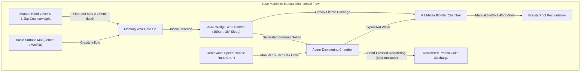
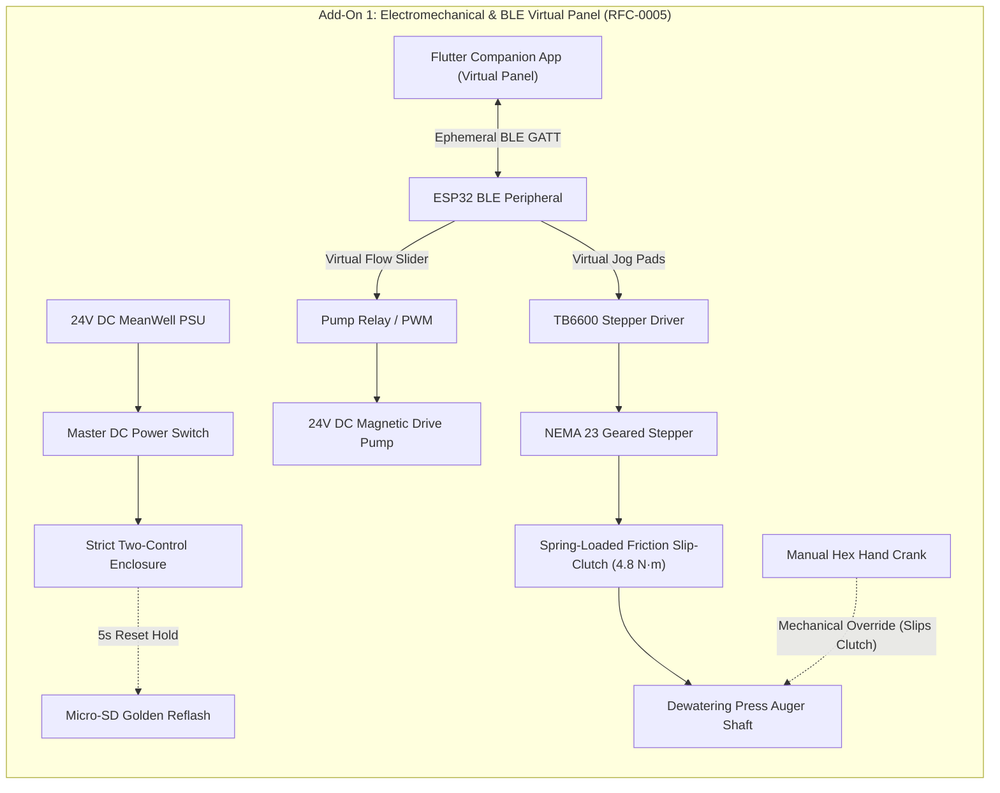
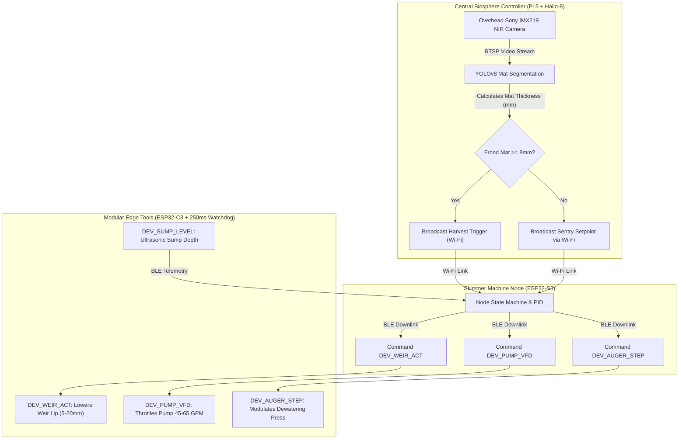

import { Card, CardGrid } from '@astrojs/starlight/components';

The **Fluidic Skimmer & Dewatering Separator** is an open-hardware aquatic harvester and clarification machine. Designed to operate both as an independent surface biomass skimmer for farm ponds and homestead aquaponics systems, it also serves as the core aquatic protein engine for the master Open Biosphere assembly.

---

## 1. Standalone Homesteading & Off-Grid Utility

For homesteaders managing duckweed (*Lemna minor* / *Wolffia globosa*) or operating small-scale aquaculture/aquaponics systems, harvesting surface biomass manually is backbreaking and erratic. This machine provides **continuous, autonomous surface skimming, solids separation, and water dewatering**:

<CardGrid>
  <Card title="Pond & Tank Duckweed Harvester" icon="leaf">
    Mounts onto any farm pond edge, IBC tote, or stock tank to skim high-protein floating watermeal automatically, harvesting up to 12.5 kg of green biomass per hour.
  </Card>
  <Card title="Continuous Aeration & Clarification" icon="droplet">
    Integrated Moving Bed Biofilm Reactor (MBBR) and venturi aerator maintain clear, pathogen-free water for fish or aquatic crops with zero chemical inputs.
  </Card>
  <Card title="Zero-Clog Wedge-Wire Screen" icon="grid">
    V-shaped 316L stainless steel wedge wires shed microscopic fronds cleanly, eliminating the constant clogging seen in woven mesh nets.
  </Card>
  <Card title="12V/24V Off-Grid Solar Ready" icon="sun">
    Powered by an efficient 24V brushless DC motor drawing just 45W to 120W, easily run directly off a small off-grid solar panel and battery bank.
  </Card>
</CardGrid>

---

## 2. Technical Specifications

| Parameter | Specification |
| :--- | :--- |
| **Circulation Flow Rate** | 45 to 75 Gallons per Minute (GPM) |
| **Skimmer Weir** | Variable-buoyancy bistable overflow weir (600 mm or 1,200 mm modular width) |
| **Dewatering Screen** | Stainless 316L wedge-wire screen (slot width: 150 µm) |
| **Harvest Rate** | Up to 12.5 kg wet biomass per hour |
| **Biofilter Loop** | 3-stage moving bed biofilm reactor (MBBR) with K1 media + 15W UV-C clarifier |
| **Drive Pump** | Brushless DC variable-frequency magnetic-drive pump (240W max, 24V DC) |
| **Separation Auger** | 3D printed PETG / stainless screw press (reduces frond moisture to ~82%) |
| **Microcontroller** | Raspberry Pi Pico or ESP32 running FreeRTOS with optical level triggers |

---

## 3. Instructions (Base Zero-Power Machine)

The base Fluidic Skimmer is a **100% mechanical, zero-electricity, off-grid surface harvester and clarification unit**. It requires zero microcontrollers, zero software, and zero wiring—operating purely on gravity, manual hand levers, rotary cranks, and physical siphons. 

All builders assemble this base machine first. The subsequent tiers are modular add-on packs installed directly onto this foundation.

### Mechanical Architecture & Decoupling
- **Counterweighted Overflow Weir**: An external hand lever with an adjustable lead or steel counterweight balances the floating weir gate. Moving the lever raises or lowers the weir lip relative to the water line (0 mm to 25 mm skimming depth), allowing an operator to dial in surface draw by hand or pull it shut completely.
- **Manual Dewatering Press**: The dewatering auger features a standard 1/2-inch hex head on its drive shaft. A removable aluminum speed-handle hand crank slots directly onto the shaft. Cranking clockwise advances duckweed and watermeal fronds against the stainless 316L wedge-wire screen, pressing free water back into the sump while extruding dense, 82% moisture protein paste out the discharge chute.
- **Gravity Drainage & Manual Siphon**: A 1.5-inch 3-way manual L-port PVC ball valve allows operators to bypass electric pumps entirely, dumping water through the K1 moving bed media chamber and back into the main reservoir via gravity.

### Step-by-Step Fabrication & Assembly Protocol

```text
Step 1.1: Flume Chassis Fabrication
  ├── Cut 1/4" cast acrylic or HDPE sheet into two 600mm x 400mm side plates, one 600mm x 300mm base.
  ├── Mill 12mm pivot slots for the weir Delrin pin at X=80mm, Z=+120mm from intake lip.
  ├── Drill a 48mm hole in the sump floor for the 1.5" PVC bulkhead fitting.
  └── Solvent-weld acrylic seams using Weld-On 4, or bolt HDPE with M5 A4-stainless bolts & silicone.

Step 1.2: Wedge-Wire Screen Installation
  ├── Align 316L wedge-wire screen (150µm slot, 300mm x 400mm) at an exact 38° decline.
  ├── Seat edges against 3mm EPDM closed-cell rubber sealing strips to prevent frond blow-by.
  └── Fasten screen using 3D-printed PETG clamping rails and four M4 thumb-screws (toolless service).

Step 1.3: Counterweighted Weir Gate Mounting
  ├── Fabricate hollow floating weir gate (PETG printed, 15% infill, 4 perimeters for buoyancy).
  ├── Press-fit Ø12mm Delrin pivot pins into side flume bushings with 0.5mm axial clearance.
  ├── Attach 450mm aluminum lever arm with threaded M10 rod for sliding 1.2 kg counterweight.
  └── Adjust counterweight position until weir gate floats neutral at 2mm below calm water level.

Step 1.4: Manual Dewatering Screw Press Assembly
  ├── 3D print PETG continuous flight auger screw (50mm pitch, 85mm outer diameter, Ø20mm core).
  ├── Insert 1/2" zinc-plated steel hex drive shaft through auger core; secure with cross-drilled M5 roll pin.
  ├── Slide auger into perforated stainless steel sleeve (1.0mm micro-perforations).
  ├── Press dual 608-2RS sealed ball bearings into rear flange; slide 1/2" hex drive through.
  └── Attach removable 1/2" socket speed-handle hand crank onto external hex stub.

Step 1.5: Biofilter & Manual Valve Plumbing
  ├── Thread 1.5" PVC schedule 40 male adapter into sump bulkhead with PTFE thread tape.
  ├── Glue 1.5" 3-way L-port PVC ball valve inline directly below bulkhead.
  ├── Connect Port A to gravity drain manifold; connect Port B to recirculation return.
  └── Pour 10 liters of K1 micro filter biomedia into sump and install slotted retention screen.
```

### Step-by-Step Operating Runbook (Zero-Power Baseline)

1. **Pre-Skim Inspection**: Verify the weir gate floats smoothly by deflecting the counterweight lever by hand. Inspect the wedge-wire face; brush off dried algae using a stiff nylon bristle brush.
2. **Weir Gate Deployment**: Slowly pull the counterweight hand lever downward 10 mm to 15 mm. Observe the water cascading over the weir lip, carrying floating duckweed fronds down the intake flume onto the wedge-wire screen.
3. **Biomass Concentration**: Allow gravity filtration to run for 5 to 10 minutes. Water drains through the 150 µm slots into the K1 biofilter sump while green fronds slide downward into the dewatering auger barrel.
4. **Manual Dewatering Pressing**: Slide the 1/2" hex speed-handle crank onto the auger drive shaft. Rotate clockwise at 15 to 20 RPM for 12 to 15 full revolutions. Fronds are compressed against the cone nozzle, expressing moisture through the perforated sleeve.
5. **Cake Harvesting**: Dense, dewatered green protein paste (approx. 82% moisture) extrudes from the discharge cone. Collect the cake directly into a food-grade harvest tote.
6. **Flume Gate Closure**: Release the counterweight lever; the counterweight automatically pulls the weir gate upward, sealing off surface flow.
7. **Gravity Drainage Flush**: Rotate the 3-way manual ball valve handle to Position A for 30 seconds to flush settled solids out the bottom drain port.

### Base Machine Blueprint & Elevation Profile

```text
========================================================================================
BASE MACHINE MECHANICAL ELEVATION & KINEMATICS BLUEPRINT (ZERO-POWER BASELINE)
All dimensions in millimeters [mm] | Datum Z=0.00 at South Coping Surface
========================================================================================

                 [Adjustable Counterweight: 1.2 kg]
                                  │
                                 ┌┴┐
             [Hand Lever] ═══════╡ ╞══════════════════════════════════╗ (Counterweight Arm)
                                 └┬┘                                  ║
                                  │ Pivot Pin (Delrin, Ø12mm)         ║ Linkage Rod
                                                                      ▼
 WATER SURFACE ────────────────────────────────────────┐          ┌───────┐
 ~~~~~~~~~~~~~ [Surface Duckweed Mat: 4-12mm] ~~~~~~~~ │  Flow    │Floating│ [Weir Gate Lip]
                                                       ▼ ───────► │ Weir  │ (Travel: 0-25mm)
   ┌──────────────────────────────────────────────────────────────┴───────┴──────┐
   │ INLET FLUME (Food-Grade Acrylic/HDPE, Width: 600mm, Length: 400mm)         │
   │                                                                             │
   │     Duckweed + Water Inflow                                                 │
   │     ═══════════════════════════════════════╗                                │
   │                                            ▼                                │
   │                             ┌───────────────────────────────┐               │
   │                             │  316L Stainless Wedge-Wire   │               │
   │                             │  Screen (150µm Slot Width,   │               │
   │                             │   Declination: 38° Angle)    │               │
   │                             └──────────────┬────────────────┘               │
   │                                            │ Separated Fronds               │
   │    Clarified Filtrate Return               ▼                                │
   │    ┌─────────────────────────── [Auger Dewatering Chamber] ────────────────┐│
   │    │                                                                       ││
   │    │  [Removable Crank]         PETG Continuous Screw Flight               ││
   │    │      ┌───┐             ┌───┬───┬───┬───┬───┬───┬───┐    Discharge Chute│
   │    │  (C) │   ╞═════════════╡ / │ / │ / │ / │ / │ / │ / ╞═══► [Protein     ││
   │    │      └───┘             └───┴───┴───┴───┴───┴───┴───┘     Paste Out]   ││
   │    │  1/2" Hex Socket        Perforated Stainless Sleeve                   ││
   │    └───────────────────────────────────────┬───────────────────────────────┘│
   │                                            │ Expressed Liquid               │
   │                                            ▼                                │
   │  GRAVITY RETENTION SUMP                                                     │
   │  ┌────────────────────────────────────────────────────────────────────────┐ │
   │  │ K1 Micro Biomedia Chamber (10 Liters Moving Bed)                      │ │
   │  └────────────────────────────────────┬───────────────────────────────────┘ │
   └───────────────────────────────────────┼─────────────────────────────────────┘
                                           ▼
                       3-Way Manual L-Port PVC Ball Valve (Ø1.5")
                                   ┌───────┴───────┐
                      [Position A] │               │ [Position B]
                     Gravity Sump  ▼               ▼ Direct Pond/Basin Return
========================================================================================
```

### Base Kinematics & Gravity Flow



### Base Machine Bill of Materials (BOM)
*Pure gravity skimming, counterweighted weir lever, hand-cranked auger dewatering press, and manual drain valves.*

| Item Category | Component Name & Description | Sourcing / Standard Part | Est. Cost (USD) |
| :--- | :--- | :--- | :--- |
| **Flume Body** | Food-Grade 1/4-inch Acrylic / Polycarbonate Sheets or HDPE Sump Chamber | Hardware store / plastic supplier | $45.00 |
| **Wedge-Wire Screen** | 316L Stainless Steel Wedge-Wire Panel (150µm slot, 300x400mm) | Industrial filtration supplier / eBay | $65.00 |
| **Weir Gate Lever** | Counterweighted Hand Lever & Delrin Pivot Pin for Overflow Weir | 3D printed PETG + Delrin pin | $16.00 |
| **Dewatering Press** | Manual Dewatering Screw Press (3D Printed PETG Auger + Removable Hex Crank) | 3D printed + steel hex shaft | $22.00 |
| **Plumbing & Drain** | 3-Way Manual L-Port PVC Bypass Ball Valve (1.5-inch) + Bulkhead Drain | Standard plumbing supply | $18.00 |
| **Filter Media** | K1 Micro Filter Media (10 Liters) + Perforated Gravity Retention Screen | Aquaculture / pond supply | $14.00 |
| **Base Build Total** | **Complete Zero-Electricity Manual Harvester** | **Off-grid mechanical baseline** | **$180.00** |

---

## 4. Add-On 1: Semi-Autonomous Electromechanical Pack (BLE Virtual Panel)

Under [RFC-0005](/rfcs/rfc-0005-hardware-interlocks-ble-virtual-panel), physical control panels with dedicated jog buttons, dials, and potentiometers are banned across all machine tiers to eliminate water ingress and control priority contention. 

Add-On 1 introduces **motorized pumping and electric auger pressing** governed by the **Strict Two-Control Physical Standard**:
1. **Master Hardware DC Power Switch**: Mechanically disconnects 24V power.
2. **"Nuke & Pave" SD Factory Restore Button**: Dedicated recessed tactile switch wired to trigger an automatic re-flash from micro-SD storage.

All manual jogging, auger jam clearing, and pump speed adjustments are executed via the **Flutter Companion App Virtual Panel** over direct local BLE.

### Electromechanical Actuation & Controls
- **Motorized Circulation**: A 24V DC brushless magnetic-drive pump (55 GPM) circulates water across the weir flume without manual siphoning.
- **Electric Auger Drive**: A high-torque NEMA 23 stepper motor couples to the auger shaft via an inline spring-loaded friction slip-clutch. If the auger jams or power is cut, an operator can insert the manual hand crank and turn the auger without back-driving or damaging the stepper.
- **Strict Two-Control Enclosure**: An IP67 waterproof junction box mounted on the side flume contains:
  - Heavy-duty toggle switch directly isolating the 24V DC supply line.
  - Recessed tactile button next to the 0.91" I2C OLED display for 5-second SD recovery reflash.
  - Micro-SD card slot module pre-loaded with golden recovery `firmware.bin` and `config.default`.
- **Ephemeral BLE Virtual Panel**: When nearby, an operator opens the Flutter companion app on their phone or tablet. The app auto-discovers the skimmer over BLE GATT and displays real-time virtual touch pads: Forward Jog, Reverse Jam Purge, and a Pump Flow Rate slider (45 to 75 GPM).

### Step-by-Step Retrofit & Electromechanical Wiring Protocol

```text
Step 2.1: 24V Circulation Pump Plumbing Installation
  ├── Mount 24V brushless magnetic-drive pump onto vibration-damping silicone isolator pads.
  ├── Connect pump suction port to sump outlet via 1.5" flexible reinforced PVC hose.
  ├── Plumb pump discharge into flume circulation manifold with an inline check valve.
  └── Install manual isolation ball valve on pump suction to enable pump servicing without draining.

Step 2.2: NEMA 23 Stepper & Slip-Clutch Mechanical Coupling
  ├── Bolt 4:1 planetary reduction NEMA 23 stepper motor onto 3D-printed PETG side motor bracket.
  ├── Install spring-loaded friction slip-clutch (calibrated to 4.8 N·m) onto 8mm motor output shaft.
  ├── Mate clutch output hub directly to the auger 1/2" hex drive shaft using M6 cross-pin.
  └── Verify hex hand crank still fits securely onto rear shaft stub for simultaneous manual override.

Step 2.3: Two-Control Enclosure Assembly
  ├── Mount IP67 polycarbonate junction box on outer coping rail.
  ├── Install heavy-duty inline 24V DC toggle switch on the positive power entry lead.
  ├── Install recessed tactile push-button wired to secondary bootloader recovery GPIO pin.
  ├── Insert micro-SD card slot module preloaded with golden firmware.bin and config.default.
  └── Mount 0.91" I2C OLED display showing [SKIMMER-A1 | BLE READY].

Step 2.4: Driver, BLE Peripheral & Power Distribution Wiring
  ├── Mount MeanWell 24V 150W power supply (LRS-150-24) inside sheltered enclosure with 10A fuse.
  ├── Wire TB6600 stepper driver and high-current pump relay to ESP32 BLE peripheral controller.
  ├── Verify BLE GATT service advertises [SKIMMER-VIRTUAL-PANEL] upon power-up.
  └── Flash ESP32 firmware with Virtual Panel peripheral profile (supports touch jog and flow sliders).

Step 2.5: Slip-Clutch Torque Verification
  ├── Fix auger flight with a wooden block to simulate a heavy branch/debris jam.
  ├── Trigger Forward Jog from Flutter mobile app; observe slip-clutch slipping smoothly without motor stalling.
  ├── Insert manual speed-handle crank and rotate by hand against motor holding torque.
  └── Clutch slips smoothly, verifying operator hand operation cannot back-feed or damage the motor.
```

### Step-by-Step BLE Virtual Panel Operating Runbook

1. **Power Initialization**: Flip the heavy-duty 24V master DC power switch to ON. The onboard 0.91" OLED illuminates: `[SKIMMER-A1 | BLE STANDBY]`.
2. **Walk-Up BLE Virtual Panel Connection**: Open the Flutter companion app on mobile device. Select `SKIMMER-A1` from discovered BLE peripherals. The app instantly renders the Skimmer Virtual Panel.
3. **Circulation Flow Adjustment**: Drag the virtual flow slider in the Flutter app to set desired skimming flow (45 to 75 GPM). The brushless pump ramps smoothly to target speed.
4. **On-Demand Dewatering Pressing**: When duckweed fronds accumulate against the wedge-wire screen, press and hold the **Virtual Forward Jog Pad** in the app. The auger rotates at 30 RPM, pressing protein paste out the nozzle. Release pad to stop.
5. **Jam Clearing Recovery**: If debris jams the auger, tap the **Virtual Reverse Purge Button** in the app. The motor reverses 5 full turns, clearing the blockage. Tap Forward Jog to resume extrusion.
6. **"Nuke & Pave" SD Recovery Protocol**: If firmware hangs or configuration deadlocks, hold the physical recessed reset button for 5 seconds during power-on. The bootloader reflashes factory baseline firmware from micro-SD in 4 seconds.
7. **Immediate Manual Fallback**: If power is severed, insert the manual 1/2" hex hand crank and rotate manually—the friction slip-clutch slips smoothly at 4.8 N·m, enabling instant zero-electricity operation.

### Add-On 1 Electromechanical Wiring & BLE Virtual Panel Blueprint

```text
========================================================================================
ADD-ON 1 ELECTROMECHANICAL SCHEMATIC & BLE VIRTUAL PANEL BLUEPRINT
Strict Two-Control Physical Standard (RFC-0005) with Ephemeral Flutter BLE Control
========================================================================================

    [24V DC 150W MeanWell PSU] ──[Heavy-Duty DC Power Switch]──┬── (24V Power Bus)
                                                               └── (GND Return Bus)
                                                                         │
   ┌──────────────── STRICT TWO-CONTROL JUNCTION BOX ──────────────────┐│
   │                                                                   ││
   │  [Master DC Power Switch]      ["Nuke & Pave" SD Reset Button]    ││
   │   Inline Mechanical Cut         Recessed Tactile Switch (5s hold) ││
   │                                                                   ││
   │  [Micro-SD Card Slot Module]   [0.91" I2C Status OLED Display]    ││
   │   Preloaded golden .bin         Displays [SKIMMER-A1 | BLE READY] ││
   │                                                                   ││
   │  [ESP32 BLE GATT Peripheral] ◄─── (Ephemeral Mobile Link) ───────┼│
   └───────────────────┬───────────────────────────────────────────────┘│
                       │                                                │
                       ▼ (Driver STEP/DIR & Relay Triggers)             │
   ┌────────────────── DRIVE TRAIN & MOTORS ───────────────────────────┐│
   │                                                                   ││
   │  24V DC Brushless Magnetic Pump (55 GPM) ◄── High-Current Relay ──┘│
   │                                                                    │
   │  NEMA 23 Geared Stepper Motor ◄── TB6600 Stepper Driver ───────────┘
   │         │
   │         ▼ (Motor Output Shaft)
   │     ┌───────┐
   │     │ ░░░░░ │ Friction Spring Slip-Clutch (Torque Limit: 4.8 N·m)
   │     └───────┘ [SLIPS ON MANUAL CRANK OR OVERTORQUE]
   │         │
   │         ▼ (Auger Drive Shaft)
   │    ═════╪══════════════════════════════════════════════════╗
   │         │                                                  ║
   │   [Auger Screw Press]                                [1/2" Hex Socket]
   │   (Motor driven OR hand cranked simultaneously)       (Hand Crank Ready)
   └────────────────────────────────────────────────────────────────────┘
========================================================================================
```

### Add-On 1 Signal & Override Flow



### Add-On 1 Bill of Materials (BOM)
*Adds motorized pumping, electric auger dewatering drive, Strict Two-Control hardware, and Flutter BLE Virtual Panel.*

| Item Category | Component Name & Description | Sourcing / Standard Part | Est. Cost (USD) |
| :--- | :--- | :--- | :--- |
| **Water Pump** | 24V DC Brushless Magnetic Drive Pump (80W–120W, 55 GPM) | Solar fountain / pond pump | $58.00 |
| **Motorized Auger** | NEMA 23 High-Torque Geared Stepper Motor | 3D printer / CNC stepper supplier | $32.00 |
| **Two-Control Enclosure** | IP67 ABS Box + Master DC Power Switch + Recessed SD Reset Button + 0.91" OLED | Industrial electrical supply | $24.00 |
| **Motor Drivers & BLE** | Dual-Channel TB6600 Driver + Pump Relay + ESP32 BLE Virtual Panel Controller | Standard maker electronics | $18.00 |
| **Power Supply** | 24V 150W MeanWell Industrial Power Supply + Inline Breaker Fuse | Standard electrical supply | $28.00 |
| **Add-On 1 Direct Cost** | **Electromechanical Power Upgrade** | **Adds to Base Machine** | **+$160.00** |
| **Cumulative Total** | **Operational Semi-Autonomous Harvester** | **Base + Add-On 1** | **$340.00** |

---

## 5. Add-On 2: Agentic Autonomous AI Pack (Edge Vision & Closed Loop)

Under [RFC-0004](/rfcs/rfc-0004-controller-node-tool), Add-On 2 transforms the skimmer into a **hierarchical Controller-Node-Tool (CNT) cyber-physical harvester**. Monolithic on-machine SBCs and brittle CAN transceivers are eliminated; the machine operates as a dedicated **Machine Node** commanding modular **Edge Tools** over BLE, orchestrated by the Central Biosphere Controller over hidden WPA3 Wi-Fi.

### Autonomous Vision, Telemetry & Multi-Agent Control
- **Decoupled Optical Frond Profiling**: The overhead Sony IMX219 NIR camera streams directly to the Central Controller (Raspberry Pi 5 + Hailo-8 M.2 HAT). The Central Controller executes morphological neural mat segmentation, determining when surface *Wolffia* thickness exceeds 8.0 mm and dispatching harvest commands to the Skimmer Node.
- **Skimmer Subsystem Node (ESP32-S3)**: A mid-tier ESP32-S3 with PSRAM mounted in an IP67 enclosure. Features an onboard 0.96" I2C OLED display (`[NODE: SKIMMER-01 | LINK -> 4096]`) and physical setup button. It maintains a secure Wi-Fi client uplink to the Central Controller and acts as a BLE Central aggregator managing downstream local Tools.
- **Dedicated Modular Edge Tools (ESP32-C3)**: Actuators and sensors are driven 1:1 by tiny ESP32-C3 micro-controllers equipped with 0.42" micro OLED displays and uncompromising **250ms hardware deadman watchdogs**:
  - `DEV_WEIR_ACT`: Governs the 12V micro linear actuator with analog position feedback to lower the weir lip (5–20 mm) dynamically.
  - `DEV_AUGER_STEP`: Governs the NEMA 23 stepper driver for dewatering screw torque and rotational speed.
  - `DEV_PUMP_VFD`: Regulates brushless pump speed via PWM/DAC interface (15–65 GPM).
  - `DEV_SUMP_LEVEL`: Collects JSN-SR04T ultrasonic sump depth and optical dry-run float telemetry with hardware cavitation trip.
- **250ms Deadman Watchdog Fail-Safe**: If any Tool loses BLE connection to the Skimmer Node for $> 250$ ms, it drops immediately into high-Z safe state: the weir actuator freezes, the pump throttle cuts to zero, and the auger stepper cuts holding torque to 0.

### Step-by-Step Sensor Commissioning & Edge AI Protocol

```text
Step 3.1: Overhead Optical Sensor Rigging & Stream Setup
  ├── Mount rigid aluminum 2020 cross-strut above the flume intake at elevation Z = 1,400mm.
  ├── Install Sony IMX219 8-Megapixel NIR camera with 850nm optical bandpass filter in weather-hood.
  ├── Connect camera to local video transmitter streaming RTSP frames over local Wi-Fi to Central Controller.
  └── Calibrate lens focus to a sharp 300mm x 400mm field of view centered on the floating weir lip.

Step 3.2: Linear Actuator Linkage & Weir Tool Rigging
  ├── Disconnect Stage 1 manual counterweight rod from the weir gate arm.
  ├── Pin 12V micro linear actuator (50mm stroke, 150N force, internal 10k potentiometer) to weir yoke.
  ├── Wire actuator motor leads and potentiometer wiper to DEV_WEIR_ACT tool controller (ESP32-C3).
  └── Mount 0.42" micro OLED on tool bracket; verify screen reads [TOOL: WEIR_ACT | LINK: OK].

Step 3.3: Sump Telemetry & Cavitation Protection Tool
  ├── Mount waterproof JSN-SR04T ultrasonic sensor perpendicular to sump water surface at Z=+350mm.
  ├── Install optical float switch in pump intake sump; wire directly to DEV_SUMP_LEVEL tool (ESP32-C3).
  ├── Verify hardware interrupt: dry-run float trip immediately asserts pump stop primitive in <5ms.
  └── Mount 0.42" micro OLED; verify screen reads [TOOL: SUMP_LEVEL | LINK: OK].

Step 3.4: Skimmer Node Provisioning & BLE Tool Binding
  ├── Mount ESP32-S3 Node with 0.96" I2C OLED display and physical setup push-button inside IP67 enclosure.
  ├── Power up Skimmer Node; onboard display shows [NODE UNPAIRED - PAIR VIA BLE].
  ├── Press physical setup button; connect mobile companion app to Node over BLE.
  ├── Enter the 4-digit Controller Pairing ID (e.g. 4096) displayed on Central Controller OLED.
  ├── Node commits credentials to NVS, connects to hidden WPA3 Wi-Fi, and updates OLED to [ONLINE | LINK -> 4096].
  └── Node scans BLE advertising channels, auto-binding DEV_WEIR_ACT, DEV_AUGER_STEP, DEV_PUMP_VFD, and DEV_SUMP_LEVEL.

Step 3.5: 250ms Watchdog & Fail-Safe Verification
  ├── Trigger test BLE signal disconnection between Skimmer Node and DEV_AUGER_STEP tool.
  ├── Verify hardware watchdog timer trips within exactly 250ms, dropping stepper current to 0.0A.
  └── Restore BLE link; confirm tool resumes idle operational state automatically.
```

### Step-by-Step Autonomous Multi-Agent Runbook

1. **Self-Diagnostic Boot & Handshake Sequence**: Upon boot, Skimmer Node queries all bound BLE Tools:
   - Verifies `DEV_SUMP_LEVEL` reads between 150 mm and 280 mm (normal sump depth).
   - Commands `DEV_WEIR_ACT` to cycle linear actuator to 0.0 mm (fully closed home).
   - Pings Central Controller over hidden Wi-Fi; registers active node status and displays `[NODE: SKIMMER-01 | LINK -> 4096]`.
2. **Autonomous Canopy Sentry (Sentry Mode)**:
   - Pump runs at minimum maintenance speed (15% duty cycle, 12 GPM) to prevent water stagnation.
   - Central Controller Hailo-8 NPU processes canopy camera frames every 5 seconds, calculating frond coverage percentage.
3. **Automated Skimming Sequence Activation**:
   - When frond mat thickness reaches $\ge 8.0$ mm, Central Controller dispatches `CMD_START_HARVEST` to Skimmer Node.
   - Skimmer Node signals `DEV_WEIR_ACT` over BLE to extend 14 mm, submerging the weir lip into the dense vegetative layer.
   - Skimmer Node signals `DEV_PUMP_VFD` over BLE to ramp pump speed to 65 GPM, drawing surface biomass across the wedge wire.
4. **Closed-Loop Dewatering Press Modulation**:
   - Skimmer Node commands `DEV_AUGER_STEP` to pulse auger motor at rate proportional to incoming biomass (15 to 45 RPM).
   - If auger torque exceeds 4.2 N·m (dense plug formation), `DEV_AUGER_STEP` automatically slows rotation to allow liquid expression.
5. **Autonomous Harvest Handshake with Ground AGV**:
   - A load cell under the harvest cake hopper tracks accumulated protein mass.
   - When hopper weight reaches 10.0 kg, Skimmer Node relays harvest alert to Central Controller via Wi-Fi.
   - Central Controller dispatches the Ground Track AGV to dock under the discharge chute and swap the collection tote.
   - Upon AGV docking confirmation, Skimmer resumes sentry mode and logs harvest metrics.
6. **250ms Failsafe Protective Interrupts**:
   - If water level drops below safe minimum, `DEV_SUMP_LEVEL` hardware interrupt halts pump power in $< 5$ ms.
   - If BLE connection between Node and any Tool drops for $> 250$ ms, the Tool immediately trips into safe state.
   - If Wi-Fi link to Central Controller is lost, Skimmer Node falls back to standalone local timer presets.

### Add-On 2 Cyber-Physical Edge Architecture Blueprint

```text
========================================================================================
ADD-ON 2 CONTROLLER-NODE-TOOL (CNT) HIERARCHICAL EDGE ARCHITECTURE BLUEPRINT
Decoupled Neural Perception, Dual-Core Machine Node & 250ms Watchdog Edge Tools
========================================================================================

            CENTRAL BIOSPHERE CONTROLLER (Raspberry Pi 5 + Hailo-8 M.2 HAT)
            • Emits Hidden WPA3 Biosphere Wi-Fi Network
            • Onboard Status OLED: [CTRL_ID: 4096]
            • YOLOv8 Canopy Biomass Vision & Global Biosphere Coordination
                                       │
                                       │ Encrypted Local Wi-Fi Uplink
                                       ▼
     ┌─────────────────────── SKIMMER NODE (ESP32-S3) ────────────────────────┐
     │  • Mini I2C OLED Status Display: [NODE: SKIMMER-01 | LINK -> 4096]       │
     │  • Physical Setup Push-Button for Mobile Companion BLE Provisioning     │
     │  • Wi-Fi Client Uplink to Controller | BLE Central Downlink to Tools    │
     │  • Coordinates Local Harvesting Logic & Fail-Safe Watchdogs            │
     └─────────────────────────────────┬──────────────────────────────────────┘
                                       │
            ┌──────────────────────────┼──────────────────────────┐
            │ Low-Power BLE Downlink   │ Low-Power BLE Downlink   │
            ▼                          ▼                          ▼
 ┌──────────────────────┐   ┌──────────────────────┐   ┌──────────────────────┐
 │  TOOL: DEV_WEIR_ACT  │   │ TOOL: DEV_AUGER_STEP │   │  TOOL: DEV_PUMP_VFD  │
 │  ESP32-C3 Edge Micro │   │ ESP32-C3 Edge Micro  │   │  ESP32-C3 Edge Micro │
 │  0.42" OLED Screen   │   │ 0.42" OLED Screen    │   │  0.42" OLED Screen   │
 │  250ms Deadman Timer │   │ 250ms Deadman Timer  │   │  250ms Deadman Timer │
 │  12V Linear Actuator │   │ NEMA 23 Auger Stepper│   │  Pump VFD Throttle   │
 └──────────────────────┘   └──────────────────────┘   └──────────────────────┘
            │
            ▼ (BLE Downlink)
 ┌──────────────────────┐
 │ TOOL: DEV_SUMP_LEVEL │
 │  ESP32-C3 Edge Micro │
 │  0.42" OLED Screen   │
 │  250ms Deadman Timer │
 │  Ultrasonic + Floats │
 └──────────────────────┘
========================================================================================
```

### Add-On 2 Autonomous Decision Loop



### Add-On 2 Bill of Materials (BOM)
*Integrates the Controller-Node-Tool (CNT) architecture: ESP32-S3 Machine Node, modular ESP32-C3 Edge Tools with OLED status screens, and 250ms hardware watchdogs.*

| Item Category | Component Name & Description | Sourcing / Standard Part | Est. Cost (USD) |
| :--- | :--- | :--- | :--- |
| **Machine Node** | ESP32-S3 Dual-Core (8MB PSRAM) + 0.96" OLED + Master DC Cut + SD Reset & Micro-SD Module | Espressif / maker distributor | $16.00 |
| **Modular Edge Tools** | 3x ESP32-C3 Micro Boards with 0.42" Micro OLED Displays & 250ms Watchdog (Weir, Auger, Pump) | Microcontroller supplier | $21.00 |
| **Sump Telemetry Tool** | 1x ESP32-C3 Micro Board + JSN-SR04T Ultrasonic Sensor + Dual Optical Float Switches | Maker electronics | $18.00 |
| **Linear Actuator** | 12V Micro Linear Actuator (50mm stroke with analog potentiometer feedback) | Robotics actuator supplier | $28.00 |
| **Enclosures & Wiring** | IP67 ABS Weatherproof Junction Box, DC Power Distribution Tap & Antenna Rigging | Standard electrical supply | $14.00 |
| **Add-On 2 Direct Cost** | **Autonomous Controller-Node-Tool Upgrade** | **Adds to Base + Add-On 1** | **+$97.00** |
| **Full Build Total** | **Complete Autonomous Closed-Loop Biosphere Skimmer** | **Base + Add-On 1 + Add-On 2** | **$437.00** |

---

## 6. Staged Upgrade Progression & Cost Summary

A builder can start with the **Base Machine ($180.00)**, run completely off-grid with manual cranks and gravity drainage, and upgrade modularly in place:

| Build Tier | Operational Capability | Direct Tier Cost | Cumulative Investment |
| :--- | :--- | :--- | :--- |
| **Base Machine** | 100% mechanical, zero-power off-grid harvesting with hand levers & cranks | $180.00 | **$180.00** |
| **Add-On 1** | Motorized pumping & auger pressing with BLE Virtual Panel & 2 physical controls | +$160.00 | **$340.00** |
| **Add-On 2** | Controller-Node-Tool (CNT) architecture, automated weir, & 250ms watchdogs | +$97.00 | **$437.00** |

### Step-by-Step Conversion Roadmap (Zero Waste Upgrade Path)

```text
Upgrade Path 1: Converting Base Machine to Add-On 1 (Semi-Autonomous)
  ├── 1. Leave all Base Machine acrylic chassis, wedge wire, and auger screw completely intact.
  ├── 2. Mount 24V brushless pump on lower flume bracket; plumb into existing 1.5" PVC bulkhead.
  ├── 3. Bolt NEMA 23 motor bracket to auger chassis; slide spring-loaded slip-clutch over auger hex shaft.
  ├── 4. Mount Two-Control IP67 box (Master DC Cut + SD Reset + Micro-SD) and pair Flutter BLE Virtual Panel.
  └── Result: Full electromechanical push-button operation; manual crank remains functional via slip-clutch.

Upgrade Path 2: Converting Add-On 1 to Add-On 2 (Agentic CNT)
  ├── 1. Leave all Add-On 1 pumps, motor drives, slip-clutch, and manual override panel in place.
  ├── 2. Unpin the manual counterweight link from the weir gate arm; bolt 12V micro linear actuator in its place.
  ├── 3. Mount overhead 2020 camera strut at Z=1,400mm; install Sony IMX219 NIR camera module for Central Controller stream.
  ├── 4. Install JSN-SR04T ultrasonic level sensor and optical float switch inside the sump with DEV_SUMP_LEVEL tool.
  ├── 5. Mount Skimmer Node (ESP32-S3 + OLED + Two-Control Standard); bind modular Tools via Flutter BLE Virtual Panel.
  ├── 6. Commission Skimmer Node with Target Controller ID via Flutter BLE Virtual Panel; bind DEV_WEIR_ACT, DEV_AUGER_STEP, DEV_PUMP_VFD, DEV_SUMP_LEVEL.
  └── Result: Fully autonomous closed-loop CNT AI operation with 100% preserved manual & push-button fallback.
```

---

## 7. Master Biosphere Assembly Interlock

In the integrated 20x10 ft Open Biosphere installation:

1. **Basin Perimeter Mounting**: Clamps directly to the south coping of the pool ($X = 300$ to $2,748$ mm, $Y = 600$ mm) using standardized 4040 aluminum extrusion bracketry.
2. **Cascading Recirculation**: Discharges clarified, nitrate-reduced effluent into the Central Basin and aeroponic manifold.
3. **Automated Harvest Discharging**: Dewatered protein paste is deposited into Ground Track AGV carrier pods for automated transport.
