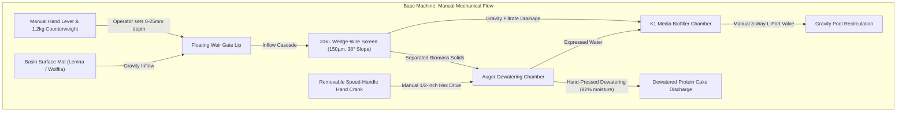
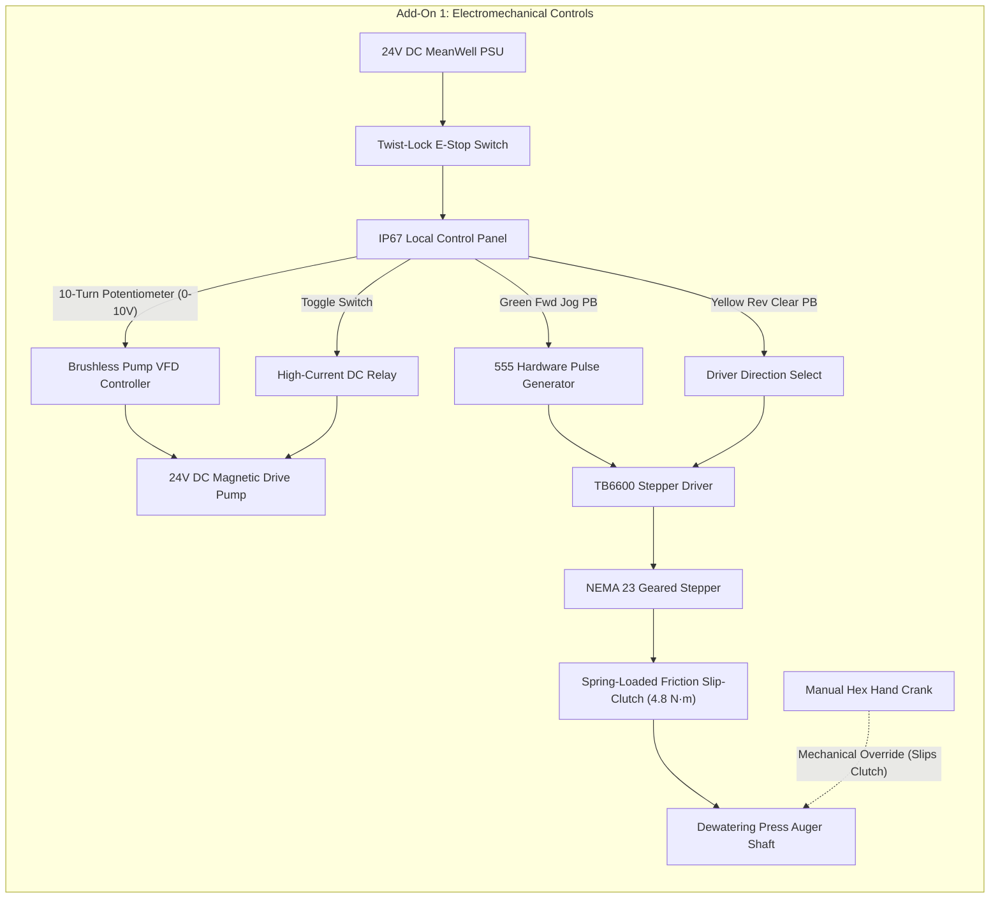

import { Card, CardGrid } from '@astrojs/starlight/components';

The **Fluidic Skimmer & Dewatering Separator** is an open-hardware aquatic harvester and clarification machine. Designed to operate both as an independent surface biomass skimmer for farm ponds and homestead aquaponics systems, it also serves as the core aquatic protein engine for the master Open Biosphere assembly.

---

## 1. Standalone Homesteading & Off-Grid Utility

For homesteaders managing duckweed (*Lemna minor* / *Wolffia globosa*) or operating small-scale aquaculture/aquaponics systems, harvesting surface biomass manually is backbreaking and erratic. This machine provides **continuous, autonomous surface skimming, solids separation, and water dewatering**:

<CardGrid>
  <Card title="Pond & Tank Duckweed Harvester" icon="leaf">
    Mounts onto any farm pond edge, IBC tote, or stock tank to skim high-protein floating watermeal automatically, harvesting up to 12.5 kg of green biomass per hour.
  </Card>
  <Card title="Continuous Aeration & Clarification" icon="droplet">
    Integrated Moving Bed Biofilm Reactor (MBBR) and venturi aerator maintain clear, pathogen-free water for fish or aquatic crops with zero chemical inputs.
  </Card>
  <Card title="Zero-Clog Wedge-Wire Screen" icon="grid">
    V-shaped 316L stainless steel wedge wires shed microscopic fronds cleanly, eliminating the constant clogging seen in woven mesh nets.
  </Card>
  <Card title="12V/24V Off-Grid Solar Ready" icon="sun">
    Powered by an efficient 24V brushless DC motor drawing just 45W to 120W, easily run directly off a small off-grid solar panel and battery bank.
  </Card>
</CardGrid>

---

## 2. Technical Specifications

| Parameter | Specification |
| :--- | :--- |
| **Circulation Flow Rate** | 45 to 75 Gallons per Minute (GPM) |
| **Skimmer Weir** | Variable-buoyancy bistable overflow weir (600 mm or 1,200 mm modular width) |
| **Dewatering Screen** | Stainless 316L wedge-wire screen (slot width: 150 µm) |
| **Harvest Rate** | Up to 12.5 kg wet biomass per hour |
| **Biofilter Loop** | 3-stage moving bed biofilm reactor (MBBR) with K1 media + 15W UV-C clarifier |
| **Drive Pump** | Brushless DC variable-frequency magnetic-drive pump (240W max, 24V DC) |
| **Separation Auger** | 3D printed PETG / stainless screw press (reduces frond moisture to ~82%) |
| **Microcontroller** | Raspberry Pi Pico or ESP32 running FreeRTOS with optical level triggers |

---

## 3. Instructions (Base Zero-Power Machine)

The base Fluidic Skimmer is a **100% mechanical, zero-electricity, off-grid surface harvester and clarification unit**. It requires zero microcontrollers, zero software, and zero wiring—operating purely on gravity, manual hand levers, rotary cranks, and physical siphons. 

All builders assemble this base machine first. The subsequent tiers are modular add-on packs installed directly onto this foundation.

### Mechanical Architecture & Decoupling
- **Counterweighted Overflow Weir**: An external hand lever with an adjustable lead or steel counterweight balances the floating weir gate. Moving the lever raises or lowers the weir lip relative to the water line (0 mm to 25 mm skimming depth), allowing an operator to dial in surface draw by hand or pull it shut completely.
- **Manual Dewatering Press**: The dewatering auger features a standard 1/2-inch hex head on its drive shaft. A removable aluminum speed-handle hand crank slots directly onto the shaft. Cranking clockwise advances duckweed and watermeal fronds against the stainless 316L wedge-wire screen, pressing free water back into the sump while extruding dense, 82% moisture protein paste out the discharge chute.
- **Gravity Drainage & Manual Siphon**: A 1.5-inch 3-way manual L-port PVC ball valve allows operators to bypass electric pumps entirely, dumping water through the K1 moving bed media chamber and back into the main reservoir via gravity.

### Step-by-Step Fabrication & Assembly Protocol

```text
Step 1.1: Flume Chassis Fabrication
  ├── Cut 1/4" cast acrylic or HDPE sheet into two 600mm x 400mm side plates, one 600mm x 300mm base.
  ├── Mill 12mm pivot slots for the weir Delrin pin at X=80mm, Z=+120mm from intake lip.
  ├── Drill a 48mm hole in the sump floor for the 1.5" PVC bulkhead fitting.
  └── Solvent-weld acrylic seams using Weld-On 4, or bolt HDPE with M5 A4-stainless bolts & silicone.

Step 1.2: Wedge-Wire Screen Installation
  ├── Align 316L wedge-wire screen (150µm slot, 300mm x 400mm) at an exact 38° decline.
  ├── Seat edges against 3mm EPDM closed-cell rubber sealing strips to prevent frond blow-by.
  └── Fasten screen using 3D-printed PETG clamping rails and four M4 thumb-screws (toolless service).

Step 1.3: Counterweighted Weir Gate Mounting
  ├── Fabricate hollow floating weir gate (PETG printed, 15% infill, 4 perimeters for buoyancy).
  ├── Press-fit Ø12mm Delrin pivot pins into side flume bushings with 0.5mm axial clearance.
  ├── Attach 450mm aluminum lever arm with threaded M10 rod for sliding 1.2 kg counterweight.
  └── Adjust counterweight position until weir gate floats neutral at 2mm below calm water level.

Step 1.4: Manual Dewatering Screw Press Assembly
  ├── 3D print PETG continuous flight auger screw (50mm pitch, 85mm outer diameter, Ø20mm core).
  ├── Insert 1/2" zinc-plated steel hex drive shaft through auger core; secure with cross-drilled M5 roll pin.
  ├── Slide auger into perforated stainless steel sleeve (1.0mm micro-perforations).
  ├── Press dual 608-2RS sealed ball bearings into rear flange; slide 1/2" hex drive through.
  └── Attach removable 1/2" socket speed-handle hand crank onto external hex stub.

Step 1.5: Biofilter & Manual Valve Plumbing
  ├── Thread 1.5" PVC schedule 40 male adapter into sump bulkhead with PTFE thread tape.
  ├── Glue 1.5" 3-way L-port PVC ball valve inline directly below bulkhead.
  ├── Connect Port A to gravity drain manifold; connect Port B to recirculation return.
  └── Pour 10 liters of K1 micro filter biomedia into sump and install slotted retention screen.
```

### Step-by-Step Operating Runbook (Zero-Power Baseline)

1. **Pre-Skim Inspection**: Verify the weir gate floats smoothly by deflecting the counterweight lever by hand. Inspect the wedge-wire face; brush off dried algae using a stiff nylon bristle brush.
2. **Weir Gate Deployment**: Slowly pull the counterweight hand lever downward 10 mm to 15 mm. Observe the water cascading over the weir lip, carrying floating duckweed fronds down the intake flume onto the wedge-wire screen.
3. **Biomass Concentration**: Allow gravity filtration to run for 5 to 10 minutes. Water drains through the 150 µm slots into the K1 biofilter sump while green fronds slide downward into the dewatering auger barrel.
4. **Manual Dewatering Pressing**: Slide the 1/2" hex speed-handle crank onto the auger drive shaft. Rotate clockwise at 15 to 20 RPM for 12 to 15 full revolutions. Fronds are compressed against the cone nozzle, expressing moisture through the perforated sleeve.
5. **Cake Harvesting**: Dense, dewatered green protein paste (approx. 82% moisture) extrudes from the discharge cone. Collect the cake directly into a food-grade harvest tote.
6. **Flume Gate Closure**: Release the counterweight lever; the counterweight automatically pulls the weir gate upward, sealing off surface flow.
7. **Gravity Drainage Flush**: Rotate the 3-way manual ball valve handle to Position A for 30 seconds to flush settled solids out the bottom drain port.

### Base Machine Blueprint & Elevation Profile

```text
========================================================================================
BASE MACHINE MECHANICAL ELEVATION & KINEMATICS BLUEPRINT (ZERO-POWER BASELINE)
All dimensions in millimeters [mm] | Datum Z=0.00 at South Coping Surface
========================================================================================

                 [Adjustable Counterweight: 1.2 kg]
                                  │
                                 ┌┴┐
             [Hand Lever] ═══════╡ ╞══════════════════════════════════╗ (Counterweight Arm)
                                 └┬┘                                  ║
                                  │ Pivot Pin (Delrin, Ø12mm)         ║ Linkage Rod
                                                                      ▼
 WATER SURFACE ────────────────────────────────────────┐          ┌───────┐
 ~~~~~~~~~~~~~ [Surface Duckweed Mat: 4-12mm] ~~~~~~~~ │  Flow    │Floating│ [Weir Gate Lip]
                                                       ▼ ───────► │ Weir  │ (Travel: 0-25mm)
   ┌──────────────────────────────────────────────────────────────┴───────┴──────┐
   │ INLET FLUME (Food-Grade Acrylic/HDPE, Width: 600mm, Length: 400mm)         │
   │                                                                             │
   │     Duckweed + Water Inflow                                                 │
   │     ═══════════════════════════════════════╗                                │
   │                                            ▼                                │
   │                             ┌───────────────────────────────┐               │
   │                             │  316L Stainless Wedge-Wire   │               │
   │                             │  Screen (150µm Slot Width,   │               │
   │                             │   Declination: 38° Angle)    │               │
   │                             └──────────────┬────────────────┘               │
   │                                            │ Separated Fronds               │
   │    Clarified Filtrate Return               ▼                                │
   │    ┌─────────────────────────── [Auger Dewatering Chamber] ────────────────┐│
   │    │                                                                       ││
   │    │  [Removable Crank]         PETG Continuous Screw Flight               ││
   │    │      ┌───┐             ┌───┬───┬───┬───┬───┬───┬───┐    Discharge Chute│
   │    │  (C) │   ╞═════════════╡ / │ / │ / │ / │ / │ / │ / ╞═══► [Protein     ││
   │    │      └───┘             └───┴───┴───┴───┴───┴───┴───┘     Paste Out]   ││
   │    │  1/2" Hex Socket        Perforated Stainless Sleeve                   ││
   │    └───────────────────────────────────────┬───────────────────────────────┘│
   │                                            │ Expressed Liquid               │
   │                                            ▼                                │
   │  GRAVITY RETENTION SUMP                                                     │
   │  ┌────────────────────────────────────────────────────────────────────────┐ │
   │  │ K1 Micro Biomedia Chamber (10 Liters Moving Bed)                      │ │
   │  └────────────────────────────────────┬───────────────────────────────────┘ │
   └───────────────────────────────────────┼─────────────────────────────────────┘
                                           ▼
                       3-Way Manual L-Port PVC Ball Valve (Ø1.5")
                                   ┌───────┴───────┐
                      [Position A] │               │ [Position B]
                     Gravity Sump  ▼               ▼ Direct Pond/Basin Return
========================================================================================
```

### Base Kinematics & Gravity Flow



### Base Machine Bill of Materials (BOM)
*Pure gravity skimming, counterweighted weir lever, hand-cranked auger dewatering press, and manual drain valves.*

| Item Category | Component Name & Description | Sourcing / Standard Part | Est. Cost (USD) |
| :--- | :--- | :--- | :--- |
| **Flume Body** | Food-Grade 1/4-inch Acrylic / Polycarbonate Sheets or HDPE Sump Chamber | Hardware store / plastic supplier | $45.00 |
| **Wedge-Wire Screen** | 316L Stainless Steel Wedge-Wire Panel (150µm slot, 300x400mm) | Industrial filtration supplier / eBay | $65.00 |
| **Weir Gate Lever** | Counterweighted Hand Lever & Delrin Pivot Pin for Overflow Weir | 3D printed PETG + Delrin pin | $16.00 |
| **Dewatering Press** | Manual Dewatering Screw Press (3D Printed PETG Auger + Removable Hex Crank) | 3D printed + steel hex shaft | $22.00 |
| **Plumbing & Drain** | 3-Way Manual L-Port PVC Bypass Ball Valve (1.5-inch) + Bulkhead Drain | Standard plumbing supply | $18.00 |
| **Filter Media** | K1 Micro Filter Media (10 Liters) + Perforated Gravity Retention Screen | Aquaculture / pond supply | $14.00 |
| **Base Build Total** | **Complete Zero-Electricity Manual Harvester** | **Off-grid mechanical baseline** | **$180.00** |

---

## 4. Add-On 1: Semi-Autonomous Electromechanical Pack (Buttons & Dials)

Add-On 1 adds **motorized pumping, electric auger driving, and local push-button controls** to the base machine. It requires 24V DC power but operates **without firmware, microcontrollers, networks, or cloud dependencies**.

### Electromechanical Actuation & Controls
- **Motorized Circulation**: A 24V DC brushless magnetic-drive pump (55 GPM) circulates water across the weir flume without manual siphoning.
- **Electric Auger Drive**: A high-torque NEMA 23 stepper motor couples to the auger shaft via an inline spring-loaded friction slip-clutch. If the auger jams or the motor is unpowered, an operator can still insert the manual hand crank and turn the auger without back-driving or damaging the stepper.
- **Local Control Panel**: An IP67 waterproof enclosure mounted on the side flume contains:
  - High-current toggle switch for master pump power (Low / Medium / High flow).
  - Green momentary push-button for forward auger jogging.
  - Yellow momentary push-button for reverse auger clearing (purges debris).
  - 10-turn analog potentiometer dial to set pump speed directly without code.
- **Hardware Override Bus**: Push-buttons connect directly to the enable and step pins of the TB6600 motor driver and coil triggers of high-current relays, guaranteeing operation even if digital controllers are disconnected.

### Step-by-Step Retrofit & Electromechanical Wiring Protocol

```text
Step 2.1: 24V Circulation Pump Plumbing Installation
  ├── Mount 24V brushless magnetic-drive pump onto vibration-damping silicone isolator pads.
  ├── Connect pump suction port to sump outlet via 1.5" flexible reinforced PVC hose.
  ├── Plumb pump discharge into flume circulation manifold with an inline check valve.
  └── Install manual isolation ball valve on pump suction to enable pump servicing without draining.

Step 2.2: NEMA 23 Stepper & Slip-Clutch Mechanical Coupling
  ├── Bolt 4:1 planetary reduction NEMA 23 stepper motor onto 3D-printed PETG side motor bracket.
  ├── Install spring-loaded friction slip-clutch (calibrated to 4.8 N·m) onto 8mm motor output shaft.
  ├── Mate clutch output hub directly to the auger 1/2" hex drive shaft using M6 cross-pin.
  └── Verify hex hand crank still fits securely onto rear shaft stub for simultaneous manual override.

Step 2.3: IP67 Control Enclosure Assembly
  ├── Drill five 22mm panel cutouts into IP67 polycarbonate electrical enclosure:
  │     Cutout 1: 2-position heavy-duty toggle switch (Pump Power).
  │     Cutout 2: 10-turn wirewound precision potentiometer with counting dial (Pump Speed).
  │     Cutout 3: Green momentary IP67 push-button (Auger Jog Forward).
  │     Cutout 4: Yellow momentary IP67 push-button (Auger Clear Reverse).
  │     Cutout 5: Red twist-to-release mushroom emergency stop button.
  └── Install M16 IP68 liquid-tight nylon cable glands along enclosure bottom rim.

Step 2.4: Driver, Pulse Generator & Power Distribution Wiring
  ├── Mount MeanWell 24V 150W power supply (LRS-150-24) inside sheltered enclosure with 10A fuse.
  ├── Wire E-Stop switch inline on the 24V positive rail before all motor drivers and relays.
  ├── Wire NE555 hardware timer circuit (set to 800 Hz pulse output) to TB6600 STEP pin.
  ├── Route Green Jog PB through 555 output to TB6600 STEP pin (drives motor forward when pressed).
  ├── Route Yellow Clear PB to TB6600 DIR pin (inverts step direction to reverse auger).
  └── Connect Potentiometer wiper to pump speed input (0-10V analog speed command signal).

Step 2.5: Slip-Clutch Torque Verification
  ├── Fix auger flight with a wooden block to simulate a heavy branch/debris jam.
  ├── Press Green Jog PB; observe slip-clutch slipping smoothly with zero stepper gear stripping.
  ├── Insert manual speed-handle crank and rotate by hand against motor holding torque.
  └── Clutch slips smoothly, verifying operator hand operation cannot back-feed or damage the motor.
```

### Step-by-Step Push-Button Operating Runbook

1. **Power Initialization**: Verify emergency stop button is pulled out. Flip the 24V master power breaker; verify power LED illuminates on the IP67 control panel.
2. **Circulation Flow Engagement**: Flip the Pump Power toggle switch to ON. Observe brushless pump ramp-up.
3. **Flow Rate Adjustment**: Rotate the 10-turn analog potentiometer dial clockwise to adjust skimming flow between 45 and 75 GPM. Align dial to achieve a 12 mm laminar water sheet over the weir lip.
4. **On-Demand Dewatering Pressing**: When green duckweed fronds pile up against the wedge-wire screen, press and hold the **Green Jog Push-Button**. The NEMA 23 stepper drives the auger forward at 30 RPM, continuously pressing protein paste out the discharge nozzle. Release button to stop.
5. **Jam Clearing Recovery**: If stringy roots or floating twigs jam the auger, release the Green Jog button and press the **Yellow Reverse Push-Button** for 2 to 3 seconds. The motor reverses 5 full turns, breaking up the jam. Press Green Jog to resume normal extrusion.
6. **Immediate Manual Fallback**: If power is cut or an emergency stop occurs, operators do not need to disengage motors or flip clutches. Simply insert the manual 1/2" hex hand crank and rotate manually—the friction slip-clutch slips at 4.8 N·m, enabling instant zero-electricity operation.

### Add-On 1 Electromechanical Wiring & Control Panel Blueprint

```text
========================================================================================
ADD-ON 1 ELECTROMECHANICAL SCHEMATIC & LOCAL CONTROL PANEL BLUEPRINT
Zero-Code / Push-Button & Dial Wiring with Spring-Loaded Mechanical Slip-Clutch
========================================================================================

    [24V DC 150W MeanWell PSU] ──[10A Breaker / E-Stop Switch]──┬── (24V Power Bus)
                                                                └── (GND Return Bus)
                                                                          │
  ┌─────────────────── IP67 OPERATOR CONTROL PANEL ──────────────────────┐│
  │                                                                      ││
  │  [Master Pump Power]      [Pump Speed Dial]     [Auger Jog Fwd]      ││
  │   Heavy-Duty Toggle      10-Turn Potentiometer  Green Momentary PB   ││
  │      ┌─────────┐             ┌─────────┐           ┌─────────┐       ││
  │      │  ON/OFF │             │ (0-10V) │           │   FWD   │       ││
  │      └────┬────┘             └────┬────┘           └────┬────┘       ││
  │           │                       │                     │            ││
  │           ▼                       ▼                     ▼            ││
  │      To Pump Relay           To 24V Pump VFD      To TB6600 Step Gen ││
  │                                                         │            ││
  │  [Auger Jam Reverse]      [Emergency Stop Loop]         │            ││
  │   Yellow Momentary PB     Red Twist-Lock Mushroom       │            ││
  │      ┌─────────┐             ┌─────────┐                │            ││
  │      │   REV   │             │  E-STOP │                │            ││
  │      └────┬────┘             └────┬────┘                │            ││
  │           │                       │                     │            ││
  │           ▼                       ▼                     ▼            ││
  │     To TB6600 Dir Pin        Master Coil Cut      To Driver Pulse In ││
  └──────────────────────────────────────────────────────────────────────┘│
                                                                          │
  ┌──────────────────── DRIVE TRAIN & MOTORS ────────────────────────────┐│
  │                                                                      ││
  │  24V DC Brushless Magnetic Pump (55 GPM) ◄─── High-Current Relay ────┘│
  │                                                                       │
  │  NEMA 23 Geared Stepper Motor ◄─── TB6600 Stepper Driver (3.5A Peak) ─┘
  │         │
  │         ▼ (Motor Output Shaft)
  │     ┌───────┐
  │     │ ░░░░░ │ Friction Spring Slip-Clutch (Torque Limit: 4.8 N·m)
  │     └───────┘ [SLIPS ON MANUAL CRANK OR OVERTORQUE]
  │         │
  │         ▼ (Auger Drive Shaft)
  │    ═════╪══════════════════════════════════════════════════╗
  │         │                                                  ║
  │   [Auger Screw Press]                                [1/2" Hex Socket]
  │   (Motor driven OR hand cranked simultaneously)       (Hand Crank Ready)
  └───────────────────────────────────────────────────────────────────────┘
========================================================================================
```

### Add-On 1 Signal & Override Flow



### Add-On 1 Bill of Materials (BOM)
*Adds motorized pumping, electric auger dewatering drive, and local IP67 jog push-buttons without software.*

| Item Category | Component Name & Description | Sourcing / Standard Part | Est. Cost (USD) |
| :--- | :--- | :--- | :--- |
| **Water Pump** | 24V DC Brushless Magnetic Drive Pump (80W–120W, 55 GPM) | Solar fountain / pond pump | $58.00 |
| **Motorized Auger** | NEMA 23 High-Torque Geared Stepper Motor | 3D printer / CNC stepper supplier | $32.00 |
| **Control Box** | Waterproof IP67 Enclosure with Fwd/Rev Momentary Jog Buttons + Speed Dial | Industrial electrical supply | $24.00 |
| **Motor Drivers** | Dual-Channel TB6600 Stepper Driver + High-Current DC Pump Relay | Standard maker electronics | $18.00 |
| **Power Supply** | 24V 150W MeanWell Industrial Power Supply + Inline Breaker Fuse | Standard electrical supply | $28.00 |
| **Add-On 1 Direct Cost** | **Electromechanical Power Upgrade** | **Adds to Base Machine** | **+$160.00** |
| **Cumulative Total** | **Operational Semi-Autonomous Harvester** | **Base + Add-On 1** | **$340.00** |

---

## 5. Add-On 2: Agentic Autonomous AI Pack (Edge Vision & Closed Loop)

Add-On 2 transforms the machine into a **fully autonomous, closed-loop cyber-physical harvester** integrated into the multi-agent biosphere mesh.

### Autonomous Vision, Telemetry & Multi-Agent Control
- **Optical Frond Density Profiling**: An overhead Sony IMX219 NIR/RGB camera module continuously monitors surface mat thickness. Using on-device edge computer vision, the system detects when the floating mat exceeds 8 mm in thickness.
- **Closed-Loop Weir & Pump Modulation**: A 12V micro linear actuator with internal potentiometer feedback replaces the manual counterweight link, dynamically lowering the weir gate to skim surface biomass only when dense fronds are present. A 1 Hz PID loop throttles the brushless pump to match incoming biomass flow.
- **Ultrasonic Level & Runaway Protection**: A waterproof JSN-SR04T ultrasonic distance sensor continuously monitors sump water height. Dual optical float switches provide hardware emergency cutoffs to prevent pump cavitation.
- **Master Biosphere Bus & AGV Handshake**: Telemetry streams over CAN bus / RS-485 Modbus. When the dewatered protein cake fills the collection bin, the ESP32-S3 signals the Ground Track AGV to dock and swap the collection tote.

### Step-by-Step Sensor Commissioning & Edge AI Protocol

```text
Step 3.1: Overhead Optical Sensor Rigging
  ├── Mount rigid aluminum 2020 cross-strut above the flume intake at elevation Z = 1,400mm.
  ├── Install Sony IMX219 8-Megapixel NIR camera with 850nm optical bandpass filter in weather-hood.
  ├── Connect CSI-2 ribbon cable to ESP32-S3 / Raspberry Pi CM4 carrier board.
  └── Calibrate lens focus to a sharp 300mm x 400mm field of view centered on the floating weir lip.

Step 3.2: Linear Actuator Linkage Retrofit
  ├── Disconnect Stage 1 manual counterweight rod from the weir gate arm.
  ├── Pin 12V micro linear actuator (50mm stroke, 150N force, internal 10k potentiometer) to weir yoke.
  ├── Connect actuator motor leads to L9110S H-bridge driver board on ESP32-S3 GPIO 18/19.
  └── Wire actuator 10k feedback wiper to ESP32-S3 ADC2 (Channel 0) for sub-millimeter position tracking.

Step 3.3: Sump Telemetry & Cavitation Protection
  ├── Mount waterproof JSN-SR04T ultrasonic sensor perpendicular to sump water surface at Z=+350mm.
  ├── Wire ultrasonic Trigger to GPIO 14, Echo to GPIO 15 (samples water depth at 10 Hz).
  ├── Install low-level optical float switch in pump intake sump; wire directly to hardware interrupt GPIO 21.
  └── If float switch goes open-circuit (dry-run condition), firmware immediately cuts pump relay in <5ms.

Step 3.4: Firmware Flashing & CAN Bus Network Binding
  ├── Flash ESP32-S3 with Open Biosphere Skimmer FreeRTOS firmware via PlatformIO / ESP-IDF.
  ├── Connect SN65HVD230 CAN bus transceiver to ESP32-S3 GPIO 4 (TX) and GPIO 5 (RX).
  ├── Set CAN node address to 0x14 (Fluidic Skimmer Primary Controller, 500 kbps baud).
  └── Connect twisted-pair shielded CAN cable with 120Ω terminating resistor to Biosphere Core backbone.

Step 3.5: Computer Vision Threshold Calibration
  ├── Run onboard calibration script `skimmer_calibrate_mat.py` under ambient grow lights.
  ├── Script captures 640x480 NIR frame, computes Otsu thresholding on 850nm reflectance.
  ├── Calibrate pixel density: floating frond mat thickness = (pixel_area * calibration_factor).
  └── Store setpoint: Trigger skimming sequence when frond mat thickness exceeds 8.0 mm.
```

### Step-by-Step Autonomous Multi-Agent Runbook

1. **Self-Diagnostic Boot Sequence**: Upon boot, ESP32-S3 queries all sensors:
   - Verifies ultrasonic distance reads between 150 mm and 280 mm (normal sump level).
   - Cycles linear actuator to 0.0 mm (fully closed home) and confirms potentiometer ADC reading.
   - Pings CAN bus master; verifies heartbeat acknowledgment from central biosphere server.
2. **Autonomous Canopy Sentry (Sentry Mode)**:
   - Pump runs at minimum maintenance speed (15% duty cycle, 12 GPM) to prevent water stagnation.
   - Camera captures an image every 5 seconds, calculating frond surface coverage percentage.
3. **Automated Skimming Sequence Activation**:
   - When frond mat thickness reaches $\ge 8.0$ mm, ESP32-S3 triggers the harvesting routine.
   - Linear actuator extends 14 mm, submerging weir lip into dense vegetative layer.
   - PID controller ramps pump speed to 65 GPM, drawing surface biomass across the wedge wire.
4. **Closed-Loop Dewatering Press Modulation**:
   - Stepper driver pulses auger motor at rate proportional to incoming biomass (15 to 45 RPM).
   - Firmware monitors stepper driver current consumption via shunt resistor; if torque exceeds 4.2 N·m (dense plug formation), auger speed slows to allow liquid expression.
5. **Autonomous Harvest Handshake with Ground AGV**:
   - A load cell mounted under the harvest cake hopper tracks accumulated protein mass.
   - When hopper weight reaches 10.0 kg, ESP32-S3 broadcasts CAN message `0x14_AGV_DOCK_REQ`.
   - Ground Track AGV receives message, navigates along perimeter magnetic line, and docks under discharge chute.
   - AGV actuates transfer clamp, swaps full collection canister for an empty bin, and sends `0x22_AGV_READY`.
   - Skimmer logs harvest weight and batch timestamp to central database and resumes sentry mode.
6. **Failsafe Protective Interrupts**:
   - If water level drops below safe minimum, optical float trips, immediately cutting pump power and raising weir to sealed position.
   - If CAN communication with central server times out for $>30$ seconds, system reverts to autonomous Stage 2 preset operation without stalling harvest loops.

### Add-On 2 Cyber-Physical Edge Architecture Blueprint

```text
========================================================================================
ADD-ON 2 AUTONOMOUS EDGE AI & CLOSED-LOOP CONTROL ARCHITECTURE BLUEPRINT
Closed-Loop Optical CV, Sub-Millimeter Weir Positioning & Master CAN Mesh Interlock
========================================================================================

                     OVERHEAD CANOPY STRUT (Z = 1,400 mm)
                                      │
               ┌──────────────────────┴──────────────────────┐
               │ Sony IMX219 NIR/RGB Camera (850nm Bandpass) │
               └──────────────────────┬──────────────────────┘
                                      │ CSI-2 Ribbon Cable
                                      ▼
    ┌───────────────────────── ESP32-S3 BRAIN BOARD ─────────────────────────┐
    │                                                                        │
    │  [Edge CV Pipeline]        [1 Hz FreeRTOS PID Loop]   [Bus Network]    │
    │  Morphological Mat Depth   Error: Setpoint - Mat_mm   Isolated CAN 2.0 │
    │  Threshold: >8.0 mm frond  Output: Actuator & Pump Hz RS-485 Modbus    │
    │                                                                        │
    │  GPIO 14 / ADC1 ◄── JSN-SR04T Waterproof Ultrasonic Level Sensor       │
    │  GPIO 21 / INT  ◄── Dual Optical Liquid Float Switches (Dry-Run Guard) │
    │  ADC2 (Ch 0)    ◄── Micro Linear Actuator Wiper Feedback (Position mm) │
    │                                                                        │
    │  DAC / PWM Out  ──► Pump VFD Flow Throttle (45 - 75 GPM)               │
    │  DIR / STEP Out ──► NEMA 23 Auger Pulse Controller                     │
    │  H-Bridge PWM   ──► 12V Linear Actuator Driver (Weir Elevation 0-25mm) │
    └─────────────────────────────────┬──────────────────────────────────────┘
                                      │
            ┌─────────────────────────┴────────────────────────┐
            │ Master Biosphere CAN Bus / RS-485 Backbone       │
            └──────────────┬────────────────────────┬──────────┘
                           ▼                        ▼
                [Ground Track AGV]        [Master Biosphere Core]
             "Tote 85% Full Handshake"     Telemetry Telemetry Stream:
             Dispatches Rover for Swap     • Mat Inflow Rate: kg/h
                                           • Sump Level & Water Turbidity
                                           • Auger Torque & Moisture %
========================================================================================
```

### Add-On 2 Autonomous Decision Loop

```mermaid
flowchart TD
    subgraph S3_ClosedLoop["Add-On 2: Autonomous Closed-Loop Decision Engine"]
        Cam["Overhead Sony IMX219 NIR Camera"] -->|"850nm Reflectance Frame"| CV["Edge CV Morphological Segmentation"]
        CV -->|"Calculates Mat Thickness (mm)"| Check{"Frond Mat >= 8mm?"}
        
        Check -->|"No (< 8mm)"| Idle["Idle State: Weir Gate Closed, Pump at 15% Min Recirc"]
        Check -->|"Yes (>= 8mm)"| PID["1 Hz PID Control Loop"]
        
        Ultra["JSN-SR04T Ultrasonic Sump Level"] -->|"Real-Time Sump Height"| PID
        PID -->|"PWM Position Command"| Actuator["12V Micro Linear Actuator"]
        Actuator -->|"Lowers Weir Lip (5-20mm)"| Skim["Active Surface Mat Skimming"]
        
        PID -->|"VFD Frequency Output"| Pump["Brushless Pump throttles 45-75 GPM"]
        Skim --> Press["Motorized Auger Dewatering Press"]
        Press --> LoadCell["Auger Torque Monitor"]
        
        LoadCell --> Tote{"Tote Weight >= 10kg?"}
        Tote -->|"Yes"| AGV["CAN Bus Message: Dispatch Ground AGV for Pod Swap"]
        Tote -->|"No"| Continue["Continue Continuous Dewatering"]
    end
```



### Add-On 2 Bill of Materials (BOM)
*Integrates overhead computer vision frond scanning, linear actuator weir control, and master CAN bus telemetry.*

| Item Category | Component Name & Description | Sourcing / Standard Part | Est. Cost (USD) |
| :--- | :--- | :--- | :--- |
| **Canopy Scanner** | Overhead Sony IMX219 NIR/RGB Camera for Frond Mat Thickness Profiling | Raspberry Pi / camera module | $25.00 |
| **Controller Node** | ESP32-S3 Dual-Core Microcontroller with CAN Bus Transceiver (FreeRTOS) | Open-source maker hardware | $18.00 |
| **Level Telemetry** | Waterproof Ultrasonic Sump Level Sensor (JSN-SR04T) + Optical Float Switches | Maker electronics | $14.00 |
| **Linear Actuator** | 12V Micro Linear Actuator (50mm stroke with analog position feedback) | Robotics actuator supplier | $28.00 |
| **Interlock Harness** | IP67 M12 Quick-Disconnect CAN / RS-485 Biosphere Telemetry Harness | Industrial automation supplier | $12.00 |
| **Add-On 2 Direct Cost** | **Autonomous Edge AI & Vision Upgrade** | **Adds to Base + Add-On 1** | **+$97.00** |
| **Full Build Total** | **Complete Autonomous Closed-Loop Biosphere Skimmer** | **Base + Add-On 1 + Add-On 2** | **$437.00** |

---

## 6. Staged Upgrade Progression & Cost Summary

A builder can start with the **Base Machine ($180.00)**, run completely off-grid with manual cranks and gravity drainage, and upgrade modularly in place:

| Build Tier | Operational Capability | Direct Tier Cost | Cumulative Investment |
| :--- | :--- | :--- | :--- |
| **Base Machine** | 100% mechanical, zero-power off-grid harvesting with hand levers & cranks | $180.00 | **$180.00** |
| **Add-On 1** | Motorized pumping & auger pressing with waterproof panel buttons & dials | +$160.00 | **$340.00** |
| **Add-On 2** | Full edge computer vision, automated weir positioning, and CAN bus interlock | +$97.00 | **$437.00** |

### Step-by-Step Conversion Roadmap (Zero Waste Upgrade Path)

```text
Upgrade Path 1: Converting Base Machine to Add-On 1 (Semi-Autonomous)
  ├── 1. Leave all Base Machine acrylic chassis, wedge wire, and auger screw completely intact.
  ├── 2. Mount 24V brushless pump on lower flume bracket; plumb into existing 1.5" PVC bulkhead.
  ├── 3. Bolt NEMA 23 motor bracket to auger chassis; slide spring-loaded slip-clutch over auger hex shaft.
  ├── 4. Mount IP67 control box to outer coping; wire 24V PSU, TB6600 driver, pump toggle, and jog buttons.
  └── Result: Full electromechanical push-button operation; manual crank remains functional via slip-clutch.

Upgrade Path 2: Converting Add-On 1 to Add-On 2 (Agentic)
  ├── 1. Leave all Add-On 1 pumps, motor drives, slip-clutch, and manual override panel in place.
  ├── 2. Unpin the manual counterweight link from the weir gate arm; bolt 12V micro linear actuator in its place.
  ├── 3. Mount overhead 2020 camera strut at Z=1,400mm; install Sony IMX219 NIR camera module.
  ├── 4. Install JSN-SR04T ultrasonic level sensor and optical float switch inside the sump.
  ├── 5. Mount ESP32-S3 brain board; wire into driver STEP/DIR lines in parallel with the manual jog buttons.
  └── Result: Fully autonomous closed-loop AI operation with 100% preserved manual & push-button fallback.
```

---

## 7. Master Biosphere Assembly Interlock

In the integrated 20x10 ft Open Biosphere installation:

1. **Basin Perimeter Mounting**: Clamps directly to the south coping of the pool ($X = 300$ to $2,748$ mm, $Y = 600$ mm) using standardized 4040 aluminum extrusion bracketry.
2. **Cascading Recirculation**: Discharges clarified, nitrate-reduced effluent into the Central Basin and aeroponic manifold.
3. **Automated Harvest Discharging**: Dewatered protein paste is deposited into Ground Track AGV carrier pods for automated transport.
