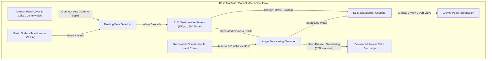

import { Card, CardGrid, LinkButton } from '@astrojs/starlight/components';

## Part 1: Stage Header & Executive Summary

> [!NOTE]
> **Stage Designation:** Stage 0 (Zero-Power Baseline)  
> **Operating Mode:** 100% Mechanical Manual Fallback  
> **Power Consumption:** 0 Watts (Zero Electrical Input Required)  
> **Resilience Rating:** Continuous Off-Grid / EMP / Submersion Proof  
> **Decoupling Standard:** Friction Slip-Clutch / Quick-Release Cam Linkage  

The Stage 0 baseline build of the **Fluidic Skimmer & Dewatering Separator** is a **100% mechanical, zero-power agricultural machine**. It operates entirely by human leverage, manual hand cranks, counterweights, and gravity flows—providing complete food security and operational continuity during total grid blackouts.

---

## Part 2: Capability Delta (Features Introduced)

* **Zero-Power Resilience**: Operates indefinitely without batteries, solar controllers, or power supplies.
* **Direct Mechanical Leverage**: All actuation performed via hand cranks, manual levers, counterweights, or gravity siphoning.
* **Inherent Decoupling**: Built from the ground up with mechanical slip-clutches, quick-release clamps, or bypass valves to ensure motor upgrades never bind.

---

## Part 3: Isolated Stage 0 Bill of Materials (BOM)


### Base Machine Bill of Materials (BOM)

| Item | Part ID & Registry Link | Component & Specification | Sourcing / Supplier | Fab Type | Qty | Unit Cost | CAD Asset | Total Cost |
| :--- | :--- | :--- | :--- | :--- | :--- | :--- | :--- | :--- |
| **Base Build Total** | **Complete Zero-Electricity Manual Harvester** | **Off-grid mechanical baseline** | | | | | | **$180.00** |

---

## Part 4: Standalone Full SVG Blueprint


---

## Part 5: Step-by-Step Assembly & Operating Protocol

The base Fluidic Skimmer is a **100% mechanical, zero-electricity, off-grid surface harvester and clarification unit**. It requires zero microcontrollers, zero software, and zero wiring—operating purely on gravity, manual hand levers, rotary cranks, and physical siphons. 

All builders assemble this base machine first. The subsequent tiers are modular add-on packs installed directly onto this foundation.

### Mechanical Architecture & Decoupling
- **Counterweighted Overflow Weir**: An external hand lever with an adjustable lead or steel counterweight balances the floating weir gate. Moving the lever raises or lowers the weir lip relative to the water line (0 mm to 25 mm skimming depth), allowing an operator to dial in surface draw by hand or pull it shut completely.
- **Manual Dewatering Press**: The dewatering auger features a standard 1/2-inch hex head on its drive shaft. A removable aluminum speed-handle hand crank slots directly onto the shaft. Cranking clockwise advances duckweed and watermeal fronds against the stainless 316L wedge-wire screen, pressing free water back into the sump while extruding dense, 82% moisture protein paste out the discharge chute.
- **Gravity Drainage & Manual Siphon**: A 1.5-inch 3-way manual L-port PVC ball valve allows operators to bypass electric pumps entirely, dumping water through the K1 moving bed media chamber and back into the main reservoir via gravity.

### Step-by-Step Fabrication & Assembly Protocol

```text
Step 1.1: Flume Chassis Fabrication
  ├── Cut 1/4" cast acrylic or HDPE sheet into two 600mm x 400mm side plates, one 600mm x 300mm base.
  ├── Mill 12mm pivot slots for the weir Delrin pin at X=80mm, Z=+120mm from intake lip.
  ├── Drill a 48mm hole in the sump floor for the 1.5" PVC bulkhead fitting.
  └── Solvent-weld acrylic seams using Weld-On 4, or bolt HDPE with M5 A4-stainless bolts & silicone.

Step 1.2: Wedge-Wire Screen Installation
  ├── Align 316L wedge-wire screen (150µm slot, 300mm x 400mm) at an exact 38° decline.
  ├── Seat edges against 3mm EPDM closed-cell rubber sealing strips to prevent frond blow-by.
  └── Fasten screen using 3D-printed PETG clamping rails and four M4 thumb-screws (toolless service).

Step 1.3: Counterweighted Weir Gate Mounting
  ├── Fabricate hollow floating weir gate (PETG printed, 15% infill, 4 perimeters for buoyancy).
  ├── Press-fit Ø12mm Delrin pivot pins into side flume bushings with 0.5mm axial clearance.
  ├── Attach 450mm aluminum lever arm with threaded M10 rod for sliding 1.2 kg counterweight.
  └── Adjust counterweight position until weir gate floats neutral at 2mm below calm water level.

Step 1.4: Manual Dewatering Screw Press Assembly
  ├── 3D print PETG continuous flight auger screw (50mm pitch, 85mm outer diameter, Ø20mm core).
  ├── Insert 1/2" zinc-plated steel hex drive shaft through auger core; secure with cross-drilled M5 roll pin.
  ├── Slide auger into perforated stainless steel sleeve (1.0mm micro-perforations).
  ├── Press dual 608-2RS sealed ball bearings into rear flange; slide 1/2" hex drive through.
  └── Attach removable 1/2" socket speed-handle hand crank onto external hex stub.

Step 1.5: Biofilter & Manual Valve Plumbing
  ├── Thread 1.5" PVC schedule 40 male adapter into sump bulkhead with PTFE thread tape.
  ├── Glue 1.5" 3-way L-port PVC ball valve inline directly below bulkhead.
  ├── Connect Port A to gravity drain manifold; connect Port B to recirculation return.
  └── Pour 10 liters of K1 micro filter biomedia into sump and install slotted retention screen.
```

### Step-by-Step Operating Runbook (Zero-Power Baseline)

1. **Pre-Skim Inspection**: Verify the weir gate floats smoothly by deflecting the counterweight lever by hand. Inspect the wedge-wire face; brush off dried algae using a stiff nylon bristle brush.
2. **Weir Gate Deployment**: Slowly pull the counterweight hand lever downward 10 mm to 15 mm. Observe the water cascading over the weir lip, carrying floating duckweed fronds down the intake flume onto the wedge-wire screen.
3. **Biomass Concentration**: Allow gravity filtration to run for 5 to 10 minutes. Water drains through the 150 µm slots into the K1 biofilter sump while green fronds slide downward into the dewatering auger barrel.
4. **Manual Dewatering Pressing**: Slide the 1/2" hex speed-handle crank onto the auger drive shaft. Rotate clockwise at 15 to 20 RPM for 12 to 15 full revolutions. Fronds are compressed against the cone nozzle, expressing moisture through the perforated sleeve.
5. **Cake Harvesting**: Dense, dewatered green protein paste (approx. 82% moisture) extrudes from the discharge cone. Collect the cake directly into a food-grade harvest tote.
6. **Flume Gate Closure**: Release the counterweight lever; the counterweight automatically pulls the weir gate upward, sealing off surface flow.
7. **Gravity Drainage Flush**: Rotate the 3-way manual ball valve handle to Position A for 30 seconds to flush settled solids out the bottom drain port.

### Base Machine Blueprint & Elevation Profile

```text
========================================================================================
BASE MACHINE MECHANICAL ELEVATION & KINEMATICS BLUEPRINT (ZERO-POWER BASELINE)
All dimensions in millimeters [mm] | Datum Z=0.00 at South Coping Surface
========================================================================================

                 [Adjustable Counterweight: 1.2 kg]
                                  │
                                 ┌┴┐
             [Hand Lever] ═══════╡ ╞══════════════════════════════════╗ (Counterweight Arm)
                                 └┬┘                                  ║
                                  │ Pivot Pin (Delrin, Ø12mm)         ║ Linkage Rod
                                                                      ▼
 WATER SURFACE ────────────────────────────────────────┐          ┌───────┐
 ~~~~~~~~~~~~~ [Surface Duckweed Mat: 4-12mm] ~~~~~~~~ │  Flow    │Floating│ [Weir Gate Lip]
                                                       ▼ ───────► │ Weir  │ (Travel: 0-25mm)
   ┌──────────────────────────────────────────────────────────────┴───────┴──────┐
   │ INLET FLUME (Food-Grade Acrylic/HDPE, Width: 600mm, Length: 400mm)         │
   │                                                                             │
   │     Duckweed + Water Inflow                                                 │
   │     ═══════════════════════════════════════╗                                │
   │                                            ▼                                │
   │                             ┌───────────────────────────────┐               │
   │                             │  316L Stainless Wedge-Wire   │               │
   │                             │  Screen (150µm Slot Width,   │               │
   │                             │   Declination: 38° Angle)    │               │
   │                             └──────────────┬────────────────┘               │
   │                                            │ Separated Fronds               │
   │    Clarified Filtrate Return               ▼                                │
   │    ┌─────────────────────────── [Auger Dewatering Chamber] ────────────────┐│
   │    │                                                                       ││
   │    │  [Removable Crank]         PETG Continuous Screw Flight               ││
   │    │      ┌───┐             ┌───┬───┬───┬───┬───┬───┬───┐    Discharge Chute│
   │    │  (C) │   ╞═════════════╡ / │ / │ / │ / │ / │ / │ / ╞═══► [Protein     ││
   │    │      └───┘             └───┴───┴───┴───┴───┴───┴───┘     Paste Out]   ││
   │    │  1/2" Hex Socket        Perforated Stainless Sleeve                   ││
   │    └───────────────────────────────────────┬───────────────────────────────┘│
   │                                            │ Expressed Liquid               │
   │                                            ▼                                │
   │  GRAVITY RETENTION SUMP                                                     │
   │  ┌────────────────────────────────────────────────────────────────────────┐ │
   │  │ K1 Micro Biomedia Chamber (10 Liters Moving Bed)                      │ │
   │  └────────────────────────────────────┬───────────────────────────────────┘ │
   └───────────────────────────────────────┼─────────────────────────────────────┘
                                           ▼
                       3-Way Manual L-Port PVC Ball Valve (Ø1.5")
                                   ┌───────┴───────┐
                      [Position A] │               │ [Position B]
                     Gravity Sump  ▼               ▼ Direct Pond/Basin Return
========================================================================================
```

### Base Kinematics & Gravity Flow



---

## Part 6: Guided Stage Navigation

<CardGrid>
  <Card title="Subsystem Overview" icon="left-arrow">
    Return to the machine overview, crop affinity matrix, and multi-stage comparison.
    <br/><br/>
    <LinkButton href="/open-biosphere/hardware/fluidic-skimmer-loop/" variant="minimal">← Return to Overview</LinkButton>
  </Card>
  <Card title="Stage 1: BLE Electromechanical Pack" icon="right-arrow">
    Ready to motorize this machine? Upgrade with DC actuation and Flutter BLE Virtual Panel controls.
    <br/><br/>
    <LinkButton href="/open-biosphere/hardware/fluidic-skimmer-loop/stage-1/" variant="primary">Proceed to Stage 1 Upgrade →</LinkButton>
  </Card>
</CardGrid>
