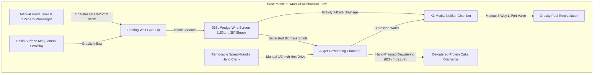

import { Card, CardGrid, LinkButton } from '@astrojs/starlight/components';

## Part 1: Stage Header & Executive Summary

> [!NOTE]
> **Stage Designation:** Stage 0 (Zero-Power Baseline)  
> **Operating Mode:** 100% Mechanical Manual Fallback  
> **Power Consumption:** 0 Watts (Zero Electrical Input Required)  
> **Resilience Rating:** Continuous Off-Grid / EMP / Submersion Proof  
> **Decoupling Standard:** Friction Slip-Clutch / Quick-Release Cam Linkage  

The Stage 0 baseline build of the **Fluidic Skimmer & Dewatering Separator** is a **100% mechanical, zero-power agricultural machine**. It operates entirely by human leverage, manual hand cranks, counterweights, and gravity flows—providing complete food security and operational continuity during total grid blackouts.

---

## Part 2: Capability Delta (Features Introduced)

* **Zero-Power Resilience**: Operates indefinitely without batteries, solar controllers, or power supplies.
* **Direct Mechanical Leverage**: All actuation performed via hand cranks, manual levers, counterweights, or gravity siphoning.
* **Inherent Decoupling**: Built from the ground up with mechanical slip-clutches, quick-release clamps, or bypass valves to ensure motor upgrades never bind.

---

## Part 3: Isolated Stage 0 Bill of Materials (BOM)


### Base Machine Bill of Materials (BOM)

| Item | Part ID & Registry Link | Component & Specification | Sourcing / Supplier | Fab Type | Qty | Unit Cost | CAD Asset | Total Cost |
| :--- | :--- | :--- | :--- | :--- | :--- | :--- | :--- | :--- |
| **Base Build Total** | **Complete Zero-Electricity Manual Harvester** | **Off-grid mechanical baseline** | | | | | | **$180.00** |

---

## Part 4: Standalone Full SVG Blueprint


---

## Part 5: Step-by-Step Assembly & Operating Protocol

The following 5 sequential assembly steps guide the physical fabrication, mounting, and wiring of the Fluidic Skimmer & Dewatering Separator (0). Each procedural step is directly anchored by an isolated, reverse-deconstructed vector blueprint adhering to RFC-0010.

### Step 1.1: Flume Chassis Fabrication & Solvent Welding


1. **Alignment & Positioning:** WALL THICKNESS: 6.35mm | BASE LENGTH: 600mm
2. **Mechanical & Electrical Execution:** 1/4" cast acrylic or HDPE flume chassis with 48mm drain bulkhead hole and weir pivot slots.
3. **Quality Assurance & Verification:** Inspect fastener seating, verify clearances against the technical drawing, and ensure no binding across the full range of motion.


### Step 1.2: 316L Wedge-Wire Screen Installation


1. **Alignment & Positioning:** SLOT SIZE: 150µm | ANGLE: 38.0° DECLINE
2. **Mechanical & Electrical Execution:** Stainless wedge-wire screen (150µm slot, 300x400mm) seated at 38° decline against EPDM seals.
3. **Quality Assurance & Verification:** Inspect fastener seating, verify clearances against the technical drawing, and ensure no binding across the full range of motion.


### Step 1.3: Counterweighted Floating Weir Gate Mounting


1. **Alignment & Positioning:** PIVOT PIN: Ø12.0mm Delrin | FLOAT OFFSET: -2.0mm
2. **Mechanical & Electrical Execution:** Buoyant hollow weir gate with Ø12mm Delrin pivot pins and adjustable 1.2kg lead counterweight.
3. **Quality Assurance & Verification:** Inspect fastener seating, verify clearances against the technical drawing, and ensure no binding across the full range of motion.


### Step 1.4: Manual Dewatering Screw Press Assembly


1. **Alignment & Positioning:** CORE DIAMETER: 20mm | FLIGHT PITCH: 50mm
2. **Mechanical & Electrical Execution:** PETG progressive pitch auger in perforated sleeve with dual 608-2RS bearings and 1/2" hex speed crank.
3. **Quality Assurance & Verification:** Inspect fastener seating, verify clearances against the technical drawing, and ensure no binding across the full range of motion.


### Step 1.5: Biofilter Sump & 3-Way Manual Valve Plumbing


1. **Alignment & Positioning:** PORT: 1.5" NPT / Barb | BIOMEDIA: 10L K1 Micro
2. **Mechanical & Electrical Execution:** 1.5" Schedule 40 bulkhead with 3-way L-port bypass valve and 10L K1 micro filter biomedia sump.
3. **Quality Assurance & Verification:** Inspect fastener seating, verify clearances against the technical drawing, and ensure no binding across the full range of motion.


### Step-by-Step Operating Runbook (Zero-Power Baseline)

1. **Pre-Skim Inspection**: Verify the weir gate floats smoothly by deflecting the counterweight lever by hand. Inspect the wedge-wire face; brush off dried algae using a stiff nylon bristle brush.
2. **Weir Gate Deployment**: Slowly pull the counterweight hand lever downward 10 mm to 15 mm. Observe the water cascading over the weir lip, carrying floating duckweed fronds down the intake flume onto the wedge-wire screen.
3. **Biomass Concentration**: Allow gravity filtration to run for 5 to 10 minutes. Water drains through the 150 µm slots into the K1 biofilter sump while green fronds slide downward into the dewatering auger barrel.
4. **Manual Dewatering Pressing**: Slide the 1/2" hex speed-handle crank onto the auger drive shaft. Rotate clockwise at 15 to 20 RPM for 12 to 15 full revolutions. Fronds are compressed against the cone nozzle, expressing moisture through the perforated sleeve.
5. **Cake Harvesting**: Dense, dewatered green protein paste (approx. 82% moisture) extrudes from the discharge cone. Collect the cake directly into a food-grade harvest tote.
6. **Flume Gate Closure**: Release the counterweight lever; the counterweight automatically pulls the weir gate upward, sealing off surface flow.
7. **Gravity Drainage Flush**: Rotate the 3-way manual ball valve handle to Position A for 30 seconds to flush settled solids out the bottom drain port.

### Base Machine Blueprint & Elevation Profile

```text
========================================================================================
BASE MACHINE MECHANICAL ELEVATION & KINEMATICS BLUEPRINT (ZERO-POWER BASELINE)
All dimensions in millimeters [mm] | Datum Z=0.00 at South Coping Surface
========================================================================================

                 [Adjustable Counterweight: 1.2 kg]
                                  │
                                 ┌┴┐
             [Hand Lever] ═══════╡ ╞══════════════════════════════════╗ (Counterweight Arm)
                                 └┬┘                                  ║
                                  │ Pivot Pin (Delrin, Ø12mm)         ║ Linkage Rod
                                                                      ▼
 WATER SURFACE ────────────────────────────────────────┐          ┌───────┐
 ~~~~~~~~~~~~~ [Surface Duckweed Mat: 4-12mm] ~~~~~~~~ │  Flow    │Floating│ [Weir Gate Lip]
                                                       ▼ ───────► │ Weir  │ (Travel: 0-25mm)
   ┌──────────────────────────────────────────────────────────────┴───────┴──────┐
   │ INLET FLUME (Food-Grade Acrylic/HDPE, Width: 600mm, Length: 400mm)         │
   │                                                                             │
   │     Duckweed + Water Inflow                                                 │
   │     ═══════════════════════════════════════╗                                │
   │                                            ▼                                │
   │                             ┌───────────────────────────────┐               │
   │                             │  316L Stainless Wedge-Wire   │               │
   │                             │  Screen (150µm Slot Width,   │               │
   │                             │   Declination: 38° Angle)    │               │
   │                             └──────────────┬────────────────┘               │
   │                                            │ Separated Fronds               │
   │    Clarified Filtrate Return               ▼                                │
   │    ┌─────────────────────────── [Auger Dewatering Chamber] ────────────────┐│
   │    │                                                                       ││
   │    │  [Removable Crank]         PETG Continuous Screw Flight               ││
   │    │      ┌───┐             ┌───┬───┬───┬───┬───┬───┬───┐    Discharge Chute│
   │    │  (C) │   ╞═════════════╡ / │ / │ / │ / │ / │ / │ / ╞═══► [Protein     ││
   │    │      └───┘             └───┴───┴───┴───┴───┴───┴───┘     Paste Out]   ││
   │    │  1/2" Hex Socket        Perforated Stainless Sleeve                   ││
   │    └───────────────────────────────────────┬───────────────────────────────┘│
   │                                            │ Expressed Liquid               │
   │                                            ▼                                │
   │  GRAVITY RETENTION SUMP                                                     │
   │  ┌────────────────────────────────────────────────────────────────────────┐ │
   │  │ K1 Micro Biomedia Chamber (10 Liters Moving Bed)                      │ │
   │  └────────────────────────────────────┬───────────────────────────────────┘ │
   └───────────────────────────────────────┼─────────────────────────────────────┘
                                           ▼
                       3-Way Manual L-Port PVC Ball Valve (Ø1.5")
                                   ┌───────┴───────┐
                      [Position A] │               │ [Position B]
                     Gravity Sump  ▼               ▼ Direct Pond/Basin Return
========================================================================================
```

### Base Kinematics & Gravity Flow



---

---

## Part 6: Guided Stage Navigation

<CardGrid>
  <Card title="Subsystem Overview" icon="left-arrow">
    Return to the machine overview, crop affinity matrix, and multi-stage comparison.
    <br/><br/>
    <LinkButton href="/open-biosphere/hardware/fluidic-skimmer-loop/" variant="minimal">← Return to Overview</LinkButton>
  </Card>
  <Card title="Stage 1: BLE Electromechanical Pack" icon="right-arrow">
    Ready to motorize this machine? Upgrade with DC actuation and Flutter BLE Virtual Panel controls.
    <br/><br/>
    <LinkButton href="/open-biosphere/hardware/fluidic-skimmer-loop/stage-1/" variant="primary">Proceed to Stage 1 Upgrade →</LinkButton>
  </Card>
</CardGrid>
