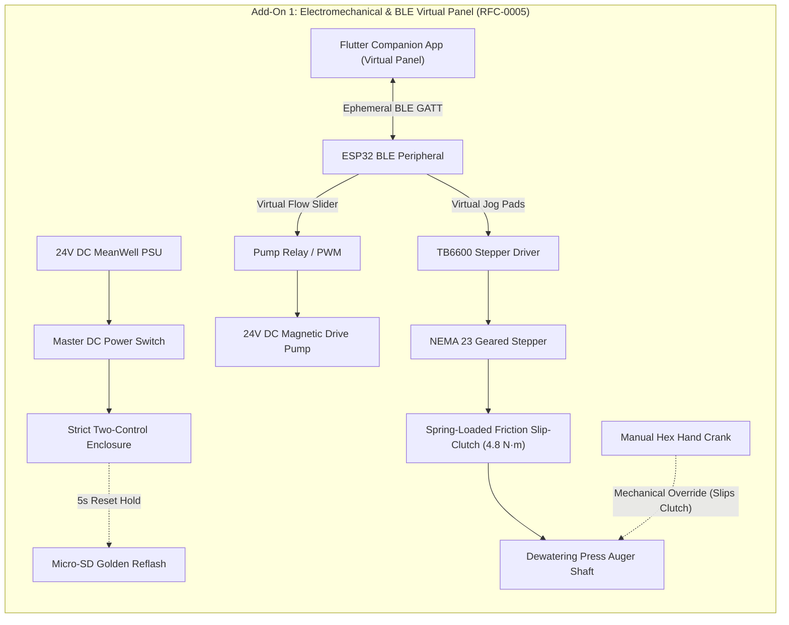

import { Card, CardGrid, LinkButton } from '@astrojs/starlight/components';

## Part 1: Stage Header & Executive Summary

> [!NOTE]
> **Stage Designation:** Stage 1 (Semi-Autonomous Electromechanical Pack)  
> **Operating Mode:** DC Motorized Continuous Duty with Ephemeral BLE Virtual Panel  
> **Power Requirement:** 12V / 24V DC Industrial Bus  
> **Physical Interlocks:** Strict Two-Control Standard (Master DC Cut + Recessed SD Factory Restore)  
> **Operator Interface:** Ephemeral Flutter Mobile Companion App over BLE GATT  

The Stage 1 electromechanical pack motorizes the **Fluidic Skimmer & Dewatering Separator**, adding continuous DC motor/pump drive governed by the **Strict Two-Control Physical Standard** (RFC-0005) and an ephemeral **Flutter Companion App Virtual Panel** over direct local BLE.

---

## Part 2: Capability Delta (Features Introduced)

* **Continuous Motorized Actuation**: Replaces human manual cranking with high-efficiency DC gearmotors, steppers, or booster pumps.
* **Strict Two-Control Physical Standard**: Eliminates physical jog buttons and potentiometer dials to prevent moisture breach and priority race conditions. Only Master DC Switch and Recessed SD Reset Button are permitted on hardware.
* **Ephemeral BLE Virtual Panel**: Jogging, speed sliders, and priming pulses execute via the Flutter companion app over direct local BLE GATT.
* **100% Preserved Manual Fallback**: Slip-clutches, bypass valves, or belt releases guarantee instant zero-power manual hand operation without disassembly.

---

## Part 3: Isolated Stage 1 Bill of Materials (BOM)

### Add-On 1 Bill of Materials (BOM)
*Adds motorized pumping, electric auger dewatering drive, Strict Two-Control hardware, and Flutter BLE Virtual Panel.*

| Item Category | Component Name & Description | Sourcing / Standard Part | Est. Cost (USD) |
| :--- | :--- | :--- | :--- |
| **Water Pump** | 24V DC Brushless Magnetic Drive Pump (80W–120W, 55 GPM) | Solar fountain / pond pump | $58.00 |
| **Motorized Auger** | NEMA 23 High-Torque Geared Stepper Motor | 3D printer / CNC stepper supplier | $32.00 |
| **Two-Control Enclosure** | IP67 ABS Box + Master DC Power Switch + Recessed SD Reset Button + 0.91" OLED | Industrial electrical supply | $24.00 |
| **Motor Drivers & BLE** | Dual-Channel TB6600 Driver + Pump Relay + ESP32 BLE Virtual Panel Controller | Standard maker electronics | $18.00 |
| **Power Supply** | 24V 150W MeanWell Industrial Power Supply + Inline Breaker Fuse | Standard electrical supply | $28.00 |
| **Add-On 1 Direct Cost** | **Electromechanical Power Upgrade** | **Adds to Base Machine** | **+$160.00** |
| **Cumulative Total** | **Operational Semi-Autonomous Harvester** | **Base + Add-On 1** | **$340.00** |

---

---

## Part 4: Standalone Full SVG Blueprint


### Add-On 1 Electromechanical Wiring & BLE Virtual Panel Blueprint

```text
========================================================================================
ADD-ON 1 ELECTROMECHANICAL SCHEMATIC & BLE VIRTUAL PANEL BLUEPRINT
Strict Two-Control Physical Standard (RFC-0005) with Ephemeral Flutter BLE Control
========================================================================================

    [24V DC 150W MeanWell PSU] ──[Heavy-Duty DC Power Switch]──┬── (24V Power Bus)
                                                               └── (GND Return Bus)
                                                                         │
   ┌──────────────── STRICT TWO-CONTROL JUNCTION BOX ──────────────────┐│
   │                                                                   ││
   │  [Master DC Power Switch]      ["Nuke & Pave" SD Reset Button]    ││
   │   Inline Mechanical Cut         Recessed Tactile Switch (5s hold) ││
   │                                                                   ││
   │  [Micro-SD Card Slot Module]   [0.91" I2C Status OLED Display]    ││
   │   Preloaded golden .bin         Displays [SKIMMER-A1 | BLE READY] ││
   │                                                                   ││
   │  [ESP32 BLE GATT Peripheral] ◄─── (Ephemeral Mobile Link) ───────┼│
   └───────────────────┬───────────────────────────────────────────────┘│
                       │                                                │
                       ▼ (Driver STEP/DIR & Relay Triggers)             │
   ┌────────────────── DRIVE TRAIN & MOTORS ───────────────────────────┐│
   │                                                                   ││
   │  24V DC Brushless Magnetic Pump (55 GPM) ◄── High-Current Relay ──┘│
   │                                                                    │
   │  NEMA 23 Geared Stepper Motor ◄── TB6600 Stepper Driver ───────────┘
   │         │
   │         ▼ (Motor Output Shaft)
   │     ┌───────┐
   │     │ ░░░░░ │ Friction Spring Slip-Clutch (Torque Limit: 4.8 N·m)
   │     └───────┘ [SLIPS ON MANUAL CRANK OR OVERTORQUE]
   │         │
   │         ▼ (Auger Drive Shaft)
   │    ═════╪══════════════════════════════════════════════════╗
   │         │                                                  ║
   │   [Auger Screw Press]                                [1/2" Hex Socket]
   │   (Motor driven OR hand cranked simultaneously)       (Hand Crank Ready)
   └────────────────────────────────────────────────────────────────────┘
========================================================================================
```

---

## Part 5: Step-by-Step Retrofit, Wiring & Operating Protocol

Under [RFC-0005](/rfcs/rfc-0005-hardware-interlocks-ble-virtual-panel), physical control panels with dedicated jog buttons, dials, and potentiometers are banned across all machine tiers to eliminate water ingress and control priority contention. 

Add-On 1 introduces **motorized pumping and electric auger pressing** governed by the **Strict Two-Control Physical Standard**:
1. **Master Hardware DC Power Switch**: Mechanically disconnects 24V power.
2. **"Nuke & Pave" SD Factory Restore Button**: Dedicated recessed tactile switch wired to trigger an automatic re-flash from micro-SD storage.

All manual jogging, auger jam clearing, and pump speed adjustments are executed via the **Flutter Companion App Virtual Panel** over direct local BLE.

### Electromechanical Actuation & Controls
- **Motorized Circulation**: A 24V DC brushless magnetic-drive pump (55 GPM) circulates water across the weir flume without manual siphoning.
- **Electric Auger Drive**: A high-torque NEMA 23 stepper motor couples to the auger shaft via an inline spring-loaded friction slip-clutch. If the auger jams or power is cut, an operator can insert the manual hand crank and turn the auger without back-driving or damaging the stepper.
- **Strict Two-Control Enclosure**: An IP67 waterproof junction box mounted on the side flume contains:
  - Heavy-duty toggle switch directly isolating the 24V DC supply line.
  - Recessed tactile button next to the 0.91" I2C OLED display for 5-second SD recovery reflash.
  - Micro-SD card slot module pre-loaded with golden recovery `firmware.bin` and `config.default`.
- **Ephemeral BLE Virtual Panel**: When nearby, an operator opens the Flutter companion app on their phone or tablet. The app auto-discovers the skimmer over BLE GATT and displays real-time virtual touch pads: Forward Jog, Reverse Jam Purge, and a Pump Flow Rate slider (45 to 75 GPM).

### Step-by-Step Retrofit & Electromechanical Wiring Protocol

```text
Step 2.1: 24V Circulation Pump Plumbing Installation
  ├── Mount 24V brushless magnetic-drive pump onto vibration-damping silicone isolator pads.
  ├── Connect pump suction port to sump outlet via 1.5" flexible reinforced PVC hose.
  ├── Plumb pump discharge into flume circulation manifold with an inline check valve.
  └── Install manual isolation ball valve on pump suction to enable pump servicing without draining.

Step 2.2: NEMA 23 Stepper & Slip-Clutch Mechanical Coupling
  ├── Bolt 4:1 planetary reduction NEMA 23 stepper motor onto 3D-printed PETG side motor bracket.
  ├── Install spring-loaded friction slip-clutch (calibrated to 4.8 N·m) onto 8mm motor output shaft.
  ├── Mate clutch output hub directly to the auger 1/2" hex drive shaft using M6 cross-pin.
  └── Verify hex hand crank still fits securely onto rear shaft stub for simultaneous manual override.

Step 2.3: Two-Control Enclosure Assembly
  ├── Mount IP67 polycarbonate junction box on outer coping rail.
  ├── Install heavy-duty inline 24V DC toggle switch on the positive power entry lead.
  ├── Install recessed tactile push-button wired to secondary bootloader recovery GPIO pin.
  ├── Insert micro-SD card slot module preloaded with golden firmware.bin and config.default.
  └── Mount 0.91" I2C OLED display showing [SKIMMER-A1 | BLE READY].

Step 2.4: Driver, BLE Peripheral & Power Distribution Wiring
  ├── Mount MeanWell 24V 150W power supply (LRS-150-24) inside sheltered enclosure with 10A fuse.
  ├── Wire TB6600 stepper driver and high-current pump relay to ESP32 BLE peripheral controller.
  ├── Verify BLE GATT service advertises [SKIMMER-VIRTUAL-PANEL] upon power-up.
  └── Flash ESP32 firmware with Virtual Panel peripheral profile (supports touch jog and flow sliders).

Step 2.5: Slip-Clutch Torque Verification
  ├── Fix auger flight with a wooden block to simulate a heavy branch/debris jam.
  ├── Trigger Forward Jog from Flutter mobile app; observe slip-clutch slipping smoothly without motor stalling.
  ├── Insert manual speed-handle crank and rotate by hand against motor holding torque.
  └── Clutch slips smoothly, verifying operator hand operation cannot back-feed or damage the motor.
```

### Step-by-Step BLE Virtual Panel Operating Runbook

1. **Power Initialization**: Flip the heavy-duty 24V master DC power switch to ON. The onboard 0.91" OLED illuminates: `[SKIMMER-A1 | BLE STANDBY]`.
2. **Walk-Up BLE Virtual Panel Connection**: Open the Flutter companion app on mobile device. Select `SKIMMER-A1` from discovered BLE peripherals. The app instantly renders the Skimmer Virtual Panel.
3. **Circulation Flow Adjustment**: Drag the virtual flow slider in the Flutter app to set desired skimming flow (45 to 75 GPM). The brushless pump ramps smoothly to target speed.
4. **On-Demand Dewatering Pressing**: When duckweed fronds accumulate against the wedge-wire screen, press and hold the **Virtual Forward Jog Pad** in the app. The auger rotates at 30 RPM, pressing protein paste out the nozzle. Release pad to stop.
5. **Jam Clearing Recovery**: If debris jams the auger, tap the **Virtual Reverse Purge Button** in the app. The motor reverses 5 full turns, clearing the blockage. Tap Forward Jog to resume extrusion.
6. **"Nuke & Pave" SD Recovery Protocol**: If firmware hangs or configuration deadlocks, hold the physical recessed reset button for 5 seconds during power-on. The bootloader reflashes factory baseline firmware from micro-SD in 4 seconds.
7. **Immediate Manual Fallback**: If power is severed, insert the manual 1/2" hex hand crank and rotate manually—the friction slip-clutch slips smoothly at 4.8 N·m, enabling instant zero-electricity operation.


### Add-On 1 Signal & Override Flow



---

## Part 6: Guided Stage Navigation

<CardGrid>
  <Card title="Stage 0: Zero-Power Baseline" icon="left-arrow">
    Review the underlying manual chassis, fabrication tolerances, and mechanical fallback linkage.
    <br/><br/>
    <LinkButton href="/open-biosphere/hardware/fluidic-skimmer-loop/stage-0/" variant="minimal">← Previous: Stage 0 Baseline</LinkButton>
  </Card>
  <Card title="Stage 2: Agentic Autonomous AI Pack" icon="right-arrow">
    Ready for full closed-loop autonomy? Integrate the Controller-Node-Tool mesh and local neural vision.
    <br/><br/>
    <LinkButton href="/open-biosphere/hardware/fluidic-skimmer-loop/stage-2/" variant="primary">Proceed to Stage 2 Upgrade →</LinkButton>
  </Card>
</CardGrid>
