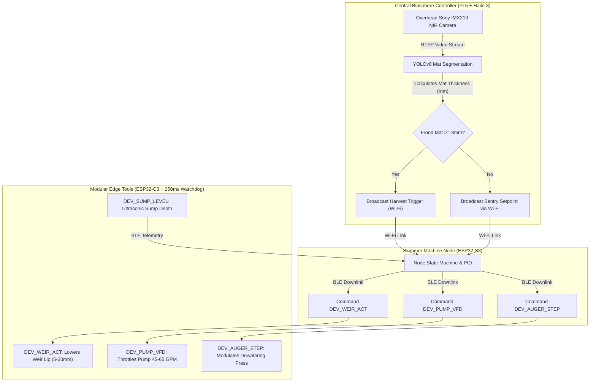

import { Card, CardGrid, LinkButton } from '@astrojs/starlight/components';

## Part 1: Stage Header & Executive Summary

> [!NOTE]
> **Stage Designation:** Stage 2 (Agentic Autonomous AI Pack)  
> **Operating Mode:** 24/7 Closed-Loop Autonomous Neural Telemetry & Robotics  
> **Network Mesh:** Encrypted Isolated Farm Wi-Fi (<code>POTFRM-4096</code> on 192.168.42.0/24) + BLE Tool Downlinks  
> **Safety Interlocks:** 250ms Hardware Deadman Watchdogs on all Edge Tools  
> **Edge AI Engine:** <code>llama-cpp-python</code> Local GGUF Multimodal Vision (Zero Cloud Dependence)  

The Stage 2 agentic pack elevates the **Fluidic Skimmer & Dewatering Separator** into a fully autonomous cyber-physical robotics cell operating under the **Controller-Node-Tool (CNT)** standard (RFC-0004) and **Agnostic Controller Runtime** (RFC-0006).

---

## Part 2: Capability Delta (Features Introduced)

* **Controller-Node-Tool (CNT) Hierarchy**: Heavy neural perception runs on the Central Biosphere Controller; the Machine Node coordinates local kinematics; tiny Edge Tools drive motors 1:1.
* **Isolated Farm AP Mesh**: Secure, air-gapped local Wi-Fi (<code>POTFRM-&lt;CLUSTER_ID&gt;</code> on <code>192.168.42.0/24</code>) with WebSocket node registration at <code>ws://192.168.42.1:8443/register</code>.
* **250ms Hardware Deadman Watchdogs**: Every Tool trips into safe, high-Z, zero-power state within 250 ms if signal is interrupted.
* **Local Zero-Cloud Edge AI**: Multi-agent perception via <code>llama-cpp-python</code> local vision models without internet dependencies.

---

## Part 3: Isolated Stage 2 Bill of Materials (BOM)

### Add-On 2 Bill of Materials (BOM)
*Integrates the Controller-Node-Tool (CNT) architecture: ESP32-S3 Machine Node, modular ESP32-C3 Edge Tools with OLED status screens, and 250ms hardware watchdogs.*

| Item Category | Component Name & Description | Sourcing / Standard Part | Est. Cost (USD) |
| :--- | :--- | :--- | :--- |
| **Machine Node** | ESP32-S3 Dual-Core (8MB PSRAM) + 0.96" OLED + Master DC Cut + SD Reset & Micro-SD Module | Espressif / maker distributor | $16.00 |
| **Modular Edge Tools** | 3x ESP32-C3 Micro Boards with 0.42" Micro OLED Displays & 250ms Watchdog (Weir, Auger, Pump) | Microcontroller supplier | $21.00 |
| **Sump Telemetry Tool** | 1x ESP32-C3 Micro Board + JSN-SR04T Ultrasonic Sensor + Dual Optical Float Switches | Maker electronics | $18.00 |
| **Linear Actuator** | 12V Micro Linear Actuator (50mm stroke with analog potentiometer feedback) | Robotics actuator supplier | $28.00 |
| **Enclosures & Wiring** | IP67 ABS Weatherproof Junction Box, DC Power Distribution Tap & Antenna Rigging | Standard electrical supply | $14.00 |
| **Add-On 2 Direct Cost** | **Autonomous Controller-Node-Tool Upgrade** | **Adds to Base + Add-On 1** | **+$97.00** |
| **Full Build Total** | **Complete Autonomous Closed-Loop Biosphere Skimmer** | **Base + Add-On 1 + Add-On 2** | **$437.00** |

---

---

## Part 4: Standalone Full SVG Blueprint


### Add-On 2 Cyber-Physical Edge Architecture Blueprint

```text
========================================================================================
ADD-ON 2 CONTROLLER-NODE-TOOL (CNT) HIERARCHICAL EDGE ARCHITECTURE BLUEPRINT
Decoupled Neural Perception, Dual-Core Machine Node & 250ms Watchdog Edge Tools
========================================================================================

            CENTRAL BIOSPHERE CONTROLLER (Agnostic Runtime / POTFRM-4096)
            • Emits Isolated Farm AP: SSID [POTFRM-4096] (192.168.42.0/24)
            • Host Status Output: OLED / CLI / Beacon: [POTFRM-4096]
            • YOLOv8 Canopy Biomass Vision & Global Biosphere Coordination
                                       │
                                       │ Isolated Farm Wi-Fi (192.168.42.0/24)
                                       ▼
     ┌─────────────────────── SKIMMER NODE (ESP32-S3) ────────────────────────┐
     │  • Mini I2C OLED Status Display: [NODE: SKIMMER-01 | LINK -> 4096]       │
     │  • Physical Setup Push-Button for Mobile Companion BLE Provisioning     │
     │  • Wi-Fi Client Uplink to Controller | BLE Central Downlink to Tools    │
     │  • Coordinates Local Harvesting Logic & Fail-Safe Watchdogs            │
     └─────────────────────────────────┬──────────────────────────────────────┘
                                       │
            ┌──────────────────────────┼──────────────────────────┐
            │ Low-Power BLE Downlink   │ Low-Power BLE Downlink   │
            ▼                          ▼                          ▼
 ┌──────────────────────┐   ┌──────────────────────┐   ┌──────────────────────┐
 │  TOOL: DEV_WEIR_ACT  │   │ TOOL: DEV_AUGER_STEP │   │  TOOL: DEV_PUMP_VFD  │
 │  ESP32-C3 Edge Micro │   │ ESP32-C3 Edge Micro  │   │  ESP32-C3 Edge Micro │
 │  0.42" OLED Screen   │   │ 0.42" OLED Screen    │   │  0.42" OLED Screen   │
 │  250ms Deadman Timer │   │ 250ms Deadman Timer  │   │  250ms Deadman Timer │
 │  12V Linear Actuator │   │ NEMA 23 Auger Stepper│   │  Pump VFD Throttle   │
 └──────────────────────┘   └──────────────────────┘   └──────────────────────┘
            │
            ▼ (BLE Downlink)
 ┌──────────────────────┐
 │ TOOL: DEV_SUMP_LEVEL │
 │  ESP32-C3 Edge Micro │
 │  0.42" OLED Screen   │
 │  250ms Deadman Timer │
 │  Ultrasonic + Floats │
 └──────────────────────┘
========================================================================================
```

---

## Part 5: Step-by-Step Commissioning, Provisioning & Autonomous Runbook

Under [RFC-0004](/rfcs/rfc-0004-controller-node-tool) and [RFC-0006](/rfcs/rfc-0006-agnostic-controller-runtime), Add-On 2 transforms the skimmer into a **hierarchical Controller-Node-Tool (CNT) cyber-physical harvester**. Monolithic on-machine SBCs and brittle CAN transceivers are eliminated; the machine operates as a dedicated **Machine Node** commanding modular **Edge Tools** over BLE, orchestrated by the Central Biosphere Controller over isolated farm Wi-Fi (`POTFRM-4096`).

### Autonomous Vision, Telemetry & Multi-Agent Control
- **Decoupled Optical Frond Profiling**: The overhead Sony IMX219 NIR camera streams directly to the Central Controller (Agnostic Runtime, e.g. Raspberry Pi 5 + Hailo-8 or x86 Host). The Central Controller executes morphological neural mat segmentation, determining when surface *Wolffia* thickness exceeds 8.0 mm and dispatching harvest commands to the Skimmer Node.
- **Skimmer Subsystem Node (ESP32-S3)**: A mid-tier ESP32-S3 with PSRAM mounted in an IP67 enclosure. Features an onboard 0.96" I2C OLED display (`[NODE: SKIMMER-01 | LINK -> 4096]`) and physical setup button. It maintains a secure Wi-Fi client uplink to the Central Controller and acts as a BLE Central aggregator managing downstream local Tools.
- **Dedicated Modular Edge Tools (ESP32-C3)**: Actuators and sensors are driven 1:1 by tiny ESP32-C3 micro-controllers equipped with 0.42" micro OLED displays and uncompromising **250ms hardware deadman watchdogs**:
  - `DEV_WEIR_ACT`: Governs the 12V micro linear actuator with analog position feedback to lower the weir lip (5–20 mm) dynamically.
  - `DEV_AUGER_STEP`: Governs the NEMA 23 stepper driver for dewatering screw torque and rotational speed.
  - `DEV_PUMP_VFD`: Regulates brushless pump speed via PWM/DAC interface (15–65 GPM).
  - `DEV_SUMP_LEVEL`: Collects JSN-SR04T ultrasonic sump depth and optical dry-run float telemetry with hardware cavitation trip.
- **250ms Deadman Watchdog Fail-Safe**: If any Tool loses BLE connection to the Skimmer Node for $> 250$ ms, it drops immediately into high-Z safe state: the weir actuator freezes, the pump throttle cuts to zero, and the auger stepper cuts holding torque to 0.

### Step-by-Step Sensor Commissioning & Edge AI Protocol

```text
Step 3.1: Overhead Optical Sensor Rigging & Stream Setup
  ├── Mount rigid aluminum 2020 cross-strut above the flume intake at elevation Z = 1,400mm.
  ├── Install Sony IMX219 8-Megapixel NIR camera with 850nm optical bandpass filter in weather-hood.
  ├── Connect camera to local video transmitter streaming RTSP frames over local Wi-Fi to Central Controller.
  └── Calibrate lens focus to a sharp 300mm x 400mm field of view centered on the floating weir lip.

Step 3.2: Linear Actuator Linkage & Weir Tool Rigging
  ├── Disconnect Stage 1 manual counterweight rod from the weir gate arm.
  ├── Pin 12V micro linear actuator (50mm stroke, 150N force, internal 10k potentiometer) to weir yoke.
  ├── Wire actuator motor leads and potentiometer wiper to DEV_WEIR_ACT tool controller (ESP32-C3).
  └── Mount 0.42" micro OLED on tool bracket; verify screen reads [TOOL: WEIR_ACT | LINK: OK].

Step 3.3: Sump Telemetry & Cavitation Protection Tool
  ├── Mount waterproof JSN-SR04T ultrasonic sensor perpendicular to sump water surface at Z=+350mm.
  ├── Install optical float switch in pump intake sump; wire directly to DEV_SUMP_LEVEL tool (ESP32-C3).
  ├── Verify hardware interrupt: dry-run float trip immediately asserts pump stop primitive in <5ms.
  └── Mount 0.42" micro OLED; verify screen reads [TOOL: SUMP_LEVEL | LINK: OK].

Step 3.4: Skimmer Node Provisioning & BLE Tool Binding
  ├── Mount ESP32-S3 Node with 0.96" I2C OLED display and physical setup push-button inside IP67 enclosure.
  ├── Power up Skimmer Node; onboard display shows [NODE UNPAIRED - PAIR VIA BLE].
  ├── Press physical setup button; connect mobile companion app to Node over BLE.
  ├── Enter the 4-digit Cluster ID (e.g. 4096) displayed on Central Controller OLED, terminal stdout, or BLE beacon.
  ├── Node commits credentials to NVS, connects to POTFRM-4096, registers at ws://192.168.42.1:8443/register, and updates OLED to [ONLINE | LINK -> 4096].
  └── Node scans BLE advertising channels, auto-binding DEV_WEIR_ACT, DEV_AUGER_STEP, DEV_PUMP_VFD, and DEV_SUMP_LEVEL.

Step 3.5: 250ms Watchdog & Fail-Safe Verification
  ├── Trigger test BLE signal disconnection between Skimmer Node and DEV_AUGER_STEP tool.
  ├── Verify hardware watchdog timer trips within exactly 250ms, dropping stepper current to 0.0A.
  └── Restore BLE link; confirm tool resumes idle operational state automatically.
```

### Step-by-Step Autonomous Multi-Agent Runbook

1. **Self-Diagnostic Boot & Handshake Sequence**: Upon boot, Skimmer Node queries all bound BLE Tools:
   - Verifies `DEV_SUMP_LEVEL` reads between 150 mm and 280 mm (normal sump depth).
   - Commands `DEV_WEIR_ACT` to cycle linear actuator to 0.0 mm (fully closed home).
   - Pings Central Controller over isolated farm Wi-Fi; registers active node status and displays `[NODE: SKIMMER-01 | LINK -> 4096]`.
2. **Autonomous Canopy Sentry (Sentry Mode)**:
   - Pump runs at minimum maintenance speed (15% duty cycle, 12 GPM) to prevent water stagnation.
   - Central Controller Hailo-8 NPU processes canopy camera frames every 5 seconds, calculating frond coverage percentage.
3. **Automated Skimming Sequence Activation**:
   - When frond mat thickness reaches $\ge 8.0$ mm, Central Controller dispatches `CMD_START_HARVEST` to Skimmer Node.
   - Skimmer Node signals `DEV_WEIR_ACT` over BLE to extend 14 mm, submerging the weir lip into the dense vegetative layer.
   - Skimmer Node signals `DEV_PUMP_VFD` over BLE to ramp pump speed to 65 GPM, drawing surface biomass across the wedge wire.
4. **Closed-Loop Dewatering Press Modulation**:
   - Skimmer Node commands `DEV_AUGER_STEP` to pulse auger motor at rate proportional to incoming biomass (15 to 45 RPM).
   - If auger torque exceeds 4.2 N·m (dense plug formation), `DEV_AUGER_STEP` automatically slows rotation to allow liquid expression.
5. **Autonomous Harvest Handshake with Ground AGV**:
   - A load cell under the harvest cake hopper tracks accumulated protein mass.
   - When hopper weight reaches 10.0 kg, Skimmer Node relays harvest alert to Central Controller via Wi-Fi.
   - Central Controller dispatches the Ground Track AGV to dock under the discharge chute and swap the collection tote.
   - Upon AGV docking confirmation, Skimmer resumes sentry mode and logs harvest metrics.
6. **250ms Failsafe Protective Interrupts**:
   - If water level drops below safe minimum, `DEV_SUMP_LEVEL` hardware interrupt halts pump power in $< 5$ ms.
   - If BLE connection between Node and any Tool drops for $> 250$ ms, the Tool immediately trips into safe state.
   - If Wi-Fi link to Central Controller is lost, Skimmer Node falls back to standalone local timer presets.


### Add-On 2 Autonomous Decision Loop



---

## Part 6: Guided Stage Navigation

<CardGrid>
  <Card title="Stage 1: BLE Electromechanical Pack" icon="left-arrow">
    Review the motorized powertrain, Two-Control enclosure wiring, and BLE Virtual Panel.
    <br/><br/>
    <LinkButton href="/open-biosphere/hardware/fluidic-skimmer-loop/stage-1/" variant="minimal">← Previous: Stage 1 Upgrade</LinkButton>
  </Card>
  <Card title="Subsystem Overview" icon="right-arrow">
    Return to the machine overview, crop affinity matrix, and master biosphere interlocks.
    <br/><br/>
    <LinkButton href="/open-biosphere/hardware/fluidic-skimmer-loop/" variant="primary">Return to Overview →</LinkButton>
  </Card>
</CardGrid>
