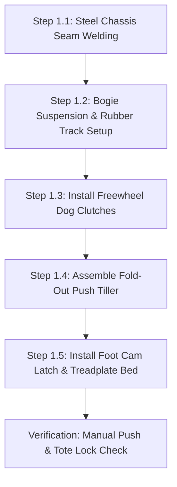
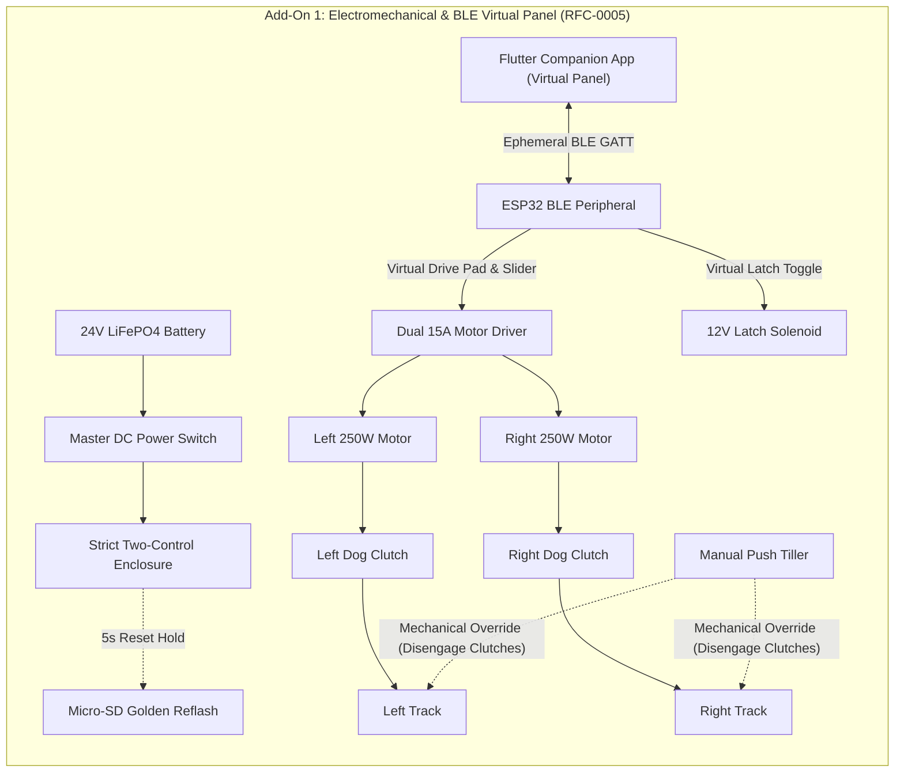
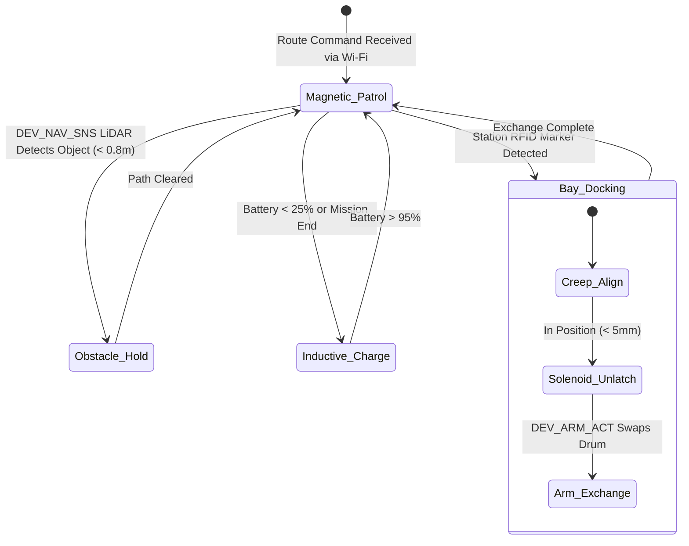

import { Card, CardGrid } from '@astrojs/starlight/components';

The **Ground Track AGV Pod Carrier** is an autonomous, low-profile tracked robot engineered for narrow-lane agricultural transport and selective harvesting. It operates independently as a homestead or greenhouse utility rover, or services the Perimeter Lower Tier of the master Open Biosphere assembly.

---

## 1. Standalone Homesteading & Off-Grid Utility

In greenhouses, hoop houses, and high tunnels, narrow aisles make traditional tractors and human carts cumbersome. This machine handles **heavy repetitive material shuttling, seedling tray transport, and low-canopy selective harvesting**:

<CardGrid>
  <Card title="Narrow-Aisle Rover" icon="truck">
    Ultra-compact chassis (350 mm width) turns in place on rubber tracks, easily navigating tight greenhouse aisles and rough earthen paths.
  </Card>
  <Card title="25 kg Cargo Capacity" icon="box">
    Pneumatic quick-docking latch carries seed drums, produce totes, compost tubs, or water reservoirs without manual lifting.
  </Card>
  <Card title="Simple Tape or LiDAR Guidance" icon="compass">
    Follows low-cost adhesive magnetic floor tape for bulletproof reliability, or pairs with 2D LiDAR for flexible SLAM navigation.
  </Card>
  <Card title="Selective Robotic Harvester" icon="scissors">
    Optional 3-axis articulated harvesting arm with soft silicone gripper and rotary shear picks low bush beans and peppers with stereo-depth precision.
  </Card>
</CardGrid>

---

## 2. Technical Specifications

| Parameter | Specification |
| :--- | :--- |
| **Chassis Dimensions** | 500 mm (L) × 350 mm (W) × 280 mm (H) |
| **Locomotion** | Dual continuous rubber tracks with suspension bogies (45 mm ground clearance) |
| **Payload Capacity** | 25 kg continuous payload on cargo bed |
| **Max Speed** | 0.8 m/s (programmable working speed: 0.2 to 0.4 m/s) |
| **Docking Interface** | Mechanical foot cam latch / 12V solenoid / Pneumatic quick-connect |
| **Harvest Arm** | Optional 3-axis articulated arm with soft silicone 2-finger clamp & rotary blade |
| **Battery System** | 24V 15Ah LiFePO4 pack (6+ hours runtime) with inductive floor charging pads |
| **Onboard Controller**| 0W (Manual) / Dual 15A DC Driver Pendant (Add-On 1) / ESP32-S3 + ROS2 (Add-On 2) |

---

## 3. Instructions (Base Zero-Power Machine)

The foundational build of the Ground Track AGV Pod Carrier is a **100% mechanical, zero-electricity tracked utility handcart**. Operating without batteries, motors, or wiring, it utilizes a fold-out steel tubular push-tiller, dual mechanical dog clutches for effortless freewheel rolling, and an ergonomic foot-pedal cam latch to lock and eject standardized agricultural totes.

### Mechanical Architecture & Decoupling Standard
1. **Tracked Bogie Frame**: A welded 2 mm sheet steel chassis houses two continuous rubber treads (50 mm width, 180 mm ground contact) driven across four spring-suspended bogie rollers per side.
2. **Freewheel Dog Clutch**: Both drive sprockets feature spring-loaded sliding dog clutches. A single quarter-turn lever disengages sprockets from the axle gears, allowing the machine to roll manually with less than 5 N rolling resistance.
3. **Fold-Out Push Tiller**: A tubular steel pull/push handle pivots from the chassis rear. It locks upright for ergonomic standing transport ($950$ mm handle height) or folds flush into the chassis deck for compact storage.
4. **Mechanical Foot Cam Latch**: Stepping on a spring-loaded foot pedal depresses a dual-jaw clamping wedge that grips the bottom rim of standard Euro-boxes or cylindrical bioreactor drums, locking cargo securely without power.

```
         GROUND TRACK AGV POD CARRIER — BASE MECHANICAL ELEVATION
  =================================================================
                  [Standard 25 kg Euro-Box or Sprout Canister]
           +-----------------------------------------------+
           |                                               |
           +-----------------------+-----------------------+
                                   |
         [Fold-Out Tiller]         v [Foot Cam Latch]
         (950 mm Height)   [Cargo Bed Deck: 500 x 350 mm]
               \                   |
                \     +------------+------------+
                 \    |  Steel Chassis Box      |
                  \===|                         |
                      +------------+------------+
                             /            \
           (Drive Sprocket) /              \ (Idler Sprocket)
               [===O===]  (Bogie)  (Bogie)  [===O===]
           ===========================================
             [Continuous Heavy-Duty Rubber Track Tread]
```

### Step-by-Step Fabrication & Assembly Protocol

#### Step 1.1: Chassis Cutting & Welding
1. Cut chassis floor and side plates from 2.0 mm mild steel sheet: one 500 × 280 mm floor plate, two 500 × 120 mm side rails, and two 280 × 120 mm end bulkheads.
2. Slot side rails for eight 10 mm bogie suspension swing-arm pivot pins.
3. Clamp chassis plates in a welding fixture and seam-weld corners with MIG (0.8 mm wire, 75/25 Ar/$CO_2$). Grind external welds flush.
4. Paint with rust-inhibiting zinc-phosphate primer and industrial enamel topcoat.

#### Step 1.2: Bogie Suspension & Rubber Track Assembly
1. Assemble four independent suspension bogies per side using 10 mm steel pivot arms and 80 mm OD polyurethane road wheels with dual 6000-2RS sealed bearings.
2. Pre-load each swing-arm with a 35 mm compression die spring ($k = 18\text{ N/mm}$), providing 25 mm of compliant vertical travel over uneven ground.
3. Mount the front adjustable idler sprockets with M10 threaded track-tensioner bolts.
4. Wrap continuous reinforced rubber tracks (50 mm wide, 38-link pitch) around sprockets and bogies. Tighten tensioners until track sag measures 12 mm mid-span under a 20 N downward force.

#### Step 1.3: Freewheel Dog Clutch Hub Installation
1. Machine or turn two sliding steel dog clutch collars with 3-tooth interlocking drive faces.
2. Mount the matching dog hubs onto the drive sprockets supported on 15 mm precision steel stub axles.
3. Install sliding shift forks linked to external quarter-turn red handle levers.
4. Verify mechanical neutral: when disengaged, tracks spin freely by hand with $< 0.1\text{ N}\cdot\text{m}$ drag torque.

#### Step 1.4: Fold-Out Push Tiller & Brake Rigging
1. Bend a 22 mm OD tubular steel U-shaped tiller handle with dual non-slip rubber handgrips.
2. Pivot-mount the tiller base to the rear chassis brackets using M8 shoulder bolts and Belleville spring washers.
3. Install a spring-loaded spring pin that locks the tiller at a 45° pushing angle, or releases it to fold flat.
4. Install a dead-man friction drag brake pad pressing against the rear idler wheel when the tiller is released.

#### Step 1.5: Foot Cam Latch & Cargo Bed Mounting
1. Mount a 480 × 330 mm 3 mm aluminum treadplate cargo bed atop the chassis deck with rubber vibration isolators.
2. Fabricate the foot-actuated cam latch: a spring-loaded steel rocker linkage connected to a textured 60 mm foot pedal protruding past the rear bumper.
3. Test tote retention: slide a standard 400 × 300 mm Euro-box onto the deck until the spring jaws click shut. Depress foot pedal; the jaws retract cleanly, allowing the tote to slide off.



### Step-by-Step Operating Runbook (Manual Mode)

1. **Pre-Trip Track Inspection**: Check rubber tracks for trapped gravel or vegetative debris. Verify idler tension bolt locknuts are snug.
2. **Deploying the Push Tiller**: Pull the spring release pin on the chassis rear deck; raise the tubular tiller handle until the pin clicks solidly into the 45° operational detent ($950$ mm height).
3. **Engaging Neutral Freewheel**: Verify that both red clutch levers on the side sprockets are pulled outward into the DISENGAGED (Neutral) position.
4. **Loading Produce Totes**: Slide a 25 kg tote or cylindrical sprout drum onto the aluminum cargo deck. Push forward until the foot cam latch clicks over the tote rim, locking it securely against tipping.
5. **Aisle Pushing & Skid-Steering**: Push the AGV by the tiller handles along greenhouse aisles. To turn, apply lateral force on the handles; the dual rubber tracks pivot smoothly on earthen or concrete pathways.
6. **Foot-Pedal Ejection**: Upon reaching the packing table or storage cellar, step firmly on the rear foot pedal. The latch jaws open, allowing the tote to slide forward effortlessly onto the transfer bench.
7. **Fold-Up Storage**: Pull the tiller spring pin, fold the handle forward flat against the cargo deck, and stow the AGV under a bench or vertical against a wall.

### Base Machine Bill of Materials (BOM)

| Item | Component Description | Sourcing / Part Reference | Qty | Unit Cost | Total Cost |
| :--- | :--- | :--- | :--- | :--- | :--- |
| **G-01** | Welded 2mm Steel Tracked Chassis Box & Bulkheads | Local metal fabrication | 1 | $35.00 | $35.00 |
| **G-02** | Continuous Rubber Track Treads (50mm W x 38-link) | Compact robotics supplier | 2 | $10.00 | $20.00 |
| **G-03** | Bogie Suspension Arms + Die Springs + Polyurethane Wheels | Machinery hardware kit | 8 | $3.50 | $28.00 |
| **G-04** | Sliding Steel Dog Clutch Neutral Hubs & Levers | Machined steel parts | 2 | $7.00 | $14.00 |
| **G-05** | Fold-Out 22mm Tubular Steel Tiller Handle + Grips | Hardware steel stock | 1 | $12.00 | $12.00 |
| **G-06** | Mechanical Foot-Pedal Spring Cam Clamp Assembly | Fabricated steel linkage | 1 | $10.00 | $10.00 |
| **Total** | **Base Zero-Power Push Cart Build** | **Complete off-grid manual carrier** | | | **$119.00** |

---

## 4. Add-On 1: Semi-Autonomous Electromechanical Pack (BLE Virtual Panel)

Under [RFC-0005](/rfcs/rfc-0005-hardware-interlocks-ble-virtual-panel), physical control boxes, rotary potentiometers, and tethered industrial pendants are banned across all machine tiers to eliminate cable snagging, moisture ingress, and priority contention. 

The **Semi-Autonomous Pack** converts the manual push cart into a heavy-duty motorized power tug governed by the **Strict Two-Control Physical Standard**:
1. **Master Hardware DC Power Switch**: Inline high-current switch mechanically isolating the 24V LiFePO4 battery pack.
2. **"Nuke & Pave" SD Factory Restore Button**: Dedicated recessed tactile switch that triggers an automatic hardware re-flash from micro-SD storage.

All manual jogging, steering, speed regulation, and tote unlatching are performed via the **Flutter Companion App Virtual Panel** over direct local BLE.

### Electromechanical Actuation Architecture & Decoupling
- **Drive Powertrain**: Dual 24V 250W brushed DC planetary gearmotors (18:1 reduction, 14 N·m torque per track) driving the sprockets through heavy-duty #25 roller chain.
- **Mechanical Decoupling**: The base sliding dog clutches are preserved intact. Flipping the red clutch levers disengages sprockets from motor chains, restoring 100% manual freewheel pushing in $< 2$ seconds.
- **Smart Motor Driver**: Dual-channel 15A continuous (30A peak) motor controller (Cytron MDDS30 or Sabertooth 2x12) with regenerative electric braking and thermal cutoffs.
- **Strict Two-Control Enclosure**: An IP65 aluminum electronics enclosure inside the battery deck contains:
  - Heavy-duty toggle switch directly isolating positive battery power.
  - Recessed tactile button next to the 0.91" I2C OLED display for 5-second SD recovery reflash.
  - Micro-SD card slot module pre-loaded with golden recovery `firmware.bin` and `config.default`.
- **Ephemeral BLE Virtual Panel**: Operators connect using the Flutter companion app on mobile device: Virtual Directional Drive Pad (Forward / Reverse / Differential Pivot), Drive Speed Touch Slider (0.1 to 0.8 m/s), and Tote Latch Solenoid Toggle.

### Step-by-Step Retrofit Protocol

```text
Step 2.1: Dual 250W Gearmotor Bracket Installation
  ├── Bolt steel motor mounting brackets to inner chassis side walls with M6 grade 8.8 bolts.
  ├── Mount two 24V 250W planetary gearmotors horizontally with drive shafts facing outward.
  ├── Install 9T #25 hardened drive sprockets onto 10mm keyed motor output shafts.
  └── Route #25 roller chains to 24T sprockets on dog clutch input hubs; tension to 6mm slack.

Step 2.2: LiFePO4 Battery & BMS Installation
  ├── Secure steel battery tray in lowest center section of chassis between track wells.
  ├── Seat 24V 15Ah LiFePO4 battery pack, clamping down with rubber-padded quick-release strap.
  └── Install inline 40A MIDI fuse block directly off positive battery terminal.

Step 2.3: Motor Controller & Solenoid Latch Wiring
  ├── Mount dual-channel 15A motor controller on aluminum standoffs against rear bulkhead.
  ├── Wire battery positive through master DC disconnect switch to controller B+ terminal.
  ├── Connect motor power leads using 12 AWG high-flex silicone wire.
  └── Replace manual foot latch with 12V 25N high-force push-pull solenoid wired through relay.

Step 2.4: Two-Control Enclosure Assembly
  ├── Mount IP65 enclosure above battery deck with master DC toggle and recessed SD reset button.
  ├── Insert micro-SD slot module pre-loaded with golden recovery firmware.bin and config.default.
  ├── Mount 0.91" I2C OLED display showing [AGV-A1 | BLE READY].
  └── Wire dual-channel motor controller PWM/DIR lines to ESP32 BLE peripheral controller.

Step 2.5: Differential Drive Calibration
  ├── Elevate AGV chassis on jackstands so rubber tracks clear the bench.
  ├── Turn master DC power switch ON. Open Flutter companion app and connect to AGV-A1 over BLE.
  ├── Test Virtual Drive Pad: verify forward, reverse, and pivot steering respond smoothly.
  └── Test dog clutch: flipping levers disengages motors, allowing effortless manual pushing.
```

### Step-by-Step BLE Virtual Panel Operating Runbook

1. **Power-On & BLE Check**: Flip the master DC power switch ON (blue status LED illuminates). The 0.91" OLED displays: `[AGV-A1 | BLE STANDBY]`.
2. **Engaging Drive Gearboxes**: Push both red mechanical dog clutch levers inward until drive teeth mesh solidly with sprockets.
3. **Walk-Up BLE Virtual Panel Connection**: Open Flutter companion app on mobile device. Connect to `AGV-A1`. The app displays the AGV Virtual Panel.
4. **Speed Regulation via Virtual Slider**: Set virtual speed slider to 30% for indoor walking pace ($0.3$ m/s).
5. **Motorized Material Hauling**: Walk alongside or behind AGV. Press and hold the **Virtual Forward Drive Pad** in app to traverse aisles. Release pad to engage regenerative electric braking (stops within 150 mm).
6. **Electronic Latch Actuation**: To unload cargo, tap the **Virtual Latch Toggle** in app; the 12V solenoid retracts latch wedge, allowing tote to slide onto transfer shelf.
7. **"Nuke & Pave" SD Recovery Protocol**: If firmware hangs, hold the physical recessed reset button for 5 seconds during power-on to restore factory baseline from micro-SD.
8. **Emergency Neutral Freewheeling**: If battery level drops below 10%, disengage both dog clutch levers to push the AGV by hand back to charging dock.

### Add-On 1 Electromechanical Wiring & BLE Virtual Panel Blueprint

```text
========================================================================================
ADD-ON 1 ELECTROMECHANICAL SCHEMATIC & BLE VIRTUAL PANEL BLUEPRINT
Strict Two-Control Physical Standard (RFC-0005) with Ephemeral Flutter BLE Control
========================================================================================

  [24V 15Ah LiFePO4 Pack] ──[40A Fuse]──[Master DC Power Switch]──┬── (24V Power Bus)
                                                                  └── (GND Return Bus)
                                                                            │
   ┌──────────────── STRICT TWO-CONTROL CHASSIS BOX ──────────────────────┐│
   │                                                                      ││
   │  [Master DC Power Switch]         ["Nuke & Pave" SD Reset Button]    ││
   │   Inline Mechanical Cut            Recessed Tactile Switch (5s hold) ││
   │                                                                      ││
   │  [Micro-SD Card Slot Module]      [0.91" I2C Status OLED Display]    ││
   │   Preloaded golden .bin            Displays [AGV-A1 | BLE READY]     ││
   │                                                                      ││
   │  [ESP32 BLE GATT Peripheral] ◄───── (Ephemeral Mobile Link) ────────┼│
   └───────────────────┬──────────────────────────────────────────────────┘│
                       │                                                   │
                       ▼ (Motor Controller PWM/DIR Signals)                │
   ┌────────────────── DRIVE TRAIN & MOTORS ──────────────────────────────┐│
   │                                                                      ││
   │  Dual-Channel 15A Smart DC Motor Driver ◄────────────────────────────┘│
   │       │                     │                                         │
   │       ▼                     ▼                                         │
   │  [Left 250W Motor]     [Right 250W Motor]                             │
   │       │                     │                                         │
   │       ▼ (Drive Chains)      ▼ (Drive Chains)                          │
   │  [Left Dog Clutch]     [Right Dog Clutch]                             │
   │  (Flippable Levers)    (Flippable Levers)                             │
   │       │                     │                                         │
   │       ▼                     ▼                                         │
   │  [Left Track]          [Right Track]                                  │
   │                                                                       │
   │  12V High-Force Latch Solenoid ◄── Relay Trigger ─────────────────────┘
   └───────────────────────────────────────────────────────────────────────┘
========================================================================================
```

### Add-On 1 Signal & Override Flow



### Add-On 1 Bill of Materials (BOM)

| Item | Component Description | Sourcing / Part Reference | Qty | Unit Cost | Total Cost |
| :--- | :--- | :--- | :--- | :--- | :--- |
| **A1-01** | 24V 250W Brushed DC Planetary Gearmotors (18:1 ratio) | Robotics drive supplier | 2 | $24.00 | $48.00 |
| **A1-02** | Dual-Channel 15A Smart DC Motor Driver Board | Cytron MDDS30 or equivalent | 1 | $38.00 | $38.00 |
| **A1-03** | Strict Two-Control Enclosure (Master DC Cut + SD Reset + Micro-SD Module + 0.91" OLED) | Maker electrical kit | 1 | $24.00 | $24.00 |
| **A1-04** | ESP32 BLE Virtual Panel Peripheral Controller | Maker electronics shop | 1 | $15.00 | $15.00 |
| **A1-05** | 24V 15Ah LiFePO4 Battery Pack with Built-In BMS | Solar / e-mobility store | 1 | $70.00 | $70.00 |
| **A1-06** | 12V High-Force 25N Push-Pull Latch Solenoid | Automation components shop | 1 | $18.00 | $18.00 |
| **Total** | **Add-On 1 Electromechanical Pack** | **Retrofits directly to Base** | | | **+$213.00** |
| **Cumul.** | **Operational BLE-Controlled Power Tug** | **Base ($119) + Add-On 1 ($213)** | | | **$332.00** |

---

## 5. Add-On 2: Agentic Autonomous AI Pack (Edge Vision & Closed Loop)

Under [RFC-0004](/rfcs/rfc-0004-controller-node-tool), the **Agentic Autonomous AI Pack** transforms the AGV into a hierarchical **Controller-Node-Tool (CNT)** autonomous logistics carrier. Operating as a dedicated **AGV Node** commanding modular **Edge Tools** over BLE, it receives route schedules from the Central Biosphere Controller over Wi-Fi, tracks magnetic floor tape, scans for obstacles via 2D LiDAR, and transfers harvest totes with 250ms watchdog safety.

### Autonomous Vision & Telemetry Architecture
- **AGV Machine Node (ESP32-S3)**: Dual-Core Xtensa LX7 (240 MHz, 8 MB PSRAM) mounted in a protected central tray. Features an onboard 0.96" I2C OLED display (`[NODE: AGV-01 | LINK -> 4096]`) and setup push-button for mobile BLE provisioning. Uplinks to Central Controller via Wi-Fi; coordinates local kinematics and downlinks to Tools via BLE Central.
- **Dedicated Modular Edge Tools (ESP32-C3)**: Driven 1:1 by micro ESP32-C3 controllers equipped with 0.42" micro OLED displays and **250ms hardware deadman watchdogs**:
  - `DEV_TRACK_DRV`: Micro ESP32-C3 with 0.42" OLED (`TOOL: TRACK_DRV | LINK: OK`) + 250ms watchdog driving dual 24V track motor drivers (PWM/DIR) with current sensing.
  - `DEV_NAV_SNS`: Micro ESP32-C3 with 0.42" OLED (`TOOL: NAV_SNS | LINK: OK`) reading the 5-channel magnetic induction guide sensor and 360° 2D LiDAR scanner.
  - `DEV_ARM_ACT`: Micro ESP32-C3 with 0.42" OLED (`TOOL: ARM_ACT | LINK: OK`) + 250ms watchdog driving 3-axis articulated canister transfer arm servos.
  - `DEV_CHARGE_CTL`: Micro ESP32-C3 with 0.42" OLED (`TOOL: CHARGE_CTL | LINK: OK`) regulating the 120W wireless inductive floor charging receiver.
- **250ms Deadman Watchdog Fail-Safe**: If any Tool loses BLE connection to the AGV Node for $> 250$ ms, it drops immediately into high-Z safe state: track motors stop instantly and drop holding torque to zero, and the transfer arm freezes in place.

```text
       CONTROLLER-NODE-TOOL (CNT) HIERARCHICAL EDGE ARCHITECTURE
  =================================================================
            CENTRAL BIOSPHERE CONTROLLER (Pi 5 + Hailo-8 M.2 HAT)
            • Emits Hidden WPA3 Wi-Fi Network | OLED: [CTRL_ID: 4096]
            • Global Logistics Routing, Zone Scheduling & Multi-Agent Dispatch
                                  │
                                  │ Encrypted Wi-Fi Uplink
                                  ▼
             ┌─────────────────────────────────────────┐
             │         AGV MACHINE NODE (ESP32-S3)     │
             │  • OLED Display: [NODE: AGV-01]         │
             │  • Setup Push-Button for Mobile BLE     │
             │  • Kinematics, PD Line Tracking & RTOS  │
             └────────────────────┬────────────────────┘
                                  │
         ┌────────────────────────┼────────────────────────┐
         │ BLE Downlink           │ BLE Downlink           │ BLE Downlink
         ▼                        ▼                        ▼
 ┌───────────────┐        ┌───────────────┐        ┌───────────────┐
 │ TOOL:         │        │ TOOL:         │        │ TOOL:         │
 │ DEV_TRACK_DRV │        │ DEV_NAV_SNS   │        │ DEV_ARM_ACT   │
 │ ESP32-C3 Micro│        │ ESP32-C3 Micro│        │ ESP32-C3 Micro│
 │ 0.42" OLED    │        │ 0.42" OLED    │        │ 0.42" OLED    │
 │ 250ms Deadman │        │ 250ms Deadman │        │ 250ms Deadman │
 │ Dual 24V PWM  │        │ 5-Ch Magnetic │        │ 3-Axis Servos │
 │ Track Drive   │        │ 2D LiDAR Scnr │        │ Canister Arm  │
 └───────────────┘        └───────────────┘        └───────────────┘
                                  │
                                  ▼ (BLE Downlink)
                          ┌───────────────┐
                          │ TOOL:         │
                          │ DEV_CHARGE_CTL│
                          │ ESP32-C3 Micro│
                          │ 0.42" OLED    │
                          │ 120W Inductive│
                          │ Battery BMS   │
                          └───────────────┘
```

### Step-by-Step Sensor Commissioning & Edge AI Protocol

#### Step 3.1: AGV Node & Driver Assembly
1. Mount the ESP32-S3 Node with 0.96" I2C OLED display and physical setup push-button in the electronics tray above the battery deck.
2. Mount the `DEV_TRACK_DRV` tool board (ESP32-C3) and connect its PWM and DIR lines directly to the dual 15A motor driver inputs.
3. Verify driver current sensing and stall detection under track load.

#### Step 3.2: 5-Channel Magnetic Induction & LiDAR Integration
1. Mount the 5-channel magnetic sensor bar beneath the front chassis bumper ($20$ mm road clearance).
2. Mount the RPLiDAR C1 scanner on the elevated 150 mm center mast above the cargo bed.
3. Wire both sensors to the `DEV_NAV_SNS` tool board (ESP32-C3); verify magnetic line tracking and obstacle point cloud over tool OLED.

#### Step 3.3: 3-Axis Articulated Transfer Arm Mounting
1. Bolt the 3-axis mini transfer arm base to the front-right chassis corner.
2. Connect the three metal-gear servos (base pan, shoulder pitch, gripper clamp) to `DEV_ARM_ACT` tool board (ESP32-C3).
3. Program calibration positions: Stowed, Reaching, Gripping, and Lifted.

#### Step 3.4: Inductive Floor Charging Coil Installation
1. Mount the 120W wireless power receiver coil under the rear chassis plate ($15$ mm air gap clearance).
2. Wire the coil output through a synchronous rectifier and CC/CV charge controller directly into the LiFePO4 battery terminals via `DEV_CHARGE_CTL` tool.
3. Test dock alignment: navigating onto the transmitter plate initiates 24V 4.5A charging within 1.5 seconds.

#### Step 3.5: Provisioning & 250ms Watchdog Verification
1. Power on Central Controller; note pairing ID on its OLED (`CTRL_ID: 4096`).
2. Power on AGV Node; display shows `[NODE UNPAIRED - PAIR VIA BLE]`.
3. Press physical setup button on Node; connect via mobile companion app over BLE, enter `4096`.
4. Node commits credentials to NVS, links to hidden Wi-Fi, and updates display to `[ONLINE | LINK -> 4096]`.
5. Verify Node auto-discovers and binds all four BLE Tools.
6. Test fail-safe watchdog: drop BLE link to `DEV_TRACK_DRV`; verify track motors cut to 0.0A in $< 250$ ms.



### Step-by-Step Autonomous Multi-Agent Runbook

1. **Autonomous Route Initiation**: On receiving a harvest dispatch from the Central Controller over Wi-Fi, the AGV unlatches from the inductive charging dock, powers its sensor array, and accelerates to 0.4 m/s.
2. **Magnetic Line-Tracking Loop**: The `DEV_NAV_SNS` tool runs a closed-loop PD steering algorithm at 100 Hz, centering the AGV over the magnetic floor tape with $< 4$ mm lateral drift.
3. **LiDAR Sentry & Obstacle Avoidance**: The 2D LiDAR continuously scans at 10 Hz. If an obstacle enters within 0.8 m of the track, the robot decelerates smoothly to a complete stop, sounding an alert tone until the path clears.
4. **Bioreactor Bay Precision Docking**: Upon sensing the magnetic RFID bay marker at the Revolving Sprout Bioreactor or Skimmer chute, the AGV drops speed to 0.05 m/s, using optical alignment to dock with $\pm 3$ mm precision.
5. **Autonomous Canister Transfer**: The `DEV_ARM_ACT` tool extends the 3-axis arm, clamps the spent drum handle, and pulls it onto the cargo bed. The AGV shuttles the ripe drum directly to the wash station.
6. **250ms Fail-Safe Watchdogs**: If BLE connection between Node and any Tool drops for $> 250$ ms, track motors halt and holding torque cuts to 0. If Wi-Fi link to Central Controller is lost, the AGV finishes its immediate local dock waypoint and halts in a safe siding.

### Add-On 2 Bill of Materials (BOM)

| Item | Component Description | Sourcing / Part Reference | Qty | Unit Cost | Total Cost |
| :--- | :--- | :--- | :--- | :--- | :--- |
| **A2-01** | AGV Machine Node: ESP32-S3 (8MB PSRAM) + 0.96" OLED + Master DC Cut + SD Reset & Micro-SD Module | Espressif distributor | 1 | $16.00 | $16.00 |
| **A2-02** | 5-Channel Magnetic Track Induction Sensor + 1x ESP32-C3 Nav Tool | Robotics sensor store | 1 | $20.00 | $20.00 |
| **A2-03** | 360-Degree 2D LiDAR Scanner (RPLiDAR C1 / LD06) | Maker LiDAR distributor | 1 | $68.00 | $68.00 |
| **A2-04** | 3-Axis Mini Articulated Arm Kit + Servos + 1x ESP32-C3 Arm Tool | 3D printed + metal servos | 1 | $36.00 | $36.00 |
| **A2-05** | 120W Magnetic Inductive Wireless Charging Receiver Module | Wireless power supplier | 1 | $25.00 | $25.00 |
| **Total** | **Add-On 2 Agentic Autonomous Pack (CNT Standard)** | **Expands Base + Add-On 1** | | | **+$165.00** |
| **Full Build** | **Complete Autonomous Biosphere AGV Carrier** | **Base + Add-On 1 + Add-On 2** | | | **$497.00** |

---

## 6. Staged Upgrade Progression & Cost Summary

### Build Tier Comparison

| Build Stage | Operational Capability | Direct Stage Cost | Cumulative Investment |
| :--- | :--- | :--- | :--- |
| **Base: Instructions** | 100% mechanical manual push cart with neutral gearbox lever and foot-pedal clamp | $119.00 | **$119.00** |
| **Add-On 1: Semi-Auto** | Motorized planetary track drive with BLE Virtual Panel & 2 physical controls | +$213.00 | **$332.00** |
| **Add-On 2: Agentic AI** | Controller-Node-Tool (CNT) automation, 2D LiDAR, magnetic line following, & inductive charge | +$165.00 | **$497.00** |

### Step-by-Step Zero-Waste Conversion Roadmap

#### Path 1: Base Machine $
ightarrow$ Add-On 1 (Motorized Tug Upgrade)
1. Bolt the two 24V 250W gearmotor brackets inside the welded chassis.
2. Connect the #25 drive chains to the dog clutch input hubs (the manual freewheel dog clutch levers remain fully functional).
3. Drop the 24V LiFePO4 battery pack into the central tray, wire the motor driver, and connect Two-Control box with BLE Virtual Panel. The manual push tiller can either fold flat or be detached via its quick-release pins.

#### Path 2: Add-On 1 $
ightarrow$ Add-On 2 (Autonomous Robotics CNT Platform)
1. Mount the AGV Node (ESP32-S3 + OLED + Button) and modular ESP32-C3 Tools in the electronics deck.
2. Wire the `DEV_TRACK_DRV` tool to the motor drivers in parallel with the BLE Virtual Panel controller.
3. Install the 5-channel magnetic sensor bar and 2D LiDAR scanner linked to `DEV_NAV_SNS`.
4. Bolt the 3-axis articulated transfer arm and wire to `DEV_ARM_ACT`.
5. Install the 120W inductive charging receiver coil on the chassis underside, provision the AGV Node with Central Controller ID via mobile app BLE, and confirm 250ms watchdogs are active.

---

## 7. Master Biosphere Assembly Interlock

When integrated into the centralized Open Biosphere facility (~20 × 10 ft footprint):

1. **Perimeter Lane Routing**: Follows the continuous magnetic guide strip embedded along the Perimeter Lower Tier ($Z = 150$ to $365$ mm above water level).
2. **Bioreactor Drum Exchange**: Automatically docks into the Revolving Sprout Bioreactor bays, unlatching ripe 4-day canisters and replacing them with freshly seeded drums.
3. **Automated Recharging**: Docks into magnetic inductive floor charge plates located at the South-West datum origin $(0,0,0)$.
4. **Fleet Coordination**: Communicates with the overhead gantry and aerial drone via CAN bus / MQTT, synchronizing produce tote handoffs without path collisions.
