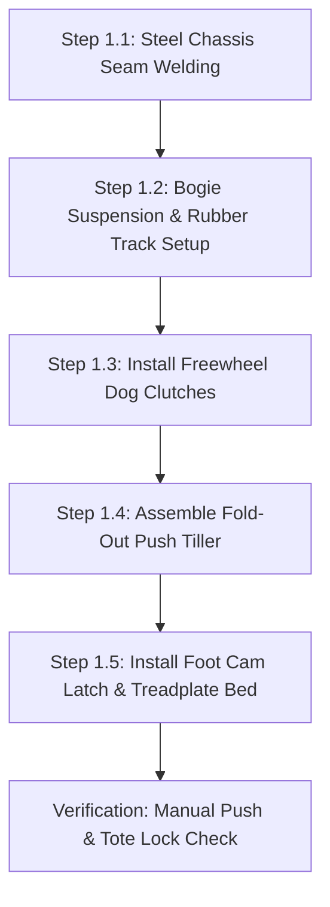
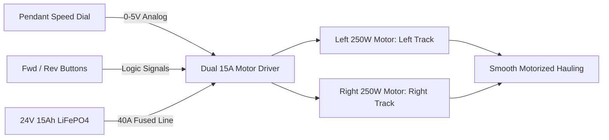
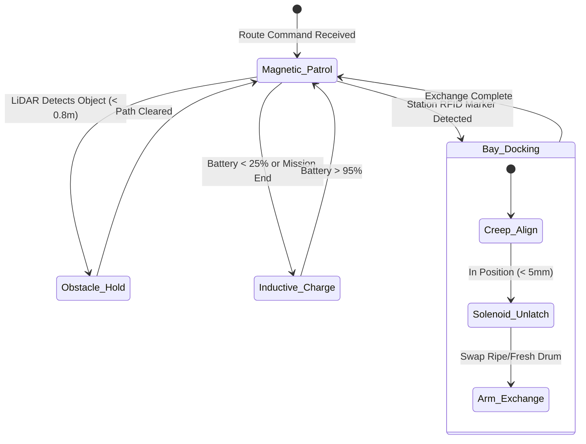

import { Card, CardGrid } from '@astrojs/starlight/components';

The **Ground Track AGV Pod Carrier** is an autonomous, low-profile tracked robot engineered for narrow-lane agricultural transport and selective harvesting. It operates independently as a homestead or greenhouse utility rover, or services the Perimeter Lower Tier of the master Open Biosphere assembly.

---

## 1. Standalone Homesteading & Off-Grid Utility

In greenhouses, hoop houses, and high tunnels, narrow aisles make traditional tractors and human carts cumbersome. This machine handles **heavy repetitive material shuttling, seedling tray transport, and low-canopy selective harvesting**:

<CardGrid>
  <Card title="Narrow-Aisle Rover" icon="truck">
    Ultra-compact chassis (350 mm width) turns in place on rubber tracks, easily navigating tight greenhouse aisles and rough earthen paths.
  </Card>
  <Card title="25 kg Cargo Capacity" icon="box">
    Pneumatic quick-docking latch carries seed drums, produce totes, compost tubs, or water reservoirs without manual lifting.
  </Card>
  <Card title="Simple Tape or LiDAR Guidance" icon="compass">
    Follows low-cost adhesive magnetic floor tape for bulletproof reliability, or pairs with 2D LiDAR for flexible SLAM navigation.
  </Card>
  <Card title="Selective Robotic Harvester" icon="scissors">
    Optional 3-axis articulated harvesting arm with soft silicone gripper and rotary shear picks low bush beans and peppers with stereo-depth precision.
  </Card>
</CardGrid>

---

## 2. Technical Specifications

| Parameter | Specification |
| :--- | :--- |
| **Chassis Dimensions** | 500 mm (L) × 350 mm (W) × 280 mm (H) |
| **Locomotion** | Dual continuous rubber tracks with suspension bogies (45 mm ground clearance) |
| **Payload Capacity** | 25 kg continuous payload on cargo bed |
| **Max Speed** | 0.8 m/s (programmable working speed: 0.2 to 0.4 m/s) |
| **Docking Interface** | Mechanical foot cam latch / 12V solenoid / Pneumatic quick-connect |
| **Harvest Arm** | Optional 3-axis articulated arm with soft silicone 2-finger clamp & rotary blade |
| **Battery System** | 24V 15Ah LiFePO4 pack (6+ hours runtime) with inductive floor charging pads |
| **Onboard Controller**| 0W (Manual) / Dual 15A DC Driver Pendant (Add-On 1) / ESP32-S3 + ROS2 (Add-On 2) |

---

## 3. Instructions (Base Zero-Power Machine)

The foundational build of the Ground Track AGV Pod Carrier is a **100% mechanical, zero-electricity tracked utility handcart**. Operating without batteries, motors, or wiring, it utilizes a fold-out steel tubular push-tiller, dual mechanical dog clutches for effortless freewheel rolling, and an ergonomic foot-pedal cam latch to lock and eject standardized agricultural totes.

### Mechanical Architecture & Decoupling Standard
1. **Tracked Bogie Frame**: A welded 2 mm sheet steel chassis houses two continuous rubber treads (50 mm width, 180 mm ground contact) driven across four spring-suspended bogie rollers per side.
2. **Freewheel Dog Clutch**: Both drive sprockets feature spring-loaded sliding dog clutches. A single quarter-turn lever disengages sprockets from the axle gears, allowing the machine to roll manually with less than 5 N rolling resistance.
3. **Fold-Out Push Tiller**: A tubular steel pull/push handle pivots from the chassis rear. It locks upright for ergonomic standing transport ($950$ mm handle height) or folds flush into the chassis deck for compact storage.
4. **Mechanical Foot Cam Latch**: Stepping on a spring-loaded foot pedal depresses a dual-jaw clamping wedge that grips the bottom rim of standard Euro-boxes or cylindrical bioreactor drums, locking cargo securely without power.

```
         GROUND TRACK AGV POD CARRIER — BASE MECHANICAL ELEVATION
  =================================================================
                  [Standard 25 kg Euro-Box or Sprout Canister]
           +-----------------------------------------------+
           |                                               |
           +-----------------------+-----------------------+
                                   |
         [Fold-Out Tiller]         v [Foot Cam Latch]
         (950 mm Height)   [Cargo Bed Deck: 500 x 350 mm]
               \                   |
                \     +------------+------------+
                 \    |  Steel Chassis Box      |
                  \===|                         |
                      +------------+------------+
                             /            \
           (Drive Sprocket) /              \ (Idler Sprocket)
               [===O===]  (Bogie)  (Bogie)  [===O===]
           ===========================================
             [Continuous Heavy-Duty Rubber Track Tread]
```

### Step-by-Step Fabrication & Assembly Protocol

#### Step 1.1: Chassis Cutting & Welding
1. Cut chassis floor and side plates from 2.0 mm mild steel sheet: one 500 × 280 mm floor plate, two 500 × 120 mm side rails, and two 280 × 120 mm end bulkheads.
2. Slot side rails for eight 10 mm bogie suspension swing-arm pivot pins.
3. Clamp chassis plates in a welding fixture and seam-weld corners with MIG (0.8 mm wire, 75/25 Ar/$CO_2$). Grind external welds flush.
4. Paint with rust-inhibiting zinc-phosphate primer and industrial enamel topcoat.

#### Step 1.2: Bogie Suspension & Rubber Track Assembly
1. Assemble four independent suspension bogies per side using 10 mm steel pivot arms and 80 mm OD polyurethane road wheels with dual 6000-2RS sealed bearings.
2. Pre-load each swing-arm with a 35 mm compression die spring ($k = 18\text{ N/mm}$), providing 25 mm of compliant vertical travel over uneven ground.
3. Mount the front adjustable idler sprockets with M10 threaded track-tensioner bolts.
4. Wrap continuous reinforced rubber tracks (50 mm wide, 38-link pitch) around sprockets and bogies. Tighten tensioners until track sag measures 12 mm mid-span under a 20 N downward force.

#### Step 1.3: Freewheel Dog Clutch Hub Installation
1. Machine or turn two sliding steel dog clutch collars with 3-tooth interlocking drive faces.
2. Mount the matching dog hubs onto the drive sprockets supported on 15 mm precision steel stub axles.
3. Install sliding shift forks linked to external quarter-turn red handle levers.
4. Verify mechanical neutral: when disengaged, tracks spin freely by hand with $< 0.1\text{ N}\cdot\text{m}$ drag torque.

#### Step 1.4: Fold-Out Push Tiller & Brake Rigging
1. Bend a 22 mm OD tubular steel U-shaped tiller handle with dual non-slip rubber handgrips.
2. Pivot-mount the tiller base to the rear chassis brackets using M8 shoulder bolts and Belleville spring washers.
3. Install a spring-loaded spring pin that locks the tiller at a 45° pushing angle, or releases it to fold flat.
4. Install a dead-man friction drag brake pad pressing against the rear idler wheel when the tiller is released.

#### Step 1.5: Foot Cam Latch & Cargo Bed Mounting
1. Mount a 480 × 330 mm 3 mm aluminum treadplate cargo bed atop the chassis deck with rubber vibration isolators.
2. Fabricate the foot-actuated cam latch: a spring-loaded steel rocker linkage connected to a textured 60 mm foot pedal protruding past the rear bumper.
3. Test tote retention: slide a standard 400 × 300 mm Euro-box onto the deck until the spring jaws click shut. Depress foot pedal; the jaws retract cleanly, allowing the tote to slide off.



### Step-by-Step Operating Runbook (Manual Mode)

1. **Pre-Trip Track Inspection**: Check rubber tracks for trapped gravel or vegetative debris. Verify idler tension bolt locknuts are snug.
2. **Deploying the Push Tiller**: Pull the spring release pin on the chassis rear deck; raise the tubular tiller handle until the pin clicks solidly into the 45° operational detent ($950$ mm height).
3. **Engaging Neutral Freewheel**: Verify that both red clutch levers on the side sprockets are pulled outward into the DISENGAGED (Neutral) position.
4. **Loading Produce Totes**: Slide a 25 kg tote or cylindrical sprout drum onto the aluminum cargo deck. Push forward until the foot cam latch clicks over the tote rim, locking it securely against tipping.
5. **Aisle Pushing & Skid-Steering**: Push the AGV by the tiller handles along greenhouse aisles. To turn, apply lateral force on the handles; the dual rubber tracks pivot smoothly on earthen or concrete pathways.
6. **Foot-Pedal Ejection**: Upon reaching the packing table or storage cellar, step firmly on the rear foot pedal. The latch jaws open, allowing the tote to slide forward effortlessly onto the transfer bench.
7. **Fold-Up Storage**: Pull the tiller spring pin, fold the handle forward flat against the cargo deck, and stow the AGV under a bench or vertical against a wall.

### Base Machine Bill of Materials (BOM)

| Item | Component Description | Sourcing / Part Reference | Qty | Unit Cost | Total Cost |
| :--- | :--- | :--- | :--- | :--- | :--- |
| **G-01** | Welded 2mm Steel Tracked Chassis Box & Bulkheads | Local metal fabrication | 1 | $35.00 | $35.00 |
| **G-02** | Continuous Rubber Track Treads (50mm W x 38-link) | Compact robotics supplier | 2 | $10.00 | $20.00 |
| **G-03** | Bogie Suspension Arms + Die Springs + Polyurethane Wheels | Machinery hardware kit | 8 | $3.50 | $28.00 |
| **G-04** | Sliding Steel Dog Clutch Neutral Hubs & Levers | Machined steel parts | 2 | $7.00 | $14.00 |
| **G-05** | Fold-Out 22mm Tubular Steel Tiller Handle + Grips | Hardware steel stock | 1 | $12.00 | $12.00 |
| **G-06** | Mechanical Foot-Pedal Spring Cam Clamp Assembly | Fabricated steel linkage | 1 | $10.00 | $10.00 |
| **Total** | **Base Zero-Power Push Cart Build** | **Complete off-grid manual carrier** | | | **$119.00** |

---

## 4. Add-On 1: Semi-Autonomous Electromechanical Pack (Buttons & Dials)

The **Semi-Autonomous Pack** converts the manual push cart into a heavy-duty motorized power tug. Featuring dual 24V 250W brushed planetary gearmotors, a smart dual-channel 15A motor driver, an industrial 3-button pendant with speed potentiometer, and a 24V 15Ah LiFePO4 battery pack, it hauls 25 kg payloads up 15° inclines with zero operator physical strain.

### Electromechanical Actuation Architecture & Decoupling
- **Drive Powertrain**: Dual 24V 250W brushed DC planetary gearmotors (18:1 reduction, 14 N·m torque per track) driving the sprockets through heavy-duty #25 roller chain.
- **Mechanical Decoupling**: The base sliding dog clutches are preserved intact. Flipping the red clutch levers disengages the sprockets from the motor chains, restoring 100% manual freewheel pushing in $< 2$ seconds.
- **Smart Motor Driver**: Dual-channel 15A continuous (30A peak) motor controller (Cytron MDDS30 or Sabertooth 2x12) with regenerative braking and thermal cutoffs.
- **Operator Pendant**: Heavy-duty IP65 yellow pendant with Forward / Reverse momentary buttons, emergency stop mushroom button, and an analog rotary speed potentiometer (0.1 to 0.8 m/s).

```
       ELECTROMECHANICAL WIRING & PENDANT CONTROL SCHEMATIC
  =================================================================
  [24V 15Ah LiFePO4 Pack with BMS]
         |
         +----[40A Master Fuse]----+----[E-Stop Push Button]
                                   |
                                   v
                  [Dual-Channel 15A DC Motor Driver]
                     |                           |
         +-----------+-----------+               |
         | Analog In             | Direction     |
         v                       v               v
  [Speed Potentiometer]    [Fwd/Rev Push]    [12V Solenoid Latch]
  (Industrial Pendant)     (Button Switch)   (Toggle Switch)
         |                       |
         +-----------+-----------+
                     |
         +-----------+-----------+
         | Left Motor            | Right Motor
         v                       v
   [24V 250W Gearmotor]    [24V 250W Gearmotor]
   (Dog Clutch Left)       (Dog Clutch Right)
         |                       |
         v                       v
    [Left Track]            [Right Track]
```

### Step-by-Step Retrofit Protocol

#### Step 2.1: Dual 250W Gearmotor Bracket Installation
1. Bolt steel motor mounting brackets to the inner chassis side walls using M6 grade 8.8 bolts and flange nuts.
2. Mount the two 24V 250W planetary gearmotors horizontally with drive shafts facing outward.
3. Install 9T #25 hardened drive sprockets onto the 10 mm keyed motor output shafts.
4. Route #25 roller chains to 24T sprockets attached to the dog clutch input hubs. Tension chains to 6 mm slack.

#### Step 2.2: LiFePO4 Battery & BMS Installation
1. Secure a steel battery tray in the lowest center section of the chassis between the track wells.
2. Seat the 24V 15Ah LiFePO4 battery pack, clamping it down with a rubber-padded quick-release strap.
3. Install an inline 40A MIDI fuse block directly off the positive battery terminal.

#### Step 2.3: Motor Controller & Solenoid Latch Wiring
1. Mount the dual-channel 15A motor controller on aluminum standoffs against the rear bulkhead.
2. Wire battery positive through a 2-pole master disconnect switch to the controller's `B+` terminal.
3. Connect motor power leads using 12 AWG high-flex silicone wire.
4. Replace the manual foot latch rocker with a 12V 25 N high-force push-pull solenoid, wired through a momentary relay.

#### Step 2.4: Industrial Pendant Cable Loom Rigging
1. Mount a heavy-duty 4-conductor coiled pendant cable (2.5 m extended length) to the rear chassis cable gland.
2. Terminate conductors inside the yellow pendant to:
   - Green Button: Forward run contact.
   - Yellow Button: Reverse run contact.
   - Rotary Potentiometer: 0–5V analog speed reference.
   - Twist-to-Release Red E-Stop: Series power break.

#### Step 2.5: Differential Drive Calibration
1. Elevate the AGV chassis on jackstands so rubber tracks clear the bench.
2. Turn the master power switch ON. Set the speed dial to 20% and press Forward; verify both tracks rotate forward smoothly.
3. Calibrate potentiometer deadband so tracks remain completely stationary when buttons are released.



### Step-by-Step Push-Button Operating Runbook

1. **Power-On & Pendant Checkout**: Disengage the red E-stop button on the pendant (twist clockwise). Turn master power key ON (blue LED illuminates).
2. **Engaging Drive Gearboxes**: Push both red mechanical dog clutch levers inward until drive teeth mesh solidly with sprockets.
3. **Speed Regulation via Dial**: Rotate the yellow pendant dial to 30% speed for indoor walking pace ($0.3$ m/s).
4. **Motorized Material Hauling**: Walk alongside or behind the AGV. Press and hold the green Forward button to traverse aisles. Release button to engage regenerative electric braking (stops within 150 mm).
5. **Electronic Latch Actuation**: To unload cargo, press the pendant's toggle switch; the 12V solenoid retracts the latch wedge, allowing the tote to slide onto the transfer shelf.
6. **Emergency Neutral Freewheeling**: If battery level drops below 10% (audible low-voltage beep), disengage both dog clutch levers to push the AGV by hand back to the charging outlet.

### Add-On 1 Bill of Materials (BOM)

| Item | Component Description | Sourcing / Part Reference | Qty | Unit Cost | Total Cost |
| :--- | :--- | :--- | :--- | :--- | :--- |
| **A1-01** | 24V 250W Brushed DC Planetary Gearmotors (18:1 ratio) | Robotics drive supplier | 2 | $24.00 | $48.00 |
| **A1-02** | Dual-Channel 15A Smart DC Motor Driver Board | Cytron MDDS30 or equivalent | 1 | $38.00 | $38.00 |
| **A1-03** | Heavy-Duty IP65 3-Button Industrial Pendant + Dial | Hoist pendant manufacturer | 1 | $24.00 | $24.00 |
| **A1-04** | 24V 15Ah LiFePO4 Battery Pack with Built-In BMS | Solar / e-mobility store | 1 | $85.00 | $85.00 |
| **A1-05** | 12V High-Force 25N Push-Pull Latch Solenoid | Automation components shop | 1 | $18.00 | $18.00 |
| **Total** | **Add-On 1 Electromechanical Pack** | **Retrofits directly to Base** | | | **+$213.00** |
| **Cumul.** | **Operational Pendant-Controlled Power Tug** | **Base ($119) + Add-On 1 ($213)** | | | **$332.00** |

---

## 5. Add-On 2: Agentic Autonomous AI Pack (Edge Vision & Closed Loop)

The **Agentic Autonomous AI Pack** transforms the AGV into an intelligent, driverless robotic logistics platform. Operating under ROS2 / Micro-XRCE-DDS on an ESP32-S3 brain, it tracks magnetic floor tape, scans for obstacles via 360° 2D LiDAR, exchanges sprout drums automatically using a 3-axis articulated transfer arm, and charges itself wirelessly over inductive floor pads.

### Autonomous Vision & Telemetry Architecture
- **Robotics Compute Core**: ESP32-S3 Dual-Core Xtensa LX7 (240 MHz) with CAN bus transceiver and ROS2 Micro-XRCE-DDS agent communication.
- **Guidance & Navigation**: 5-channel magnetic track induction guide sensor array detecting adhesive floor magnetic tape, combined with a 360° 2D LiDAR scanner (RPLiDAR C1 / LD06, 12 m range, 10 Hz scan rate) for obstacle avoidance and SLAM mapping.
- **3-Axis Material Transfer Arm**: Articulated mini transfer arm actuated by metal-gear high-torque digital servos, capable of gripping drum handles and transferring 4.0 kg hypocotyl canisters.
- **Inductive Wireless Charging**: Floor-mounted magnetic resonance receiver pad (24V 5A, 120W) mating automatically with the datum origin charging pad.

```
       CYBER-PHYSICAL EDGE AI ARCHITECTURE & SLAM TELEMETRY
  =================================================================
               +--------------------------------------+
               |    ESP32-S3 ROS2 Micro-XRCE Brain    |
               |  (Dual-Core 240 MHz + RTOS Nav-Loop) |
               +---+--------------------+---------+---+
                   |                    |         |
         +---------+----+               | UART    | SPI / I2C
         | PWM / CAN    |               v         v
         v              v        [2D LiDAR Scanner] [5-Ch Magnetic]
  [Dual 15A Driver] [CAN Bus]    (360 deg Obstacle) (Tape Induction)
         |          (Master             |                 |
         v           Biosphere)         v                 v
   [Dual Tracks]                 [SLAM Map Vector]  [Track Following]
```

### Step-by-Step Sensor Commissioning & Edge AI Protocol

#### Step 3.1: ESP32-S3 & CAN Bus Controller Installation
1. Mount the ESP32-S3 robotics carrier board in a protected electronics tray above the battery deck.
2. Connect PWM and DIR lines from ESP32 GPIO pins directly to the motor driver inputs.
3. Wire the SN65HVD230 CAN bus transceiver to GPIO 4 (TX) and GPIO 5 (RX).

#### Step 3.2: 5-Channel Magnetic Induction Sensor Installation
1. Mount the 5-channel magnetic sensor bar beneath the front chassis bumper ($20$ mm road clearance).
2. Wire the 5 digital sensor outputs to ESP32 GPIOs 11–15 with $10\text{ k}\Omega$ pull-up resistors.
3. Verify calibration: rolling over 25 mm magnetic floor tape triggers cleanly across adjacent sensors with zero false positives.

#### Step 3.3: 360-Degree 2D LiDAR Scanner Integration
1. Mount the RPLiDAR scanner on a 150 mm elevated center mast above the cargo bed for an unobstructed 360° field of view.
2. Connect LiDAR UART lines to ESP32 hardware serial port 1 (115,200 baud).
3. Verify laser point cloud: obstacles at 1.5 m distance register with $< 20$ mm distance variance.

#### Step 3.4: 3-Axis Articulated Transfer Arm Mounting
1. Bolt the 3-axis mini transfer arm base to the front-right chassis corner.
2. Connect the three metal-gear servos (base pan, shoulder pitch, gripper clamp) to a dedicated 6V 5A BEC regulator.
3. Program calibration positions: Stowed, Reaching, Gripping, and Lifted.

#### Step 3.5: Inductive Floor Charging Coil Installation
1. Mount the 120W wireless power receiver coil under the rear chassis plate ($15$ mm air gap clearance).
2. Wire the coil output through a synchronous rectifier and CC/CV charge controller directly into the LiFePO4 battery terminals.
3. Test dock alignment: navigating onto the transmitter plate initiates 24V 4.5A charging within 1.5 seconds.



### Step-by-Step Autonomous Multi-Agent Runbook

1. **Autonomous Route Initiation**: On receiving a harvest dispatch over CAN bus, the AGV unlatches from the inductive charging dock, powers its sensor array, and accelerates to 0.4 m/s.
2. **Magnetic Line-Tracking Loop**: The 5-channel sensor runs a closed-loop PD steering algorithm at 100 Hz, centering the AGV over the magnetic floor tape with $< 4$ mm lateral drift.
3. **LiDAR Sentry & Obstacle Avoidance**: The 2D LiDAR continuously scans at 10 Hz. If a human, hanging vine, or tool enters within 0.8 m of the track, the robot decelerates smoothly to a complete stop, sounding an intermittent alert tone until the path clears.
4. **Bioreactor Bay Precision Docking**: Upon sensing the magnetic RFID bay marker at the Revolving Sprout Bioreactor, the AGV drops speed to 0.05 m/s, using reflective optical alignment to dock into the chassis bay with $\pm 3$ mm precision.
5. **Autonomous Canister Transfer**: The 3-axis arm extends, clamps the spent sprout drum handle, and pulls it onto the cargo bed. The 12V solenoid engages the retention wedge. The AGV shuttles the ripe drum directly to the wash station.
6. **Automatic Wireless Recharging**: When mission queues are empty or battery drops below 25%, the AGV navigates to the $(0,0,0)$ datum charge pad. The inductive coil auto-engages, replenishing the battery at 120W with zero mechanical plug contacts.

### Add-On 2 Bill of Materials (BOM)

| Item | Component Description | Sourcing / Part Reference | Qty | Unit Cost | Total Cost |
| :--- | :--- | :--- | :--- | :--- | :--- |
| **A2-01** | ESP32-S3 Microcontroller Carrier + CAN Transceiver | Robotics maker supplier | 1 | $18.00 | $18.00 |
| **A2-02** | 5-Channel Magnetic Track Induction Guide Sensor Array | Autonomous robotics store | 1 | $16.00 | $16.00 |
| **A2-03** | 360-Degree 2D LiDAR Scanner (RPLiDAR C1 / LD06) | Maker LiDAR distributor | 1 | $68.00 | $68.00 |
| **A2-04** | 3-Axis Mini Articulated Arm Kit + Metal Gear Servos | 3D printed + MG996R servos | 1 | $38.00 | $38.00 |
| **A2-05** | 120W Magnetic Inductive Wireless Charging Receiver Module | Wireless power supplier | 1 | $25.00 | $25.00 |
| **Total** | **Add-On 2 Agentic Autonomous Pack** | **Expands Base + Add-On 1** | | | **+$165.00** |
| **Full Build** | **Complete Autonomous Biosphere AGV Carrier** | **Base + Add-On 1 + Add-On 2** | | | **$497.00** |

---

## 6. Staged Upgrade Progression & Cost Summary

### Build Tier Comparison

| Build Stage | Operational Capability | Direct Stage Cost | Cumulative Investment |
| :--- | :--- | :--- | :--- |
| **Base: Instructions** | 100% mechanical manual push cart with neutral gearbox lever and foot-pedal clamp | $119.00 | **$119.00** |
| **Add-On 1: Semi-Auto** | Motorized planetary track drive with wired industrial jog pendant and LiFePO4 pack | +$213.00 | **$332.00** |
| **Add-On 2: Agentic AI** | Autonomous ROS2 SLAM, 2D LiDAR, magnetic line following, and inductive auto-charging | +$165.00 | **$497.00** |

### Step-by-Step Zero-Waste Conversion Roadmap

#### Path 1: Base Machine $\rightarrow$ Add-On 1 (Motorized Tug Upgrade)
1. Bolt the two 24V 250W gearmotor brackets inside the welded chassis.
2. Connect the #25 drive chains to the dog clutch input hubs (the manual freewheel dog clutch levers remain fully functional).
3. Drop the 24V LiFePO4 battery pack into the pre-drilled central tray, wire the motor driver, and plug in the yellow industrial pendant. The manual push tiller can either fold flat or be detached via its quick-release pins.

#### Path 2: Add-On 1 $\rightarrow$ Add-On 2 (Autonomous Robotics Platform)
1. Mount the ESP32-S3 robotics carrier board in the electronics tray and connect PWM control lines to the motor driver.
2. Fasten the 5-channel magnetic line sensor beneath the front bumper and erect the center LiDAR mast.
3. Install the 3-axis mini transfer arm and inductive floor charge coil, connect to the CAN bus backbone, and flash the autonomous ROS2 micro-agent firmware.

---

## 7. Master Biosphere Assembly Interlock

When integrated into the centralized Open Biosphere facility (~20 × 10 ft footprint):

1. **Perimeter Lane Routing**: Follows the continuous magnetic guide strip embedded along the Perimeter Lower Tier ($Z = 150$ to $365$ mm above water level).
2. **Bioreactor Drum Exchange**: Automatically docks into the Revolving Sprout Bioreactor bays, unlatching ripe 4-day canisters and replacing them with freshly seeded drums.
3. **Automated Recharging**: Docks into magnetic inductive floor charge plates located at the South-West datum origin $(0,0,0)$.
4. **Fleet Coordination**: Communicates with the overhead gantry and aerial drone via CAN bus / MQTT, synchronizing produce tote handoffs without path collisions.
