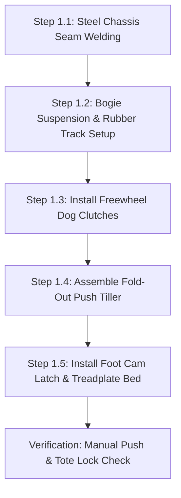

import { Card, CardGrid, LinkButton } from '@astrojs/starlight/components';

## Part 1: Stage Header & Executive Summary

> [!NOTE]
> **Stage Designation:** Stage 0 (Zero-Power Baseline)  
> **Operating Mode:** 100% Mechanical Manual Fallback  
> **Power Consumption:** 0 Watts (Zero Electrical Input Required)  
> **Resilience Rating:** Continuous Off-Grid / EMP / Submersion Proof  
> **Decoupling Standard:** Friction Slip-Clutch / Quick-Release Cam Linkage  

The Stage 0 baseline build of the **Ground Track AGV Pod Carrier** is a **100% mechanical, zero-power agricultural machine**. It operates entirely by human leverage, manual hand cranks, counterweights, and gravity flows—providing complete food security and operational continuity during total grid blackouts.

---

## Part 2: Capability Delta (Features Introduced)

* **Zero-Power Resilience**: Operates indefinitely without batteries, solar controllers, or power supplies.
* **Direct Mechanical Leverage**: All actuation performed via hand cranks, manual levers, counterweights, or gravity siphoning.
* **Inherent Decoupling**: Built from the ground up with mechanical slip-clutches, quick-release clamps, or bypass valves to ensure motor upgrades never bind.

---

## Part 3: Isolated Stage 0 Bill of Materials (BOM)


### Base Machine Bill of Materials (BOM)

| Item | Part ID & Registry Link | Component & Specification | Sourcing / Supplier | Fab Type | Qty | Unit Cost | CAD Asset | Total Cost |
| :--- | :--- | :--- | :--- | :--- | :--- | :--- | :--- | :--- |
| **G-01** | [`PART-MECH-CHASSIS-STEEL-2MM`](/open-biosphere/parts/mechanical/PART-MECH-CHASSIS-STEEL-2MM/) | Welded 2mm Steel Tracked Chassis Box & Bulkheads | [Local metal fabrication](https://sendcutsend.com) | Laser-Cut / Welded Steel | 1 | $35.00 | [Download .3DS](/open-biosphere/assets/parts/PART-MECH-CHASSIS-STEEL-2MM/model.3ds) | $35.00 |
| **G-02** | [`PART-MECH-TREAD-RUBBER-50MM`](/open-biosphere/parts/mechanical/PART-MECH-TREAD-RUBBER-50MM/) | Continuous Rubber Track Treads (50mm W x 38-link) | [Compact robotics supplier](https://robotshop.com) | Stock Molded Rubber | 2 | $10.00 | [Download .3DS](/open-biosphere/assets/parts/PART-MECH-TREAD-RUBBER-50MM/model.3ds) | $20.00 |
| **G-03** | [`PART-MECH-SUSP-BOGIE-ARM`](/open-biosphere/parts/mechanical/PART-MECH-SUSP-BOGIE-ARM/) | Bogie Suspension Arms + Die Springs + Polyurethane Wheels | [Machinery hardware kit](https://open-biosphere.org) | Machined Aluminum + Die Spring | 8 | $3.50 | [Download .3DS](/open-biosphere/assets/parts/PART-MECH-SUSP-BOGIE-ARM/model.3ds) | $28.00 |
| **G-04** | [`PART-MECH-CLUTCH-DOG-STEEL`](/open-biosphere/parts/mechanical/PART-MECH-CLUTCH-DOG-STEEL/) | Sliding Steel Dog Clutch Neutral Hubs & Levers | [Machined steel parts](https://open-biosphere.org) | CNC Steel / Machined | 2 | $7.00 | [Download .3DS](/open-biosphere/assets/parts/PART-MECH-CLUTCH-DOG-STEEL/model.3ds) | $14.00 |
| **G-05** | [`PART-MECH-HANDLE-TILLER-22MM`](/open-biosphere/parts/mechanical/PART-MECH-HANDLE-TILLER-22MM/) | Fold-Out 22mm Tubular Steel Tiller Handle + Grips | [Hardware steel stock](https://open-biosphere.org) | Tubular Steel Fabrication | 1 | $12.00 | [Download .3DS](/open-biosphere/assets/parts/PART-MECH-HANDLE-TILLER-22MM/model.3ds) | $12.00 |
| **G-06** | [`PART-MECH-CLAMP-FOOT-CAM`](/open-biosphere/parts/mechanical/PART-MECH-CLAMP-FOOT-CAM/) | Mechanical Foot-Pedal Spring Cam Clamp Assembly | [Fabricated steel linkage](https://mcmaster.com) | Laser Steel / Spring Clamp | 1 | $10.00 | [Download .3DS](/open-biosphere/assets/parts/PART-MECH-CLAMP-FOOT-CAM/model.3ds) | $10.00 |
| **Total** | **Base Zero-Power Push Cart Build** | **Complete off-grid manual carrier** | | | | | | **$119.00** |

---

## Part 4: Standalone Full SVG Blueprint


---

## Part 5: Step-by-Step Assembly & Operating Protocol

The foundational build of the Ground Track AGV Pod Carrier is a **100% mechanical, zero-electricity tracked utility handcart**. Operating without batteries, motors, or wiring, it utilizes a fold-out steel tubular push-tiller, dual mechanical dog clutches for effortless freewheel rolling, and an ergonomic foot-pedal cam latch to lock and eject standardized agricultural totes.

### Mechanical Architecture & Decoupling Standard
1. **Tracked Bogie Frame**: A welded 2 mm sheet steel chassis houses two continuous rubber treads (50 mm width, 180 mm ground contact) driven across four spring-suspended bogie rollers per side.
2. **Freewheel Dog Clutch**: Both drive sprockets feature spring-loaded sliding dog clutches. A single quarter-turn lever disengages sprockets from the axle gears, allowing the machine to roll manually with less than 5 N rolling resistance.
3. **Fold-Out Push Tiller**: A tubular steel pull/push handle pivots from the chassis rear. It locks upright for ergonomic standing transport ($950$ mm handle height) or folds flush into the chassis deck for compact storage.
4. **Mechanical Foot Cam Latch**: Stepping on a spring-loaded foot pedal depresses a dual-jaw clamping wedge that grips the bottom rim of standard Euro-boxes or cylindrical bioreactor drums, locking cargo securely without power.

```
         GROUND TRACK AGV POD CARRIER — BASE MECHANICAL ELEVATION
  =================================================================
                  [Standard 25 kg Euro-Box or Sprout Canister]
           +-----------------------------------------------+
           |                                               |
           +-----------------------+-----------------------+
                                   |
         [Fold-Out Tiller]         v [Foot Cam Latch]
         (950 mm Height)   [Cargo Bed Deck: 500 x 350 mm]
               \                   |
                \     +------------+------------+
                 \    |  Steel Chassis Box      |
                  \===|                         |
                      +------------+------------+
                             /            \
           (Drive Sprocket) /              \ (Idler Sprocket)
               [===O===]  (Bogie)  (Bogie)  [===O===]
           ===========================================
             [Continuous Heavy-Duty Rubber Track Tread]
```

### Step-by-Step Fabrication & Assembly Protocol

#### Step 1.1: Chassis Cutting & Welding
1. Cut chassis floor and side plates from 2.0 mm mild steel sheet: one 500 × 280 mm floor plate, two 500 × 120 mm side rails, and two 280 × 120 mm end bulkheads.
2. Slot side rails for eight 10 mm bogie suspension swing-arm pivot pins.
3. Clamp chassis plates in a welding fixture and seam-weld corners with MIG (0.8 mm wire, 75/25 Ar/$CO_2$). Grind external welds flush.
4. Paint with rust-inhibiting zinc-phosphate primer and industrial enamel topcoat.

#### Step 1.2: Bogie Suspension & Rubber Track Assembly
1. Assemble four independent suspension bogies per side using 10 mm steel pivot arms and 80 mm OD polyurethane road wheels with dual 6000-2RS sealed bearings.
2. Pre-load each swing-arm with a 35 mm compression die spring (k = 18 N/mm), providing 25 mm of compliant vertical travel over uneven ground.
3. Mount the front adjustable idler sprockets with M10 threaded track-tensioner bolts.
4. Wrap continuous reinforced rubber tracks (50 mm wide, 38-link pitch) around sprockets and bogies. Tighten tensioners until track sag measures 12 mm mid-span under a 20 N downward force.

#### Step 1.3: Freewheel Dog Clutch Hub Installation
1. Machine or turn two sliding steel dog clutch collars with 3-tooth interlocking drive faces.
2. Mount the matching dog hubs onto the drive sprockets supported on 15 mm precision steel stub axles.
3. Install sliding shift forks linked to external quarter-turn red handle levers.
4. Verify mechanical neutral: when disengaged, tracks spin freely by hand with < 0.1 N·m drag torque.

#### Step 1.4: Fold-Out Push Tiller & Brake Rigging
1. Bend a 22 mm OD tubular steel U-shaped tiller handle with dual non-slip rubber handgrips.
2. Pivot-mount the tiller base to the rear chassis brackets using M8 shoulder bolts and Belleville spring washers.
3. Install a spring-loaded spring pin that locks the tiller at a 45° pushing angle, or releases it to fold flat.
4. Install a dead-man friction drag brake pad pressing against the rear idler wheel when the tiller is released.

#### Step 1.5: Foot Cam Latch & Cargo Bed Mounting
1. Mount a 480 × 330 mm 3 mm aluminum treadplate cargo bed atop the chassis deck with rubber vibration isolators.
2. Fabricate the foot-actuated cam latch: a spring-loaded steel rocker linkage connected to a textured 60 mm foot pedal protruding past the rear bumper.
3. Test tote retention: slide a standard 400 × 300 mm Euro-box onto the deck until the spring jaws click shut. Depress foot pedal; the jaws retract cleanly, allowing the tote to slide off.



### Step-by-Step Operating Runbook (Manual Mode)

1. **Pre-Trip Track Inspection**: Check rubber tracks for trapped gravel or vegetative debris. Verify idler tension bolt locknuts are snug.
2. **Deploying the Push Tiller**: Pull the spring release pin on the chassis rear deck; raise the tubular tiller handle until the pin clicks solidly into the 45° operational detent ($950$ mm height).
3. **Engaging Neutral Freewheel**: Verify that both red clutch levers on the side sprockets are pulled outward into the DISENGAGED (Neutral) position.
4. **Loading Produce Totes**: Slide a 25 kg tote or cylindrical sprout drum onto the aluminum cargo deck. Push forward until the foot cam latch clicks over the tote rim, locking it securely against tipping.
5. **Aisle Pushing & Skid-Steering**: Push the AGV by the tiller handles along greenhouse aisles. To turn, apply lateral force on the handles; the dual rubber tracks pivot smoothly on earthen or concrete pathways.
6. **Foot-Pedal Ejection**: Upon reaching the packing table or storage cellar, step firmly on the rear foot pedal. The latch jaws open, allowing the tote to slide forward effortlessly onto the transfer bench.
7. **Fold-Up Storage**: Pull the tiller spring pin, fold the handle forward flat against the cargo deck, and stow the AGV under a bench or vertical against a wall.

---

## Part 6: Guided Stage Navigation

<CardGrid>
  <Card title="Subsystem Overview" icon="left-arrow">
    Return to the machine overview, crop affinity matrix, and multi-stage comparison.
    <br/><br/>
    <LinkButton href="/open-biosphere/hardware/ground-track-agv/" variant="minimal">← Return to Overview</LinkButton>
  </Card>
  <Card title="Stage 1: BLE Electromechanical Pack" icon="right-arrow">
    Ready to motorize this machine? Upgrade with DC actuation and Flutter BLE Virtual Panel controls.
    <br/><br/>
    <LinkButton href="/open-biosphere/hardware/ground-track-agv/stage-1/" variant="primary">Proceed to Stage 1 Upgrade →</LinkButton>
  </Card>
</CardGrid>
