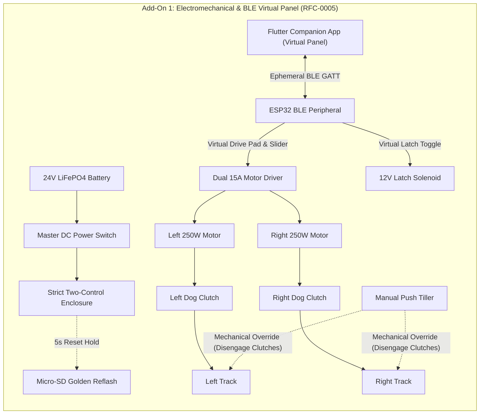

import { Card, CardGrid, LinkButton } from '@astrojs/starlight/components';

## Part 1: Stage Header & Executive Summary

> [!NOTE]
> **Stage Designation:** Stage 1 (Semi-Autonomous Electromechanical Pack)  
> **Operating Mode:** DC Motorized Continuous Duty with Ephemeral BLE Virtual Panel  
> **Power Requirement:** 12V / 24V DC Industrial Bus  
> **Physical Interlocks:** Strict Two-Control Standard (Master DC Cut + Recessed SD Factory Restore)  
> **Operator Interface:** Ephemeral Flutter Mobile Companion App over BLE GATT  

The Stage 1 electromechanical pack motorizes the **Ground Track AGV Pod Carrier**, adding continuous DC motor/pump drive governed by the **Strict Two-Control Physical Standard** (RFC-0005) and an ephemeral **Flutter Companion App Virtual Panel** over direct local BLE.

---

## Part 2: Capability Delta (Features Introduced)

* **Continuous Motorized Actuation**: Replaces human manual cranking with high-efficiency DC gearmotors, steppers, or booster pumps.
* **Strict Two-Control Physical Standard**: Eliminates physical jog buttons and potentiometer dials to prevent moisture breach and priority race conditions. Only Master DC Switch and Recessed SD Reset Button are permitted on hardware.
* **Ephemeral BLE Virtual Panel**: Jogging, speed sliders, and priming pulses execute via the Flutter companion app over direct local BLE GATT.
* **100% Preserved Manual Fallback**: Slip-clutches, bypass valves, or belt releases guarantee instant zero-power manual hand operation without disassembly.

---

## Part 3: Isolated Stage 1 Bill of Materials (BOM)

### Add-On 1 Bill of Materials (BOM)

| Item | Component Description | Sourcing / Part Reference | Qty | Unit Cost | Total Cost |
| :--- | :--- | :--- | :--- | :--- | :--- |
| **A1-01** | 24V 250W Brushed DC Planetary Gearmotors (18:1 ratio) | Robotics drive supplier | 2 | $24.00 | $48.00 |
| **A1-02** | Dual-Channel 15A Smart DC Motor Driver Board | Cytron MDDS30 or equivalent | 1 | $38.00 | $38.00 |
| **A1-03** | Strict Two-Control Enclosure (Master DC Cut + SD Reset + Micro-SD Module + 0.91" OLED) | Maker electrical kit | 1 | $24.00 | $24.00 |
| **A1-04** | ESP32 BLE Virtual Panel Peripheral Controller | Maker electronics shop | 1 | $15.00 | $15.00 |
| **A1-05** | 24V 15Ah LiFePO4 Battery Pack with Built-In BMS | Solar / e-mobility store | 1 | $70.00 | $70.00 |
| **A1-06** | 12V High-Force 25N Push-Pull Latch Solenoid | Automation components shop | 1 | $18.00 | $18.00 |
| **Total** | **Add-On 1 Electromechanical Pack** | **Retrofits directly to Base** | | | **+$213.00** |
| **Cumul.** | **Operational BLE-Controlled Power Tug** | **Base ($119) + Add-On 1 ($213)** | | | **$332.00** |

---

---

## Part 4: Standalone Full SVG Blueprint


### Add-On 1 Electromechanical Wiring & BLE Virtual Panel Blueprint

```text
========================================================================================
ADD-ON 1 ELECTROMECHANICAL SCHEMATIC & BLE VIRTUAL PANEL BLUEPRINT
Strict Two-Control Physical Standard (RFC-0005) with Ephemeral Flutter BLE Control
========================================================================================

  [24V 15Ah LiFePO4 Pack] ──[40A Fuse]──[Master DC Power Switch]──┬── (24V Power Bus)
                                                                  └── (GND Return Bus)
                                                                            │
   ┌──────────────── STRICT TWO-CONTROL CHASSIS BOX ──────────────────────┐│
   │                                                                      ││
   │  [Master DC Power Switch]         ["Nuke & Pave" SD Reset Button]    ││
   │   Inline Mechanical Cut            Recessed Tactile Switch (5s hold) ││
   │                                                                      ││
   │  [Micro-SD Card Slot Module]      [0.91" I2C Status OLED Display]    ││
   │   Preloaded golden .bin            Displays [AGV-A1 | BLE READY]     ││
   │                                                                      ││
   │  [ESP32 BLE GATT Peripheral] ◄───── (Ephemeral Mobile Link) ────────┼│
   └───────────────────┬──────────────────────────────────────────────────┘│
                       │                                                   │
                       ▼ (Motor Controller PWM/DIR Signals)                │
   ┌────────────────── DRIVE TRAIN & MOTORS ──────────────────────────────┐│
   │                                                                      ││
   │  Dual-Channel 15A Smart DC Motor Driver ◄────────────────────────────┘│
   │       │                     │                                         │
   │       ▼                     ▼                                         │
   │  [Left 250W Motor]     [Right 250W Motor]                             │
   │       │                     │                                         │
   │       ▼ (Drive Chains)      ▼ (Drive Chains)                          │
   │  [Left Dog Clutch]     [Right Dog Clutch]                             │
   │  (Flippable Levers)    (Flippable Levers)                             │
   │       │                     │                                         │
   │       ▼                     ▼                                         │
   │  [Left Track]          [Right Track]                                  │
   │                                                                       │
   │  12V High-Force Latch Solenoid ◄── Relay Trigger ─────────────────────┘
   └───────────────────────────────────────────────────────────────────────┘
========================================================================================
```

---

## Part 5: Step-by-Step Retrofit, Wiring & Operating Protocol

Under [RFC-0005](/rfcs/rfc-0005-hardware-interlocks-ble-virtual-panel), physical control boxes, rotary potentiometers, and tethered industrial pendants are banned across all machine tiers to eliminate cable snagging, moisture ingress, and priority contention. 

The **Semi-Autonomous Pack** converts the manual push cart into a heavy-duty motorized power tug governed by the **Strict Two-Control Physical Standard**:
1. **Master Hardware DC Power Switch**: Inline high-current switch mechanically isolating the 24V LiFePO4 battery pack.
2. **"Nuke & Pave" SD Factory Restore Button**: Dedicated recessed tactile switch that triggers an automatic hardware re-flash from micro-SD storage.

All manual jogging, steering, speed regulation, and tote unlatching are performed via the **Flutter Companion App Virtual Panel** over direct local BLE.

### Electromechanical Actuation Architecture & Decoupling
- **Drive Powertrain**: Dual 24V 250W brushed DC planetary gearmotors (18:1 reduction, 14 N·m torque per track) driving the sprockets through heavy-duty #25 roller chain.
- **Mechanical Decoupling**: The base sliding dog clutches are preserved intact. Flipping the red clutch levers disengages sprockets from motor chains, restoring 100% manual freewheel pushing in $< 2$ seconds.
- **Smart Motor Driver**: Dual-channel 15A continuous (30A peak) motor controller (Cytron MDDS30 or Sabertooth 2x12) with regenerative electric braking and thermal cutoffs.
- **Strict Two-Control Enclosure**: An IP65 aluminum electronics enclosure inside the battery deck contains:
  - Heavy-duty toggle switch directly isolating positive battery power.
  - Recessed tactile button next to the 0.91" I2C OLED display for 5-second SD recovery reflash.
  - Micro-SD card slot module pre-loaded with golden recovery `firmware.bin` and `config.default`.
- **Ephemeral BLE Virtual Panel**: Operators connect using the Flutter companion app on mobile device: Virtual Directional Drive Pad (Forward / Reverse / Differential Pivot), Drive Speed Touch Slider (0.1 to 0.8 m/s), and Tote Latch Solenoid Toggle.

### Step-by-Step Retrofit Protocol

```text
Step 2.1: Dual 250W Gearmotor Bracket Installation
  ├── Bolt steel motor mounting brackets to inner chassis side walls with M6 grade 8.8 bolts.
  ├── Mount two 24V 250W planetary gearmotors horizontally with drive shafts facing outward.
  ├── Install 9T #25 hardened drive sprockets onto 10mm keyed motor output shafts.
  └── Route #25 roller chains to 24T sprockets on dog clutch input hubs; tension to 6mm slack.

Step 2.2: LiFePO4 Battery & BMS Installation
  ├── Secure steel battery tray in lowest center section of chassis between track wells.
  ├── Seat 24V 15Ah LiFePO4 battery pack, clamping down with rubber-padded quick-release strap.
  └── Install inline 40A MIDI fuse block directly off positive battery terminal.

Step 2.3: Motor Controller & Solenoid Latch Wiring
  ├── Mount dual-channel 15A motor controller on aluminum standoffs against rear bulkhead.
  ├── Wire battery positive through master DC disconnect switch to controller B+ terminal.
  ├── Connect motor power leads using 12 AWG high-flex silicone wire.
  └── Replace manual foot latch with 12V 25N high-force push-pull solenoid wired through relay.

Step 2.4: Two-Control Enclosure Assembly
  ├── Mount IP65 enclosure above battery deck with master DC toggle and recessed SD reset button.
  ├── Insert micro-SD slot module pre-loaded with golden recovery firmware.bin and config.default.
  ├── Mount 0.91" I2C OLED display showing [AGV-A1 | BLE READY].
  └── Wire dual-channel motor controller PWM/DIR lines to ESP32 BLE peripheral controller.

Step 2.5: Differential Drive Calibration
  ├── Elevate AGV chassis on jackstands so rubber tracks clear the bench.
  ├── Turn master DC power switch ON. Open Flutter companion app and connect to AGV-A1 over BLE.
  ├── Test Virtual Drive Pad: verify forward, reverse, and pivot steering respond smoothly.
  └── Test dog clutch: flipping levers disengages motors, allowing effortless manual pushing.
```

### Step-by-Step BLE Virtual Panel Operating Runbook

1. **Power-On & BLE Check**: Flip the master DC power switch ON (blue status LED illuminates). The 0.91" OLED displays: `[AGV-A1 | BLE STANDBY]`.
2. **Engaging Drive Gearboxes**: Push both red mechanical dog clutch levers inward until drive teeth mesh solidly with sprockets.
3. **Walk-Up BLE Virtual Panel Connection**: Open Flutter companion app on mobile device. Connect to `AGV-A1`. The app displays the AGV Virtual Panel.
4. **Speed Regulation via Virtual Slider**: Set virtual speed slider to 30% for indoor walking pace ($0.3$ m/s).
5. **Motorized Material Hauling**: Walk alongside or behind AGV. Press and hold the **Virtual Forward Drive Pad** in app to traverse aisles. Release pad to engage regenerative electric braking (stops within 150 mm).
6. **Electronic Latch Actuation**: To unload cargo, tap the **Virtual Latch Toggle** in app; the 12V solenoid retracts latch wedge, allowing tote to slide onto transfer shelf.
7. **"Nuke & Pave" SD Recovery Protocol**: If firmware hangs, hold the physical recessed reset button for 5 seconds during power-on to restore factory baseline from micro-SD.
8. **Emergency Neutral Freewheeling**: If battery level drops below 10%, disengage both dog clutch levers to push the AGV by hand back to charging dock.


### Add-On 1 Signal & Override Flow



---

## Part 6: Guided Stage Navigation

<CardGrid>
  <Card title="Stage 0: Zero-Power Baseline" icon="left-arrow">
    Review the underlying manual chassis, fabrication tolerances, and mechanical fallback linkage.
    <br/><br/>
    <LinkButton href="/open-biosphere/hardware/ground-track-agv/stage-0/" variant="minimal">← Previous: Stage 0 Baseline</LinkButton>
  </Card>
  <Card title="Stage 2: Agentic Autonomous AI Pack" icon="right-arrow">
    Ready for full closed-loop autonomy? Integrate the Controller-Node-Tool mesh and local neural vision.
    <br/><br/>
    <LinkButton href="/open-biosphere/hardware/ground-track-agv/stage-2/" variant="primary">Proceed to Stage 2 Upgrade →</LinkButton>
  </Card>
</CardGrid>
