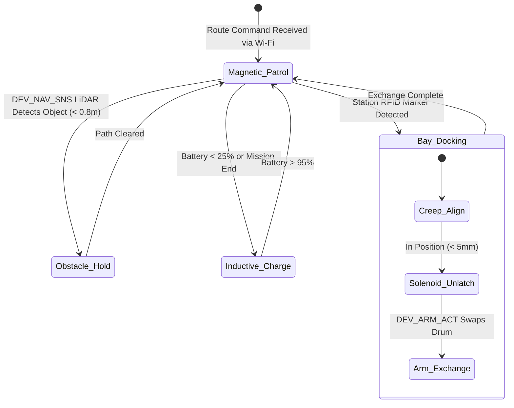

import { Card, CardGrid, LinkButton } from '@astrojs/starlight/components';

## Part 1: Stage Header & Executive Summary

> [!NOTE]
> **Stage Designation:** Stage 2 (Agentic Autonomous AI Pack)  
> **Operating Mode:** 24/7 Closed-Loop Autonomous Neural Telemetry & Robotics  
> **Network Mesh:** Encrypted Isolated Farm Wi-Fi (<code>POTFRM-4096</code> on 192.168.42.0/24) + BLE Tool Downlinks  
> **Safety Interlocks:** 250ms Hardware Deadman Watchdogs on all Edge Tools  
> **Edge AI Engine:** <code>llama-cpp-python</code> Local GGUF Multimodal Vision (Zero Cloud Dependence)  

The Stage 2 agentic pack elevates the **Ground Track AGV Pod Carrier** into a fully autonomous cyber-physical robotics cell operating under the **Controller-Node-Tool (CNT)** standard (RFC-0004) and **Agnostic Controller Runtime** (RFC-0006).

---

## Part 2: Capability Delta (Features Introduced)

* **Controller-Node-Tool (CNT) Hierarchy**: Heavy neural perception runs on the Central Biosphere Controller; the Machine Node coordinates local kinematics; tiny Edge Tools drive motors 1:1.
* **Isolated Farm AP Mesh**: Secure, air-gapped local Wi-Fi (<code>POTFRM-&lt;CLUSTER_ID&gt;</code> on <code>192.168.42.0/24</code>) with WebSocket node registration at <code>ws://192.168.42.1:8443/register</code>.
* **250ms Hardware Deadman Watchdogs**: Every Tool trips into safe, high-Z, zero-power state within 250 ms if signal is interrupted.
* **Local Zero-Cloud Edge AI**: Multi-agent perception via <code>llama-cpp-python</code> local vision models without internet dependencies.

---

## Part 3: Isolated Stage 2 Bill of Materials (BOM)

### Add-On 2 Bill of Materials (BOM)

| Item | Component Description | Sourcing / Part Reference | Qty | Unit Cost | Total Cost |
| :--- | :--- | :--- | :--- | :--- | :--- |
| **A2-01** | AGV Machine Node: ESP32-S3 (8MB PSRAM) + 0.96" OLED + Master DC Cut + SD Reset & Micro-SD Module | Espressif distributor | 1 | $16.00 | $16.00 |
| **A2-02** | 5-Channel Magnetic Track Induction Sensor + 1x ESP32-C3 Nav Tool | Robotics sensor store | 1 | $20.00 | $20.00 |
| **A2-03** | 360-Degree 2D LiDAR Scanner (RPLiDAR C1 / LD06) | Maker LiDAR distributor | 1 | $68.00 | $68.00 |
| **A2-04** | 3-Axis Mini Articulated Arm Kit + Servos + 1x ESP32-C3 Arm Tool | 3D printed + metal servos | 1 | $36.00 | $36.00 |
| **A2-05** | 120W Magnetic Inductive Wireless Charging Receiver Module | Wireless power supplier | 1 | $25.00 | $25.00 |
| **Total** | **Add-On 2 Agentic Autonomous Pack (CNT Standard)** | **Expands Base + Add-On 1** | | | **+$165.00** |
| **Full Build** | **Complete Autonomous Biosphere AGV Carrier** | **Base + Add-On 1 + Add-On 2** | | | **$497.00** |

---

---

## Part 4: Standalone Full SVG Blueprint


---

## Part 5: Step-by-Step Commissioning, Provisioning & Autonomous Runbook

Under [RFC-0004](/rfcs/rfc-0004-controller-node-tool) and [RFC-0006](/rfcs/rfc-0006-agnostic-controller-runtime), the **Agentic Autonomous AI Pack** transforms the AGV into a hierarchical **Controller-Node-Tool (CNT)** autonomous logistics carrier. Operating as a dedicated **AGV Node** commanding modular **Edge Tools** over BLE, it receives route schedules from the Central Biosphere Controller over Wi-Fi, tracks magnetic floor tape, scans for obstacles via 2D LiDAR, and transfers harvest totes with 250ms watchdog safety.

### Autonomous Vision & Telemetry Architecture
- **AGV Machine Node (ESP32-S3)**: Dual-Core Xtensa LX7 (240 MHz, 8 MB PSRAM) mounted in a protected central tray. Features an onboard 0.96" I2C OLED display (`[NODE: AGV-01 | LINK -> 4096]`) and setup push-button for mobile BLE provisioning. Uplinks to Central Controller via Wi-Fi; coordinates local kinematics and downlinks to Tools via BLE Central.
- **Dedicated Modular Edge Tools (ESP32-C3)**: Driven 1:1 by micro ESP32-C3 controllers equipped with 0.42" micro OLED displays and **250ms hardware deadman watchdogs**:
  - `DEV_TRACK_DRV`: Micro ESP32-C3 with 0.42" OLED (`TOOL: TRACK_DRV | LINK: OK`) + 250ms watchdog driving dual 24V track motor drivers (PWM/DIR) with current sensing.
  - `DEV_NAV_SNS`: Micro ESP32-C3 with 0.42" OLED (`TOOL: NAV_SNS | LINK: OK`) reading the 5-channel magnetic induction guide sensor and 360° 2D LiDAR scanner.
  - `DEV_ARM_ACT`: Micro ESP32-C3 with 0.42" OLED (`TOOL: ARM_ACT | LINK: OK`) + 250ms watchdog driving 3-axis articulated canister transfer arm servos.
  - `DEV_CHARGE_CTL`: Micro ESP32-C3 with 0.42" OLED (`TOOL: CHARGE_CTL | LINK: OK`) regulating the 120W wireless inductive floor charging receiver.
- **250ms Deadman Watchdog Fail-Safe**: If any Tool loses BLE connection to the AGV Node for $> 250$ ms, it drops immediately into high-Z safe state: track motors stop instantly and drop holding torque to zero, and the transfer arm freezes in place.

```text
       CONTROLLER-NODE-TOOL (CNT) HIERARCHICAL EDGE ARCHITECTURE
  =================================================================
            CENTRAL BIOSPHERE CONTROLLER (Agnostic Runtime / POTFRM-4096)
            • Emits Isolated Farm AP: SSID [POTFRM-4096] (192.168.42.0/24)
            • Global Logistics Routing, Zone Scheduling & Multi-Agent Dispatch
                                  │
                                  │ Isolated Farm Wi-Fi (192.168.42.0/24)
                                  ▼
             ┌─────────────────────────────────────────┐
             │         AGV MACHINE NODE (ESP32-S3)     │
             │  • OLED Display: [NODE: AGV-01]         │
             │  • Setup Push-Button for Mobile BLE     │
             │  • Kinematics, PD Line Tracking & RTOS  │
             └────────────────────┬────────────────────┘
                                  │
         ┌────────────────────────┼────────────────────────┐
         │ BLE Downlink           │ BLE Downlink           │ BLE Downlink
         ▼                        ▼                        ▼
 ┌───────────────┐        ┌───────────────┐        ┌───────────────┐
 │ TOOL:         │        │ TOOL:         │        │ TOOL:         │
 │ DEV_TRACK_DRV │        │ DEV_NAV_SNS   │        │ DEV_ARM_ACT   │
 │ ESP32-C3 Micro│        │ ESP32-C3 Micro│        │ ESP32-C3 Micro│
 │ 0.42" OLED    │        │ 0.42" OLED    │        │ 0.42" OLED    │
 │ 250ms Deadman │        │ 250ms Deadman │        │ 250ms Deadman │
 │ Dual 24V PWM  │        │ 5-Ch Magnetic │        │ 3-Axis Servos │
 │ Track Drive   │        │ 2D LiDAR Scnr │        │ Canister Arm  │
 └───────────────┘        └───────────────┘        └───────────────┘
                                  │
                                  ▼ (BLE Downlink)
                          ┌───────────────┐
                          │ TOOL:         │
                          │ DEV_CHARGE_CTL│
                          │ ESP32-C3 Micro│
                          │ 0.42" OLED    │
                          │ 120W Inductive│
                          │ Battery BMS   │
                          └───────────────┘
```

### Step-by-Step Sensor Commissioning & Edge AI Protocol

#### Step 3.1: AGV Node & Driver Assembly
1. Mount the ESP32-S3 Node with 0.96" I2C OLED display and physical setup push-button in the electronics tray above the battery deck.
2. Mount the `DEV_TRACK_DRV` tool board (ESP32-C3) and connect its PWM and DIR lines directly to the dual 15A motor driver inputs.
3. Verify driver current sensing and stall detection under track load.

#### Step 3.2: 5-Channel Magnetic Induction & LiDAR Integration
1. Mount the 5-channel magnetic sensor bar beneath the front chassis bumper ($20$ mm road clearance).
2. Mount the RPLiDAR C1 scanner on the elevated 150 mm center mast above the cargo bed.
3. Wire both sensors to the `DEV_NAV_SNS` tool board (ESP32-C3); verify magnetic line tracking and obstacle point cloud over tool OLED.

#### Step 3.3: 3-Axis Articulated Transfer Arm Mounting
1. Bolt the 3-axis mini transfer arm base to the front-right chassis corner.
2. Connect the three metal-gear servos (base pan, shoulder pitch, gripper clamp) to `DEV_ARM_ACT` tool board (ESP32-C3).
3. Program calibration positions: Stowed, Reaching, Gripping, and Lifted.

#### Step 3.4: Inductive Floor Charging Coil Installation
1. Mount the 120W wireless power receiver coil under the rear chassis plate ($15$ mm air gap clearance).
2. Wire the coil output through a synchronous rectifier and CC/CV charge controller directly into the LiFePO4 battery terminals via `DEV_CHARGE_CTL` tool.
3. Test dock alignment: navigating onto the transmitter plate initiates 24V 4.5A charging within 1.5 seconds.

#### Step 3.5: Provisioning & 250ms Watchdog Verification
1. Power on Central Controller; verify active Cluster ID on OLED, terminal stdout, or BLE beacon (`POTFRM-4096`).
2. Power on AGV Node; display shows `[NODE UNPAIRED - PAIR VIA BLE]`.
3. Press physical setup button on Node; connect via mobile companion app over BLE, enter `4096`.
4. Node commits credentials to NVS, links to `POTFRM-4096`, registers at `ws://192.168.42.1:8443/register`, and updates display to `[ONLINE | LINK -> 4096]`.
5. Verify Node auto-discovers and binds all four BLE Tools.
6. Test fail-safe watchdog: drop BLE link to `DEV_TRACK_DRV`; verify track motors cut to 0.0A in $< 250$ ms.



### Step-by-Step Autonomous Multi-Agent Runbook

1. **Autonomous Route Initiation**: On receiving a harvest dispatch from the Central Controller over Wi-Fi, the AGV unlatches from the inductive charging dock, powers its sensor array, and accelerates to 0.4 m/s.
2. **Magnetic Line-Tracking Loop**: The `DEV_NAV_SNS` tool runs a closed-loop PD steering algorithm at 100 Hz, centering the AGV over the magnetic floor tape with $< 4$ mm lateral drift.
3. **LiDAR Sentry & Obstacle Avoidance**: The 2D LiDAR continuously scans at 10 Hz. If an obstacle enters within 0.8 m of the track, the robot decelerates smoothly to a complete stop, sounding an alert tone until the path clears.
4. **Bioreactor Bay Precision Docking**: Upon sensing the magnetic RFID bay marker at the Revolving Sprout Bioreactor or Skimmer chute, the AGV drops speed to 0.05 m/s, using optical alignment to dock with $\pm 3$ mm precision.
5. **Autonomous Canister Transfer**: The `DEV_ARM_ACT` tool extends the 3-axis arm, clamps the spent drum handle, and pulls it onto the cargo bed. The AGV shuttles the ripe drum directly to the wash station.
6. **250ms Fail-Safe Watchdogs**: If BLE connection between Node and any Tool drops for $> 250$ ms, track motors halt and holding torque cuts to 0. If Wi-Fi link to Central Controller is lost, the AGV finishes its immediate local dock waypoint and halts in a safe siding.

---

## Part 6: Guided Stage Navigation

<CardGrid>
  <Card title="Stage 1: BLE Electromechanical Pack" icon="left-arrow">
    Review the motorized powertrain, Two-Control enclosure wiring, and BLE Virtual Panel.
    <br/><br/>
    <LinkButton href="/open-biosphere/hardware/ground-track-agv/stage-1/" variant="minimal">← Previous: Stage 1 Upgrade</LinkButton>
  </Card>
  <Card title="Subsystem Overview" icon="right-arrow">
    Return to the machine overview, crop affinity matrix, and master biosphere interlocks.
    <br/><br/>
    <LinkButton href="/open-biosphere/hardware/ground-track-agv/" variant="primary">Return to Overview →</LinkButton>
  </Card>
</CardGrid>
