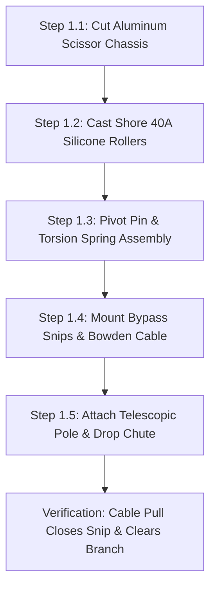
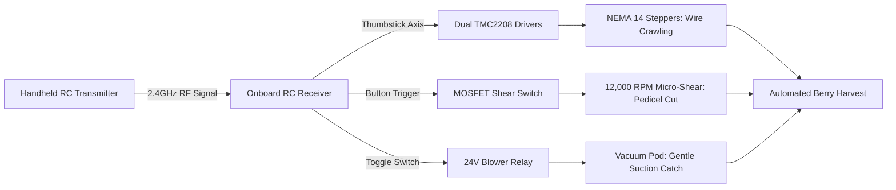
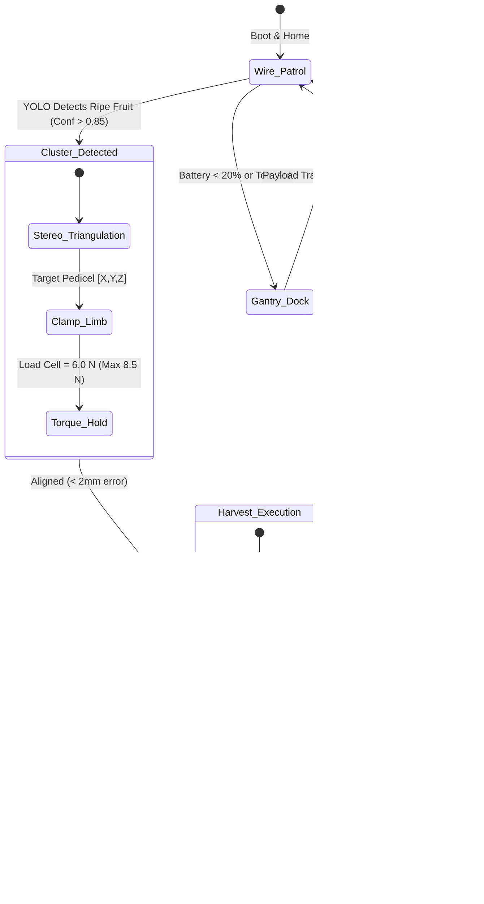

import { Card, CardGrid } from '@astrojs/starlight/components';

The **Mantis Branch-Crawler Robot** is an agile, limb-climbing harvesting robot designed to navigate the rigid horizontal wire guideframes of espalier-trained fruit bushes. It can be constructed as a standalone robotic harvester for orchard trellises, vineyards, and greenhouse espaliers, or deployed along the Trellised Espalier wall of the master Open Biosphere assembly.

---

## 1. Standalone Homesteading & Off-Grid Utility

Delicate soft fruits such as mulberries, blackberries, and goldenberries bruise easily when picked with conventional robotic grippers or shaken mechanically. The Mantis crawler solves this with **soft-silicone pinch locomotion and cushioned vacuum-assisted harvesting**:

<CardGrid>
  <Card title="Espalier & Trellis Agility" icon="anchor">
    Traverses standard 1/8-inch orchard guide wires and woody limbs (6 mm to 22 mm diameter) without slipping, stripping bark, or crushing vascular xylem.
  </Card>
  <Card title="Zero-Bruise Vacuum Catch" icon="feather">
    Pneumatic suction pulls ripe fruit into a foam-lined funnel simultaneously with pedicel micro-shearing, eliminating drop damage completely.
  </Card>
  <Card title="Stereo Multispectral Ripeness" icon="eye">
    Dual RGB-NIR cameras run on-device YOLO edge segmentation, distinguishing ripe, sugar-rich berries from unripe green fruit under variable lighting.
  </Card>
  <Card title="Off-Grid Battery or Tethered" icon="battery">
    Runs on standard 18V/20V tool batteries (Makita, DeWalt) for portable field use, or plugs into a 24V bus rail for continuous greenhouse operation.
  </Card>
</CardGrid>

---

## 2. Technical Specifications

| Parameter | Specification |
| :--- | :--- |
| **Locomotion** | Dual-opposed silicone roller pinch drive (Shore 40A durometer) |
| **Limb Clamping Force** | Dynamic 2.0 to 8.5 N closed-loop torque control |
| **End-Effector** | High-precision micro-rotary shear + pneumatic vacuum catch pod |
| **Harvest Cycle Time** | 4.2 seconds per fruit |
| **Onboard Compute** | Raspberry Pi 5 (4GB) + Hailo-8L AI Accelerator (13 TOPS) |
| **Vision Modality** | Dual-stereo RGB + 850nm NIR structured light illuminator |
| **Traversable Angle** | Up to 65° incline along tensioned trellis wire or woody espalier arms |
| **Weight** | 1.85 kg (chassis + battery + end-effector) |
| **Power Supply** | 0W (Manual) / 18V Tool Battery (Add-On 1) / 24V Tethered Bus (Add-On 2) |

---

## 3. Instructions (Base Zero-Power Machine)

The baseline build of the Mantis Branch-Crawler is a **100% mechanical, zero-power pole-mounted harvesting tool**. It utilizes human leverage transmitted through a standard bicycle Bowden cable, high-grip cast silicone pinch rollers, and spring-loaded bypass snips. It allows homesteaders to harvest high espalier branches without ladders, batteries, or electronics.

### Mechanical Architecture & Decoupling Standard
1. **Scissor Chassis**: Two laser-cut 2 mm aluminum side plates pivot around a hardened 6 mm steel central pin, pre-loaded by an adjustable torsion spring (20 N resting clamp force).
2. **Shore 40A Silicone Pinch Rollers**: Two opposed concave rollers cast in two-part platinum silicone grip trellis wires or branches from 6 mm to 22 mm diameter with zero slippage and zero bark abrasion.
3. **Bowden Cable Actuation**: Squeezing a bicycle brake lever mounted at the base of a 1.8 m to 3.6 m telescopic pole tensions a stainless Bowden cable, closing the spring bypass snips around the berry pedicel.
4. **Mechanical Decoupling**: The motor mounting plates incorporate quick-release cam latches. When electric motors are added in later tiers, flipping the cam latches disengages the motor pinions from the roller drive gears, allowing the crawler to glide manually along trellis lines with zero cogging resistance.

```
          MANTIS BRANCH-CRAWLER — BASE MECHANICAL ELEVATION
  =================================================================
                 [Espalier Branch or 1/8" Trellis Wire]
         ========================+========================
                                 |
                     (Concave Silicone Roller 1)
                     /-------------------------\
                     |   [Shore 40A Silicone]  |
                     \-------------------------/
                                 |
                                 +-----[Pivot Bolt 6mm]
                                 |     (Torsion Spring)
                     /-------------------------\
                     |   [Shore 40A Silicone]  |
                     \-------------------------/
                     (Concave Silicone Roller 2)
                                 |
                +----------------+----------------+
                |                                 |
        [Bypass Micro-Snip]              [Foam-Lined Funnel]
        (Spring-Return Blade)            (3D-Printed PETG)
                |                                 |
         [Bowden Cable]                    [Drop Chute]
                |                                 |
                v                                 v
         (Telescopic Pole)               (Soft Catch Tote)
         (Bicycle Lever)
```

### Step-by-Step Fabrication & Assembly Protocol

#### Step 1.1: Chassis Plate Cutting & Deburring
1. Cut two identical scissor chassis plates from 2.0 mm 5052 aluminum sheet using CNC router, laser, or hand jigsaw template.
2. Drill the 6.0 mm central pivot hole and two 8.0 mm roller axle holes.
3. Chamfer all edges with a deburring tool to eliminate sharp burrs that could fray cables or scratch plant bark.
4. Anodize or spray-coat plates with self-etching primer to prevent aluminum oxidation in humid greenhouse air.

#### Step 1.2: Silicone Pinch Roller Mold Casting
1. 3D-print two-piece split molds in PETG at 0.16 mm layer height for the concave hourglass rollers (outer diameter 45 mm, waist diameter 32 mm).
2. Spray mold release into both cavities. Press an 8 mm bore flanged bronze sleeve bushing onto the center core pin.
3. Mix two-part platinum cure silicone (Shore 40A) in a 1:1 ratio by weight. Vacuum degas for 8 minutes to eliminate trapped air bubbles.
4. Pour silicone into molds and cure at room temperature for 16 hours. Demold and trim flash with a scalpel.

#### Step 1.3: Scissor Linkage & Torsion Spring Rigging
1. Assemble the two aluminum plates around the 6.0 mm hardened pivot pin with PTFE thrust washers between the plates.
2. Install a wound music-wire torsion spring ($k = 0.45\text{ N}\cdot\text{mm/deg}$) over the pivot pin, seating spring legs into pre-drilled holes in the scissor arms.
3. Install the cast silicone rollers on 8 mm stainless shoulder bolts with nylon-insert locknuts. Verify completely smooth rotation ($< 0.02\text{ N}\cdot\text{m}$ rolling resistance).

#### Step 1.4: Bypass Micro-Snip & Bowden Cable Rigging
1. Mount a pair of carbon-steel bonsai bypass snip blades onto the forward extension arm using M4 standoffs.
2. Anchor the Bowden cable outer casing to the chassis cable stop bracket.
3. Thread the 1.2 mm stainless inner wire through the moving snip blade lever, clamping with an M3 brass cable barrel nut.
4. Verify mechanical stroke: a 15 mm pull on the Bowden cable fully closes the snip blades against their internal return spring.

#### Step 1.5: Telescopic Pole & Collection Chute Mounting
1. Bolt the crawler base bracket to the standard 3/4" Acme male thread of a 1.8 m to 3.6 m telescopic aluminum/fiberglass pole.
2. Clamp a standard ergonomic bicycle brake lever to the bottom handle of the pole.
3. Route the Bowden cable along the pole length using hook-and-loop straps.
4. Zip-tie a lightweight flexible ripstop nylon drop chute (diameter 80 mm) directly below the snip blades, leading down into a waist-mounted soft collection basket.



### Step-by-Step Operating Runbook (Manual Mode)

1. **Pre-Harvest Inspection**: Inspect the espalier wall. Ensure trellis guide wires are tensioned to $\ge 400$ N and clear of dead wood or thick entangling vines.
2. **Pole Height Adjustment**: Unlock the telescopic pole collar, extend to reach the target branch height ($1.8$ to $3.0$ m), and tighten twist collar securely.
3. **Engaging the Trellis Wire**: Lift the Mantis head upward against the underside of the horizontal trellis wire or woody branch (6 mm to 22 mm diameter). The spring-loaded scissor arms automatically part and snap shut, seating the wire into the concave silicone roller waist.
4. **Targeting Fruit Cluster**: Push or pull the pole along the wire until the bypass snip jaw frames the ripe berry pedicel (stem).
5. **Executing the Cut**: Squeeze the bicycle lever at the pole base firmly. The Bowden cable pulls the micro-snip shut, severing the pedicel cleanly without tugging or jarring neighboring fruit.
6. **Zero-Bruise Catch**: The severed berry drops immediately into the padded collection funnel, sliding down the soft ripstop nylon chute into the waist tote.
7. **Disengagement & Storage**: Pull down on the pole firmly at a 30° rearward angle to cam the scissor arms open and release from the trellis wire. Wipe snip blades with isopropyl alcohol to prevent sap gumming.

### Base Machine Bill of Materials (BOM)

| Item | Component Description | Sourcing / Part Reference | Qty | Unit Cost | Total Cost |
| :--- | :--- | :--- | :--- | :--- | :--- |
| **M-01** | Laser-Cut 2mm 5052 Aluminum Scissor Chassis Plates | Local fab / SendCutSend | 2 | $9.00 | $18.00 |
| **M-02** | Cast Shore 40A Platinum Silicone Hourglass Rollers | DIY cast in 3D molds | 2 | $9.00 | $18.00 |
| **M-03** | Telescopic Fiberglass/Aluminum Extension Pole (1.8–3.6m) | Hardware store pole tool | 1 | $24.00 | $24.00 |
| **M-04** | Bowden Cable Assembly (2.5m stainless + lined housing) | Bicycle parts supplier | 1 | $8.00 | $8.00 |
| **M-05** | Ergonomic Aluminum Bicycle Hand Brake Squeeze Lever | Bicycle parts supplier | 1 | $6.00 | $6.00 |
| **M-06** | Carbon Steel Spring-Loaded Bypass Micro-Snip Blades | Bonsai / orchard tool store | 1 | $11.00 | $11.00 |
| **M-07** | 3D-Printed PETG Funnel + Ripstop Nylon Gravity Drop Chute | DIY 3D print + fabric | 1 | $8.00 | $8.00 |
| **Total** | **Base Zero-Power Harvester Build** | **Complete manual off-grid tool** | | | **$93.00** |

---

## 4. Add-On 1: Semi-Autonomous Electromechanical Pack (Buttons & Dials)

The **Semi-Autonomous Pack** adds motorized locomotion, an electric rotary pedicel shear, an active pneumatic vacuum catch pod, and a handheld 2.4 GHz RC radio or wired push-button pendant. The operator guides the crawler along espaliers with a thumbstick and harvests berries on demand with a button press.

### Electromechanical Actuation Architecture & Decoupling
- **Drive Locomotion**: Dual NEMA 14 planetary pancake steppers (10:1 reduction) driving the silicone pinch rollers via steel spur gears ($120\text{ mm/s}$ traverse speed along wire).
- **Mechanical Decoupling**: Quick-release spring cam levers swing motor pinion gears out of mesh with roller gears. If battery dies, the robot can be pushed or pulled by hand along the wire without motor drag.
- **High-Speed Rotary Shear**: 12V 12,000 RPM coreless DC micro-motor driving a 15 mm stainless circular slitting saw blade that cuts woody pedicels in $< 0.1$ seconds.
- **Active Vacuum Collection**: A 24V miniature centrifugal blower fan (5015 blower, $4.8\text{ CFM}$) draws suction through a soft silicone intake cowl, pulling the berry gently toward the blade and catching it without manual aiming.
- **Operator Control**: 2.4 GHz 4-channel RC transmitter/receiver (or tethered 4-button pendant: Forward, Reverse, Shear Pulse, Vacuum Toggle).

```
       ELECTROMECHANICAL WIRING & RC CONTROL SCHEMATIC
  =================================================================
  [18V/20V Tool Battery or 24V Umbilical]
         |
         +----[Main Power Switch]----+----(Power LED)
         |                           |
         +----[DC-DC Buck: 12V]      +----[DC-DC Buck: 5V]
         |          |                              |
         |          v                              v
         |   [Coreless Shear Motor]          [RC Receiver Node]
         |   (Via MOSFET Trigger)                  |
         |                                         +---> CH1/CH2 (PPM)
         |                                         |          |
         +----[24V Blower Fan]                     |          v
         |    (Suction Pod)                        |    [Dual TMC2208]
         |                                         |          |
         +-----------------------------------------+          v
                                                         [Dual NEMA 14]
                                                         (Drive Steppers)
```

### Step-by-Step Retrofit Protocol

#### Step 2.1: NEMA 14 Motor Bracket Mounting
1. Bolt aluminum motor swing-plates to the chassis outer plate using M3 shoulder pivot bolts.
2. Mount NEMA 14 planetary pancake steppers onto the swing-plates with M3 button-head cap screws.
3. Press 16T brass pinion gears onto the 5 mm motor output D-shafts.
4. Align pinions with the 40T spur gears attached to the silicone roller shafts. Set mesh backlash to 0.1 mm; lock with spring cam toggle.

#### Step 2.2: Rotary Micro-Shear Tool Installation
1. Replace the manual bypass snip with the 12V high-speed coreless rotary cutter bracket on the front arm.
2. Secure the 15 mm ultra-thin circular slitting saw blade onto the motor hub with an M2.5 central arbor screw.
3. Install a 3D-printed polycarbonate blade guard with a 4 mm protective slot to prevent branch contact.

#### Step 2.3: Active Pneumatic Vacuum Pod Installation
1. Mount the 5015 centrifugal blower fan to the underside chassis deck using M3 silicone vibration dampers.
2. Connect a flexible 38 mm clear polyurethane corrugated suction hose from the blower inlet to the 3D-printed soft TPU collection funnel.
3. Position the suction mouth 10 mm behind the circular saw blade, angled upward at 25°.

#### Step 2.4: Control Board & Dual TMC2208 Driver Wiring
1. Mount a compact electronics enclosure (80 × 50 × 25 mm) on the rear chassis spine.
2. Seat two TMC2208 stepper drivers on a shared carrier board with heatsinks.
3. Wire the NEMA 14 stepper coils to driver outputs; connect STEP/DIR signals to the RC receiver pulse channels.
4. Install an N-channel logic-level MOSFET (IRLZ44N) to switch 12V power to the rotary shear motor.

#### Step 2.5: Battery Umbilical & Receiver Pairing
1. Mount a slide-in adapter shoe for standard 18V tool batteries (Makita 18V or DeWalt 20V Max).
2. Wire battery output through a 10A fuse and rocker power switch.
3. Bind the 4-channel 2.4 GHz handheld radio transmitter to the onboard receiver.
4. Verify channel mapping: Left thumbstick drives Forward/Reverse locomotion; Right index button triggers 0.5-second rotary shear pulse; Right thumb switch toggles vacuum blower.



### Step-by-Step Push-Button Operating Runbook

1. **Battery Insertion & System Check**: Slide an 18V 2.0Ah tool battery into the adapter shoe. Flip master power switch ON (solid green status LED). Turn on the handheld RC transmitter.
2. **Mounting on Wire Guideframe**: Manually hook the crawler onto the espalier wire at the row end. The silicone rollers self-center on the wire.
3. **Traverse Navigation via Joystick**: Push the left thumbstick forward. The dual NEMA 14 steppers roll the crawler smoothly along the wire at up to 120 mm/s.
4. **Targeting Fruit Pedicel**: As the crawler approaches a ripe mulberry cluster, slow speed to 20 mm/s. Toggle the vacuum switch ON; the soft TPU funnel draws the berry snugly into the intake cowl.
5. **Executing the Micro-Shear**: Press the right index trigger. The 12,000 RPM rotary shear spins for a 0.4-second pulse, slicing through the pedicel instantly. The berry is sucked through the clear hose into the rear tote.
6. **Continuous Row Harvesting**: Move forward to the next fruit cluster. When the row ends, reverse back or unhook using the quick-release scissor lever.

### Add-On 1 Bill of Materials (BOM)

| Item | Component Description | Sourcing / Part Reference | Qty | Unit Cost | Total Cost |
| :--- | :--- | :--- | :--- | :--- | :--- |
| **A1-01** | NEMA 14 Planetary Pancake Steppers (10:1 ratio, 5mm shaft) | Motion / 3D printer store | 2 | $18.00 | $36.00 |
| **A1-02** | Brass Pinion & Spur Gear Drive Set (16T/40T, Mod 0.5) | Precision hobby gear kit | 2 | $6.00 | $12.00 |
| **A1-03** | 12V Coreless 12,000 RPM Micro-Shear Motor + 15mm Blade | Micro-robotics supplier | 1 | $15.00 | $15.00 |
| **A1-04** | 24V 5015 Centrifugal Vacuum Blower + TPU Funnel Pod | Blower fan supplier | 1 | $18.00 | $18.00 |
| **A1-05** | 2.4 GHz 4-Channel Compact RC Transmitter & Receiver | Hobby RC supplier | 1 | $28.00 | $28.00 |
| **A1-06** | Dual TMC2208 Stepper Driver Carrier Board + MOSFET | Maker electronics shop | 1 | $16.00 | $16.00 |
| **A1-07** | Universal 18V Tool Battery Adapter Shoe + Fuse Block | Battery tooling parts | 1 | $10.00 | $10.00 |
| **Total** | **Add-On 1 Electromechanical Pack** | **Retrofits directly to Base** | | | **+$135.00** |
| **Cumul.** | **Operational Remote-Controlled Harvester** | **Base ($93) + Add-On 1 ($135)** | | | **$228.00** |

---

## 5. Add-On 2: Agentic Autonomous AI Pack (Edge Vision & Closed Loop)

The **Agentic Autonomous AI Pack** elevates the Mantis Crawler into an unsupervised autonomous harvesting robot. Driven by an onboard neural accelerator, stereo RGB-NIR cameras, and micro-load cell clamping feedback, the robot patrols espaliers, calculates 3D pedicel cutting vectors, regulates limb grip force to 8.5 N max, and auto-harvests without human intervention.

### Autonomous Vision & Telemetry Architecture
- **Edge AI Compute Core**: Raspberry Pi 5 (4GB) paired with a Hailo-8L M.2 AI Acceleration HAT delivering 13 TOPS of neural inference at $< 5$W power consumption.
- **Multispectral Stereo Vision**: Dual Sony IMX219 camera modules (baseline 60 mm) with 850 nm optical bandpass filters and synchronized infrared pulse LEDs for invariant day/night ripeness segmentation.
- **Closed-Loop Clamping Feedback**: Integrated micro-load cell on the scissor hinge amplified by an HX711 24-bit ADC, dynamically governing limb clamping force between 2.0 N (traverse) and 8.5 N (stationary shear stability).
- **Robotic Docking Interlock**: Overhead gantry slip-ring auto-dock latch and gravity produce drop chute for automated payload transfer to the Ground Track AGV.

```
       CYBER-PHYSICAL EDGE AI ARCHITECTURE & STEREO TELEMETRY
  =================================================================
               +--------------------------------------+
               |    Raspberry Pi 5 + Hailo-8L HAT     |
               | (YOLOv8 Edge Segmentation @ 45 FPS)  |
               +---+--------------------+---------+---+
                   |                    |         |
         +---------+----+               | CSI     | I2C / SPI
         | UART / CAN   |               v         v
         v              v       [Dual Sony IMX219] [HX711 Load Cell]
   [TMC2209 Drivers] [Master    (Stereo RGB-NIR)   (8.5N Clamp Max)
         |            Biosphere]        |                 |
         v                              v                 v
   [NEMA 14 Pinch]              [3D Pedicel Vector] [Limb Protection]
```

### Step-by-Step Sensor Commissioning & Edge AI Protocol

#### Step 3.1: Raspberry Pi 5 & Hailo-8L HAT Installation
1. Seat the Hailo-8L M.2 AI module into the PCIe M.2 HAT and bolt atop the Raspberry Pi 5 with brass standoffs.
2. Mount the compute stack inside an IP54 vented enclosure on the rear spine of the crawler.
3. Connect power via an onboard 5V 5A synchronous step-down DC-DC converter tapped from the 24V bus rail.

#### Step 3.2: Stereo RGB-NIR Camera Rigging & Calibration
1. Mount dual Sony IMX219 camera sensors in a rigid 3D-printed PETG crossbar with exactly 60 mm optical separation.
2. Install 850 nm optical bandpass filters over both lenses to isolate chlorophyll reflection shifts.
3. Run OpenCV stereo camera calibration using a 9×6 chessboard target ($< 0.18$ px reprojection error).

#### Step 3.3: Micro-Load Cell Clamping Sensor Integration
1. Mount a 20 N miniature bending beam load cell between the scissor clamping arm and the tensioning actuator.
2. Connect load cell leads to an HX711 24-bit ADC module wired to Raspberry Pi GPIO (Clock: GPIO 23, Data: GPIO 24).
3. Calibrate load cell reading against a precision 500 g calibration weight ($0.05$ N resolution).

#### Step 3.4: Overhead Gantry Slip-Ring Auto-Dock Latch
1. Install an overhead spring-loaded pogo-pin power shoe on top of the chassis.
2. Align the pogo-pin shoe with the overhead gantry 24V DC bus line.
3. Install an optical fiducial marker on the docking shoe for gantry camera alignment.

#### Step 3.5: Neural Network Deployment & Closed-Loop Tuning
1. Compile the custom YOLOv8-Harvest model using the Hailo Dataflow Compiler into an optimized `.hef` neural binary.
2. Verify inference speed on Raspberry Pi 5: dual-camera ripeness detection and 3D pedicel bounding boxes execute at 45 FPS.
3. Test closed-loop clamping script: ensure motor torque instantly backs off if load cell reading exceeds 8.5 N.



### Step-by-Step Autonomous Multi-Agent Runbook

1. **Autonomous Wakeup & Rail Scan**: On receiving a scheduled patrol command from the biosphere master over CAN bus, the Mantis crawler unlatches from its gantry docking shoe, clamps to the trellis wire at 4.0 N, and traverses at 60 mm/s.
2. **On-Device Multispectral Detection**: The Hailo-8L neural core continuously analyzes 60 FPS video feeds. It identifies fruit clusters, classifies ripeness using NIR spectral absorption ratios (distinguishing deep purple ripe mulberries from red/green unripened fruit), and flags candidate targets.
3. **3D Stereo Pedicel Triangulation**: The stereo camera calculates Euclidean pedicel coordinates relative to the rotary saw blade datum to $\pm 1.5$ mm accuracy.
4. **Adaptive 8.5 N Branch Clamping**: The scissor servo clamps the branch. The HX711 load cell monitors contact force at 80 Hz; if force reaches 8.5 N, clamp motion halts instantly, securing the cutter rigidly without crushing plant cambium tissue.
5. **Vacuum Shear Execution**: The 24V blower spins up; vacuum pulls the fruit into the TPU funnel; the rotary saw blade pulses for 300 ms, severing the pedicel cleanly. The fruit glides into the internal payload hopper.
6. **AGV Produce Handoff**: When the internal hopper load cell reads 1.5 kg, the crawler travels to the nearest vertical drop flume, signaling the Ground Track AGV pod carrier below. It actuates its bottom trapdoor, dropping berries into the AGV's soft tote before resuming patrol.

### Add-On 2 Bill of Materials (BOM)

| Item | Component Description | Sourcing / Part Reference | Qty | Unit Cost | Total Cost |
| :--- | :--- | :--- | :--- | :--- | :--- |
| **A2-01** | Raspberry Pi 5 (4GB RAM) Single Board Computer | Official Pi distributor | 1 | $60.00 | $60.00 |
| **A2-02** | Hailo-8L M.2 AI Acceleration Module (13 TOPS) + PCIe HAT | AI hardware distributor | 1 | $35.00 | $35.00 |
| **A2-03** | Dual Sony IMX219 Stereo RGB-NIR Camera Modules + Lens | Camera sensor supplier | 2 | $18.00 | $36.00 |
| **A2-04** | 20 N Miniature Bending Beam Load Cell + HX711 24-bit ADC | Precision scale sensor shop | 1 | $14.00 | $14.00 |
| **A2-05** | 5V 5A High-Efficiency Step-Down DC-DC Power Module | Power electronics supplier | 1 | $14.00 | $14.00 |
| **A2-06** | Overhead Gantry Spring-Loaded Pogo-Pin Docking Shoe | Custom 3D + spring pins | 1 | $18.00 | $18.00 |
| **Total** | **Add-On 2 Agentic Autonomous Pack** | **Expands Base + Add-On 1** | | | **+$177.00** |
| **Full Build** | **Complete Autonomous Trellis Harvester Robot** | **Base + Add-On 1 + Add-On 2** | | | **$405.00** |

---

## 6. Staged Upgrade Progression & Cost Summary

### Build Tier Comparison

| Build Stage | Operational Capability | Direct Stage Cost | Cumulative Investment |
| :--- | :--- | :--- | :--- |
| **Base: Instructions** | 100% mechanical pole-mounted pruner and squeeze clamp with gravity collection | $93.00 | **$93.00** |
| **Add-On 1: Semi-Auto** | Motorized pinch climb, vacuum fruit funnel, and handheld RC radio joystick steering | +$135.00 | **$228.00** |
| **Add-On 2: Agentic AI** | On-device YOLOv8 neural pedicel detection, 8.5N grip limiting, and auto-harvesting | +$177.00 | **$405.00** |

### Step-by-Step Zero-Waste Conversion Roadmap

#### Path 1: Base Machine $\rightarrow$ Add-On 1 (Electromechanical RC Upgrade)
1. Remove the manual telescopic pole from the base clamp.
2. Swing the aluminum motor swing-plates into position and bolt the NEMA 14 pancake steppers onto the chassis plates.
3. Replace the manual bypass snip blade with the 12V coreless rotary micro-shear tool and 5015 vacuum blower funnel.
4. Mount the battery shoe and RC receiver enclosure onto the spine, connect the 18V tool battery, and operate via the handheld RC transmitter. The silicone rollers and scissor frame remain 100% identical.

#### Path 2: Add-On 1 $\rightarrow$ Add-On 2 (Autonomous Edge AI Upgrade)
1. Disconnect the 2.4 GHz RC receiver from the motor carrier board.
2. Bolt the Raspberry Pi 5 + Hailo-8L compute stack onto the rear chassis deck.
3. Mount the dual Sony IMX219 stereo camera bar on the forward chassis snout.
4. Wire the HX711 load cell into the scissor hinge, connect the 24V overhead gantry slip-ring shoe, and boot the autonomous ROS2 harvesting daemon.

---

## 7. Master Biosphere Assembly Interlock

When integrated into the centralized Open Biosphere facility (~20 × 10 ft footprint):

1. **Perimeter Wall Indexing**: Navigates the rigid 1/8" stainless guideframe wires running along the North-East vertical boundary wall ($Z = 760$ to $1,220$ mm), servicing espaliered bush mulberries and goldenberries.
2. **Tethered DC Bus**: Draws continuous 24V power from an overhead slip-ring cable running along the gantry rail, eliminating battery swap downtime.
3. **Pneumatic Transfer**: Deposits harvested berries directly into the Ground Track AGV transit bins stationed on the Perimeter Lower Tier.
4. **Biosphere Central Telemetry**: Broadcasts real-time crop ripeness maps, yield counts, and branch stress metrics over CAN bus to the central facility dashboard.
