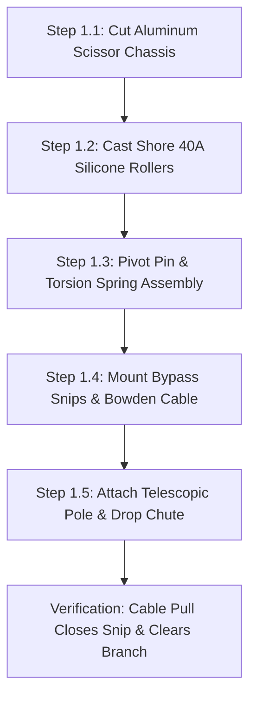
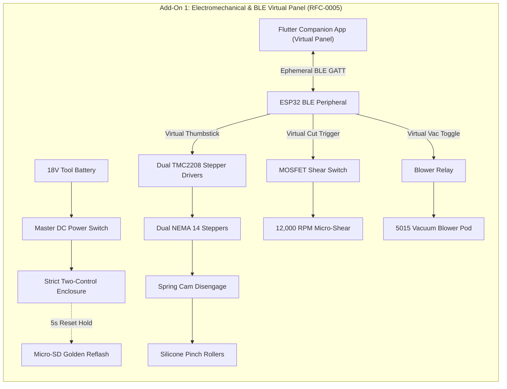
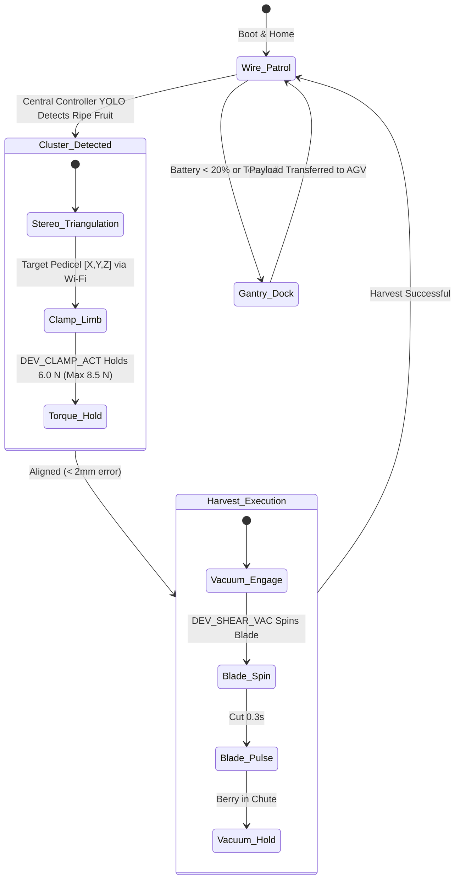

import { Card, CardGrid } from '@astrojs/starlight/components';

The **Mantis Branch-Crawler Robot** is an agile, limb-climbing harvesting robot designed to navigate the rigid horizontal wire guideframes of espalier-trained fruit bushes. It can be constructed as a standalone robotic harvester for orchard trellises, vineyards, and greenhouse espaliers, or deployed along the Trellised Espalier wall of the master Open Biosphere assembly.

---

## 1. Standalone Homesteading & Off-Grid Utility

Delicate soft fruits such as mulberries, blackberries, and goldenberries bruise easily when picked with conventional robotic grippers or shaken mechanically. The Mantis crawler solves this with **soft-silicone pinch locomotion and cushioned vacuum-assisted harvesting**:

<CardGrid>
  <Card title="Espalier & Trellis Agility" icon="anchor">
    Traverses standard 1/8-inch orchard guide wires and woody limbs (6 mm to 22 mm diameter) without slipping, stripping bark, or crushing vascular xylem.
  </Card>
  <Card title="Zero-Bruise Vacuum Catch" icon="feather">
    Pneumatic suction pulls ripe fruit into a foam-lined funnel simultaneously with pedicel micro-shearing, eliminating drop damage completely.
  </Card>
  <Card title="Stereo Multispectral Ripeness" icon="eye">
    Dual RGB-NIR cameras run on-device YOLO edge segmentation, distinguishing ripe, sugar-rich berries from unripe green fruit under variable lighting.
  </Card>
  <Card title="Off-Grid Battery or Tethered" icon="battery">
    Runs on standard 18V/20V tool batteries (Makita, DeWalt) for portable field use, or plugs into a 24V bus rail for continuous greenhouse operation.
  </Card>
</CardGrid>

---

## 2. Technical Specifications

| Parameter | Specification |
| :--- | :--- |
| **Locomotion** | Dual-opposed silicone roller pinch drive (Shore 40A durometer) |
| **Limb Clamping Force** | Dynamic 2.0 to 8.5 N closed-loop torque control |
| **End-Effector** | High-precision micro-rotary shear + pneumatic vacuum catch pod |
| **Harvest Cycle Time** | 4.2 seconds per fruit |
| **Compute Architecture** | ESP32-S3 Mantis Node + ESP32-C3 Modular Tools (Vision offloaded to Central Controller) |
| **Vision Modality** | Dual-stereo RGB + 850nm NIR structured light illuminator |
| **Traversable Angle** | Up to 65° incline along tensioned trellis wire or woody espalier arms |
| **Weight** | 1.85 kg (chassis + battery + end-effector) |
| **Power Supply** | 0W (Manual) / 18V Tool Battery (Add-On 1) / 24V Tethered Bus (Add-On 2) |

---

## 3. Instructions (Base Zero-Power Machine)

The baseline build of the Mantis Branch-Crawler is a **100% mechanical, zero-power pole-mounted harvesting tool**. It utilizes human leverage transmitted through a standard bicycle Bowden cable, high-grip cast silicone pinch rollers, and spring-loaded bypass snips. It allows homesteaders to harvest high espalier branches without ladders, batteries, or electronics.

### Mechanical Architecture & Decoupling Standard
1. **Scissor Chassis**: Two laser-cut 2 mm aluminum side plates pivot around a hardened 6 mm steel central pin, pre-loaded by an adjustable torsion spring (20 N resting clamp force).
2. **Shore 40A Silicone Pinch Rollers**: Two opposed concave rollers cast in two-part platinum silicone grip trellis wires or branches from 6 mm to 22 mm diameter with zero slippage and zero bark abrasion.
3. **Bowden Cable Actuation**: Squeezing a bicycle brake lever mounted at the base of a 1.8 m to 3.6 m telescopic pole tensions a stainless Bowden cable, closing the spring bypass snips around the berry pedicel.
4. **Mechanical Decoupling**: The motor mounting plates incorporate quick-release cam latches. When electric motors are added in later tiers, flipping the cam latches disengages the motor pinions from the roller drive gears, allowing the crawler to glide manually along trellis lines with zero cogging resistance.

```
          MANTIS BRANCH-CRAWLER — BASE MECHANICAL ELEVATION
  =================================================================
                 [Espalier Branch or 1/8" Trellis Wire]
         ========================+========================
                                 |
                     (Concave Silicone Roller 1)
                     /-------------------------\
                     |   [Shore 40A Silicone]  |
                     \-------------------------/
                                 |
                                 +-----[Pivot Bolt 6mm]
                                 |     (Torsion Spring)
                     /-------------------------\
                     |   [Shore 40A Silicone]  |
                     \-------------------------/
                     (Concave Silicone Roller 2)
                                 |
                +----------------+----------------+
                |                                 |
        [Bypass Micro-Snip]              [Foam-Lined Funnel]
        (Spring-Return Blade)            (3D-Printed PETG)
                |                                 |
         [Bowden Cable]                    [Drop Chute]
                |                                 |
                v                                 v
         (Telescopic Pole)               (Soft Catch Tote)
         (Bicycle Lever)
```

### Step-by-Step Fabrication & Assembly Protocol

#### Step 1.1: Chassis Plate Cutting & Deburring
1. Cut two identical scissor chassis plates from 2.0 mm 5052 aluminum sheet using CNC router, laser, or hand jigsaw template.
2. Drill the 6.0 mm central pivot hole and two 8.0 mm roller axle holes.
3. Chamfer all edges with a deburring tool to eliminate sharp burrs that could fray cables or scratch plant bark.
4. Anodize or spray-coat plates with self-etching primer to prevent aluminum oxidation in humid greenhouse air.

#### Step 1.2: Silicone Pinch Roller Mold Casting
1. 3D-print two-piece split molds in PETG at 0.16 mm layer height for the concave hourglass rollers (outer diameter 45 mm, waist diameter 32 mm).
2. Spray mold release into both cavities. Press an 8 mm bore flanged bronze sleeve bushing onto the center core pin.
3. Mix two-part platinum cure silicone (Shore 40A) in a 1:1 ratio by weight. Vacuum degas for 8 minutes to eliminate trapped air bubbles.
4. Pour silicone into molds and cure at room temperature for 16 hours. Demold and trim flash with a scalpel.

#### Step 1.3: Scissor Linkage & Torsion Spring Rigging
1. Assemble the two aluminum plates around the 6.0 mm hardened pivot pin with PTFE thrust washers between the plates.
2. Install a wound music-wire torsion spring ($k = 0.45\text{ N}\cdot\text{mm/deg}$) over the pivot pin, seating spring legs into pre-drilled holes in the scissor arms.
3. Install the cast silicone rollers on 8 mm stainless shoulder bolts with nylon-insert locknuts. Verify completely smooth rotation ($< 0.02\text{ N}\cdot\text{m}$ rolling resistance).

#### Step 1.4: Bypass Micro-Snip & Bowden Cable Rigging
1. Mount a pair of carbon-steel bonsai bypass snip blades onto the forward extension arm using M4 standoffs.
2. Anchor the Bowden cable outer casing to the chassis cable stop bracket.
3. Thread the 1.2 mm stainless inner wire through the moving snip blade lever, clamping with an M3 brass cable barrel nut.
4. Verify mechanical stroke: a 15 mm pull on the Bowden cable fully closes the snip blades against their internal return spring.

#### Step 1.5: Telescopic Pole & Collection Chute Mounting
1. Bolt the crawler base bracket to the standard 3/4" Acme male thread of a 1.8 m to 3.6 m telescopic aluminum/fiberglass pole.
2. Clamp a standard ergonomic bicycle brake lever to the bottom handle of the pole.
3. Route the Bowden cable along the pole length using hook-and-loop straps.
4. Zip-tie a lightweight flexible ripstop nylon drop chute (diameter 80 mm) directly below the snip blades, leading down into a waist-mounted soft collection basket.



### Step-by-Step Operating Runbook (Manual Mode)

1. **Pre-Harvest Inspection**: Inspect the espalier wall. Ensure trellis guide wires are tensioned to $\ge 400$ N and clear of dead wood or thick entangling vines.
2. **Pole Height Adjustment**: Unlock the telescopic pole collar, extend to reach the target branch height ($1.8$ to $3.0$ m), and tighten twist collar securely.
3. **Engaging the Trellis Wire**: Lift the Mantis head upward against the underside of the horizontal trellis wire or woody branch (6 mm to 22 mm diameter). The spring-loaded scissor arms automatically part and snap shut, seating the wire into the concave silicone roller waist.
4. **Targeting Fruit Cluster**: Push or pull the pole along the wire until the bypass snip jaw frames the ripe berry pedicel (stem).
5. **Executing the Cut**: Squeeze the bicycle lever at the pole base firmly. The Bowden cable pulls the micro-snip shut, severing the pedicel cleanly without tugging or jarring neighboring fruit.
6. **Zero-Bruise Catch**: The severed berry drops immediately into the padded collection funnel, sliding down the soft ripstop nylon chute into the waist tote.
7. **Disengagement & Storage**: Pull down on the pole firmly at a 30° rearward angle to cam the scissor arms open and release from the trellis wire. Wipe snip blades with isopropyl alcohol to prevent sap gumming.

### Base Machine Bill of Materials (BOM)

| Item | Component Description | Sourcing / Part Reference | Qty | Unit Cost | Total Cost |
| :--- | :--- | :--- | :--- | :--- | :--- |
| **M-01** | Laser-Cut 2mm 5052 Aluminum Scissor Chassis Plates | Local fab / SendCutSend | 2 | $9.00 | $18.00 |
| **M-02** | Cast Shore 40A Platinum Silicone Hourglass Rollers | DIY cast in 3D molds | 2 | $9.00 | $18.00 |
| **M-03** | Telescopic Fiberglass/Aluminum Extension Pole (1.8–3.6m) | Hardware store pole tool | 1 | $24.00 | $24.00 |
| **M-04** | Bowden Cable Assembly (2.5m stainless + lined housing) | Bicycle parts supplier | 1 | $8.00 | $8.00 |
| **M-05** | Ergonomic Aluminum Bicycle Hand Brake Squeeze Lever | Bicycle parts supplier | 1 | $6.00 | $6.00 |
| **M-06** | Carbon Steel Spring-Loaded Bypass Micro-Snip Blades | Bonsai / orchard tool store | 1 | $11.00 | $11.00 |
| **M-07** | 3D-Printed PETG Funnel + Ripstop Nylon Gravity Drop Chute | DIY 3D print + fabric | 1 | $8.00 | $8.00 |
| **Total** | **Base Zero-Power Harvester Build** | **Complete manual off-grid tool** | | | **$93.00** |

---

## 4. Add-On 1: Semi-Autonomous Electromechanical Pack (BLE Virtual Panel)

Under [RFC-0005](/rfcs/rfc-0005-hardware-interlocks-ble-virtual-panel), physical control panels, bulky radio transmitters, and wired jog pendants are banned across all machine tiers. 

The **Semi-Autonomous Pack** motorizes espalier crawling, active vacuum collection, and rotary micro-shearing under the **Strict Two-Control Physical Standard**:
1. **Master Hardware DC Power Switch**: Mechanically disconnects 18V tool battery / 24V DC bus power.
2. **"Nuke & Pave" SD Factory Restore Button**: Dedicated recessed tactile switch that triggers an automatic hardware re-flash from micro-SD storage.

All manual traversal, fruit alignment, shear pulsing, and vacuum control are performed via the **Flutter Companion App Virtual Panel** over direct local BLE.

### Electromechanical Actuation Architecture & Decoupling
- **Drive Locomotion**: Dual NEMA 14 planetary pancake steppers (10:1 reduction) driving the silicone pinch rollers via steel spur gears ($120	ext{ mm/s}$ traverse speed along wire).
- **Mechanical Decoupling**: Quick-release spring cam levers swing motor pinion gears out of mesh with roller gears. If power is severed, the robot can be pushed or pulled along the wire by hand without motor resistance.
- **High-Speed Rotary Shear**: 12V 12,000 RPM coreless DC micro-motor driving a 15 mm stainless circular slitting saw blade that cuts woody pedicels in $< 0.1$ seconds.
- **Active Vacuum Collection**: A 24V miniature centrifugal blower fan (5015 blower, $4.8	ext{ CFM}$) draws suction through a soft silicone intake cowl, pulling berries gently into the intake funnel.
- **Strict Two-Control Enclosure**: An ultra-compact enclosure on the chassis spine contains:
  - Heavy-duty toggle switch directly isolating DC supply.
  - Recessed tactile button next to the 0.91" I2C OLED display for 5-second SD recovery reflash.
  - Micro-SD card slot module pre-loaded with golden recovery `firmware.bin` and `config.default`.
- **Ephemeral BLE Virtual Panel**: The operator controls the crawler using the Flutter companion app on mobile device: Virtual Thumbstick for Forward/Reverse traverse, Shear Pulse Trigger, and Vacuum Toggle.

### Step-by-Step Retrofit Protocol

```text
Step 2.1: NEMA 14 Motor Bracket Mounting
  ├── Bolt aluminum motor swing-plates to chassis outer plate with M3 shoulder pivot bolts.
  ├── Mount NEMA 14 planetary pancake steppers onto swing-plates with M3 button-head screws.
  ├── Press 16T brass pinion gears onto 5mm motor output D-shafts.
  └── Align pinions with 40T spur gears on silicone roller shafts; lock with spring cam toggle.

Step 2.2: Rotary Micro-Shear Tool Installation
  ├── Replace manual bypass snip with 12V coreless rotary cutter bracket on front arm.
  ├── Secure 15mm circular slitting saw blade onto motor hub with M2.5 central arbor screw.
  └── Install 3D-printed polycarbonate blade guard with 4mm slot to protect branches.

Step 2.3: Active Pneumatic Vacuum Pod Installation
  ├── Mount 5015 centrifugal blower fan to underside deck using M3 silicone vibration dampers.
  ├── Connect flexible 38mm polyurethane clear suction hose from blower to soft TPU funnel.
  └── Position suction mouth 10mm behind saw blade, angled upward at 25°.

Step 2.4: Two-Control Enclosure & Driver Wiring
  ├── Mount compact spine enclosure (80 × 50 × 25mm) with master DC switch and recessed SD reset.
  ├── Insert micro-SD slot module pre-loaded with golden recovery firmware.bin and config.default.
  ├── Mount 0.91" I2C OLED display showing [MANTIS-A1 | BLE READY].
  └── Wire dual TMC2208 stepper drivers and shear MOSFET to ESP32 BLE peripheral controller.

Step 2.5: Battery Shoe & Virtual Panel BLE Verification
  ├── Mount slide-in adapter shoe for standard 18V tool battery (Makita 18V / DeWalt 20V Max).
  ├── Wire battery through 10A fuse and master DC toggle switch.
  ├── Verify BLE GATT service advertises [MANTIS-VIRTUAL-PANEL] upon boot.
  └── Test spring cam levers: disengaging cams allows completely free rolling along trellis wire.
```

### Step-by-Step BLE Virtual Panel Operating Runbook

1. **Battery Insertion & System Check**: Slide 18V tool battery into adapter shoe. Flip master DC power switch ON. The 0.91" OLED displays: `[MANTIS-A1 | BLE STANDBY]`.
2. **Mounting on Wire Guideframe**: Hook crawler onto espalier wire at row datum. Silicone rollers self-center.
3. **Walk-Up BLE Virtual Panel Connection**: Open Flutter companion app on phone. Connect to `MANTIS-A1`.
4. **Traverse Navigation via Virtual Joystick**: Push the virtual thumbstick in the Flutter app forward. The crawler rolls along the wire smoothly at up to 120 mm/s.
5. **Targeting Fruit Pedicel**: As crawler approaches ripe fruit, tap the Vacuum Toggle in app; soft TPU funnel pulls fruit gently into cowl.
6. **Executing the Micro-Shear**: Tap the **Virtual Cut Trigger** in app. The 12,000 RPM rotary shear pulses for 0.4 seconds, slicing the pedicel cleanly into the catch tote.
7. **"Nuke & Pave" SD Recovery Protocol**: If firmware hangs, hold the physical recessed reset button for 5 seconds during power-on to restore factory baseline from micro-SD.
8. **Instant Zero-Power Override**: Disengage the spring cam levers to roll the crawler by hand or unclip it from the wire via the base scissor release lever.

### Add-On 1 Electromechanical Wiring & BLE Virtual Panel Blueprint

```text
========================================================================================
ADD-ON 1 ELECTROMECHANICAL SCHEMATIC & BLE VIRTUAL PANEL BLUEPRINT
Strict Two-Control Physical Standard (RFC-0005) with Ephemeral Flutter BLE Control
========================================================================================

  [18V/20V Tool Battery] ──[Master DC Power Switch]──┬── (18V Power Bus)
                                                     └── (GND Return Bus)
                                                               │
   ┌──────────────── STRICT TWO-CONTROL CHASSIS BOX ───────────────────┐│
   │                                                                   ││
   │  [Master DC Power Switch]      ["Nuke & Pave" SD Reset Button]    ││
   │   Inline Mechanical Cut         Recessed Tactile Switch (5s hold) ││
   │                                                                   ││
   │  [Micro-SD Card Slot Module]   [0.91" I2C Status OLED Display]    ││
   │   Preloaded golden .bin         Displays [MANTIS-A1 | BLE READY]  ││
   │                                                                   ││
   │  [ESP32 BLE GATT Peripheral] ◄─── (Ephemeral Mobile Link) ───────┼│
   └───────────────────┬───────────────────────────────────────────────┘│
                       │                                                │
                       ▼ (TMC Driver & MOSFET Signals)                  │
   ┌────────────────── DRIVE TRAIN & ACTUATORS ────────────────────────┐│
   │                                                                   ││
   │  Dual NEMA 14 Pancake Steppers ◄── Dual TMC2208 Drivers ──────────┘│
   │         │                                                          │
   │         ▼ (Pinion Gears)                                           │
   │     ┌───────┐                                                      │
   │     │ ░░░░░ │ Quick-Release Spring Cam Disengage Mechanism         │
   │     └───────┘ [SWING CAM OUT TO ROLL BY HAND WITHOUT MOTOR DRAG]   │
   │         │                                                          │
   │         ▼ (Roller Shafts)                                          │
   │   [Silicone Pinch Rollers]                                         │
   │                                                                    │
   │  12V Coreless Micro-Shear ◄── Logic-Level MOSFET Trigger ──────────┘
   │  24V 5015 Vacuum Blower   ◄── High-Current Relay ──────────────────┘
   └───────────────────────────────────────────────────────────────────┘
========================================================================================
```

### Add-On 1 Signal & Override Flow



### Add-On 1 Bill of Materials (BOM)

| Item | Component Description | Sourcing / Part Reference | Qty | Unit Cost | Total Cost |
| :--- | :--- | :--- | :--- | :--- | :--- |
| **A1-01** | NEMA 14 Planetary Pancake Steppers (10:1 ratio, 5mm shaft) | Motion / 3D printer store | 2 | $18.00 | $36.00 |
| **A1-02** | Brass Pinion & Spur Gear Drive Set (16T/40T, Mod 0.5) | Precision hobby gear kit | 2 | $6.00 | $12.00 |
| **A1-03** | 12V Coreless 12,000 RPM Micro-Shear Motor + 15mm Blade | Micro-robotics supplier | 1 | $15.00 | $15.00 |
| **A1-04** | 24V 5015 Centrifugal Vacuum Blower + TPU Funnel Pod | Blower fan supplier | 1 | $18.00 | $18.00 |
| **A1-05** | Strict Two-Control Enclosure (Master DC Cut + SD Reset + Micro-SD Module + 0.91" OLED) | Maker electronics shop | 1 | $18.00 | $18.00 |
| **A1-06** | Dual TMC2208 Driver Carrier + ESP32 BLE Virtual Panel Controller | Maker electronics shop | 1 | $26.00 | $26.00 |
| **A1-07** | Universal 18V Tool Battery Adapter Shoe + Fuse Block | Battery tooling parts | 1 | $10.00 | $10.00 |
| **Total** | **Add-On 1 Electromechanical Pack** | **Retrofits directly to Base** | | | **+$135.00** |
| **Cumul.** | **Operational Remote-Controlled Harvester** | **Base ($93) + Add-On 1 ($135)** | | | **$228.00** |

---

## 5. Add-On 2: Agentic Autonomous AI Pack (Edge Vision & Closed Loop)

Under [RFC-0004](/rfcs/rfc-0004-controller-node-tool) and [RFC-0006](/rfcs/rfc-0006-agnostic-controller-runtime), the **Agentic Autonomous AI Pack** transforms the Mantis Crawler into a lightweight, hierarchical **Controller-Node-Tool (CNT)** harvesting robot. The crawler operates as a dedicated **Mantis Node** commanding modular **Edge Tools** over BLE, while heavy neural vision processing is offloaded to the Central Biosphere Controller over Wi-Fi.

### Autonomous Vision & Telemetry Architecture
- **Mantis Machine Node (ESP32-S3)**: Dual-Core Xtensa LX7 (240 MHz, 8 MB PSRAM) mounted on the spine in an ultra-light enclosure. Hosts an onboard 0.96" I2C OLED display (`[NODE: MANTIS-01 | LINK -> 4096]`) and setup push-button for mobile BLE provisioning. Uplinks to Central Controller via Wi-Fi; coordinates local motion and downlinks to Tools via BLE Central.
- **Decoupled Stereo Vision & Neural Targeting**: Dual lightweight micro RGB-NIR camera modules (baseline 60 mm) stream video directly to the Central Controller (Agnostic Runtime, e.g. Raspberry Pi 5 + Hailo-8 or x86 Host) over Wi-Fi. The Central Controller runs YOLOv8 ripeness segmentation and stereo triangulation, returning 3D pedicel targeting vectors (, Y, Z$) to the Mantis Node.
- **Dedicated Modular Edge Tools (ESP32-C3)**: Driven 1:1 by micro ESP32-C3 controllers equipped with 0.42" micro OLED displays and **250ms hardware deadman watchdogs**:
  - `DEV_ROLLER_DRV`: Micro ESP32-C3 with 0.42" OLED (`TOOL: ROLLER_DRV | LINK: OK`) + 250ms watchdog driving NEMA 14 pinch rollers and traverse motors.
  - `DEV_CLAMP_ACT`: Micro ESP32-C3 with 0.42" OLED (`TOOL: CLAMP_ACT | LINK: OK`) + 250ms watchdog reading the HX711 24-bit ADC micro-load cell, regulating limb clamp force between 2.0 N (traverse) and 8.5 N max (shear stability).
  - `DEV_SHEAR_VAC`: Micro ESP32-C3 with 0.42" OLED (`TOOL: SHEAR_VAC | LINK: OK`) + 250ms watchdog pulsing the rotary saw blade and vacuum suction blower.
- **250ms Deadman Watchdog Fail-Safe**: If any Tool loses BLE connection to the Mantis Node for $> 250$ ms, it drops immediately into high-Z safe state: roller steppers cut holding torque to zero, the clamp returns to safe passive spring position, and the saw blade and vacuum shut down within $< 250$ ms.

```text
       CONTROLLER-NODE-TOOL (CNT) HIERARCHICAL EDGE ARCHITECTURE
  =================================================================
            CENTRAL BIOSPHERE CONTROLLER (Agnostic Runtime / POTFRM-4096)
            • Emits Isolated Farm AP: SSID [POTFRM-4096] (192.168.42.0/24)
            • YOLOv8 Stereo Ripeness Detection & 3D Pedicel Triangulation
                                  │
                                  │ Isolated Farm Wi-Fi (192.168.42.0/24)
                                  ▼
             ┌─────────────────────────────────────────┐
             │       MANTIS MACHINE NODE (ESP32-S3)    │
             │  • OLED Display: [NODE: MANTIS-01]      │
             │  • Setup Push-Button for Mobile BLE     │
             │  • Subsystem Navigation & Motion Bridge │
             └────────────────────┬────────────────────┘
                                  │
         ┌────────────────────────┼────────────────────────┐
         │ BLE Downlink           │ BLE Downlink           │ BLE Downlink
         ▼                        ▼                        ▼
 ┌───────────────┐        ┌───────────────┐        ┌───────────────┐
 │ TOOL:         │        │ TOOL:         │        │ TOOL:         │
 │ DEV_ROLLER_DRV│        │ DEV_CLAMP_ACT │        │ DEV_SHEAR_VAC │
 │ ESP32-C3 Micro│        │ ESP32-C3 Micro│        │ ESP32-C3 Micro│
 │ 0.42" OLED    │        │ 0.42" OLED    │        │ 0.42" OLED    │
 │ 250ms Deadman │        │ 250ms Deadman │        │ 250ms Deadman │
 │ Dual NEMA 14  │        │ HX711 LoadCell│        │ Rotary Shear  │
 │ Pinch Rollers │        │ 8.5N Grip Max │        │ Vacuum Blower │
 └───────────────┘        └───────────────┘        └───────────────┘
```

### Step-by-Step Sensor Commissioning & Edge AI Protocol

#### Step 3.1: Mantis Node & Power Board Rigging
1. Mount the ESP32-S3 Node with 0.96" I2C OLED display and physical setup push-button inside the spine enclosure.
2. Connect power via an onboard 5V 5A synchronous step-down DC-DC converter tapped from the 24V bus rail.
3. Verify power rail stability under full stepper load ($< 45	ext{ mV}$ ripple).

#### Step 3.2: Stereo RGB-NIR Camera Rigging & RTSP Link
1. Mount dual micro camera sensors in a rigid 3D-printed PETG crossbar with exactly 60 mm optical separation.
2. Install 850 nm optical bandpass filters over both lenses to isolate chlorophyll reflection shifts.
3. Configure camera transmitter to stream stereo frames over local Wi-Fi to the Central Controller.

#### Step 3.3: Micro-Load Cell Clamping Tool (`DEV_CLAMP_ACT`)
1. Mount a 20 N miniature bending beam load cell between the scissor clamping arm and the tensioning actuator.
2. Connect load cell leads to HX711 24-bit ADC module wired to `DEV_CLAMP_ACT` tool controller (ESP32-C3).
3. Calibrate load cell reading; ensure tool firmware hard-clamps grip force at 8.5 N maximum to protect plant cambium.

#### Step 3.4: Overhead Gantry Slip-Ring Auto-Dock Latch
1. Install an overhead spring-loaded pogo-pin power shoe on top of the chassis.
2. Align the pogo-pin shoe with the overhead gantry 24V DC bus line.
3. Install an optical fiducial marker on the docking shoe for gantry camera alignment.

#### Step 3.5: Provisioning & 250ms Watchdog Verification
1. Power on Central Controller; verify active Cluster ID on OLED, terminal stdout, or BLE beacon (`POTFRM-4096`).
2. Power on Mantis Node; display shows `[NODE UNPAIRED - PAIR VIA BLE]`.
3. Press physical setup button on Node; connect via mobile companion app over BLE, enter `4096`.
4. Node commits credentials to NVS, links to `POTFRM-4096`, registers at `ws://192.168.42.1:8443/register`, and updates display to `[ONLINE | LINK -> 4096]`.
5. Verify Node auto-discovers and binds all three BLE Tools.
6. Test fail-safe watchdog: drop BLE link to `DEV_ROLLER_DRV`; verify roller steppers drop holding torque to zero in $< 250$ ms.



### Step-by-Step Autonomous Multi-Agent Runbook

1. **Autonomous Wakeup & Rail Scan**: On receiving a scheduled patrol command from the Central Controller over Wi-Fi, the Mantis crawler unlatches from its gantry docking shoe, signals `DEV_CLAMP_ACT` to clamp the trellis wire at 4.0 N, and traverses at 60 mm/s via `DEV_ROLLER_DRV`.
2. **Central Controller Neural Detection**: The Central Controller Hailo-8 NPU continuously analyzes the stereo video feed. It identifies fruit clusters, classifies ripeness using NIR spectral absorption ratios, and calculates 3D pedicel targeting vectors.
3. **Target Navigation**: The Mantis Node converts the pedicel coordinates into motor step counts, inching the chassis until the cutter head aligns with the fruit pedicel to $\pm 1.5$ mm accuracy.
4. **Adaptive 8.5 N Branch Clamping**: `DEV_CLAMP_ACT` drives the clamp servo. The onboard HX711 load cell monitors contact force at 80 Hz; if force reaches 8.5 N, clamping halts instantly, securing the cutter rigidly without crushing plant tissue.
5. **Vacuum Shear Execution**: The Mantis Node signals `DEV_SHEAR_VAC` over BLE; the 24V blower spins up; vacuum pulls the fruit into the TPU funnel; the rotary saw blade pulses for 300 ms, severing the pedicel cleanly into the internal hopper.
6. **250ms Fail-Safe Watchdogs**: If BLE connection to `DEV_ROLLER_DRV`, `DEV_CLAMP_ACT`, or `DEV_SHEAR_VAC` drops for $> 250$ ms, each tool immediately trips into safe state. If Wi-Fi link to Central Controller is lost, the crawler clamps safely in place at 4.0 N and halts.

### Add-On 2 Bill of Materials (BOM)

| Item | Component Description | Sourcing / Part Reference | Qty | Unit Cost | Total Cost |
| :--- | :--- | :--- | :--- | :--- | :--- |
| **A2-01** | Mantis Machine Node: ESP32-S3 (8MB PSRAM) + 0.96" OLED + Master DC Cut + SD Reset & Micro-SD Module | Espressif distributor | 1 | 6.00 | 6.00 |
| **A2-02** | Dual Micro RGB-NIR Stereo Cameras with Wi-Fi RTSP Transmitter | Camera sensor supplier | 1 | 2.00 | 2.00 |
| **A2-03** | 3x ESP32-C3 Modular Tools with 0.42" OLEDs & 250ms Watchdogs (Rollers, Clamp, Shears) | Microcontroller supplier | 3 | .00 | 1.00 |
| **A2-04** | 20 N Miniature Bending Beam Load Cell + HX711 24-bit ADC | Precision scale sensor shop | 1 | 4.00 | 4.00 |
| **A2-05** | 5V 5A High-Efficiency Step-Down DC-DC Power Module + Power Tap | Power electronics supplier | 1 | 4.00 | 4.00 |
| **A2-06** | Overhead Gantry Spring-Loaded Pogo-Pin Docking Shoe & Latch | Custom 3D + spring pins | 1 | 8.00 | 8.00 |
| **A2-07** | Dual TMC2209 Drivers & Actuator Interface Pack | 3D printer electronics supplier | 1 | 6.00 | 6.00 |
| **A2-08** | Custom Lightweight Carbon Chassis Harness & Enclosure | Robotics carbon hardware | 1 | 6.00 | 6.00 |
| **Total** | **Add-On 2 Agentic Autonomous Pack (CNT Standard)** | **Expands Base + Add-On 1** | | | **+77.00** |
| **Full Build** | **Complete Autonomous Trellis Harvester Robot** | **Base + Add-On 1 + Add-On 2** | | | **05.00** |

---

## 6. Staged Upgrade Progression & Cost Summary

### Build Tier Comparison

| Build Stage | Operational Capability | Direct Stage Cost | Cumulative Investment |
| :--- | :--- | :--- | :--- |
| **Base: Instructions** | 100% mechanical pole-mounted pruner and squeeze clamp with gravity collection | 3.00 | **3.00** |
| **Add-On 1: Semi-Auto** | Motorized pinch climb, vacuum fruit funnel with BLE Virtual Panel & 2 physical controls | +35.00 | **28.00** |
| **Add-On 2: Agentic AI** | Controller-Node-Tool (CNT) automation, 8.5N grip limiting, & 250ms watchdogs | +77.00 | **05.00** |

### Step-by-Step Zero-Waste Conversion Roadmap

#### Path 1: Base Machine $
ightarrow$ Add-On 1 (Electromechanical RC Upgrade)
1. Remove the manual telescopic pole from the base clamp.
2. Swing the aluminum motor swing-plates into position and bolt the NEMA 14 pancake steppers onto the chassis plates.
3. Replace the manual bypass snip blade with the 12V coreless rotary micro-shear tool and 5015 vacuum blower funnel.
4. Mount the battery shoe and Two-Control enclosure onto the spine, connect the 18V tool battery, and operate via Flutter BLE Virtual Panel. The silicone rollers and scissor frame remain 100% identical.

#### Path 2: Add-On 1 $
ightarrow$ Add-On 2 (Autonomous Edge CNT Upgrade)
1. Transition the ESP32 carrier into the Mantis Node configuration.
2. Mount the Mantis Node (ESP32-S3 + OLED + Button) and modular ESP32-C3 Tools on the chassis spine.
3. Mount the lightweight dual stereo camera bar on the forward snout for video streaming to the Central Controller.
4. Wire the HX711 load cell into the `DEV_CLAMP_ACT` tool, and connect the `DEV_SHEAR_VAC` and `DEV_ROLLER_DRV` tools.
5. Provision the Mantis Node with the Central Controller ID via mobile app BLE, and confirm 250ms hardware watchdogs are active across all tools.

---

## 7. Master Biosphere Assembly Interlock

When integrated into the centralized Open Biosphere facility (~20 × 10 ft footprint):

1. **Perimeter Wall Indexing**: Navigates the rigid 1/8" stainless guideframe wires running along the North-East vertical boundary wall ($Z = 760$ to $1,220$ mm), servicing espaliered bush mulberries and goldenberries.
2. **Tethered DC Bus**: Draws continuous 24V power from an overhead slip-ring cable running along the gantry rail, eliminating battery swap downtime.
3. **Pneumatic Transfer**: Deposits harvested berries directly into the Ground Track AGV transit bins stationed on the Perimeter Lower Tier.
4. **Biosphere Central Telemetry**: Broadcasts real-time crop ripeness maps, yield counts, and branch stress metrics over CAN bus to the central facility dashboard.
