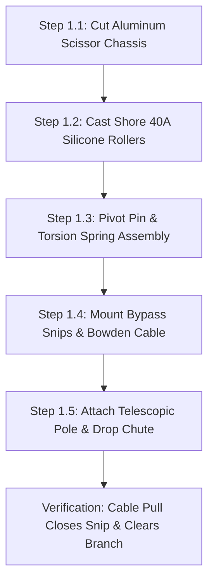

import { Card, CardGrid, LinkButton } from '@astrojs/starlight/components';

## Part 1: Stage Header & Executive Summary

> [!NOTE]
> **Stage Designation:** Stage 0 (Zero-Power Baseline)  
> **Operating Mode:** 100% Mechanical Manual Fallback  
> **Power Consumption:** 0 Watts (Zero Electrical Input Required)  
> **Resilience Rating:** Continuous Off-Grid / EMP / Submersion Proof  
> **Decoupling Standard:** Friction Slip-Clutch / Quick-Release Cam Linkage  

The Stage 0 baseline build of the **Mantis Branch-Crawler Robot** is a **100% mechanical, zero-power agricultural machine**. It operates entirely by human leverage, manual hand cranks, counterweights, and gravity flows—providing complete food security and operational continuity during total grid blackouts.

---

## Part 2: Capability Delta (Features Introduced)

* **Zero-Power Resilience**: Operates indefinitely without batteries, solar controllers, or power supplies.
* **Direct Mechanical Leverage**: All actuation performed via hand cranks, manual levers, counterweights, or gravity siphoning.
* **Inherent Decoupling**: Built from the ground up with mechanical slip-clutches, quick-release clamps, or bypass valves to ensure motor upgrades never bind.

---

## Part 3: Isolated Stage 0 Bill of Materials (BOM)


### Base Machine Bill of Materials (BOM)

| Item | Part ID & Registry Link | Component & Specification | Sourcing / Supplier | Fab Type | Qty | Unit Cost | CAD Asset | Total Cost |
| :--- | :--- | :--- | :--- | :--- | :--- | :--- | :--- | :--- |
| **M-01** | [`PART-FAB-PLATES-MANTIS-5052`](/open-biosphere/parts/custom-fab/PART-FAB-PLATES-MANTIS-5052/) | Laser-Cut 2mm 5052 Aluminum Scissor Chassis Plates | [Local fab / SendCutSend](https://sendcutsend.com) | CNC Laser Cut Aluminum | 2 | $9.00 | [Download .3DS](/open-biosphere/assets/parts/PART-FAB-PLATES-MANTIS-5052/model.3ds) | $18.00 |
| **M-02** | [`PART-FAB-ROLLER-SILICONE-40A`](/open-biosphere/parts/custom-fab/PART-FAB-ROLLER-SILICONE-40A/) | Cast Shore 40A Platinum Silicone Hourglass Rollers | [DIY cast in 3D molds](https://smooth-on.com) | 3D Mold + Silicone Cast | 2 | $9.00 | [Download .3DS](/open-biosphere/assets/parts/PART-FAB-ROLLER-SILICONE-40A/model.3ds) | $18.00 |
| **M-03** | [`PART-MECH-POLE-FIBERGLASS-EXT`](/open-biosphere/parts/mechanical/PART-MECH-POLE-FIBERGLASS-EXT/) | Telescopic Fiberglass/Aluminum Extension Pole (1.8–3.6m) | [Hardware store pole tool](https://homedepot.com) | Stock Fiberglass Pole | 1 | $24.00 | [Download .3DS](/open-biosphere/assets/parts/PART-MECH-POLE-FIBERGLASS-EXT/model.3ds) | $24.00 |
| **M-04** | [`PART-MECH-CABLE-BOWDEN-25M`](/open-biosphere/parts/mechanical/PART-MECH-CABLE-BOWDEN-25M/) | Bowden Cable Assembly (2.5m stainless + lined housing) | [Bicycle parts supplier](https://jensonusa.com) | Stock Cable Assembly | 1 | $8.00 | [Download .3DS](/open-biosphere/assets/parts/PART-MECH-CABLE-BOWDEN-25M/model.3ds) | $8.00 |
| **M-05** | [`PART-MECH-LEVER-BRAKE-ALUM`](/open-biosphere/parts/mechanical/PART-MECH-LEVER-BRAKE-ALUM/) | Ergonomic Aluminum Bicycle Hand Brake Squeeze Lever | [Bicycle parts supplier](https://universalcycles.com) | Stock Hardware | 1 | $6.00 | [Download .3DS](/open-biosphere/assets/parts/PART-MECH-LEVER-BRAKE-ALUM/model.3ds) | $6.00 |
| **M-06** | [`PART-MECH-SNIP-BYPASS-STEEL`](/open-biosphere/parts/mechanical/PART-MECH-SNIP-BYPASS-STEEL/) | Carbon Steel Spring-Loaded Bypass Micro-Snip Blades | [Bonsai / orchard tool store](https://ars-edge.com) | Stock Tool Blades | 1 | $11.00 | [Download .3DS](/open-biosphere/assets/parts/PART-MECH-SNIP-BYPASS-STEEL/model.3ds) | $11.00 |
| **M-07** | [`PART-FAB-CHUTE-RIPSTOP-PETG`](/open-biosphere/parts/custom-fab/PART-FAB-CHUTE-RIPSTOP-PETG/) | 3D-Printed PETG Funnel + Ripstop Nylon Gravity Drop Chute | [DIY 3D print + fabric](https://open-biosphere.org) | 3D Print + Fabric Sewn | 1 | $8.00 | [Download .3DS](/open-biosphere/assets/parts/PART-FAB-CHUTE-RIPSTOP-PETG/model.3ds) | $8.00 |
| **Total** | **Base Zero-Power Harvester Build** | **Complete manual off-grid tool** | | | | | | **$93.00** |

---

## Part 4: Standalone Full SVG Blueprint


---

## Part 5: Step-by-Step Assembly & Operating Protocol

The baseline build of the Mantis Branch-Crawler is a **100% mechanical, zero-power pole-mounted harvesting tool**. It utilizes human leverage transmitted through a standard bicycle Bowden cable, high-grip cast silicone pinch rollers, and spring-loaded bypass snips. It allows homesteaders to harvest high espalier branches without ladders, batteries, or electronics.

### Mechanical Architecture & Decoupling Standard
1. **Scissor Chassis**: Two laser-cut 2 mm aluminum side plates pivot around a hardened 6 mm steel central pin, pre-loaded by an adjustable torsion spring (20 N resting clamp force).
2. **Shore 40A Silicone Pinch Rollers**: Two opposed concave rollers cast in two-part platinum silicone grip trellis wires or branches from 6 mm to 22 mm diameter with zero slippage and zero bark abrasion.
3. **Bowden Cable Actuation**: Squeezing a bicycle brake lever mounted at the base of a 1.8 m to 3.6 m telescopic pole tensions a stainless Bowden cable, closing the spring bypass snips around the berry pedicel.
4. **Mechanical Decoupling**: The motor mounting plates incorporate quick-release cam latches. When electric motors are added in later tiers, flipping the cam latches disengages the motor pinions from the roller drive gears, allowing the crawler to glide manually along trellis lines with zero cogging resistance.

```
          MANTIS BRANCH-CRAWLER — BASE MECHANICAL ELEVATION
  =================================================================
                 [Espalier Branch or 1/8" Trellis Wire]
         ========================+========================
                                 |
                     (Concave Silicone Roller 1)
                     /-------------------------\
                     |   [Shore 40A Silicone]  |
                     \-------------------------/
                                 |
                                 +-----[Pivot Bolt 6mm]
                                 |     (Torsion Spring)
                     /-------------------------\
                     |   [Shore 40A Silicone]  |
                     \-------------------------/
                     (Concave Silicone Roller 2)
                                 |
                +----------------+----------------+
                |                                 |
        [Bypass Micro-Snip]              [Foam-Lined Funnel]
        (Spring-Return Blade)            (3D-Printed PETG)
                |                                 |
         [Bowden Cable]                    [Drop Chute]
                |                                 |
                v                                 v
         (Telescopic Pole)               (Soft Catch Tote)
         (Bicycle Lever)
```

### Step-by-Step Fabrication & Assembly Protocol

#### Step 1.1: Chassis Plate Cutting & Deburring
1. Cut two identical scissor chassis plates from 2.0 mm 5052 aluminum sheet using CNC router, laser, or hand jigsaw template.
2. Drill the 6.0 mm central pivot hole and two 8.0 mm roller axle holes.
3. Chamfer all edges with a deburring tool to eliminate sharp burrs that could fray cables or scratch plant bark.
4. Anodize or spray-coat plates with self-etching primer to prevent aluminum oxidation in humid greenhouse air.

#### Step 1.2: Silicone Pinch Roller Mold Casting
1. 3D-print two-piece split molds in PETG at 0.16 mm layer height for the concave hourglass rollers (outer diameter 45 mm, waist diameter 32 mm).
2. Spray mold release into both cavities. Press an 8 mm bore flanged bronze sleeve bushing onto the center core pin.
3. Mix two-part platinum cure silicone (Shore 40A) in a 1:1 ratio by weight. Vacuum degas for 8 minutes to eliminate trapped air bubbles.
4. Pour silicone into molds and cure at room temperature for 16 hours. Demold and trim flash with a scalpel.

#### Step 1.3: Scissor Linkage & Torsion Spring Rigging
1. Assemble the two aluminum plates around the 6.0 mm hardened pivot pin with PTFE thrust washers between the plates.
2. Install a wound music-wire torsion spring (k = 0.45 N·mm/deg) over the pivot pin, seating spring legs into pre-drilled holes in the scissor arms.
3. Install the cast silicone rollers on 8 mm stainless shoulder bolts with nylon-insert locknuts. Verify completely smooth rotation (< 0.02 N·m rolling resistance).

#### Step 1.4: Bypass Micro-Snip & Bowden Cable Rigging
1. Mount a pair of carbon-steel bonsai bypass snip blades onto the forward extension arm using M4 standoffs.
2. Anchor the Bowden cable outer casing to the chassis cable stop bracket.
3. Thread the 1.2 mm stainless inner wire through the moving snip blade lever, clamping with an M3 brass cable barrel nut.
4. Verify mechanical stroke: a 15 mm pull on the Bowden cable fully closes the snip blades against their internal return spring.

#### Step 1.5: Telescopic Pole & Collection Chute Mounting
1. Bolt the crawler base bracket to the standard 3/4" Acme male thread of a 1.8 m to 3.6 m telescopic aluminum/fiberglass pole.
2. Clamp a standard ergonomic bicycle brake lever to the bottom handle of the pole.
3. Route the Bowden cable along the pole length using hook-and-loop straps.
4. Zip-tie a lightweight flexible ripstop nylon drop chute (diameter 80 mm) directly below the snip blades, leading down into a waist-mounted soft collection basket.



### Step-by-Step Operating Runbook (Manual Mode)

1. **Pre-Harvest Inspection**: Inspect the espalier wall. Ensure trellis guide wires are tensioned to ≥ 400 N and clear of dead wood or thick entangling vines.
2. **Pole Height Adjustment**: Unlock the telescopic pole collar, extend to reach the target branch height ($1.8$ to $3.0$ m), and tighten twist collar securely.
3. **Engaging the Trellis Wire**: Lift the Mantis head upward against the underside of the horizontal trellis wire or woody branch (6 mm to 22 mm diameter). The spring-loaded scissor arms automatically part and snap shut, seating the wire into the concave silicone roller waist.
4. **Targeting Fruit Cluster**: Push or pull the pole along the wire until the bypass snip jaw frames the ripe berry pedicel (stem).
5. **Executing the Cut**: Squeeze the bicycle lever at the pole base firmly. The Bowden cable pulls the micro-snip shut, severing the pedicel cleanly without tugging or jarring neighboring fruit.
6. **Zero-Bruise Catch**: The severed berry drops immediately into the padded collection funnel, sliding down the soft ripstop nylon chute into the waist tote.
7. **Disengagement & Storage**: Pull down on the pole firmly at a 30° rearward angle to cam the scissor arms open and release from the trellis wire. Wipe snip blades with isopropyl alcohol to prevent sap gumming.

---

## Part 6: Guided Stage Navigation

<CardGrid>
  <Card title="Subsystem Overview" icon="left-arrow">
    Return to the machine overview, crop affinity matrix, and multi-stage comparison.
    <br/><br/>
    <LinkButton href="/open-biosphere/hardware/mantis-branch-crawler/" variant="minimal">← Return to Overview</LinkButton>
  </Card>
  <Card title="Stage 1: BLE Electromechanical Pack" icon="right-arrow">
    Ready to motorize this machine? Upgrade with DC actuation and Flutter BLE Virtual Panel controls.
    <br/><br/>
    <LinkButton href="/open-biosphere/hardware/mantis-branch-crawler/stage-1/" variant="primary">Proceed to Stage 1 Upgrade →</LinkButton>
  </Card>
</CardGrid>
