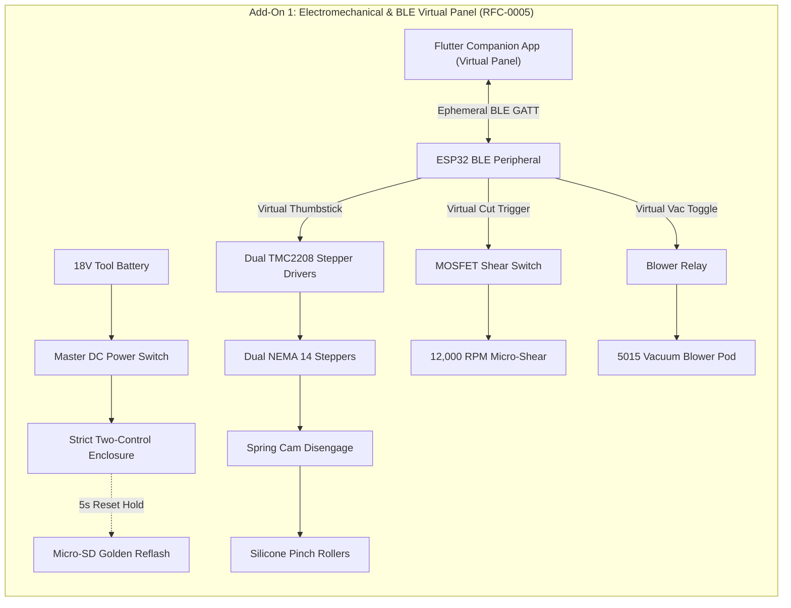

import { Card, CardGrid, LinkButton } from '@astrojs/starlight/components';

## Part 1: Stage Header & Executive Summary

> [!NOTE]
> **Stage Designation:** Stage 1 (Semi-Autonomous Electromechanical Pack)  
> **Operating Mode:** DC Motorized Continuous Duty with Ephemeral BLE Virtual Panel  
> **Power Requirement:** 12V / 24V DC Industrial Bus  
> **Physical Interlocks:** Strict Two-Control Standard (Master DC Cut + Recessed SD Factory Restore)  
> **Operator Interface:** Ephemeral Flutter Mobile Companion App over BLE GATT  

The Stage 1 electromechanical pack motorizes the **Mantis Branch-Crawler Robot**, adding continuous DC motor/pump drive governed by the **Strict Two-Control Physical Standard** (RFC-0005) and an ephemeral **Flutter Companion App Virtual Panel** over direct local BLE.

---

## Part 2: Capability Delta (Features Introduced)

* **Continuous Motorized Actuation**: Replaces human manual cranking with high-efficiency DC gearmotors, steppers, or booster pumps.
* **Strict Two-Control Physical Standard**: Eliminates physical jog buttons and potentiometer dials to prevent moisture breach and priority race conditions. Only Master DC Switch and Recessed SD Reset Button are permitted on hardware.
* **Ephemeral BLE Virtual Panel**: Jogging, speed sliders, and priming pulses execute via the Flutter companion app over direct local BLE GATT.
* **100% Preserved Manual Fallback**: Slip-clutches, bypass valves, or belt releases guarantee instant zero-power manual hand operation without disassembly.

---

## Part 3: Isolated Stage 1 Bill of Materials (BOM)


### Add-On 1 Bill of Materials (BOM)

| Item | Part ID & Registry Link | Component & Specification | Sourcing / Supplier | Fab Type | Qty | Unit Cost | CAD Asset | Total Cost |
| :--- | :--- | :--- | :--- | :--- | :--- | :--- | :--- | :--- |
| **A1-01** | [`PART-ELEC-NEMA14-PANCAKE`](/open-biosphere/parts/electrical/PART-ELEC-NEMA14-PANCAKE/) | NEMA 14 Planetary Pancake Steppers (10:1 ratio, 5mm shaft) | [Motion / 3D printer store](https://omc-stepperonline.com) | Stock Motor | 2 | $18.00 | [Download .3DS](/open-biosphere/assets/parts/PART-ELEC-NEMA14-PANCAKE/model.3ds) | $36.00 |
| **A1-02** | [`PART-MECH-ALUM-2020-6M`](/open-biosphere/parts/mechanical/PART-MECH-ALUM-2020-6M/) | Brass Pinion & Spur Gear Drive Set (16T/40T, Mod 0.5) | [Precision hobby gear kit](https://openbuildspartstore.com) | Stock Extrusion | 2 | $6.00 | [Download .3DS](/open-biosphere/assets/parts/PART-MECH-ALUM-2020-6M/model.3ds) | $12.00 |
| **A1-03** | [`PART-ELEC-MTR-CORELESS-12V`](/open-biosphere/parts/electrical/PART-ELEC-MTR-CORELESS-12V/) | 12V Coreless 12,000 RPM Micro-Shear Motor + 15mm Blade | [Micro-robotics supplier](https://pololu.com) | Stock Motor | 1 | $15.00 | [Download .3DS](/open-biosphere/assets/parts/PART-ELEC-MTR-CORELESS-12V/model.3ds) | $15.00 |
| **A1-04** | [`PART-FLUID-BLOWER-5015-24V`](/open-biosphere/parts/fluidic/PART-FLUID-BLOWER-5015-24V/) | 24V 5015 Centrifugal Vacuum Blower + TPU Funnel Pod | [Blower fan supplier](https://digikey.com) | Stock Fan + Fab Pod | 1 | $18.00 | [Download .3DS](/open-biosphere/assets/parts/PART-FLUID-BLOWER-5015-24V/model.3ds) | $18.00 |
| **A1-05** | [`PART-ELEC-TWO-CTRL-PACK`](/open-biosphere/parts/electrical/PART-ELEC-TWO-CTRL-PACK/) | Strict Two-Control Enclosure (Master DC Cut + SD Reset + Micro-SD Module + 0.91" OLED) | [Maker electronics shop](https://open-biosphere.org/parts/PART-ELEC-TWO-CTRL-PACK) | 3D Print / Assembly | 1 | $18.00 | [Download .3DS](/open-biosphere/assets/parts/PART-ELEC-TWO-CTRL-PACK/model.3ds) | $18.00 |
| **A1-06** | [`PART-MECH-ALUM-2020-6M`](/open-biosphere/parts/mechanical/PART-MECH-ALUM-2020-6M/) | Dual TMC2208 Driver Carrier + ESP32 BLE Virtual Panel Controller | [Maker electronics shop](https://openbuildspartstore.com) | Stock Extrusion | 1 | $26.00 | [Download .3DS](/open-biosphere/assets/parts/PART-MECH-ALUM-2020-6M/model.3ds) | $26.00 |
| **A1-07** | [`PART-ELEC-BAT-ADAPT-18V`](/open-biosphere/parts/electrical/PART-ELEC-BAT-ADAPT-18V/) | Universal 18V Tool Battery Adapter Shoe + Fuse Block | [Battery tooling parts](https://open-biosphere.org) | 3D Print / Assembly | 1 | $10.00 | [Download .3DS](/open-biosphere/assets/parts/PART-ELEC-BAT-ADAPT-18V/model.3ds) | $10.00 |
| **Total** | **Add-On 1 Electromechanical Pack** | **Retrofits directly to Base** | | | | | | **+$135.00** |
| **Cumul.** | **Operational Remote-Controlled Harvester** | **Base ($93) + Add-On 1 ($135)** | | | | | | **$228.00** |

---

## Part 4: Standalone Full SVG Blueprint


### Add-On 1 Electromechanical Wiring & BLE Virtual Panel Blueprint

```text
========================================================================================
ADD-ON 1 ELECTROMECHANICAL SCHEMATIC & BLE VIRTUAL PANEL BLUEPRINT
Strict Two-Control Physical Standard (RFC-0005) with Ephemeral Flutter BLE Control
========================================================================================

  [18V/20V Tool Battery] ──[Master DC Power Switch]──┬── (18V Power Bus)
                                                     └── (GND Return Bus)
                                                               │
   ┌──────────────── STRICT TWO-CONTROL CHASSIS BOX ───────────────────┐│
   │                                                                   ││
   │  [Master DC Power Switch]      ["Nuke & Pave" SD Reset Button]    ││
   │   Inline Mechanical Cut         Recessed Tactile Switch (5s hold) ││
   │                                                                   ││
   │  [Micro-SD Card Slot Module]   [0.91" I2C Status OLED Display]    ││
   │   Preloaded golden .bin         Displays [MANTIS-A1 | BLE READY]  ││
   │                                                                   ││
   │  [ESP32 BLE GATT Peripheral] ◄─── (Ephemeral Mobile Link) ───────┼│
   └───────────────────┬───────────────────────────────────────────────┘│
                       │                                                │
                       ▼ (TMC Driver & MOSFET Signals)                  │
   ┌────────────────── DRIVE TRAIN & ACTUATORS ────────────────────────┐│
   │                                                                   ││
   │  Dual NEMA 14 Pancake Steppers ◄── Dual TMC2208 Drivers ──────────┘│
   │         │                                                          │
   │         ▼ (Pinion Gears)                                           │
   │     ┌───────┐                                                      │
   │     │ ░░░░░ │ Quick-Release Spring Cam Disengage Mechanism         │
   │     └───────┘ [SWING CAM OUT TO ROLL BY HAND WITHOUT MOTOR DRAG]   │
   │         │                                                          │
   │         ▼ (Roller Shafts)                                          │
   │   [Silicone Pinch Rollers]                                         │
   │                                                                    │
   │  12V Coreless Micro-Shear ◄── Logic-Level MOSFET Trigger ──────────┘
   │  24V 5015 Vacuum Blower   ◄── High-Current Relay ──────────────────┘
   └───────────────────────────────────────────────────────────────────┘
========================================================================================
```

---

## Part 5: Step-by-Step Retrofit, Wiring & Operating Protocol

Under [RFC-0005](/rfcs/rfc-0005-hardware-interlocks-ble-virtual-panel), physical control panels, bulky radio transmitters, and wired jog pendants are banned across all machine tiers. 

The **Semi-Autonomous Pack** motorizes espalier crawling, active vacuum collection, and rotary micro-shearing under the **Strict Two-Control Physical Standard**:
1. **Master Hardware DC Power Switch**: Mechanically disconnects 18V tool battery / 24V DC bus power.
2. **"Nuke & Pave" SD Factory Restore Button**: Dedicated recessed tactile switch that triggers an automatic hardware re-flash from micro-SD storage.

All manual traversal, fruit alignment, shear pulsing, and vacuum control are performed via the **Flutter Companion App Virtual Panel** over direct local BLE.

### Electromechanical Actuation Architecture & Decoupling
- **Drive Locomotion**: Dual NEMA 14 planetary pancake steppers (10:1 reduction) driving the silicone pinch rollers via steel spur gears (120 mm/s traverse speed along wire).
- **Mechanical Decoupling**: Quick-release spring cam levers swing motor pinion gears out of mesh with roller gears. If power is severed, the robot can be pushed or pulled along the wire by hand without motor resistance.
- **High-Speed Rotary Shear**: 12V 12,000 RPM coreless DC micro-motor driving a 15 mm stainless circular slitting saw blade that cuts woody pedicels in $< 0.1$ seconds.
- **Active Vacuum Collection**: A 24V miniature centrifugal blower fan (5015 blower, 4.8 CFM) draws suction through a soft silicone intake cowl, pulling berries gently into the intake funnel.
- **Strict Two-Control Enclosure**: An ultra-compact enclosure on the chassis spine contains:
  - Heavy-duty toggle switch directly isolating DC supply.
  - Recessed tactile button next to the 0.91" I2C OLED display for 5-second SD recovery reflash.
  - Micro-SD card slot module pre-loaded with golden recovery `firmware.bin` and `config.default`.
- **Ephemeral BLE Virtual Panel**: The operator controls the crawler using the Flutter companion app on mobile device: Virtual Thumbstick for Forward/Reverse traverse, Shear Pulse Trigger, and Vacuum Toggle.

### Step-by-Step Retrofit Protocol

```text
Step 2.1: NEMA 14 Motor Bracket Mounting
  ├── Bolt aluminum motor swing-plates to chassis outer plate with M3 shoulder pivot bolts.
  ├── Mount NEMA 14 planetary pancake steppers onto swing-plates with M3 button-head screws.
  ├── Press 16T brass pinion gears onto 5mm motor output D-shafts.
  └── Align pinions with 40T spur gears on silicone roller shafts; lock with spring cam toggle.

Step 2.2: Rotary Micro-Shear Tool Installation
  ├── Replace manual bypass snip with 12V coreless rotary cutter bracket on front arm.
  ├── Secure 15mm circular slitting saw blade onto motor hub with M2.5 central arbor screw.
  └── Install 3D-printed polycarbonate blade guard with 4mm slot to protect branches.

Step 2.3: Active Pneumatic Vacuum Pod Installation
  ├── Mount 5015 centrifugal blower fan to underside deck using M3 silicone vibration dampers.
  ├── Connect flexible 38mm polyurethane clear suction hose from blower to soft TPU funnel.
  └── Position suction mouth 10mm behind saw blade, angled upward at 25°.

Step 2.4: Two-Control Enclosure & Driver Wiring
  ├── Mount compact spine enclosure (80 × 50 × 25mm) with master DC switch and recessed SD reset.
  ├── Insert micro-SD slot module pre-loaded with golden recovery firmware.bin and config.default.
  ├── Mount 0.91" I2C OLED display showing [MANTIS-A1 | BLE READY].
  └── Wire dual TMC2208 stepper drivers and shear MOSFET to ESP32 BLE peripheral controller.

Step 2.5: Battery Shoe & Virtual Panel BLE Verification
  ├── Mount slide-in adapter shoe for standard 18V tool battery (Makita 18V / DeWalt 20V Max).
  ├── Wire battery through 10A fuse and master DC toggle switch.
  ├── Verify BLE GATT service advertises [MANTIS-VIRTUAL-PANEL] upon boot.
  └── Test spring cam levers: disengaging cams allows completely free rolling along trellis wire.
```

### Step-by-Step BLE Virtual Panel Operating Runbook

1. **Battery Insertion & System Check**: Slide 18V tool battery into adapter shoe. Flip master DC power switch ON. The 0.91" OLED displays: `[MANTIS-A1 | BLE STANDBY]`.
2. **Mounting on Wire Guideframe**: Hook crawler onto espalier wire at row datum. Silicone rollers self-center.
3. **Walk-Up BLE Virtual Panel Connection**: Open Flutter companion app on phone. Connect to `MANTIS-A1`.
4. **Traverse Navigation via Virtual Joystick**: Push the virtual thumbstick in the Flutter app forward. The crawler rolls along the wire smoothly at up to 120 mm/s.
5. **Targeting Fruit Pedicel**: As crawler approaches ripe fruit, tap the Vacuum Toggle in app; soft TPU funnel pulls fruit gently into cowl.
6. **Executing the Micro-Shear**: Tap the **Virtual Cut Trigger** in app. The 12,000 RPM rotary shear pulses for 0.4 seconds, slicing the pedicel cleanly into the catch tote.
7. **"Nuke & Pave" SD Recovery Protocol**: If firmware hangs, hold the physical recessed reset button for 5 seconds during power-on to restore factory baseline from micro-SD.
8. **Instant Zero-Power Override**: Disengage the spring cam levers to roll the crawler by hand or unclip it from the wire via the base scissor release lever.


### Add-On 1 Signal & Override Flow



---

## Part 6: Guided Stage Navigation

<CardGrid>
  <Card title="Stage 0: Zero-Power Baseline" icon="left-arrow">
    Review the underlying manual chassis, fabrication tolerances, and mechanical fallback linkage.
    <br/><br/>
    <LinkButton href="/open-biosphere/hardware/mantis-branch-crawler/stage-0/" variant="minimal">← Previous: Stage 0 Baseline</LinkButton>
  </Card>
  <Card title="Stage 2: Agentic Autonomous AI Pack" icon="right-arrow">
    Ready for full closed-loop autonomy? Integrate the Controller-Node-Tool mesh and local neural vision.
    <br/><br/>
    <LinkButton href="/open-biosphere/hardware/mantis-branch-crawler/stage-2/" variant="primary">Proceed to Stage 2 Upgrade →</LinkButton>
  </Card>
</CardGrid>
