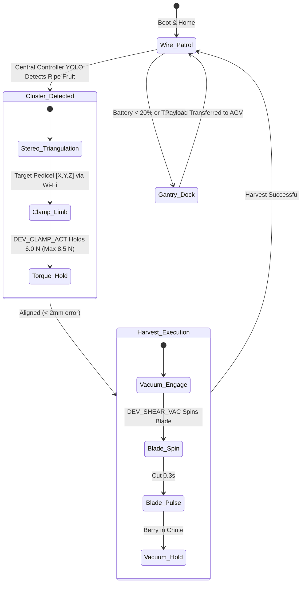

import { Card, CardGrid, LinkButton } from '@astrojs/starlight/components';

## Part 1: Stage Header & Executive Summary

> [!NOTE]
> **Stage Designation:** Stage 2 (Agentic Autonomous AI Pack)  
> **Operating Mode:** 24/7 Closed-Loop Autonomous Neural Telemetry & Robotics  
> **Network Mesh:** Encrypted Isolated Farm Wi-Fi (<code>POTFRM-4096</code> on 192.168.42.0/24) + BLE Tool Downlinks  
> **Safety Interlocks:** 250ms Hardware Deadman Watchdogs on all Edge Tools  
> **Edge AI Engine:** <code>llama-cpp-python</code> Local GGUF Multimodal Vision (Zero Cloud Dependence)  

The Stage 2 agentic pack elevates the **Mantis Branch-Crawler Robot** into a fully autonomous cyber-physical robotics cell operating under the **Controller-Node-Tool (CNT)** standard (RFC-0004) and **Agnostic Controller Runtime** (RFC-0006).

---

## Part 2: Capability Delta (Features Introduced)

* **Controller-Node-Tool (CNT) Hierarchy**: Heavy neural perception runs on the Central Biosphere Controller; the Machine Node coordinates local kinematics; tiny Edge Tools drive motors 1:1.
* **Isolated Farm AP Mesh**: Secure, air-gapped local Wi-Fi (<code>POTFRM-&lt;CLUSTER_ID&gt;</code> on <code>192.168.42.0/24</code>) with WebSocket node registration at <code>ws://192.168.42.1:8443/register</code>.
* **250ms Hardware Deadman Watchdogs**: Every Tool trips into safe, high-Z, zero-power state within 250 ms if signal is interrupted.
* **Local Zero-Cloud Edge AI**: Multi-agent perception via <code>llama-cpp-python</code> local vision models without internet dependencies.

---

## Part 3: Isolated Stage 2 Bill of Materials (BOM)


### Add-On 2 Bill of Materials (BOM)

| Item | Part ID & Registry Link | Component & Specification | Sourcing / Supplier | Fab Type | Qty | Unit Cost | CAD Asset | Total Cost |
| :--- | :--- | :--- | :--- | :--- | :--- | :--- | :--- | :--- |
| **A2-01** | [`PART-ELEC-ESP32-S3-NODE`](/open-biosphere/parts/electrical/PART-ELEC-ESP32-S3-NODE/) | Mantis Machine Node: ESP32-S3 (8MB PSRAM) + 0.96" OLED + Master DC Cut + SD Reset & Micro-SD Module | [Espressif distributor](https://mouser.com/espressif) | Stock Electronics | 1 | 6.00 | [Download .3DS](/open-biosphere/assets/parts/PART-ELEC-ESP32-S3-NODE/model.3ds) | 6.00 |
| **A2-02** | [`PART-ELEC-CAM-STEREO-NIR`](/open-biosphere/parts/electrical/PART-ELEC-CAM-STEREO-NIR/) | Dual Micro RGB-NIR Stereo Cameras with Wi-Fi RTSP Transmitter | [Camera sensor supplier](https://arducam.com) | Stock Sensor | 1 | 2.00 | [Download .3DS](/open-biosphere/assets/parts/PART-ELEC-CAM-STEREO-NIR/model.3ds) | 2.00 |
| **A2-03** | [`PART-ELEC-ESP32-C3-TOOL`](/open-biosphere/parts/electrical/PART-ELEC-ESP32-C3-TOOL/) | 3x ESP32-C3 Modular Tools with 0.42" OLEDs & 250ms Watchdogs (Rollers, Clamp, Shears) | [Microcontroller supplier](https://seeedstudio.com) | Stock Electronics | 3 | .00 | [Download .3DS](/open-biosphere/assets/parts/PART-ELEC-ESP32-C3-TOOL/model.3ds) | 1.00 |
| **A2-04** | [`PART-ELEC-SNS-LOADCELL-20N`](/open-biosphere/parts/electrical/PART-ELEC-SNS-LOADCELL-20N/) | 20 N Miniature Bending Beam Load Cell + HX711 24-bit ADC | [Precision scale sensor shop](https://sparkfun.com) | Stock Sensor | 1 | 4.00 | [Download .3DS](/open-biosphere/assets/parts/PART-ELEC-SNS-LOADCELL-20N/model.3ds) | 4.00 |
| **A2-05** | [`PART-ELEC-VR-5V5A-STEPDOWN`](/open-biosphere/parts/electrical/PART-ELEC-VR-5V5A-STEPDOWN/) | 5V 5A High-Efficiency Step-Down DC-DC Power Module + Power Tap | [Power electronics supplier](https://pololu.com) | Stock Electronics | 1 | 4.00 | [Download .3DS](/open-biosphere/assets/parts/PART-ELEC-VR-5V5A-STEPDOWN/model.3ds) | 4.00 |
| **A2-06** | [`PART-FAB-DOCK-POGO-GANTRY`](/open-biosphere/parts/custom-fab/PART-FAB-DOCK-POGO-GANTRY/) | Overhead Gantry Spring-Loaded Pogo-Pin Docking Shoe & Latch | [Custom 3D + spring pins](https://open-biosphere.org) | 3D Print + Pogo Contacts | 1 | 8.00 | [Download .3DS](/open-biosphere/assets/parts/PART-FAB-DOCK-POGO-GANTRY/model.3ds) | 8.00 |
| **A2-07** | [`PART-ELEC-TMC2209-DVR`](/open-biosphere/parts/electrical/PART-ELEC-TMC2209-DVR/) | Dual TMC2209 Drivers & Actuator Interface Pack | [3D printer electronics supplier](https://bigtree-tech.com) | Stock Electronics | 1 | 6.00 | [Download .3DS](/open-biosphere/assets/parts/PART-ELEC-TMC2209-DVR/model.3ds) | 6.00 |
| **A2-08** | [`PART-MECH-ALUM-2020-6M`](/open-biosphere/parts/mechanical/PART-MECH-ALUM-2020-6M/) | Custom Lightweight Carbon Chassis Harness & Enclosure | [Robotics carbon hardware](https://openbuildspartstore.com) | Stock Extrusion | 1 | 6.00 | [Download .3DS](/open-biosphere/assets/parts/PART-MECH-ALUM-2020-6M/model.3ds) | 6.00 |
| **Total** | **Add-On 2 Agentic Autonomous Pack (CNT Standard)** | **Expands Base + Add-On 1** | | | | | | **+77.00** |
| **Full Build** | **Complete Autonomous Trellis Harvester Robot** | **Base + Add-On 1 + Add-On 2** | | | | | | **05.00** |

---

## Part 4: Standalone Full SVG Blueprint


---

## Part 5: Step-by-Step Commissioning, Provisioning & Autonomous Runbook

Under [RFC-0004](/rfcs/rfc-0004-controller-node-tool) and [RFC-0006](/rfcs/rfc-0006-agnostic-controller-runtime), the **Agentic Autonomous AI Pack** transforms the Mantis Crawler into a lightweight, hierarchical **Controller-Node-Tool (CNT)** harvesting robot. The crawler operates as a dedicated **Mantis Node** commanding modular **Edge Tools** over BLE, while heavy neural vision processing is offloaded to the Central Biosphere Controller over Wi-Fi.

### Autonomous Vision & Telemetry Architecture
- **Mantis Machine Node (ESP32-S3)**: Dual-Core Xtensa LX7 (240 MHz, 8 MB PSRAM) mounted on the spine in an ultra-light enclosure. Hosts an onboard 0.96" I2C OLED display (`[NODE: MANTIS-01 | LINK -> 4096]`) and setup push-button for mobile BLE provisioning. Uplinks to Central Controller via Wi-Fi; coordinates local motion and downlinks to Tools via BLE Central.
- **Decoupled Stereo Vision & Neural Targeting**: Dual lightweight micro RGB-NIR camera modules (baseline 60 mm) stream video directly to the Central Controller (Agnostic Runtime, e.g. Raspberry Pi 5 + Hailo-8 or x86 Host) over Wi-Fi. The Central Controller runs YOLOv8 ripeness segmentation and stereo triangulation, returning 3D pedicel targeting vectors (, Y, Z$) to the Mantis Node.
- **Dedicated Modular Edge Tools (ESP32-C3)**: Driven 1:1 by micro ESP32-C3 controllers equipped with 0.42" micro OLED displays and **250ms hardware deadman watchdogs**:
  - `DEV_ROLLER_DRV`: Micro ESP32-C3 with 0.42" OLED (`TOOL: ROLLER_DRV | LINK: OK`) + 250ms watchdog driving NEMA 14 pinch rollers and traverse motors.
  - `DEV_CLAMP_ACT`: Micro ESP32-C3 with 0.42" OLED (`TOOL: CLAMP_ACT | LINK: OK`) + 250ms watchdog reading the HX711 24-bit ADC micro-load cell, regulating limb clamp force between 2.0 N (traverse) and 8.5 N max (shear stability).
  - `DEV_SHEAR_VAC`: Micro ESP32-C3 with 0.42" OLED (`TOOL: SHEAR_VAC | LINK: OK`) + 250ms watchdog pulsing the rotary saw blade and vacuum suction blower.
- **250ms Deadman Watchdog Fail-Safe**: If any Tool loses BLE connection to the Mantis Node for $> 250$ ms, it drops immediately into high-Z safe state: roller steppers cut holding torque to zero, the clamp returns to safe passive spring position, and the saw blade and vacuum shut down within $< 250$ ms.

```text
       CONTROLLER-NODE-TOOL (CNT) HIERARCHICAL EDGE ARCHITECTURE
  =================================================================
            CENTRAL BIOSPHERE CONTROLLER (Agnostic Runtime / POTFRM-4096)
            • Emits Isolated Farm AP: SSID [POTFRM-4096] (192.168.42.0/24)
            • YOLOv8 Stereo Ripeness Detection & 3D Pedicel Triangulation
                                  │
                                  │ Isolated Farm Wi-Fi (192.168.42.0/24)
                                  ▼
             ┌─────────────────────────────────────────┐
             │       MANTIS MACHINE NODE (ESP32-S3)    │
             │  • OLED Display: [NODE: MANTIS-01]      │
             │  • Setup Push-Button for Mobile BLE     │
             │  • Subsystem Navigation & Motion Bridge │
             └────────────────────┬────────────────────┘
                                  │
         ┌────────────────────────┼────────────────────────┐
         │ BLE Downlink           │ BLE Downlink           │ BLE Downlink
         ▼                        ▼                        ▼
 ┌───────────────┐        ┌───────────────┐        ┌───────────────┐
 │ TOOL:         │        │ TOOL:         │        │ TOOL:         │
 │ DEV_ROLLER_DRV│        │ DEV_CLAMP_ACT │        │ DEV_SHEAR_VAC │
 │ ESP32-C3 Micro│        │ ESP32-C3 Micro│        │ ESP32-C3 Micro│
 │ 0.42" OLED    │        │ 0.42" OLED    │        │ 0.42" OLED    │
 │ 250ms Deadman │        │ 250ms Deadman │        │ 250ms Deadman │
 │ Dual NEMA 14  │        │ HX711 LoadCell│        │ Rotary Shear  │
 │ Pinch Rollers │        │ 8.5N Grip Max │        │ Vacuum Blower │
 └───────────────┘        └───────────────┘        └───────────────┘
```

### Step-by-Step Sensor Commissioning & Edge AI Protocol

#### Step 3.1: Mantis Node & Power Board Rigging
1. Mount the ESP32-S3 Node with 0.96" I2C OLED display and physical setup push-button inside the spine enclosure.
2. Connect power via an onboard 5V 5A synchronous step-down DC-DC converter tapped from the 24V bus rail.
3. Verify power rail stability under full stepper load (< 45 mV ripple).

#### Step 3.2: Stereo RGB-NIR Camera Rigging & RTSP Link
1. Mount dual micro camera sensors in a rigid 3D-printed PETG crossbar with exactly 60 mm optical separation.
2. Install 850 nm optical bandpass filters over both lenses to isolate chlorophyll reflection shifts.
3. Configure camera transmitter to stream stereo frames over local Wi-Fi to the Central Controller.

#### Step 3.3: Micro-Load Cell Clamping Tool (`DEV_CLAMP_ACT`)
1. Mount a 20 N miniature bending beam load cell between the scissor clamping arm and the tensioning actuator.
2. Connect load cell leads to HX711 24-bit ADC module wired to `DEV_CLAMP_ACT` tool controller (ESP32-C3).
3. Calibrate load cell reading; ensure tool firmware hard-clamps grip force at 8.5 N maximum to protect plant cambium.

#### Step 3.4: Overhead Gantry Slip-Ring Auto-Dock Latch
1. Install an overhead spring-loaded pogo-pin power shoe on top of the chassis.
2. Align the pogo-pin shoe with the overhead gantry 24V DC bus line.
3. Install an optical fiducial marker on the docking shoe for gantry camera alignment.

#### Step 3.5: Provisioning & 250ms Watchdog Verification
1. Power on Central Controller; verify active Cluster ID on OLED, terminal stdout, or BLE beacon (`POTFRM-4096`).
2. Power on Mantis Node; display shows `[NODE UNPAIRED - PAIR VIA BLE]`.
3. Press physical setup button on Node; connect via mobile companion app over BLE, enter `4096`.
4. Node commits credentials to NVS, links to `POTFRM-4096`, registers at `ws://192.168.42.1:8443/register`, and updates display to `[ONLINE | LINK -> 4096]`.
5. Verify Node auto-discovers and binds all three BLE Tools.
6. Test fail-safe watchdog: drop BLE link to `DEV_ROLLER_DRV`; verify roller steppers drop holding torque to zero in $< 250$ ms.



### Step-by-Step Autonomous Multi-Agent Runbook

1. **Autonomous Wakeup & Rail Scan**: On receiving a scheduled patrol command from the Central Controller over Wi-Fi, the Mantis crawler unlatches from its gantry docking shoe, signals `DEV_CLAMP_ACT` to clamp the trellis wire at 4.0 N, and traverses at 60 mm/s via `DEV_ROLLER_DRV`.
2. **Central Controller Neural Detection**: The Central Controller Hailo-8 NPU continuously analyzes the stereo video feed. It identifies fruit clusters, classifies ripeness using NIR spectral absorption ratios, and calculates 3D pedicel targeting vectors.
3. **Target Navigation**: The Mantis Node converts the pedicel coordinates into motor step counts, inching the chassis until the cutter head aligns with the fruit pedicel to $\pm 1.5$ mm accuracy.
4. **Adaptive 8.5 N Branch Clamping**: `DEV_CLAMP_ACT` drives the clamp servo. The onboard HX711 load cell monitors contact force at 80 Hz; if force reaches 8.5 N, clamping halts instantly, securing the cutter rigidly without crushing plant tissue.
5. **Vacuum Shear Execution**: The Mantis Node signals `DEV_SHEAR_VAC` over BLE; the 24V blower spins up; vacuum pulls the fruit into the TPU funnel; the rotary saw blade pulses for 300 ms, severing the pedicel cleanly into the internal hopper.
6. **250ms Fail-Safe Watchdogs**: If BLE connection to `DEV_ROLLER_DRV`, `DEV_CLAMP_ACT`, or `DEV_SHEAR_VAC` drops for $> 250$ ms, each tool immediately trips into safe state. If Wi-Fi link to Central Controller is lost, the crawler clamps safely in place at 4.0 N and halts.

---

## Part 6: Guided Stage Navigation

<CardGrid>
  <Card title="Stage 1: BLE Electromechanical Pack" icon="left-arrow">
    Review the motorized powertrain, Two-Control enclosure wiring, and BLE Virtual Panel.
    <br/><br/>
    <LinkButton href="/open-biosphere/hardware/mantis-branch-crawler/stage-1/" variant="minimal">← Previous: Stage 1 Upgrade</LinkButton>
  </Card>
  <Card title="Subsystem Overview" icon="right-arrow">
    Return to the machine overview, crop affinity matrix, and master biosphere interlocks.
    <br/><br/>
    <LinkButton href="/open-biosphere/hardware/mantis-branch-crawler/" variant="primary">Return to Overview →</LinkButton>
  </Card>
</CardGrid>
