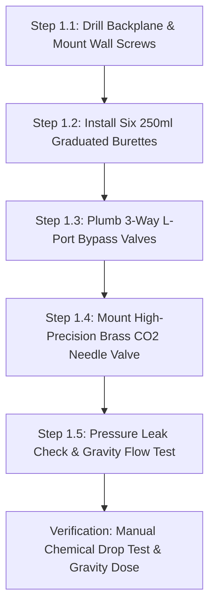
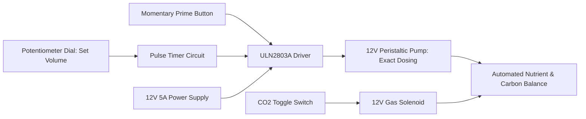
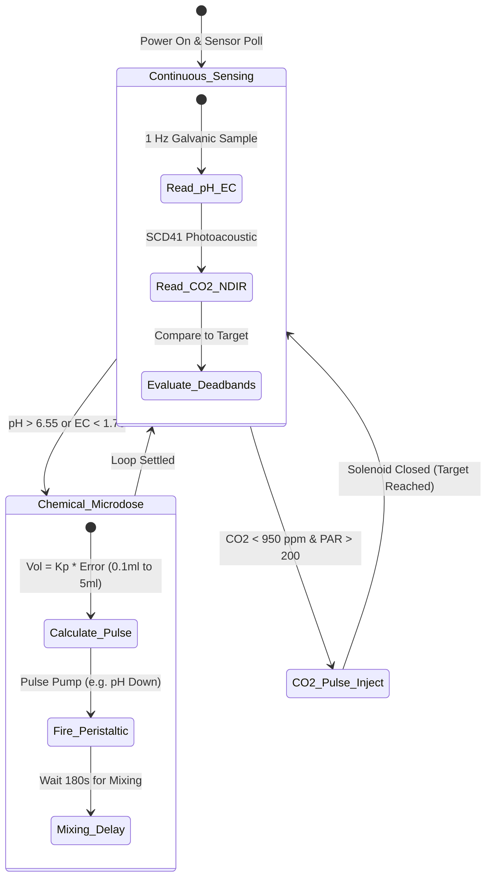

import { Card, CardGrid } from '@astrojs/starlight/components';

The **Microclimate & Automated Dosing Array** is an open-hardware agricultural controller engineered for multi-parameter environmental and nutrient automation. It can be constructed as a standalone brain for any indoor grow tent, greenhouse, or hydroponics bench, or scaled to orchestrate the master Open Biosphere assembly.

---

## 1. Standalone Homesteading & Off-Grid Utility

Maintaining optimal pH, electrical conductivity (EC), and atmospheric conditions by hand requires daily manual testing and chemical adjusting. This machine provides **autonomous 24/7 PID feedback regulation**:

<CardGrid>
  <Card title="6-Channel Nutrient & pH Doser" icon="flask">
    Industrial peristaltic pumps meter Nitrates, Phosphates, Potassium, Micronutrients, pH Up, and pH Down with $\pm 0.1$ mL precision.
  </Card>
  <Card title="Closed-Loop Atmospheric PID" icon="activity">
    Monitors air temperature, relative humidity (RH), and $CO_2$ levels in real time, triggering ultrasonic mist, exhaust dampers, or solenoids.
  </Card>
  <Card title="Open Hardware (ESP32 / Pi CM4)" icon="cpu">
    Runs open-source automation firmware (ESPHome, Mycodo, or Home Assistant) with local web dashboards and offline local datalogging.
  </Card>
  <Card title="Isolated Industrial Telemetry" icon="shield">
    Galvanically isolated I2C and RS-485 Modbus circuits prevent electrical ground-loop noise from skewing sensitive pH and EC probe readings.
  </Card>
</CardGrid>

---

## 2. Technical Specifications

| Parameter | Subsystem | Operating Target & Tolerance |
| :--- | :--- | :--- |
| **Nutrient Dosing** | 6-channel industrial 12V peristaltic pumps or gravity burettes | Resolution: $\pm 0.1$ mL per dose |
| **Water Chemistry** | Dual-junction lab-grade pH probe & platinum EC electrode | pH: 6.0 to 6.8 | EC: 1.2 to 2.4 mS/cm |
| **Atmospheric $CO_2$** | High-pressure $CO_2$ regulator with electronic solenoid mass flow meter | 800 to 1,200 ppm |
| **Relative Humidity (RH)** | Ultrasonic mist humidification + dual refrigeration dehumidifiers | 65% to 75% RH |
| **Air Temperature** | Inverter heat pump with duct distribution manifold | 21°C to 27°C day / 16°C to 19°C night |
| **Dynamic Spectrum LED** | 8-channel controllable LED bars (Deep Red 660nm, Far Red 730nm, Royal Blue 450nm) | 150 to 600 µmol/m²/s PAR |
| **Power Consumption** | 0W (Manual) / 25W avg (Add-On 1) / 38W peak (Add-On 2) |
| **Controller Architecture** | Gravity Burettes / 6-Button Potentiometer Panel / ESP32-S3 + Modbus RTU |

---

## 3. Instructions (Base Zero-Power Machine)

The foundational build of the Microclimate & Dosing Array is a **100% mechanical, zero-power gravity-fed chemical dosing backplane**. Utilizing six 250 mL graduated glass/HDPE burettes with PTFE stopcocks, 3-way manual L-port PVC ball valves, a high-precision brass gas needle valve, and colorimetric test kits, it allows off-grid growers to meter concentrated nutrients and balance water pH with clinical precision without electricity.

### Mechanical Architecture & Decoupling Standard
1. **Wall-Mount Dosing Backplane**: An 8 mm pre-drilled chemical-resistant acrylic or HDPE sheet (600 × 450 mm) mounts vertically above the reservoir.
2. **Graduated Wall Burettes**: Six 250 mL transparent graduated cylinders with permanent white enamel 1.0 mL graduations and leak-free PTFE stopcock valves allow measuring exact dose volumes before release.
3. **3-Way L-Port Bypass Valves**: 1/4" manual L-port valves connect the burettes to the nutrient injection manifold. Rotating the handle 90° isolates the line from future peristaltic pumps, allowing pure gravity-fed dosing.
4. **Mechanical Decoupling Standard**: When motorized peristaltic pumps are retrofitted in Add-On 1, the 3-way L-port ball valves remain inline. Flipping a valve handle by 90° instantly bypasses the peristaltic pump rollers, allowing direct gravity drainage from the burettes if power is interrupted.

```
       MICROCLIMATE DOSING ARRAY — BASE MECHANICAL ELEVATION
  =================================================================
             [Nutrient / pH Concentrated Stock Bottles]
             [ N ]    [ P ]    [ K ]    [Micro]  [pH Down][pH Up]
               |        |        |        |        |        |
               v        v        v        v        v        v
           +-------++-------++-------++-------++-------++-------+
           | 250ml || 250ml || 250ml || 250ml || 250ml || 250ml |
           | Grad. || Grad. || Grad. || Grad. || Grad. || Grad. |
           | Glass || Glass || Glass || Glass || Glass || Glass |
           |  (1)  ||  (2)  ||  (3)  ||  (4)  ||  (5)  ||  (6)  |
           +---+---++---+---++---+---++---+---++---+---++---+---+
               |        |        |        |        |        |
             [PTFE]   [PTFE]   [PTFE]   [PTFE]   [PTFE]   [PTFE]
            Stopcock Stopcock Stopcock Stopcock Stopcock Stopcock
               |        |        |        |        |        |
           +---+---++---+---++---+---++---+---++---+---++---+---+
           | [3-Way L-Port PVC Manual Bypass Valves (x6)]       |
           +-----------------------+----------------------------+
                                   |
                                   v Combined Injection
           ========================+=============================
                Main Recirculating Biofilter Water Return Stream
```

### Step-by-Step Fabrication & Assembly Protocol

#### Step 1.1: Backplane Drilling & Wall Mounting
1. Cut a 600 mm × 450 mm sheet of 8 mm thick transparent acrylic or white marine HDPE.
2. Drill mounting holes on a standardized 50 mm grid for six burette spring clamps, six 3-way valves, and the gas needle valve.
3. Secure the backplane to the greenhouse frame at eye level ($Z = 1,400$ mm) using four M6 stainless lag screws with rubber dampening washers.

#### Step 1.2: Graduated Burette & PTFE Stopcock Mounting
1. Snap six pairs of rubber-lined stainless steel spring clamps into the upper backplane positions.
2. Insert six 250 mL graduated burettes with 0.1 mL scale divisions into the clamps.
3. Verify that the bottom PTFE stopcock handles rotate smoothly through 360° without binding or chemical weeping.

#### Step 1.3: 3-Way L-Port Bypass Plumbing Installation
1. Mount six 1/4" NPT 3-way L-port PVC ball valves directly below each burette stopcock.
2. Connect each burette outlet to Port 1 (Top) of its corresponding 3-way valve using 1/4" ID food-grade chemical-resistant fluoroelastomer (FKM/Viton) tubing.
3. Plumb Port 2 (Bottom) of all six valves into a common 1/2" CPVC discharge injection manifold.
4. Leave Port 3 (Side) capped with a removable push-to-connect plug, reserved for motorized peristaltic pump integration in Add-On 1.

#### Step 1.4: High-Precision Gas Needle Valve Mounting
1. Mount a high-precision brass micro-metering needle valve to the lower-right corner of the backplane.
2. Plumb 1/4" high-pressure polyurethane tubing from an external $CO_2$ gas regulator (set to 15 PSI delivery pressure) to the needle valve inlet.
3. Plumb the needle valve outlet to a porous ceramic air diffuser stone submerged in the main water basin or air circulation duct.

#### Step 1.5: Chemical Leak & Calibration Verification
1. Fill all six burettes with 200 mL of clean water and close stopcocks. Let stand for 4 hours; verify zero volume loss or joint seepage.
2. Turn stopcocks to open; verify full 200 mL gravity drain empties into the manifold in $< 45$ seconds.



### Step-by-Step Operating Runbook (Manual Mode)

1. **Pre-Dose Water Quality Check**: Take a 50 mL sample from the main reservoir. Using the manual liquid test drop kit, measure pH (colorimetric comparator) and EC (manual battery pen). Note target adjustments (e.g. pH is 7.4; target is 6.5).
2. **Burette Stock Loading**: Open the stock bottle cap. Pour concentrated chemical (e.g. 10% Phosphoric Acid for pH Down) into the top funnel of Burette 5 until liquid reaches the exact calculated dose line (e.g. 18.0 mL).
3. **Volume Verification**: Check the meniscus at eye level against the graduation markings. Close the top dust cap.
4. **3-Way Valve Alignment**: Ensure the corresponding 3-way L-port valve handle points to GRAVITY DRAIN (Port 1 to Port 2 open).
5. **Executing Gravity Discharge**: Rotate the PTFE stopcock 90° open. The measured 18.0 mL dose gravity-feeds through the FKM line directly into the turbulent water return stream, dispersing instantly.
6. **Manifold Rinse**: Pour 30 mL of distilled water through the burette to flush any concentrated acid out of the manifold line. Close stopcock.
7. **Manual $CO_2$ Adjustment**: Inspect the atmospheric $CO_2$ colorimetric test card in the plant canopy. Crack open the brass micro-metering needle valve 1/8th turn until bubble counter reads 2 bubbles/second, then re-check in 2 hours.

### Base Machine Bill of Materials (BOM)

| Item | Component Description | Sourcing / Part Reference | Qty | Unit Cost | Total Cost |
| :--- | :--- | :--- | :--- | :--- | :--- |
| **K-01** | Pre-Drilled 8mm Acrylic / Marine HDPE Mounting Backplane | Local plastics fabricator | 1 | $22.00 | $22.00 |
| **K-02** | 250ml Graduated Glass Burettes with PTFE Stopcocks | Laboratory glassware supplier | 6 | $6.33 | $38.00 |
| **K-03** | 3-Way Manual L-Port PVC Ball Valves (1/4" NPT) | Standard plumbing supplier | 6 | $4.66 | $28.00 |
| **K-04** | High-Precision Brass Micro-Metering Gas Needle Valve | Beverage / welding supply | 1 | $18.00 | $18.00 |
| **K-05** | Chemical Colorimetric Liquid pH, GH/KH, and EC Test Kit | Aquarium / hydro test store | 1 | $16.00 | $16.00 |
| **Total** | **Base Zero-Power Dosing Backplane** | **Complete off-grid manual panel** | | | **$122.00** |

---

## 4. Add-On 1: Semi-Autonomous Electromechanical Pack (Buttons & Dials)

The **Semi-Autonomous Pack** motorizes chemical delivery: six 12V DC industrial peristaltic pumps (100 mL/min), six momentary green priming buttons, six multi-turn analog speed/volume potentiometers, a ULN2803A Darlington driver board, a 12V 5A MeanWell power supply, and an electric brass $CO_2$ solenoid with manual override push-pin. The grower dials in dose volumes and triggers precise chemical injections with a single button press.

### Electromechanical Actuation Architecture & Decoupling
- **Peristaltic Dosing Pumps**: Six 12V DC brushed peristaltic pumps with 3-roller rotors and food-grade PharMed BPT / silicone tubing ($0.15$ mL per rotor revolution, 100 mL/min peak).
- **Mechanical Decoupling**: The 3-way L-port valves from the Base build connect to the pump outputs. Rotating the valve handle 90° isolates the peristaltic tubing completely, restoring instant gravity-drain burette operation if power fails.
- **Operator Interface**: Six waterproof momentary push-buttons for channel priming, paired with six 10-turn precision dial potentiometers governing pump run-time pulses (0.5 to 30 seconds).
- **Atmospheric Gas Solenoid**: 12V DC direct-acting brass $CO_2$ solenoid valve with a mechanical manual override thumb-pin, allowing gas to be locked on, pulsed electrically, or opened by hand.

```
       ELECTROMECHANICAL WIRING & DIAL DOSING SCHEMATIC
  =================================================================
  [12V 5A MeanWell Power Supply]
         |
         +----[Main Power Switch]----+----(Power LED Green)
         |                           |
         +---------------------------+---------------------------+
         |                           |                           |
         v                           v                           v
  [Channel 1 Pulse Timer]     [Channel 2 Pulse Timer]     [CO2 Solenoid Relay]
  (Potentiometer 10-Turn)     (Potentiometer 10-Turn)     (Mechanical Push-Pin)
         |                           |                           |
         +----[Prime Button 1]       +----[Prime Button 2]       v
         |                           |                    [12V Brass Valve]
         v                           v                           |
  [ULN2803A Driver CH1]       [ULN2803A Driver CH2]              v
         |                           |                     (CO2 Gas Line)
         v                           v
  [12V Peristaltic Pump 1]    [12V Peristaltic Pump 2]
  (Nitrate Solution)          (Phosphate Solution)
```

### Step-by-Step Retrofit Protocol

#### Step 2.1: Peristaltic Pump Mounting
1. Bolt six 12V peristaltic pump heads into the pre-drilled central holes on the acrylic backplane using M3 stainless screws.
2. Plumb the suction tube of each pump directly into concentrated stock gallon jugs resting beneath the panel.
3. Plumb the discharge tube of each pump into Port 3 (Side) of the corresponding 3-way L-port bypass valve.

#### Step 2.2: Potentiometer Dial & Push-Button Panel Installation
1. Mount a secondary aluminum control rail below the pumps.
2. Install six 22 mm green momentary priming push-buttons.
3. Install six 10-turn counting dials paired with 10k$\Omega$ precision potentiometers.

#### Step 2.3: Darlington Driver & Pulse Timer Board
1. Mount a ULN2803A 8-channel Darlington driver module and 555-based monostable pulse timer board inside the rear junction box.
2. Wire each potentiometer into the timing resistor network of its channel: turning the dial linearly adjusts pump run time from 1.0 second (approx $1.5$ mL) to 20 seconds (approx $30$ mL).
3. Wire the momentary green buttons in parallel with the timer trigger, providing direct continuous manual motor run while held down.

#### Step 2.4: 12V $CO_2$ Electronic Solenoid Installation
1. Thread a 12V DC normally-closed brass solenoid valve inline between the gas regulator and the high-precision needle valve.
2. Wire solenoid coil through a toggle switch with a red illuminated indicator.
3. Test manual override: press the spring-loaded brass pin on the solenoid body to verify gas flows even with power disconnected.

#### Step 2.5: Power Supply & Calibration Routine
1. Mount the 12V 5A MeanWell power supply to the backplane base with an IEC fused power switch.
2. Place a 50 mL graduated cylinder under each pump discharge line.
3. Hold each green prime button for exactly 10 seconds; adjust the inline calibration trimpot until output registers exactly $16.6\text{ mL} \pm 0.2\text{ mL}$.



### Step-by-Step Push-Button Operating Runbook

1. **Power-On & Status Check**: Flip master rocker switch ON (green LED illuminates). Verify all six peristaltic tube lines are full of liquid with zero air gaps.
2. **Channel Priming**: If an air bubble is spotted in the suction line, press and hold the green prime button for that channel until solid liquid discharges into the manifold.
3. **Dialing In Calculated Doses**: Check current water EC and pH. Rotate the 10-turn dials to the desired dose volumes (e.g. Dial 1 set to 3.5 turns = 5.2 mL of Nitrogen stock; Dial 5 set to 2.0 turns = 3.0 mL of pH Down).
4. **Triggering the Dosing Cycle**: Press the pulse trigger button once. The selected peristaltic pumps run for their calibrated durations, automatically delivering the exact chemical volumes before shutting off.
5. **$CO_2$ Enrichment Toggle**: Flip the $CO_2$ toggle switch ON when lights illuminate. The solenoid opens, releasing $CO_2$ through the pre-set needle valve at a steady 2 bubbles/second.
6. **Zero-Power Bypass Override**: If power fails during a storm, turn the 3-way L-port valves 90° to open the burette ports, fill burettes by hand, and resume manual gravity dosing.

### Add-On 1 Bill of Materials (BOM)

| Item | Component Description | Sourcing / Part Reference | Qty | Unit Cost | Total Cost |
| :--- | :--- | :--- | :--- | :--- | :--- |
| **A1-01** | 12V DC Brushed Peristaltic Dosing Pumps (100 mL/min) | Aquarium / hydro supplier | 6 | $8.00 | $48.00 |
| **A1-02** | Waterproof Green Momentary Tactile Priming Buttons | Industrial switch store | 6 | $2.00 | $12.00 |
| **A1-03** | 10-Turn Precision Analog Potentiometers + Counting Dials | Electronics component shop | 6 | $2.66 | $16.00 |
| **A1-04** | ULN2803A 8-Channel Darlington Driver Board + Timers | Standard maker electronics | 1 | $12.00 | $12.00 |
| **A1-05** | 12V 5A (60W) MeanWell Enclosed Industrial Power Supply | Mean Well authorized dealer | 1 | $24.00 | $24.00 |
| **A1-06** | 12V DC Normally-Closed Brass $CO_2$ Solenoid with Push-Pin | Aquarium gas supply store | 1 | $18.00 | $18.00 |
| **Total** | **Add-On 1 Electromechanical Pack** | **Retrofits directly to Base** | | | **+$130.00** |
| **Cumul.** | **Operational Dial-Calibrated Dosing Unit** | **Base ($122) + Add-On 1 ($130)** | | | **$252.00** |

---

## 5. Add-On 2: Agentic Autonomous AI Pack (Edge Vision & Closed Loop)

The **Agentic Autonomous AI Pack** converts the panel into a 24/7 self-regulating cyber-physical biosphere orchestrator. Powered by an ESP32-S3 / Raspberry Pi CM4 controller, galvanically isolated lab-grade pH and platinum EC sensors, a Sensirion SCD41 photoacoustic NDIR $CO_2$ sensor, and CAN bus integration, it continuously executes a 1 Hz closed-loop PID algorithm, micro-dosing concentrated nutrients and injecting carbon dioxide without human intervention.

### Autonomous Vision & Telemetry Architecture
- **Microclimate Compute Core**: ESP32-S3 Dual-Core Xtensa LX7 (240 MHz) running FreeRTOS with isolated RS-485 Modbus RTU and CAN bus transceivers.
- **Galvanically Isolated Chemistry Probes**: Dual-junction sealed lab-grade pH probe and platinum dual-pin EC electrode connected via Atlas Scientific EZO or DFRobot galvanic isolation circuits, eliminating ground-loop noise from submersible pumps.
- **Photoacoustic Ambient Gas Sensor**: Sensirion SCD41 photoacoustic NDIR sensor measuring atmospheric $CO_2$ (400 to 5,000 ppm $\pm 40$ ppm), air temperature ($\pm 0.8^\circ\text{C}$), and relative humidity ($\pm 2\%$).
- **Predictive PID Loop**: 1 Hz telemetry engine calculating moving-average chemical depletion rates and dosing micro-pulses ($\pm 0.1$ mL) to prevent water chemistry oscillations.

```
       CYBER-PHYSICAL EDGE AI ARCHITECTURE & MODBUS TELEMETRY
  =================================================================
               +--------------------------------------+
               |    ESP32-S3 Microclimate Brain       |
               |  (1 Hz PID Control + Telemetry Mesh) |
               +---+--------------------+---------+---+
                   |                    |         |
         +---------+----+               | I2C     | Isolated I2C
         | CAN / RS-485 |               v         v
         v              v       [SCD41 NDIR CO2]  [Galvanic Isolator]
  [Master Biosphere] [Modbus]   (Photoacoustic)   (Ground Noise Filter)
         |                      (400 - 5000 ppm)          |
         v                                                v
   [Cloud Datalog]                                [pH & EC EZO Probes]
         |                                        (Dual-Junction Lab)
         v
   [6x Peristaltic Relays] + [CO2 Gas Solenoid]
```

### Step-by-Step Sensor Commissioning & Edge AI Protocol

#### Step 3.1: Galvanically Isolated Sensor Carrier Assembly
1. Mount the Atlas Scientific / Gravity galvanic isolation carrier board inside the lower section of the enclosure.
2. Connect the lab-grade pH probe (BNC connector) and platinum EC probe (BNC connector).
3. Calibrate probes using standard laboratory reference buffer solutions (pH 4.00, pH 7.00, EC 1,413 µS/cm). Save calibration offsets to non-volatile EEPROM.

#### Step 3.2: Sensirion SCD41 NDIR $CO_2$ Sensor Integration
1. Mount the Sensirion SCD41 sensor inside an aspirated, light-shielded duct adapter positioned at canopy level ($Z = 900$ mm).
2. Wire via shielded 4-core cable to ESP32 I2C bus (SDA: GPIO 21, SCL: GPIO 22).
3. Verify baseline reading in outdoor ambient air (must read $415\text{ ppm} \pm 25\text{ ppm}$).

#### Step 3.3: ESP32-S3 Compute & Relay Interface Wiring
1. Mount the ESP32-S3 carrier board on internal DIN rail inside an IP65 weatherproof enclosure.
2. Connect GPIO outputs 13–18 through optocoupled MOSFET drivers to trigger the six peristaltic pumps.
3. Wire GPIO 19 to an optocoupled solid-state relay controlling the 12V $CO_2$ gas solenoid.

#### Step 3.4: CAN Bus & RS-485 Modbus Interface
1. Wire the SN65HVD230 CAN transceiver to ESP32 GPIO 4 (TX) and GPIO 5 (RX).
2. Terminate the CAN bus line with a $120\Omega$ end-of-line resistor.
3. Connect the differential CAN pair to the master Open Biosphere data backbone.

#### Step 3.5: Closed-Loop PID Tuning
1. Set PID target setpoints: pH target = 6.4 (Deadband $\pm 0.15$), EC target = 1.8 mS/cm (Deadband $\pm 0.1$), $CO_2$ target = 1,000 ppm (Deadband $\pm 50$ ppm).
2. Tune proportional gain ($K_p = 0.45$) and integral time ($T_i = 180\text{ s}$) to prevent chemical overshooting in a 50-gallon recirculating reservoir.



### Step-by-Step Autonomous Multi-Agent Runbook

1. **Continuous 1 Hz Telemetry Polling**: Every second, the ESP32-S3 polls the galvanically isolated pH and EC probes and the SCD41 $CO_2$ sensor. Data is passed into a 60-sample sliding average filter to eliminate pump electrical spikes.
2. **Autonomous Closed-Loop pH Dosing**: If pH drifts above 6.55, the controller calculates the required acid volume based on reservoir volume. It pulses Peristaltic Pump 5 (pH Down) for a micro-dose of 0.8 mL, then holds a 180-second mixing delay before evaluating further dosing.
3. **Automated EC Nutrient Metering**: If EC falls below 1.70 mS/cm due to crop uptake, the controller pulses Pumps 1, 2, 3, and 4 in calibrated ratios (3:1:2:1 for N:P:K:Micro) to restore target electrical conductivity without manual fertilizer mixing.
4. **Daytime $CO_2$ Atmospheric Enrichment**: The agent checks PAR sensor readings from the overhead lighting bars. When lights are active ($\text{PAR} \ge 200\text{ }\mu\text{mol/m}^2/\text{s}$), the agent pulses the 12V $CO_2$ solenoid to maintain atmospheric carbon dioxide between 950 and 1,050 ppm. At night, $CO_2$ injection halts automatically.
5. **Dynamic Fault Protection & Safety Cutoff**: If pH readings drop below 5.2 or jump above 8.0, the firmware engages an emergency lockout: halting all chemical pumps, opening the bypass manifold, and sounding an audible alarm.
6. **Biosphere Telemetry Broadcast**: The controller broadcasts water temperature, pH, EC, and $CO_2$ logs over CAN bus to the central database, logging chemical usage down to 0.1 mL precision.

### Add-On 2 Bill of Materials (BOM)

| Item | Component Description | Sourcing / Part Reference | Qty | Unit Cost | Total Cost |
| :--- | :--- | :--- | :--- | :--- | :--- |
| **A2-01** | Galvanically Isolated Industrial pH & EC Sensor Probes + EZO | Precision water sensor maker | 1 | $85.00 | $85.00 |
| **A2-02** | Sensirion SCD41 Photoacoustic NDIR $CO_2$, Temp & RH Sensor | Environmental sensor store | 1 | $28.00 | $28.00 |
| **A2-03** | ESP32-S3 DevKitC-1 N8R8 Microcontroller Board | Espressif distributor | 1 | $14.00 | $14.00 |
| **A2-04** | Optocoupled 8-Channel High-Side MOSFET Driver Board | Industrial interface maker | 1 | $14.00 | $14.00 |
| **A2-05** | Isolated RS-485 Modbus / CAN Bus Transceiver Module | Waveshare / industrial CAN | 1 | $7.00 | $7.00 |
| **A2-06** | IP65 ABS Weatherproof Wall-Mount Enclosure with Glands | Electrical enclosure store | 1 | $22.00 | $22.00 |
| **A2-07** | Shielded Twisted-Pair Sensor Cable Harness (10m) | Alpha Wire or equivalent | 1 | $14.00 | $14.00 |
| **Total** | **Add-On 2 Agentic Autonomous Pack** | **Expands Base + Add-On 1** | | | **+$184.00** |
| **Full Build** | **Complete Autonomous Biosphere Water & Climate Brain** | **Base + Add-On 1 + Add-On 2** | | | **$436.00** |

---

## 6. Staged Upgrade Progression & Cost Summary

### Build Tier Comparison

| Build Stage | Operational Capability | Direct Stage Cost | Cumulative Investment |
| :--- | :--- | :--- | :--- |
| **Base: Instructions** | 100% mechanical gravity burettes, manual 3-way L-port valves, and colorimetric drops | $122.00 | **$122.00** |
| **Add-On 1: Semi-Auto** | Motorized 6-channel peristaltic pumping, push-button priming, and potentiometer dials | +$130.00 | **$252.00** |
| **Add-On 2: Agentic AI** | 1 Hz closed-loop PID water chemistry, NDIR $CO_2$ injection, and CAN bus integration | +$184.00 | **$436.00** |

### Step-by-Step Zero-Waste Conversion Roadmap

#### Path 1: Base Machine $\rightarrow$ Add-On 1 (Motorized Dosing Panel)
1. Bolt the six 12V peristaltic pumps into the pre-drilled central holes on the acrylic backplane.
2. Plumb the pump discharge lines into Port 3 of the 3-way L-port bypass valves (the manual burettes remain fully usable).
3. Install the 12V MeanWell power supply, priming push-buttons, and calibration potentiometers on the lower rail.

#### Path 2: Add-On 1 $\rightarrow$ Add-On 2 (Autonomous Closed-Loop Brain)
1. Mount the IP65 enclosure containing the ESP32-S3 and isolated sensor board onto the side wall.
2. Submerge the lab-grade pH and platinum EC probes in the biofilter return line.
3. Install the SCD41 $CO_2$ sensor at canopy level, connect the CAN bus pair, and flash the autonomous 1 Hz PID regulation firmware.

---

## 7. Master Biosphere Assembly Interlock

When integrated into the centralized Open Biosphere facility (~20 × 10 ft footprint):

1. **Perimeter Wall Mounting**: Mounts in an IP65 splash-proof enclosure directly beside the South-West datum origin $(0,0,0)$.
2. **Manifold Injection**: Dosing lines inject concentrated stock solutions directly into the fluidic return line after the biofiltration loop, ensuring complete turbulent mixing before water re-enters the Central Basin and NFT gutters.
3. **Master CAN / MQTT Bus**: Publishes environmental telemetry and pump actuation logs to the centralized Open Biosphere logging server, coordinating lighting spectrum adjustments with water nutrient replenishment.
