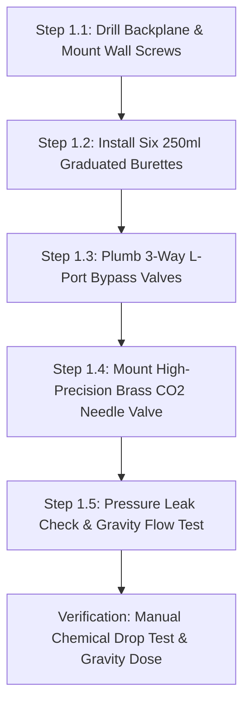

import { Card, CardGrid, LinkButton } from '@astrojs/starlight/components';

## Part 1: Stage Header & Executive Summary

> [!NOTE]
> **Stage Designation:** Stage 0 (Zero-Power Baseline)  
> **Operating Mode:** 100% Mechanical Manual Fallback  
> **Power Consumption:** 0 Watts (Zero Electrical Input Required)  
> **Resilience Rating:** Continuous Off-Grid / EMP / Submersion Proof  
> **Decoupling Standard:** Friction Slip-Clutch / Quick-Release Cam Linkage  

The Stage 0 baseline build of the **Microclimate & Automated Dosing Array** is a **100% mechanical, zero-power agricultural machine**. It operates entirely by human leverage, manual hand cranks, counterweights, and gravity flows—providing complete food security and operational continuity during total grid blackouts.

---

## Part 2: Capability Delta (Features Introduced)

* **Zero-Power Resilience**: Operates indefinitely without batteries, solar controllers, or power supplies.
* **Direct Mechanical Leverage**: All actuation performed via hand cranks, manual levers, counterweights, or gravity siphoning.
* **Inherent Decoupling**: Built from the ground up with mechanical slip-clutches, quick-release clamps, or bypass valves to ensure motor upgrades never bind.

---

## Part 3: Isolated Stage 0 Bill of Materials (BOM)


### Base Machine Bill of Materials (BOM)

| Item | Part ID & Registry Link | Component & Specification | Sourcing / Supplier | Fab Type | Qty | Unit Cost | CAD Asset | Total Cost |
| :--- | :--- | :--- | :--- | :--- | :--- | :--- | :--- | :--- |
| **K-01** | [`PART-MECH-ALUM-2020-6M`](/open-biosphere/parts/mechanical/PART-MECH-ALUM-2020-6M/) | Pre-Drilled 8mm Acrylic / Marine HDPE Mounting Backplane | [Local plastics fabricator](https://openbuildspartstore.com) | Stock Extrusion | 1 | $22.00 | [Download .3DS](/open-biosphere/assets/parts/PART-MECH-ALUM-2020-6M/model.3ds) | $22.00 |
| **K-02** | [`PART-MECH-ALUM-2020-6M`](/open-biosphere/parts/mechanical/PART-MECH-ALUM-2020-6M/) | 250ml Graduated Glass Burettes with PTFE Stopcocks | [Laboratory glassware supplier](https://openbuildspartstore.com) | Stock Extrusion | 6 | $6.33 | [Download .3DS](/open-biosphere/assets/parts/PART-MECH-ALUM-2020-6M/model.3ds) | $38.00 |
| **K-03** | [`PART-FLUID-VALVE-3WAY-L`](/open-biosphere/parts/fluidic/PART-FLUID-VALVE-3WAY-L/) | 3-Way Manual L-Port PVC Ball Valves (1/4" NPT) | [Standard plumbing supplier](https://coleparmer.com) | Stock Valve | 6 | $4.66 | [Download .3DS](/open-biosphere/assets/parts/PART-FLUID-VALVE-3WAY-L/model.3ds) | $28.00 |
| **K-04** | [`PART-MECH-ALUM-2020-6M`](/open-biosphere/parts/mechanical/PART-MECH-ALUM-2020-6M/) | High-Precision Brass Micro-Metering Gas Needle Valve | [Beverage / welding supply](https://openbuildspartstore.com) | Stock Extrusion | 1 | $18.00 | [Download .3DS](/open-biosphere/assets/parts/PART-MECH-ALUM-2020-6M/model.3ds) | $18.00 |
| **K-05** | [`PART-MECH-ALUM-2020-6M`](/open-biosphere/parts/mechanical/PART-MECH-ALUM-2020-6M/) | Chemical Colorimetric Liquid pH, GH/KH, and EC Test Kit | [Aquarium / hydro test store](https://openbuildspartstore.com) | Stock Extrusion | 1 | $16.00 | [Download .3DS](/open-biosphere/assets/parts/PART-MECH-ALUM-2020-6M/model.3ds) | $16.00 |
| **Total** | **Base Zero-Power Dosing Backplane** | **Complete off-grid manual panel** | | | | | | **$122.00** |

---

## Part 4: Standalone Full SVG Blueprint


---

## Part 5: Step-by-Step Assembly & Operating Protocol

The foundational build of the Microclimate & Dosing Array is a **100% mechanical, zero-power gravity-fed chemical dosing backplane**. Utilizing six 250 mL graduated glass/HDPE burettes with PTFE stopcocks, 3-way manual L-port PVC ball valves, a high-precision brass gas needle valve, and colorimetric test kits, it allows off-grid growers to meter concentrated nutrients and balance water pH with clinical precision without electricity.

### Mechanical Architecture & Decoupling Standard
1. **Wall-Mount Dosing Backplane**: An 8 mm pre-drilled chemical-resistant acrylic or HDPE sheet (600 × 450 mm) mounts vertically above the reservoir.
2. **Graduated Wall Burettes**: Six 250 mL transparent graduated cylinders with permanent white enamel 1.0 mL graduations and leak-free PTFE stopcock valves allow measuring exact dose volumes before release.
3. **3-Way L-Port Bypass Valves**: 1/4" manual L-port valves connect the burettes to the nutrient injection manifold. Rotating the handle 90° isolates the line from future peristaltic pumps, allowing pure gravity-fed dosing.
4. **Mechanical Decoupling Standard**: When motorized peristaltic pumps are retrofitted in Add-On 1, the 3-way L-port ball valves remain inline. Flipping a valve handle by 90° instantly bypasses the peristaltic pump rollers, allowing direct gravity drainage from the burettes if power is interrupted.

```
       MICROCLIMATE DOSING ARRAY — BASE MECHANICAL ELEVATION
  =================================================================
             [Nutrient / pH Concentrated Stock Bottles]
             [ N ]    [ P ]    [ K ]    [Micro]  [pH Down][pH Up]
               |        |        |        |        |        |
               v        v        v        v        v        v
           +-------++-------++-------++-------++-------++-------+
           | 250ml || 250ml || 250ml || 250ml || 250ml || 250ml |
           | Grad. || Grad. || Grad. || Grad. || Grad. || Grad. |
           | Glass || Glass || Glass || Glass || Glass || Glass |
           |  (1)  ||  (2)  ||  (3)  ||  (4)  ||  (5)  ||  (6)  |
           +---+---++---+---++---+---++---+---++---+---++---+---+
               |        |        |        |        |        |
             [PTFE]   [PTFE]   [PTFE]   [PTFE]   [PTFE]   [PTFE]
            Stopcock Stopcock Stopcock Stopcock Stopcock Stopcock
               |        |        |        |        |        |
           +---+---++---+---++---+---++---+---++---+---++---+---+
           | [3-Way L-Port PVC Manual Bypass Valves (x6)]       |
           +-----------------------+----------------------------+
                                   |
                                   v Combined Injection
           ========================+=============================
                Main Recirculating Biofilter Water Return Stream
```

### Step-by-Step Fabrication & Assembly Protocol

#### Step 1.1: Backplane Drilling & Wall Mounting
1. Cut a 600 mm × 450 mm sheet of 8 mm thick transparent acrylic or white marine HDPE.
2. Drill mounting holes on a standardized 50 mm grid for six burette spring clamps, six 3-way valves, and the gas needle valve.
3. Secure the backplane to the greenhouse frame at eye level ($Z = 1,400$ mm) using four M6 stainless lag screws with rubber dampening washers.

#### Step 1.2: Graduated Burette & PTFE Stopcock Mounting
1. Snap six pairs of rubber-lined stainless steel spring clamps into the upper backplane positions.
2. Insert six 250 mL graduated burettes with 0.1 mL scale divisions into the clamps.
3. Verify that the bottom PTFE stopcock handles rotate smoothly through 360° without binding or chemical weeping.

#### Step 1.3: 3-Way L-Port Bypass Plumbing Installation
1. Mount six 1/4" NPT 3-way L-port PVC ball valves directly below each burette stopcock.
2. Connect each burette outlet to Port 1 (Top) of its corresponding 3-way valve using 1/4" ID food-grade chemical-resistant fluoroelastomer (FKM/Viton) tubing.
3. Plumb Port 2 (Bottom) of all six valves into a common 1/2" CPVC discharge injection manifold.
4. Leave Port 3 (Side) capped with a removable push-to-connect plug, reserved for motorized peristaltic pump integration in Add-On 1.

#### Step 1.4: High-Precision Gas Needle Valve Mounting
1. Mount a high-precision brass micro-metering needle valve to the lower-right corner of the backplane.
2. Plumb 1/4" high-pressure polyurethane tubing from an external $CO_2$ gas regulator (set to 15 PSI delivery pressure) to the needle valve inlet.
3. Plumb the needle valve outlet to a porous ceramic air diffuser stone submerged in the main water basin or air circulation duct.

#### Step 1.5: Chemical Leak & Calibration Verification
1. Fill all six burettes with 200 mL of clean water and close stopcocks. Let stand for 4 hours; verify zero volume loss or joint seepage.
2. Turn stopcocks to open; verify full 200 mL gravity drain empties into the manifold in $< 45$ seconds.



### Step-by-Step Operating Runbook (Manual Mode)

1. **Pre-Dose Water Quality Check**: Take a 50 mL sample from the main reservoir. Using the manual liquid test drop kit, measure pH (colorimetric comparator) and EC (manual battery pen). Note target adjustments (e.g. pH is 7.4; target is 6.5).
2. **Burette Stock Loading**: Open the stock bottle cap. Pour concentrated chemical (e.g. 10% Phosphoric Acid for pH Down) into the top funnel of Burette 5 until liquid reaches the exact calculated dose line (e.g. 18.0 mL).
3. **Volume Verification**: Check the meniscus at eye level against the graduation markings. Close the top dust cap.
4. **3-Way Valve Alignment**: Ensure the corresponding 3-way L-port valve handle points to GRAVITY DRAIN (Port 1 to Port 2 open).
5. **Executing Gravity Discharge**: Rotate the PTFE stopcock 90° open. The measured 18.0 mL dose gravity-feeds through the FKM line directly into the turbulent water return stream, dispersing instantly.
6. **Manifold Rinse**: Pour 30 mL of distilled water through the burette to flush any concentrated acid out of the manifold line. Close stopcock.
7. **Manual $CO_2$ Adjustment**: Inspect the atmospheric $CO_2$ colorimetric test card in the plant canopy. Crack open the brass micro-metering needle valve 1/8th turn until bubble counter reads 2 bubbles/second, then re-check in 2 hours.

---

## Part 6: Guided Stage Navigation

<CardGrid>
  <Card title="Subsystem Overview" icon="left-arrow">
    Return to the machine overview, crop affinity matrix, and multi-stage comparison.
    <br/><br/>
    <LinkButton href="/open-biosphere/hardware/microclimate-dosing-array/" variant="minimal">← Return to Overview</LinkButton>
  </Card>
  <Card title="Stage 1: BLE Electromechanical Pack" icon="right-arrow">
    Ready to motorize this machine? Upgrade with DC actuation and Flutter BLE Virtual Panel controls.
    <br/><br/>
    <LinkButton href="/open-biosphere/hardware/microclimate-dosing-array/stage-1/" variant="primary">Proceed to Stage 1 Upgrade →</LinkButton>
  </Card>
</CardGrid>
