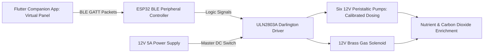

import { Card, CardGrid, LinkButton } from '@astrojs/starlight/components';

## Part 1: Stage Header & Executive Summary

> [!NOTE]
> **Stage Designation:** Stage 1 (Semi-Autonomous Electromechanical Pack)  
> **Operating Mode:** DC Motorized Continuous Duty with Ephemeral BLE Virtual Panel  
> **Power Requirement:** 12V / 24V DC Industrial Bus  
> **Physical Interlocks:** Strict Two-Control Standard (Master DC Cut + Recessed SD Factory Restore)  
> **Operator Interface:** Ephemeral Flutter Mobile Companion App over BLE GATT  

The Stage 1 electromechanical pack motorizes the **Microclimate & Automated Dosing Array**, adding continuous DC motor/pump drive governed by the **Strict Two-Control Physical Standard** (RFC-0005) and an ephemeral **Flutter Companion App Virtual Panel** over direct local BLE.

---

## Part 2: Capability Delta (Features Introduced)

* **Continuous Motorized Actuation**: Replaces human manual cranking with high-efficiency DC gearmotors, steppers, or booster pumps.
* **Strict Two-Control Physical Standard**: Eliminates physical jog buttons and potentiometer dials to prevent moisture breach and priority race conditions. Only Master DC Switch and Recessed SD Reset Button are permitted on hardware.
* **Ephemeral BLE Virtual Panel**: Jogging, speed sliders, and priming pulses execute via the Flutter companion app over direct local BLE GATT.
* **100% Preserved Manual Fallback**: Slip-clutches, bypass valves, or belt releases guarantee instant zero-power manual hand operation without disassembly.

---

## Part 3: Isolated Stage 1 Bill of Materials (BOM)


### Add-On 1 Bill of Materials (BOM)

| Item | Part ID & Registry Link | Component & Specification | Sourcing / Supplier | Fab Type | Qty | Unit Cost | CAD Asset | Total Cost |
| :--- | :--- | :--- | :--- | :--- | :--- | :--- | :--- | :--- |
| **A1-01** | [`PART-FLUID-PUMP-PERI-12V`](/open-biosphere/parts/fluidic/PART-FLUID-PUMP-PERI-12V/) | 12V DC Brushed Peristaltic Dosing Pumps (100 mL/min) | [Aquarium / hydro supplier](https://kamoer.com) | Stock Pump | 6 | $8.00 | [Download .3DS](/open-biosphere/assets/parts/PART-FLUID-PUMP-PERI-12V/model.3ds) | $48.00 |
| **A1-02** | [`PART-ELEC-TWO-CTRL-PACK`](/open-biosphere/parts/electrical/PART-ELEC-TWO-CTRL-PACK/) | Two-Control Physical Enclosure Pack (Heavy-Duty Master 12V DC Switch, Recessed Tactile SD Reset Button, Micro-SD Slot Module + 16GB Golden Card) | [Industrial switch / maker shop](https://open-biosphere.org/parts/PART-ELEC-TWO-CTRL-PACK) | 3D Print / Assembly | 1 | $18.00 | [Download .3DS](/open-biosphere/assets/parts/PART-ELEC-TWO-CTRL-PACK/model.3ds) | $18.00 |
| **A1-03** | [`PART-ELEC-OLED-091-I2C`](/open-biosphere/parts/electrical/PART-ELEC-OLED-091-I2C/) | 0.91" I2C Status OLED Display & BLE Peripheral Carrier | [Microcontroller display store](https://adafruit.com) | Stock Electronics | 1 | $10.00 | [Download .3DS](/open-biosphere/assets/parts/PART-ELEC-OLED-091-I2C/model.3ds) | $10.00 |
| **A1-04** | [`PART-MECH-ALUM-2020-6M`](/open-biosphere/parts/mechanical/PART-MECH-ALUM-2020-6M/) | ULN2803A 8-Channel Darlington Driver Board + Timers | [Standard maker electronics](https://openbuildspartstore.com) | Stock Extrusion | 1 | $12.00 | [Download .3DS](/open-biosphere/assets/parts/PART-MECH-ALUM-2020-6M/model.3ds) | $12.00 |
| **A1-05** | [`PART-ELEC-PSU-12V-60W`](/open-biosphere/parts/electrical/PART-ELEC-PSU-12V-60W/) | 12V 5A (60W) MeanWell Enclosed Industrial Power Supply | [Mean Well authorized dealer](https://digikey.com) | Stock Power Supply | 1 | $24.00 | [Download .3DS](/open-biosphere/assets/parts/PART-ELEC-PSU-12V-60W/model.3ds) | $24.00 |
| **A1-06** | [`PART-MECH-ALUM-2020-6M`](/open-biosphere/parts/mechanical/PART-MECH-ALUM-2020-6M/) | 12V DC Normally-Closed Brass \$CO_2\$ Solenoid with Push-Pin | [Aquarium gas supply store](https://openbuildspartstore.com) | Stock Extrusion | 1 | $18.00 | [Download .3DS](/open-biosphere/assets/parts/PART-MECH-ALUM-2020-6M/model.3ds) | $18.00 |
| **Total** | **Add-On 1 Electromechanical Pack** | **Retrofits directly to Base** | | | | | | **+$130.00** |
| **Cumul.** | **Operational BLE Virtual Dosing Unit** | **Base ($122) + Add-On 1 ($130)** | | | | | | **$252.00** |

---

## Part 4: Standalone Full SVG Blueprint


---

## Part 5: Step-by-Step Retrofit, Wiring & Operating Protocol

Under [RFC-0005](/rfcs/rfc-0005-hardware-interlocks-ble-virtual-panel), physical control panels with dedicated priming buttons, rotary dials, and multi-turn analog potentiometers are strictly banned across all machine tiers to eliminate liquid breach points and control priority contention.

Add-On 1 motorizes chemical delivery governed by the **Strict Two-Control Physical Standard**:
1. **Master Hardware DC Power Switch**: Heavy-duty toggle switch directly isolating the 12V DC power bus.
2. **"Nuke & Pave" SD Factory Restore Button**: Dedicated recessed tactile switch wired to trigger an automatic secondary bootloader re-flash from micro-SD storage.

All channel priming, calibrated pulse volume metering (0.1 to 30.0 mL), and atmospheric $CO_2$ solenoid pulsing are conducted via the **Flutter Companion App Virtual Panel** over direct local BLE GATT.

### Electromechanical Actuation Architecture & Decoupling
- **Peristaltic Dosing Pumps**: Six 12V DC brushed peristaltic pumps with 3-roller rotors and food-grade PharMed BPT / silicone tubing ($0.15$ mL per rotor revolution, 100 mL/min peak).
- **Mechanical Decoupling**: The 3-way L-port valves from the Base build connect to the pump outputs. Rotating the valve handle 90° isolates the peristaltic tubing completely, restoring instant gravity-drain burette operation if power fails.
- **Strict Two-Control Enclosure**: An IP65 waterproof enclosure mounted beside the manifold contains:
  - Heavy-duty toggle switch directly isolating the 12V DC supply line.
  - Recessed tactile button next to the 0.91" I2C OLED display (`[DOSER-A1 | BLE READY]`) for 5-second SD recovery reflash.
  - Micro-SD card slot module pre-loaded with golden recovery `firmware.bin` and `config.default`.
- **Atmospheric Gas Solenoid**: 12V DC direct-acting brass $CO_2$ solenoid valve with a mechanical manual override thumb-pin, allowing gas to be locked on, pulsed electrically, or opened by hand.
- **Ephemeral BLE Virtual Panel**: When nearby, an operator opens the Flutter companion app on mobile device. The app auto-discovers the doser over BLE GATT and displays real-time virtual touch controls: 6-channel momentary virtual prime pads, calibrated pulse volume sliders, and a $CO_2$ solenoid purge toggle.

```
       ELECTROMECHANICAL WIRING & BLE VIRTUAL DOSING SCHEMATIC
  =================================================================
  [12V 5A MeanWell Power Supply]
         |
         +----[Master DC Switch]----+----(OLED: [DOSER-A1 | BLE READY])
                                    |
         +--------------------------+---------------------------+
         |                          |                           |
         v                          v                           v
  [ESP32 BLE Controller]     [ULN2803A Driver CH1-6]     [12V CO2 Solenoid Relay]
  (Recessed SD Reset Button)        |                           |
  (Micro-SD Golden Recovery)        |                           v
         |                          +---------------+    [12V Brass Valve]
         |                          |               |           |
         v                          v               v           v
  [Peristaltic Pumps 1-3]    [Peristaltic Pumps 4-6]      (CO2 Gas Line)
  (N, P, K Solutions)        (Micro, pH Down, pH Up)
         ^
         : Direct BLE GATT (No Contention)
         v
  [Flutter Companion App Virtual Panel]
  (Virtual Priming Pads, Calibrated Dose Sliders, CO2 Pulse Toggle)
```

### Step-by-Step Retrofit Protocol

#### Step 2.1: Peristaltic Pump Mounting
1. Bolt six 12V peristaltic pump heads into the pre-drilled central holes on the acrylic backplane using M3 stainless screws.
2. Plumb the suction tube of each pump directly into concentrated stock gallon jugs resting beneath the panel.
3. Plumb the discharge tube of each pump into Port 3 (Side) of the corresponding 3-way L-port bypass valve.

#### Step 2.2: Two-Control Enclosure & Driver Board Assembly
1. Mount an IP65 sealed ABS junction box on the lower aluminum rail.
2. Install the heavy-duty inline 12V master switch, recessed SD reset tactile button, micro-SD slot module, and 0.91" I2C OLED display.
3. Mount the ULN2803A 8-channel Darlington driver board and ESP32 BLE peripheral controller inside the junction box.
4. Wire driver outputs to the six peristaltic pump motor leads.

#### Step 2.3: 12V $CO_2$ Electronic Solenoid Installation
1. Thread a 12V DC normally-closed brass solenoid valve inline between the gas regulator and the high-precision needle valve.
2. Wire solenoid coil through driver channel 7 with flyback diode protection.
3. Test manual override: press the spring-loaded brass pin on the solenoid body to verify gas flows even with power disconnected.

#### Step 2.4: Power Distribution & BLE Firmware Flashing
1. Mount the 12V 5A MeanWell power supply to the backplane base with an IEC fused power switch.
2. Flash the ESP32 controller with the Doser Virtual Panel peripheral firmware; verify it advertises `[DOSER-A1]`.
3. Verify onboard OLED renders `[DOSER-A1 | BLE READY]`.

#### Step 2.5: Volumetric Calibration Routine via Mobile App
1. Place a 50 mL graduated cylinder under each pump discharge line.
2. Open the Flutter companion app; tap the virtual prime pad for Channel 1 for exactly 10 seconds.
3. Adjust calibration factor in app until 10-second pulse registers exactly 16.6 mL ± 0.2 mL. Repeat for all 6 channels.



### Step-by-Step BLE Virtual Panel Operating Runbook

1. **Power Initialization**: Flip master 12V DC toggle switch ON. The onboard 0.91" OLED illuminates: `[DOSER-A1 | BLE READY]`. Verify all six peristaltic lines are primed with zero bubbles.
2. **Walk-Up BLE Virtual Panel Connection**: Open the Flutter companion app on mobile device. Select `DOSER-A1` from discovered BLE peripherals. The app instantly renders the 6-channel Dosing Virtual Panel.
3. **Channel Priming**: If an air bubble is spotted in a suction line, tap and hold the corresponding virtual prime button in the app until solid liquid discharges into the manifold.
4. **Setting Calibrated Doses**: Inspect current water EC and pH. Adjust virtual dose sliders in the app (e.g. Channel 1: 5.2 mL of Nitrogen stock; Channel 5: 3.0 mL of pH Down).
5. **Triggering the Dosing Cycle**: Tap the virtual "Execute Dosing Cycle" button. The selected peristaltic pumps run for their calibrated durations, automatically delivering the exact chemical volumes before shutting off.
6. **$CO_2$ Enrichment Toggle**: Toggle the virtual $CO_2$ switch ON in the app. The solenoid opens, releasing $CO_2$ through the pre-set needle valve at a steady 2 bubbles/second.
7. **"Nuke & Pave" SD Recovery Protocol**: If calibration values corrupt or firmware locks up, hold the physical recessed reset button for 5 seconds during power-on. The secondary bootloader reflashes factory baseline firmware from micro-SD in 4 seconds.
8. **Immediate Zero-Power Bypass Override**: If power fails during an outage, turn the 3-way L-port valves 90° to open the burette ports, fill burettes by hand, and resume manual gravity dosing.

---

## Part 6: Guided Stage Navigation

<CardGrid>
  <Card title="Stage 0: Zero-Power Baseline" icon="left-arrow">
    Review the underlying manual chassis, fabrication tolerances, and mechanical fallback linkage.
    <br/><br/>
    <LinkButton href="/open-biosphere/hardware/microclimate-dosing-array/stage-0/" variant="minimal">← Previous: Stage 0 Baseline</LinkButton>
  </Card>
  <Card title="Stage 2: Agentic Autonomous AI Pack" icon="right-arrow">
    Ready for full closed-loop autonomy? Integrate the Controller-Node-Tool mesh and local neural vision.
    <br/><br/>
    <LinkButton href="/open-biosphere/hardware/microclimate-dosing-array/stage-2/" variant="primary">Proceed to Stage 2 Upgrade →</LinkButton>
  </Card>
</CardGrid>
