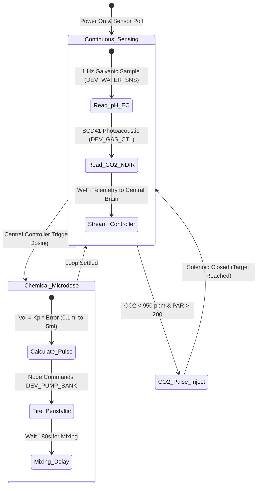

import { Card, CardGrid, LinkButton } from '@astrojs/starlight/components';

## Part 1: Stage Header & Executive Summary

> [!NOTE]
> **Stage Designation:** Stage 2 (Agentic Autonomous AI Pack)  
> **Operating Mode:** 24/7 Closed-Loop Autonomous Neural Telemetry & Robotics  
> **Network Mesh:** Encrypted Isolated Farm Wi-Fi (<code>POTFRM-4096</code> on 192.168.42.0/24) + BLE Tool Downlinks  
> **Safety Interlocks:** 250ms Hardware Deadman Watchdogs on all Edge Tools  
> **Edge AI Engine:** <code>llama-cpp-python</code> Local GGUF Multimodal Vision (Zero Cloud Dependence)  

The Stage 2 agentic pack elevates the **Microclimate & Automated Dosing Array** into a fully autonomous cyber-physical robotics cell operating under the **Controller-Node-Tool (CNT)** standard (RFC-0004) and **Agnostic Controller Runtime** (RFC-0006).

---

## Part 2: Capability Delta (Features Introduced)

* **Controller-Node-Tool (CNT) Hierarchy**: Heavy neural perception runs on the Central Biosphere Controller; the Machine Node coordinates local kinematics; tiny Edge Tools drive motors 1:1.
* **Isolated Farm AP Mesh**: Secure, air-gapped local Wi-Fi (<code>POTFRM-&lt;CLUSTER_ID&gt;</code> on <code>192.168.42.0/24</code>) with WebSocket node registration at <code>ws://192.168.42.1:8443/register</code>.
* **250ms Hardware Deadman Watchdogs**: Every Tool trips into safe, high-Z, zero-power state within 250 ms if signal is interrupted.
* **Local Zero-Cloud Edge AI**: Multi-agent perception via <code>llama-cpp-python</code> local vision models without internet dependencies.

---

## Part 3: Isolated Stage 2 Bill of Materials (BOM)


### Add-On 2 Bill of Materials (BOM)

| Item | Part ID & Registry Link | Component & Specification | Sourcing / Supplier | Fab Type | Qty | Unit Cost | CAD Asset | Total Cost |
| :--- | :--- | :--- | :--- | :--- | :--- | :--- | :--- | :--- |
| **A2-01** | [`PART-MECH-ALUM-2020-6M`](/open-biosphere/parts/mechanical/PART-MECH-ALUM-2020-6M/) | Galvanically Isolated Industrial pH & EC Sensor Probes + EZO | [Precision water sensor maker](https://openbuildspartstore.com) | Stock Extrusion | 1 | $85.00 | [Download .3DS](/open-biosphere/assets/parts/PART-MECH-ALUM-2020-6M/model.3ds) | $85.00 |
| **A2-02** | [`PART-ELEC-SNS-SCD41-NDIR`](/open-biosphere/parts/electrical/PART-ELEC-SNS-SCD41-NDIR/) | Sensirion SCD41 Photoacoustic NDIR \$CO_2\$, Temp & RH Sensor | [Environmental sensor store](https://digikey.com) | Stock Sensor | 1 | $28.00 | [Download .3DS](/open-biosphere/assets/parts/PART-ELEC-SNS-SCD41-NDIR/model.3ds) | $28.00 |
| **A2-03** | [`PART-ELEC-ESP32-S3-NODE`](/open-biosphere/parts/electrical/PART-ELEC-ESP32-S3-NODE/) | Doser Machine Node: ESP32-S3 (8MB PSRAM) + 0.96" OLED + Setup Button | [Espressif distributor](https://mouser.com/espressif) | Stock Electronics | 1 | $16.00 | [Download .3DS](/open-biosphere/assets/parts/PART-ELEC-ESP32-S3-NODE/model.3ds) | $16.00 |
| **A2-04** | [`PART-ELEC-ESP32-C3-TOOL`](/open-biosphere/parts/electrical/PART-ELEC-ESP32-C3-TOOL/) | 3x ESP32-C3 Modular Tools with 0.42" OLED & 250ms Watchdog (Pumps & Gas) | [Microcontroller supplier](https://seeedstudio.com) | Stock Electronics | 3 | $7.00 | [Download .3DS](/open-biosphere/assets/parts/PART-ELEC-ESP32-C3-TOOL/model.3ds) | $21.00 |
| **A2-05** | [`PART-ELEC-DVR-MOSFET-8CH`](/open-biosphere/parts/electrical/PART-ELEC-DVR-MOSFET-8CH/) | Optocoupled 8-Channel High-Side MOSFET Driver Board | [Industrial interface maker](https://tindie.com) | Stock Electronics | 1 | $14.00 | [Download .3DS](/open-biosphere/assets/parts/PART-ELEC-DVR-MOSFET-8CH/model.3ds) | $14.00 |
| **A2-06** | [`PART-ELEC-ENC-WEATHER-IP65`](/open-biosphere/parts/electrical/PART-ELEC-ENC-WEATHER-IP65/) | IP65 ABS Weatherproof Wall-Mount Enclosure with Glands | [Electrical enclosure store](https://mouser.com) | Stock Enclosure | 1 | $20.00 | [Download .3DS](/open-biosphere/assets/parts/PART-ELEC-ENC-WEATHER-IP65/model.3ds) | $20.00 |
| **Total** | **Add-On 2 Agentic Autonomous Pack (CNT Standard)** | **Expands Base + Add-On 1** | | | | | | **+$184.00** |
| **Full Build** | **Complete Autonomous Biosphere Water & Climate Brain** | **Base + Add-On 1 + Add-On 2** | | | | | | **$436.00** |

---

## Part 4: Standalone Full SVG Blueprint


---

## Part 5: Step-by-Step Commissioning, Provisioning & Autonomous Runbook

Under [RFC-0004](/rfcs/rfc-0004-controller-node-tool) and [RFC-0006](/rfcs/rfc-0006-agnostic-controller-runtime), the **Agentic Autonomous AI Pack** transforms the dosing panel into a 24/7 self-regulating **Controller-Node-Tool (CNT)** water chemistry orchestrator. It operates as a dedicated **Doser Node** commanding modular **Edge Tools** over BLE, receiving nutrient recipe ratios and 1 Hz closed-loop PID setpoints from the Central Biosphere Controller over Wi-Fi.

### Autonomous Vision & Telemetry Architecture
- **Doser Machine Node (ESP32-S3)**: Dual-Core Xtensa LX7 (240 MHz, 8 MB PSRAM) mounted inside an IP65 enclosure governed by the **Strict Two-Control Physical Standard** (Master DC Power Switch and Recessed SD Reset Button alongside 0.96" I2C OLED `[NODE: DOSER-01 | LINK -> 4096]`). Uplinks to Central Controller via Wi-Fi; collects telemetry and downlinks to Tools via BLE Central.
- **Galvanically Isolated Chemistry Probes**: Dual-junction sealed lab-grade pH probe and platinum dual-pin EC electrode connected via Atlas Scientific galvanic isolation circuits, eliminating ground-loop electrical noise from submersible pumps.
- **Photoacoustic Ambient Gas Sensor**: Sensirion SCD41 photoacoustic NDIR sensor measuring atmospheric $CO_2$ (400 to 5,000 ppm $\pm 40$ ppm), air temperature (± 0.8°C), and relative humidity ($\pm 2\%$).
- **Dedicated Modular Edge Tools (ESP32-C3)**: Driven 1:1 by micro ESP32-C3 controllers equipped with 0.42" micro OLED displays and **250ms hardware deadman watchdogs**:
  - `DEV_PUMP_BANK1`: Micro ESP32-C3 with 0.42" OLED (`TOOL: PUMP_BANK1 | LINK: OK`) + 250ms watchdog driving peristaltic pumps 1–3 (N, P, K).
  - `DEV_PUMP_BANK2`: Micro ESP32-C3 with 0.42" OLED (`TOOL: PUMP_BANK2 | LINK: OK`) + 250ms watchdog driving peristaltic pumps 4–6 (Micro, pH Down, pH Up).
  - `DEV_WATER_SNS`: Micro ESP32-C3 with 0.42" OLED (`TOOL: WATER_SNS | LINK: OK`) reading isolated pH and EC telemetry.
  - `DEV_GAS_CTL`: Micro ESP32-C3 with 0.42" OLED (`TOOL: GAS_CTL | LINK: OK`) + 250ms watchdog reading Sensirion SCD41 $CO_2$ and pulsing the 12V $CO_2$ solenoid valve.
- **250ms Deadman Watchdog Fail-Safe**: If any Tool loses BLE connection to the Doser Node for $> 250$ ms, it drops immediately into high-Z safe state: all peristaltic pumps halt immediately and the $CO_2$ solenoid snaps closed, preventing catastrophic chemical dumping.

```text
       CONTROLLER-NODE-TOOL (CNT) HIERARCHICAL EDGE ARCHITECTURE
  =================================================================
            CENTRAL BIOSPHERE CONTROLLER (Agnostic Runtime / POTFRM-4096)
            • Emits Isolated Farm AP: SSID [POTFRM-4096] (192.168.42.0/24)
            • Global 1 Hz PID Water Chemistry & Recipe Optimization
                                  │
                                  │ Isolated Farm Wi-Fi (192.168.42.0/24)
                                  ▼
             ┌─────────────────────────────────────────┐
             │       DOSER MACHINE NODE (ESP32-S3)     │
             │  • OLED Display: [NODE: DOSER-01]       │
             │  • Setup Push-Button for Mobile BLE     │
             │  • 1 Hz Telemetry & Chemical Sequencing │
             └────────────────────┬────────────────────┘
                                  │
         ┌────────────────────────┼────────────────────────┐
         │ BLE Downlink           │ BLE Downlink           │ BLE Downlink
         ▼                        ▼                        ▼
 ┌───────────────┐        ┌───────────────┐        ┌───────────────┐
 │ TOOL:         │        │ TOOL:         │        │ TOOL:         │
 │ DEV_PUMP_BANK1│        │ DEV_PUMP_BANK2│        │ DEV_GAS_CTL   │
 │ ESP32-C3 Micro│        │ ESP32-C3 Micro│        │ ESP32-C3 Micro│
 │ 0.42" OLED    │        │ 0.42" OLED    │        │ 0.42" OLED    │
 │ 250ms Deadman │        │ 250ms Deadman │        │ 250ms Deadman │
 │ Pumps 1-3 NPK │        │ Pumps 4-6 pH  │        │ SCD41 NDIR CO2│
 │ Micro-Dosing  │        │ Micro-Dosing  │        │ Solenoid Valve│
 └───────────────┘        └───────────────┘        └───────────────┘
                                  │
                                  ▼ (BLE Downlink)
                          ┌───────────────┐
                          │ TOOL:         │
                          │ DEV_WATER_SNS │
                          │ ESP32-C3 Micro│
                          │ 0.42" OLED    │
                          │ Isolated pH/EC│
                          │ Dual-Junction │
                          └───────────────┘
```

### Step-by-Step Sensor Commissioning & Edge AI Protocol

#### Step 3.1: Galvanically Isolated Sensor Assembly (`DEV_WATER_SNS`)
1. Mount the galvanic isolation carrier board inside the lower section of the enclosure.
2. Connect the lab-grade pH probe (BNC connector) and platinum EC probe (BNC connector) to `DEV_WATER_SNS` tool (ESP32-C3).
3. Calibrate probes using standard laboratory reference buffer solutions (pH 4.00, pH 7.00, EC 1,413 µS/cm). Save offsets to non-volatile EEPROM.

#### Step 3.2: Sensirion SCD41 NDIR $CO_2$ & Gas Tool (`DEV_GAS_CTL`)
1. Mount the Sensirion SCD41 sensor inside an aspirated, light-shielded duct adapter positioned at canopy level ($Z = 900$ mm).
2. Wire sensor and 12V $CO_2$ solenoid to `DEV_GAS_CTL` tool board (ESP32-C3).
3. Verify baseline reading in outdoor ambient air (must read 415 ppm ± 25 ppm).

#### Step 3.3: Doser Node & Pump Bank Wiring
1. Mount the ESP32-S3 Node with 0.96" I2C OLED display and physical setup push-button inside the IP65 enclosure.
2. Mount `DEV_PUMP_BANK1` and `DEV_PUMP_BANK2` tool boards connected through optocoupled MOSFET drivers to trigger the six peristaltic pumps.
3. Verify manual push-button priming remains fully functional in parallel with the MOSFET outputs.

#### Step 3.4: Closed-Loop Telemetry Tuning
1. Configure Central Controller PID setpoints: pH target = 6.4 (Deadband $\pm 0.15$), EC target = 1.8 mS/cm (Deadband $\pm 0.1$), $CO_2$ target = 1,000 ppm (Deadband $\pm 50$ ppm).
2. Tune proportional gain ($K_p = 0.45$) and integral time (T_i = 180 s) to prevent chemical overshooting in the recirculating reservoir.

#### Step 3.5: Provisioning & 250ms Watchdog Verification
1. Power on Central Controller; verify active Cluster ID on OLED, terminal stdout, or BLE beacon (`POTFRM-4096`).
2. Power on Doser Node; display shows `[NODE UNPAIRED - PAIR VIA BLE]`.
3. Press physical setup button on Node; connect via mobile companion app over BLE, enter `4096`.
4. Node commits credentials to NVS, links to `POTFRM-4096`, registers at `ws://192.168.42.1:8443/register`, and updates display to `[ONLINE | LINK -> 4096]`.
5. Verify Node auto-discovers and binds all four BLE Tools.
6. Test fail-safe watchdog: drop BLE link to `DEV_PUMP_BANK2`; verify acid pump stops immediately in $< 250$ ms.



### Step-by-Step Autonomous Multi-Agent Runbook

1. **Continuous 1 Hz Telemetry Polling**: Every second, the Doser Node polls `DEV_WATER_SNS` and `DEV_GAS_CTL`. Data is streamed over Wi-Fi to the Central Controller sliding average filter to eliminate pump electrical noise.
2. **Autonomous Closed-Loop pH Dosing**: If pH drifts above 6.55, the Central Controller calculates required acid volume. It dispatches a micro-pulse command to the Doser Node, which signals `DEV_PUMP_BANK2` (Pump 5: pH Down) for 0.8 mL, followed by a 180-second mixing delay.
3. **Automated EC Nutrient Metering**: If EC falls below 1.70 mS/cm, the Central Controller signals `DEV_PUMP_BANK1` to pulse Pumps 1, 2, and 3 in calibrated ratios (3:1:2 for N:P:K) to restore electrical conductivity automatically.
4. **Daytime $CO_2$ Atmospheric Enrichment**: When lighting is active, the Central Controller signals `DEV_GAS_CTL` to pulse the 12V $CO_2$ solenoid to maintain atmospheric carbon dioxide between 950 and 1,050 ppm.
5. **Dynamic Fault Protection & 250ms Watchdogs**: If pH readings drop below 5.2 or jump above 8.0, the firmware engages an emergency lockout. If BLE communication between Node and any pump tool drops for $> 250$ ms, pumps halt instantly.
6. **Central Biosphere Datalogging**: The Node streams water temperature, pH, EC, and chemical usage logs over Wi-Fi to the central database down to 0.1 mL precision.

---

## Part 6: Guided Stage Navigation

<CardGrid>
  <Card title="Stage 1: BLE Electromechanical Pack" icon="left-arrow">
    Review the motorized powertrain, Two-Control enclosure wiring, and BLE Virtual Panel.
    <br/><br/>
    <LinkButton href="/open-biosphere/hardware/microclimate-dosing-array/stage-1/" variant="minimal">← Previous: Stage 1 Upgrade</LinkButton>
  </Card>
  <Card title="Subsystem Overview" icon="right-arrow">
    Return to the machine overview, crop affinity matrix, and master biosphere interlocks.
    <br/><br/>
    <LinkButton href="/open-biosphere/hardware/microclimate-dosing-array/" variant="primary">Return to Overview →</LinkButton>
  </Card>
</CardGrid>
