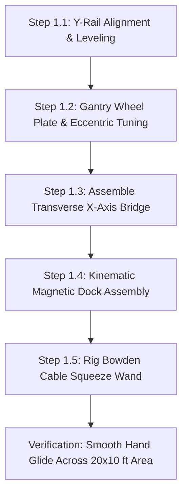
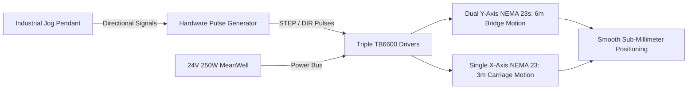
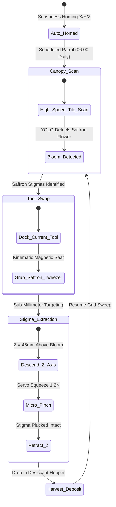

import { Card, CardGrid } from '@astrojs/starlight/components';

The **2-Axis Precision Overhead Gantry Array** is a rigid Cartesian motion system engineered to position sensors and interchangeable agricultural toolheads across wide grow beds. It can be constructed as a standalone garden or greenhouse automated gantry (similar to FarmBot), or installed as the primary overhead Cartesian robot of the master Open Biosphere assembly.

---

## 1. Standalone Homesteading & Off-Grid Utility

For homesteaders managing raised beds, hydroponic NFT channels, or microgreen trays, manual weeding, inspecting, and harvesting delicate crops takes hours every day. This machine automates **continuous optical inspection, micro-seeding, and selective micro-harvesting**:

<CardGrid>
  <Card title="Scalable Garden Automation" icon="maximize">
    Easily scaled to any rectangular garden bed (from 4x8 ft up to 10x20 ft) using standard V-slot aluminum extrusions and GT2 timing belts.
  </Card>
  <Card title="Kinematic Quick-Swap Toolhead" icon="tool">
    Magnetic tool mount allows hot-swapping between optical multi-spectral cameras, micro-tweezers (for saffron), precision seeders, and weed shears.
  </Card>
  <Card title="0.15 mm Sub-Millimeter Precision" icon="crosshair">
    Closed-loop stepper motors provide high-accuracy indexing, allowing micro-tweezers to extract saffron stigmas without tearing delicate petals.
  </Card>
  <Card title="Open Firmware (Klipper / ESPHome)" icon="code">
    Runs standard 3D printer firmware (Klipper on STM32 or ESPHome), configurable through familiar web interfaces with zero vendor lock-in.
  </Card>
</CardGrid>

---

## 2. Technical Specifications

| Parameter | Specification |
| :--- | :--- |
| **Motion Envelope** | Length: up to 6,096 mm ($Y$-Axis) | Width: up to 3,048 mm ($X$-Axis) | Elevation: 1,200 mm ($Z$) |
| **Drive Mechanism** | GT2 9mm steel-reinforced timing belts with NEMA 23 closed-loop steppers |
| **Linear Guide** | Dual 2040 / 4040 V-slot aluminum extrusions with polyoxymethylene (POM) wheels |
| **Repeatability** | $\pm 0.15$ mm across the entire 20 × 10 ft envelope |
| **Payload Rating** | Up to 8.5 kg toolhead payload |
| **Toolhead Mount** | Magnetic kinematic 3-point ball-seat quick-swap mount with 8-pin spring pogo bus |
| **Power Consumption**| 0W (Manual) / 85W avg (Add-On 1) / 120W peak (Add-On 2) |
| **Controller Architecture**| Manual Freewheel / 6-Button CNC Jog Pendant / BTT Octopus Pro (Klipper CAN) |

---

## 3. Instructions (Base Zero-Power Machine)

The foundational build of the 2-Axis Precision Overhead Gantry is a **100% mechanical, zero-power Cartesian rolling bridge**. Utilizing low-friction polyoxymethylene (POM) dual V-wheels running on 2040 aluminum extrusions, it allows a grower to glide an inspection bridge effortlessly across a 20 × 10 ft canopy with $< 2$ N of manual hand effort. A magnetic kinematic dock holds interchangeable manual wands and optical lenses.

### Mechanical Architecture & Decoupling Standard
1. **Cartesian Rail Structure**: Two parallel longitudinal Y-rails (2040 V-slot, up to 6 m) support a transverse X-axis bridge beam (4040 V-slot, 3.1 m width) rolling on 16 heavy-duty POM V-wheels with dual 625-2RS bearings.
2. **Kinematic 3-Point Toolhead Dock**: Three pairs of hardened stainless steel ball bearings seated against 4 mm neodymium N52 magnets provide exact kinematic repeatability ($< 0.05$ mm positional repeat).
3. **Manual Toolhead Wand**: A lightweight carbon-fiber wand with an integrated bicycle Bowden cable transmits hand-squeeze force to actuate bypass pruners, soil probes, or seeding tubes at bed level.
4. **Mechanical Decoupling Standard**: Quick-release cam-lever belt clamps anchor the timing belts to the carriage plates. Flipping the cam levers releases belt tension instantly, allowing the entire gantry bridge and carriage to be pushed and pulled by hand with zero motor drag.

```
       OVERHEAD CARTESIAN GANTRY — BASE MECHANICAL ELEVATION
  =================================================================
       [Y-Axis Rail: 2040 V-Slot]               [Y-Axis Rail: 2040 V-Slot]
             ||                                           ||
       (POM V-Wheels)                               (POM V-Wheels)
          [===O===]                                    [===O===]
             ||                                           ||
             +============================================+
             |         [X-Axis Bridge Beam: 4040 V-Slot]   |
             +============================================+
                                   ||
                             (POM V-Wheels)
                                [===O===]
                                   ||
                       [X-Carriage Plate: 4mm Al]
                                   ||
                       [Kinematic Magnetic Dock]
                                (N52)
                                   ||
                        [Manual Toolhead Wand]
                                   ||
                         [Bypass Hand Pruner]
                                   v
                         (Delicate Grow Bed)
```

### Step-by-Step Fabrication & Assembly Protocol

#### Step 1.1: Rail Cutting & Frame Alignment
1. Cut four 3,000 mm segments of 2040 V-slot black anodized aluminum extrusion for the longitudinal Y-axis tracks.
2. Join segments end-to-end using hidden straight internal joint connectors and M5 set screws, creating two continuous 6,000 mm guide rails.
3. Clamp and level the Y-rails atop perimeter garden posts or greenhouse walls at $Z = 1,200$ mm height. Verify parallel rail spacing across both ends ($3,050\text{ mm} \pm 1.0\text{ mm}$).

#### Step 1.2: Gantry Wheel Plates & Eccentric Spacer Tuning
1. CNC-mill or waterjet cut four 4.0 mm 6061-T6 aluminum gantry end-plates.
2. Press 625-2RS sealed ball bearings into eight POM dual V-wheels per side plate.
3. Install wheels using M5 grade 10.9 button-head screws: use standard round spacers on top wheels and eccentric spacers on bottom wheels.
4. Mount wheel plates onto the Y-rails and rotate eccentric hex spacers with a 10 mm wrench until all play is eliminated without wheel binding (wheels should be skidded only with moderate finger force).

#### Step 1.3: Transverse X-Axis Bridge Assembly
1. Span the 3,048 mm 4040 V-slot extrusion between the two Y-axis gantry end plates.
2. Fasten using 90° heavy-duty cast aluminum corner brackets and M5 roll-in T-nuts.
3. Square the bridge to the Y-rails using a 1-meter framing square. Diagonal variance across the bridge must measure $< 1.5$ mm over 3 meters.

#### Step 1.4: Kinematic Magnetic Toolhead Base Fabrication
1. 3D-print the kinematic toolhead receiver plate in carbon-fiber reinforced PETG.
2. Press three pairs of 6 mm hardened stainless steel ball bearings into the triangular radial V-grooves at 120° intervals.
3. Epoxy three 15 × 5 mm N52 neodymium disc magnets into the recessed pockets.
4. Verify kinematic seating: snapping the toolhead dock on and off 10 times must repeat physical position within $\pm 0.05$ mm measured by dial indicator.

#### Step 1.5: Manual Squeeze Wand & Cable Rigging
1. Mount a 1.2 m rigid carbon-fiber extension tube to the kinematic toolhead mating plate.
2. Route a 1.2 mm stainless steel Bowden cable down the center of the tube.
3. Clamp an ergonomic bicycle hand lever to the upper wand handle.
4. Attach spring-loaded micro-bypass snip blades to the lower wand tip, verifying that a hand squeeze cleanly snips a 4 mm test stem.



### Step-by-Step Operating Runbook (Manual Mode)

1. **Pre-Glide Rail Inspection**: Wipe down the upper V-slot tracks with a microfiber cloth to remove dust, sap, or fallen leaves that could cause wheel bumps.
2. **Positioning the Gantry Bridge**: Grasp the transverse aluminum cross-beam and push it along the length of the garden bed. The bridge glides smoothly on its 16 sealed POM wheels with under 2 N of pushing force.
3. **Traverse Carriage Positioning**: Slide the central toolhead carriage along the X-beam to align over the target crop row or individual plant.
4. **Kinematic Toolhead Insertion**: Snap the desired manual toolhead (magnifying inspection lens, micro-snips, or soil core sampler) into the magnetic base until all three ball pairs click solidly into their seats.
5. **Executing Manual Selective Harvest**: Aim the wand tip at the target stem (e.g. ripe saffron flower or succulent purslane shoot). Squeeze the bicycle hand lever firmly to snip the pedicel cleanly.
6. **Canopy-Wide Stepped Inspection**: Push the bridge forward in 500 mm increments, methodically inspecting each grow zone without stepping on bed soil or reaching across trellises.
7. **End-of-Run Parking**: Push the gantry bridge to the South datum parking stop ($Y = 0$). Engage the manual thumb-screw track locks to secure the bridge against wind movement.

### Base Machine Bill of Materials (BOM)

| Item | Component Description | Sourcing / Part Reference | Qty | Unit Cost | Total Cost |
| :--- | :--- | :--- | :--- | :--- | :--- |
| **O-01** | 2040 V-Slot Aluminum Rails (3000mm segments, 4x total) | Standard extrusion supplier | 4 | $19.50 | $78.00 |
| **O-02** | 4040 V-Slot Transverse Bridge Beam (3048mm length) | Heavy-duty extrusion store | 1 | $32.00 | $32.00 |
| **O-03** | Laser-Cut 4mm 6061 Aluminum Gantry Wheel End-Plates | SendCutSend / local fab | 4 | $8.00 | $32.00 |
| **O-04** | Dual POM V-Wheels with 625-2RS Bearings + Eccentrics | 3D printer motion kit | 16 | $1.40 | $22.40 |
| **O-05** | Kinematic Magnetic Toolhead Base (N52 Magnets + Steel Balls) | DIY 3D print + hardware | 1 | $14.00 | $14.00 |
| **O-06** | Manual Carbon-Fiber Tool Wand + Bowden Bicycle Lever | Carbon tube + bike parts | 1 | $15.00 | $15.00 |
| **Total** | **Base Zero-Power Cartesian Gantry Build** | **Complete off-grid manual gantry** | | | **$193.40** |

---

## 4. Add-On 1: Semi-Autonomous Electromechanical Pack (Buttons & Dials)

The **Semi-Autonomous Pack** motorizes the Cartesian gantry, adding dual Y-axis and single X-axis NEMA 23 stepper motors, 9 mm steel-reinforced timing belts, an industrial 6-button directional CNC jog pendant, and heavy-duty nylon drag chains. The operator stands at the edge of the bed and maneuvers the toolhead across all 200 sq ft with fingertip push-buttons.

### Electromechanical Actuation Architecture & Decoupling
- **Drive Powertrain**: Three NEMA 23 high-torque stepper motors (2.8 N·m holding torque, 2.8A RMS) driving GT2 9 mm steel-reinforced timing belts (20T pulleys, 40 mm travel per revolution).
- **Dual Y-Axis Synchronization**: Both longitudinal sides are driven by independent NEMA 23 motors electronically locked in phase to prevent gantry racking.
- **Mechanical Decoupling**: Quick-release belt clamp blocks on both end plates allow releasing belt tension with a single lever flip, enabling 100% manual hand sliding if power is unavailable.
- **Operator Interface**: Industrial IP65 6-button directional pendant ($X+, X-, Y+, Y-, Z+, Z-$), a rotary feed-rate selector switch (Rapid: 150 mm/s, Creep: 10 mm/s), and an emergency stop mushroom button.

```
       ELECTROMECHANICAL WIRING & CNC PENDANT SCHEMATIC
  =================================================================
  [24V 250W MeanWell PSU]
         |
         +----[Master Breaker 15A]----+----[E-Stop Button]
                                      |
         +----------------------------+----------------------------+
         |                            |                            |
         v                            v                            v
  [TB6600 Driver Y1]           [TB6600 Driver Y2]           [TB6600 Driver X]
         |                            |                            |
         v                            v                            v
  [NEMA 23 Motor Y1]           [NEMA 23 Motor Y2]           [NEMA 23 Motor X]
  (Left Rail Drive)            (Right Rail Drive)           (Carriage Drive)
         ^                            ^                            ^
         |                            |                            |
         +----------------------------+----------------------------+
                                      |
                     [Hardware Pulse Generator Board]
                                      ^
                                      |
                     [Industrial 6-Button CNC Pendant]
                     (X+/X-, Y+/Y-, Rapid/Creep Toggle)
```

### Step-by-Step Retrofit Protocol

#### Step 2.1: NEMA 23 Motor Bracket Installation
1. Bolt cast aluminum NEMA 23 motor mounting brackets to the outer faces of both Y-axis gantry end plates.
2. Mount the X-axis motor bracket atop the central carriage plate.
3. Install 20T GT2 9 mm aluminum pulleys onto the 6.35 mm motor D-shafts, tightening dual M4 set screws on the flats.

#### Step 2.2: Steel-Core GT2 Timing Belt Installation
1. Route 9 mm steel-reinforced neoprene timing belts along both 6-meter Y-axis extrusions and across the 3-meter X-bridge.
2. Anchor belt ends to the extrusion ends using slotted aluminum belt tensioning clamps.
3. Tension belts until fundamental resonance vibrates at 65 Hz (approx 150 N static belt tension).

#### Step 2.3: Heavy-Duty Drag Chain Cable Management
1. Mount 15 × 30 mm nylon drag chains along the outer Y-rail and across the X-bridge beam.
2. Route 18 AWG 4-conductor shielded motor cables through the drag chains to the central electronics box.
3. Ensure adequate loop bend radius ($R \ge 45$ mm) to prevent internal copper fatigue over thousands of cycles.

#### Step 2.4: TB6600 Driver & Power Supply Enclosure
1. Mount an IP65 ventilated steel enclosure (300 × 250 × 120 mm) at the South datum post.
2. Install three TB6600 microstepping drivers set to 8 microsteps (1,600 pulses/rev) and 2.8A peak current.
3. Wire the 24V 250W MeanWell power supply to driver DC power inputs through a 15A circuit breaker.

#### Step 2.5: Industrial CNC Jog Pendant Integration
1. Connect the heavy-duty coiled pendant cable to the hardware pulse generator board.
2. Wire pendant directional switches to the STEP and DIR inputs of the TB6600 drivers.
3. Verify jog response: pressing $X+$ moves the carriage right; pressing $Y+$ moves the entire bridge forward smoothly with zero racking.



### Step-by-Step Push-Button Operating Runbook

1. **System Power-Up & E-Stop Release**: Twist the red mushroom E-stop on the pendant clockwise to pop it open. Turn master breaker ON (cooling fan spins up, green status LED glows).
2. **Feed-Rate Selection**: Set the pendant feed-rate toggle switch to RAPID ($120$ mm/s) for long travel across beds, or CREEP ($8$ mm/s) for final alignment over delicate blooms.
3. **Jogging to Target Bed**: Hold down the $Y+$ button to motor the gantry bridge forward along the rails. Release button to stop instantly (stepper holding torque locks position).
4. **Carriage Traverse**: Press $X+$ or $X-$ to center the magnetic toolhead directly over the target plant cluster.
5. **Toolhead Action Trigger**: Press the yellow AUX trigger button on the pendant; this fires an onboard 24V solenoid on the toolhead, executing a micro-snip or core sample.
6. **Zero-Power Mechanical Fallback**: If power is lost or maintenance is needed, flip the quick-release cam levers on both gantry plates to slacken the belts. The bridge can immediately be pushed by hand.

### Add-On 1 Bill of Materials (BOM)

| Item | Component Description | Sourcing / Part Reference | Qty | Unit Cost | Total Cost |
| :--- | :--- | :--- | :--- | :--- | :--- |
| **A1-01** | NEMA 23 High-Torque Stepper Motors (2.8 N·m, 2.8A) | StepperOnline / CNC store | 3 | $23.00 | $69.00 |
| **A1-02** | GT2 9mm Steel-Core Timing Belt (20m spool) + Pulleys | CNC timing belt supplier | 1 | $26.00 | $26.00 |
| **A1-03** | TB6600 Microstepping Stepper Drivers (4.0A max) | Industrial stepper controls | 3 | $11.00 | $33.00 |
| **A1-04** | Industrial 6-Button Directional CNC Jog Pendant | Hoist / CNC pendant supplier | 1 | $28.00 | $28.00 |
| **A1-05** | 24V 10.4A (250W) MeanWell LRS Industrial Power Supply | Mean Well authorized dealer | 1 | $36.00 | $36.00 |
| **A1-06** | 15x30mm Heavy-Duty Nylon Drag Chains (8m total) | CNC cable carrier maker | 1 | $24.00 | $24.00 |
| **Total** | **Add-On 1 Electromechanical Pack** | **Retrofits directly to Base** | | | **+$216.00** |
| **Cumul.** | **Operational CNC Jog-Pendant Gantry** | **Base ($193.40) + Add-On 1 ($216)** | | | **$409.40** |

---

## 5. Add-On 2: Agentic Autonomous AI Pack (Edge Vision & Closed Loop)

The **Agentic Autonomous AI Pack** transforms the gantry into a sub-millimeter agricultural robot. Running Klipper firmware on an STM32 32-bit controller over CAN bus, it carries a down-facing 4K RGB/NIR macro camera and optical rotary encoders, automatically executing sub-0.05 mm trajectory micro-harvesting of saffron stigmas and selective trimming of purslane.

### Autonomous Vision & Telemetry Architecture
- **Motion Control Core**: BigTreeTech Octopus Pro (STM32F429 168 MHz) running Klipper firmware with CAN bus toolhead bridge (EBB42 CAN) over a single flexible 4-wire umbilical.
- **Down-Facing Macro Vision**: Sony IMX519 16MP / 4K RGB camera paired with an 850 nm NIR ring illuminator, delivering 40 px/mm optical resolution across the plant canopy.
- **Closed-Loop Encoders**: Magnetic rotary encoders (AS5600 12-bit) on motor shafts verifying sub-0.05 mm positional accuracy and detecting mechanical stalls.
- **Autonomous Toolhead Ecosystem**:
  - **Saffron Micro-Tweezer**: Micro-servo actuated silicone forceps extracting *Crocus sativus* stigmas with 0.15 mm repeatability.
  - **Purslane Reciprocating Shear**: Dual oscillating micro-blades trimming succulent stems without dislodging root plugs.

```
       CYBER-PHYSICAL EDGE AI ARCHITECTURE & CAN BUS BRIDGE
  =================================================================
             +-----------------------------------------+
             |    BTT Octopus Pro Mainboard (Klipper)  |
             |   (STM32F429 168 MHz + High-Current FET) |
             +----+--------------------+----------+----+
                  |                    |          |
         +--------+--+                 |          +-------+----+
         |   STEP/DIR|                 | USB / CAN        | SPI
         v           v                 v                  v
    [TMC2209 Silent] [EBB42 CAN Tool]  [Host Compute SBC] [AS5600 Encoders]
         |           | (Tool Umbilical) (Raspberry Pi 5)  (Closed-Loop)
         v           v                 |
   [NEMA 23 Motors] [Kinematic Tool]   v
   (Sensorless Home) [IMX519 4K Cam]  [Computer Vision AI]
```

### Step-by-Step Sensor Commissioning & Edge AI Protocol

#### Step 3.1: BTT Octopus Pro & Klipper Installation
1. Mount the BTT Octopus Pro mainboard inside the main electrical enclosure.
2. Wire TMC2209 silent stepper drivers in UART mode for silent, resonance-free gantry motion.
3. Flash Klipper firmware onto the Octopus Pro via SD card; configure CAN bus bit rate to 1,000,000 bps.

#### Step 3.2: EBB42 CAN Bus Toolhead Board Assembly
1. Mount the compact BigTreeTech EBB42 CAN board directly onto the kinematic toolhead carriage plate.
2. Connect the 4-wire umbilical (24V Power +, Ground, CAN-H, CAN-L) through the drag chains to the Octopus mainboard.
3. Wire toolhead servos, macro camera trigger, and LED ring illuminator directly to the EBB42 headers.

#### Step 3.3: Down-Facing Sony IMX519 4K Macro Camera
1. Mount the Sony IMX519 camera on a 3-point leveling bracket alongside the kinematic toolhead dock.
2. Install the 850 nm infrared ring illuminator surrounding the lens.
3. Calibrate camera-to-nozzle offset: run an automated optical fiducial touch-off script ($< 0.08$ mm offset error).

#### Step 3.4: Saffron & Purslane Specialized Toolheads
1. Assemble the Saffron Micro-Tweezer toolhead: a coreless digital micro-servo driving soft-silicone coated forceps tips.
2. Assemble the Purslane Reciprocating Shear toolhead: a miniature 12V 100 Hz oscillating cutter.
3. Test automatic tool-docking: the gantry moves to the tool rack at $(X=0, Y=0)$, slides sideways into the slot, and uncouples the kinematic magnets cleanly.

#### Step 3.5: Vision Pipeline Tuning & Coordinate Mapping
1. Connect the Raspberry Pi 5 host SBC to the Octopus Pro over high-speed serial.
2. Launch the OpenCV / YOLOv8 canopy segmentation daemon.
3. Calibrate pixel-to-Cartesian millimeter transform matrix ($0.024\text{ mm/pixel}$ at 200 mm working distance).



### Step-by-Step Autonomous Multi-Agent Runbook

1. **Pre-Flight Sensorless Homing**: At 06:00 daily, Klipper wakes the gantry. TMC2209 StallGuard detects hard physical stops at $(0,0,0)$, establishing a sub-0.1 mm coordinate datum.
2. **High-Speed Canopy Tile Survey**: The gantry sweeps the bed in a serpentine raster at 150 mm/s. The 4K IMX519 camera captures overlapping tiles, streaming imagery to the YOLO neural model.
3. **Saffron Stigma Detection & Triangulation**: When a blooming *Crocus sativus* flower is classified, the gantry halts. The camera zooms in with macro NIR lighting, isolating the 3 scarlet stigmas from purple petals and calculating 3D extraction coordinates ($X, Y, Z$) to $\pm 0.15$ mm precision.
4. **Autonomous Kinematic Tool Change**: If another tool is mounted, the gantry travels to the tool rack, docks the current tool, and magnetically couples the Saffron Micro-Tweezer.
5. **Precision Stigma Extraction**: The tweezer descends along the Z-axis, inserts between petals without tearing, squeezes at 1.2 N force, and lifts vertically, cleanly harvesting the high-value stigmas without manual labor.
6. **Produce Deposit & Self-Clean**: The gantry moves to the harvest chute, deposits the stigmas into a sealed desiccated collection vial, blows compressed air over the tweezers, and continues canopy surveillance.

### Add-On 2 Bill of Materials (BOM)

| Item | Component Description | Sourcing / Part Reference | Qty | Unit Cost | Total Cost |
| :--- | :--- | :--- | :--- | :--- | :--- |
| **A2-01** | BigTreeTech Octopus Pro V1.1 (STM32F429) + TMC2209s | 3D printer mainboard store | 1 | $55.00 | $55.00 |
| **A2-02** | BTT EBB42 CAN Bus Toolhead Board + Umbilical Cable | CAN toolhead supplier | 1 | $22.00 | $22.00 |
| **A2-03** | Sony IMX519 16MP Autofocus 4K Camera + 850nm NIR Ring | Precision camera supplier | 1 | $42.00 | $42.00 |
| **A2-04** | AS5600 12-bit High-Resolution Magnetic Encoders (3x) | Optical/magnetic sensor shop | 3 | $7.00 | $21.00 |
| **A2-05** | Saffron Micro-Tweezer Kinematic Toolhead (Coreless Servo) | Custom micro-assembly kit | 1 | $26.00 | $26.00 |
| **A2-06** | Purslane Reciprocating Lateral Shear Toolhead (12V Motor) | Custom micro-trimmer kit | 1 | $28.00 | $28.00 |
| **Total** | **Add-On 2 Agentic Autonomous Pack** | **Expands Base + Add-On 1** | | | **+$194.00** |
| **Full Build** | **Complete Autonomous Precision Cartesian Gantry** | **Base + Add-On 1 + Add-On 2** | | | **$603.40** |

---

## 6. Staged Upgrade Progression & Cost Summary

### Build Tier Comparison

| Build Stage | Operational Capability | Direct Stage Cost | Cumulative Investment |
| :--- | :--- | :--- | :--- |
| **Base: Instructions** | 100% mechanical free-sliding carriage with manual squeeze wand & magnetic dock | $193.40 | **$193.40** |
| **Add-On 1: Semi-Auto** | Motorized Cartesian positioning via industrial 6-button CNC jog pendant & drag chains | +$216.00 | **$409.40** |
| **Add-On 2: Agentic AI** | Sub-millimeter Klipper CAN bus autonomy, 4K camera vision, and quick-swap toolheads | +$194.00 | **$603.40** |

### Step-by-Step Zero-Waste Conversion Roadmap

#### Path 1: Base Machine $\rightarrow$ Add-On 1 (Motorized CNC Gantry)
1. Bolt the three NEMA 23 motor brackets onto the existing aluminum gantry end-plates using pre-drilled holes.
2. Lay the GT2 9 mm steel-core belts in the V-slot channels, securing ends in the tensioner clamps.
3. Install the nylon drag chains along the rails, wire the TB6600 driver enclosure, and plug in the 6-button CNC jog pendant. The kinematic magnetic dock and POM wheels remain 100% untouched.

#### Path 2: Add-On 1 $\rightarrow$ Add-On 2 (Autonomous Sub-Millimeter AI)
1. Replace the TB6600 driver box with the BTT Octopus Pro Klipper mainboard.
2. Mount the EBB42 CAN bus board on the carriage and run the 4-wire umbilical through the existing drag chains.
3. Install the Sony IMX519 4K camera, calibrate the OpenCV vision pipeline, and stock the tool rack with Saffron Tweezers and Purslane Shears.

---

## 7. Master Biosphere Assembly Interlock

When integrated into the centralized Open Biosphere facility (~20 × 10 ft footprint):

1. **Perimeter Extrusion Mounting**: The Y-axis gantry rails bolt directly onto the outer 4040 aluminum perimeter extrusions at elevation $Z = 1,200$ mm.
2. **Toolhead Ecosystem**:
   - **Optical Inspection Cartridge**: 4K RGB + 850nm NIR camera for leaf area index (LAI) and canopy stress mapping.
   - **Saffron Micro-Tweezer**: Micro-servo actuated silicone forceps extracting *Crocus sativus* stigmas with 0.15 mm repeatability.
   - **Purslane Lateral Shear**: Oscillating reciprocating micro-blades trimming succulent purslane greens without pulling root plugs.
   - **TPS Potato Root Extractor**: Vacuum-assisted nozzle descending into aeroponic root chambers to pick mature mini-tubers.
3. **Inter-Robot Handoff**: Coordinates directly with the Ground Track AGV; upon completing a harvest run, the gantry deposits harvested crop pods directly into the AGV's cargo bed.
