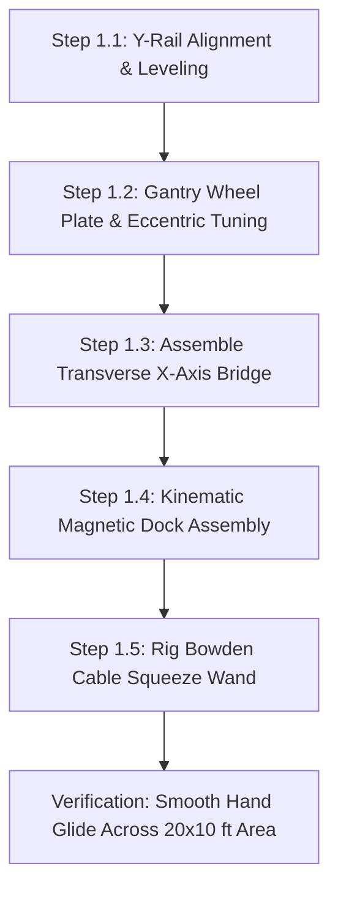
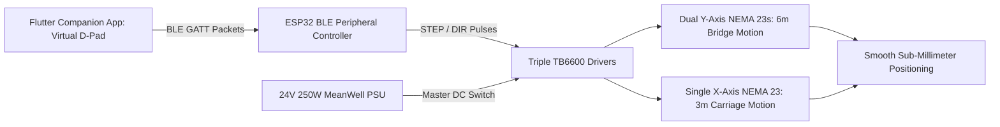
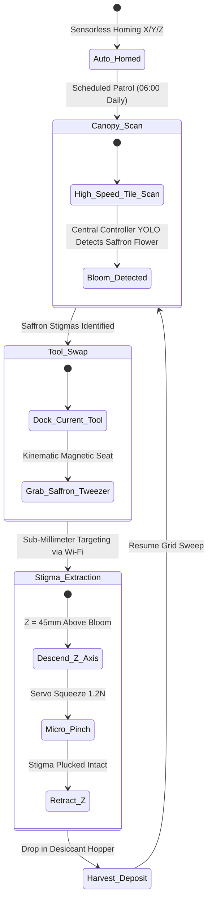

import { Card, CardGrid } from '@astrojs/starlight/components';

The **2-Axis Precision Overhead Gantry Array** is a rigid Cartesian motion system engineered to position sensors and interchangeable agricultural toolheads across wide grow beds. It can be constructed as a standalone garden or greenhouse automated gantry (similar to FarmBot), or installed as the primary overhead Cartesian robot of the master Open Biosphere assembly.

---

## 1. Standalone Homesteading & Off-Grid Utility

For homesteaders managing raised beds, hydroponic NFT channels, or microgreen trays, manual weeding, inspecting, and harvesting delicate crops takes hours every day. This machine automates **continuous optical inspection, micro-seeding, and selective micro-harvesting**:

<CardGrid>
  <Card title="Scalable Garden Automation" icon="maximize">
    Easily scaled to any rectangular garden bed (from 4x8 ft up to 10x20 ft) using standard V-slot aluminum extrusions and GT2 timing belts.
  </Card>
  <Card title="Kinematic Quick-Swap Toolhead" icon="tool">
    Magnetic tool mount allows hot-swapping between optical multi-spectral cameras, micro-tweezers (for saffron), precision seeders, and weed shears.
  </Card>
  <Card title="0.15 mm Sub-Millimeter Precision" icon="crosshair">
    Closed-loop stepper motors provide high-accuracy indexing, allowing micro-tweezers to extract saffron stigmas without tearing delicate petals.
  </Card>
  <Card title="Open Firmware (Klipper / ESPHome)" icon="code">
    Runs standard 3D printer firmware (Klipper on STM32 or ESPHome), configurable through familiar web interfaces with zero vendor lock-in.
  </Card>
</CardGrid>

---

## 2. Technical Specifications

| Parameter | Specification |
| :--- | :--- |
| **Motion Envelope** | Length: up to 6,096 mm ($Y$-Axis) | Width: up to 3,048 mm ($X$-Axis) | Elevation: 1,200 mm ($Z$) |
| **Drive Mechanism** | GT2 9mm steel-reinforced timing belts with NEMA 23 closed-loop steppers |
| **Linear Guide** | Dual 2040 / 4040 V-slot aluminum extrusions with polyoxymethylene (POM) wheels |
| **Repeatability** | $\pm 0.15$ mm across the entire 20 × 10 ft envelope |
| **Payload Rating** | Up to 8.5 kg toolhead payload |
| **Toolhead Mount** | Magnetic kinematic 3-point ball-seat quick-swap mount with 8-pin spring pogo bus |
| **Power Consumption**| 0W (Manual) / 85W avg (Add-On 1) / 120W peak (Add-On 2) |
| **Controller Architecture**| Manual Freewheel / 6-Button CNC Jog Pendant / BTT Octopus Pro (Klipper CAN) |

---

## 3. Instructions (Base Zero-Power Machine)

The foundational build of the 2-Axis Precision Overhead Gantry is a **100% mechanical, zero-power Cartesian rolling bridge**. Utilizing low-friction polyoxymethylene (POM) dual V-wheels running on 2040 aluminum extrusions, it allows a grower to glide an inspection bridge effortlessly across a 20 × 10 ft canopy with $< 2$ N of manual hand effort. A magnetic kinematic dock holds interchangeable manual wands and optical lenses.

### Mechanical Architecture & Decoupling Standard
1. **Cartesian Rail Structure**: Two parallel longitudinal Y-rails (2040 V-slot, up to 6 m) support a transverse X-axis bridge beam (4040 V-slot, 3.1 m width) rolling on 16 heavy-duty POM V-wheels with dual 625-2RS bearings.
2. **Kinematic 3-Point Toolhead Dock**: Three pairs of hardened stainless steel ball bearings seated against 4 mm neodymium N52 magnets provide exact kinematic repeatability ($< 0.05$ mm positional repeat).
3. **Manual Toolhead Wand**: A lightweight carbon-fiber wand with an integrated bicycle Bowden cable transmits hand-squeeze force to actuate bypass pruners, soil probes, or seeding tubes at bed level.
4. **Mechanical Decoupling Standard**: Quick-release cam-lever belt clamps anchor the timing belts to the carriage plates. Flipping the cam levers releases belt tension instantly, allowing the entire gantry bridge and carriage to be pushed and pulled by hand with zero motor drag.

```
       OVERHEAD CARTESIAN GANTRY — BASE MECHANICAL ELEVATION
  =================================================================
       [Y-Axis Rail: 2040 V-Slot]               [Y-Axis Rail: 2040 V-Slot]
             ||                                           ||
       (POM V-Wheels)                               (POM V-Wheels)
          [===O===]                                    [===O===]
             ||                                           ||
             +============================================+
             |         [X-Axis Bridge Beam: 4040 V-Slot]   |
             +============================================+
                                   ||
                             (POM V-Wheels)
                                [===O===]
                                   ||
                       [X-Carriage Plate: 4mm Al]
                                   ||
                       [Kinematic Magnetic Dock]
                                (N52)
                                   ||
                        [Manual Toolhead Wand]
                                   ||
                         [Bypass Hand Pruner]
                                   v
                         (Delicate Grow Bed)
```

### Step-by-Step Fabrication & Assembly Protocol

#### Step 1.1: Rail Cutting & Frame Alignment
1. Cut four 3,000 mm segments of 2040 V-slot black anodized aluminum extrusion for the longitudinal Y-axis tracks.
2. Join segments end-to-end using hidden straight internal joint connectors and M5 set screws, creating two continuous 6,000 mm guide rails.
3. Clamp and level the Y-rails atop perimeter garden posts or greenhouse walls at $Z = 1,200$ mm height. Verify parallel rail spacing across both ends ($3,050\text{ mm} \pm 1.0\text{ mm}$).

#### Step 1.2: Gantry Wheel Plates & Eccentric Spacer Tuning
1. CNC-mill or waterjet cut four 4.0 mm 6061-T6 aluminum gantry end-plates.
2. Press 625-2RS sealed ball bearings into eight POM dual V-wheels per side plate.
3. Install wheels using M5 grade 10.9 button-head screws: use standard round spacers on top wheels and eccentric spacers on bottom wheels.
4. Mount wheel plates onto the Y-rails and rotate eccentric hex spacers with a 10 mm wrench until all play is eliminated without wheel binding (wheels should be skidded only with moderate finger force).

#### Step 1.3: Transverse X-Axis Bridge Assembly
1. Span the 3,048 mm 4040 V-slot extrusion between the two Y-axis gantry end plates.
2. Fasten using 90° heavy-duty cast aluminum corner brackets and M5 roll-in T-nuts.
3. Square the bridge to the Y-rails using a 1-meter framing square. Diagonal variance across the bridge must measure $< 1.5$ mm over 3 meters.

#### Step 1.4: Kinematic Magnetic Toolhead Base Fabrication
1. 3D-print the kinematic toolhead receiver plate in carbon-fiber reinforced PETG.
2. Press three pairs of 6 mm hardened stainless steel ball bearings into the triangular radial V-grooves at 120° intervals.
3. Epoxy three 15 × 5 mm N52 neodymium disc magnets into the recessed pockets.
4. Verify kinematic seating: snapping the toolhead dock on and off 10 times must repeat physical position within $\pm 0.05$ mm measured by dial indicator.

#### Step 1.5: Manual Squeeze Wand & Cable Rigging
1. Mount a 1.2 m rigid carbon-fiber extension tube to the kinematic toolhead mating plate.
2. Route a 1.2 mm stainless steel Bowden cable down the center of the tube.
3. Clamp an ergonomic bicycle hand lever to the upper wand handle.
4. Attach spring-loaded micro-bypass snip blades to the lower wand tip, verifying that a hand squeeze cleanly snips a 4 mm test stem.



### Step-by-Step Operating Runbook (Manual Mode)

1. **Pre-Glide Rail Inspection**: Wipe down the upper V-slot tracks with a microfiber cloth to remove dust, sap, or fallen leaves that could cause wheel bumps.
2. **Positioning the Gantry Bridge**: Grasp the transverse aluminum cross-beam and push it along the length of the garden bed. The bridge glides smoothly on its 16 sealed POM wheels with under 2 N of pushing force.
3. **Traverse Carriage Positioning**: Slide the central toolhead carriage along the X-beam to align over the target crop row or individual plant.
4. **Kinematic Toolhead Insertion**: Snap the desired manual toolhead (magnifying inspection lens, micro-snips, or soil core sampler) into the magnetic base until all three ball pairs click solidly into their seats.
5. **Executing Manual Selective Harvest**: Aim the wand tip at the target stem (e.g. ripe saffron flower or succulent purslane shoot). Squeeze the bicycle hand lever firmly to snip the pedicel cleanly.
6. **Canopy-Wide Stepped Inspection**: Push the bridge forward in 500 mm increments, methodically inspecting each grow zone without stepping on bed soil or reaching across trellises.
7. **End-of-Run Parking**: Push the gantry bridge to the South datum parking stop ($Y = 0$). Engage the manual thumb-screw track locks to secure the bridge against wind movement.

### Base Machine Bill of Materials (BOM)

| Item | Component Description | Sourcing / Part Reference | Qty | Unit Cost | Total Cost |
| :--- | :--- | :--- | :--- | :--- | :--- |
| **O-01** | 2040 V-Slot Aluminum Rails (3000mm segments, 4x total) | Standard extrusion supplier | 4 | $19.50 | $78.00 |
| **O-02** | 4040 V-Slot Transverse Bridge Beam (3048mm length) | Heavy-duty extrusion store | 1 | $32.00 | $32.00 |
| **O-03** | Laser-Cut 4mm 6061 Aluminum Gantry Wheel End-Plates | SendCutSend / local fab | 4 | $8.00 | $32.00 |
| **O-04** | Dual POM V-Wheels with 625-2RS Bearings + Eccentrics | 3D printer motion kit | 16 | $1.40 | $22.40 |
| **O-05** | Kinematic Magnetic Toolhead Base (N52 Magnets + Steel Balls) | DIY 3D print + hardware | 1 | $14.00 | $14.00 |
| **O-06** | Manual Carbon-Fiber Tool Wand + Bowden Bicycle Lever | Carbon tube + bike parts | 1 | $15.00 | $15.00 |
| **Total** | **Base Zero-Power Cartesian Gantry Build** | **Complete off-grid manual gantry** | | | **$193.40** |

---

## 4. Add-On 1: Semi-Autonomous Electromechanical Pack (BLE Virtual Panel)

Under [RFC-0005](/rfcs/rfc-0005-hardware-interlocks-ble-virtual-panel), physical control panels with dedicated jog buttons, dials, potentiometers, and wired CNC pendants are banned across all machine tiers to eliminate water ingress and control priority contention.

Add-On 1 motorizes Cartesian locomotion governed by the **Strict Two-Control Physical Standard**:
1. **Master Hardware DC Power Switch**: Heavy-duty inline toggle switch directly isolating the 24V DC power rail.
2. **"Nuke & Pave" SD Factory Restore Button**: Dedicated recessed tactile switch wired to trigger an automatic secondary bootloader re-flash from micro-SD storage.

All manual jogging ($X+, X-, Y+, Y-, Z+, Z-$), feed-rate adjustments, and toolhead solenoid test pulses are conducted via the **Flutter Companion App Virtual Panel** over direct local BLE GATT.

### Electromechanical Actuation Architecture & Decoupling
- **Drive Powertrain**: Three NEMA 23 high-torque stepper motors (2.8 N·m holding torque, 2.8A RMS) driving GT2 9 mm steel-reinforced timing belts (20T pulleys, 40 mm travel per revolution).
- **Dual Y-Axis Synchronization**: Both longitudinal sides are driven by independent NEMA 23 motors electronically locked in phase to prevent gantry racking.
- **Mechanical Decoupling**: Quick-release belt clamp blocks on both end plates allow releasing belt tension with a single lever flip, enabling 100% manual hand sliding if power is unavailable.
- **Strict Two-Control Enclosure**: An IP65 sealed enclosure mounted at the South datum post contains:
  - Heavy-duty 2-pole master toggle switch directly breaking the 24V positive supply line.
  - Recessed tactile button next to the 0.91" I2C OLED display (`[GANTRY-A1 | BLE READY]`) for 5-second SD recovery reflash.
  - Micro-SD card slot module pre-loaded with golden recovery `firmware.bin` and `config.default`.
- **Ephemeral BLE Virtual Panel**: When nearby, an operator opens the Flutter companion app on their phone or tablet. The app auto-discovers the gantry over BLE GATT and displays real-time virtual touch controls: 6-way directional D-pad, feed-rate slider (10 to 150 mm/s), and toolhead solenoid test trigger.

```
       ELECTROMECHANICAL WIRING & BLE VIRTUAL PANEL SCHEMATIC
  =================================================================
  [24V 250W MeanWell PSU]
         |
         +----[Master DC Switch 15A]----+----(OLED: [GANTRY-A1 | BLE READY])
                                        |
         +------------------------------+---------------------------+
         |                              |                           |
         v                              v                           v
  [TB6600 Driver Y1]             [TB6600 Driver Y2]          [TB6600 Driver X]
         |                              |                           |
         v                              v                           v
  [NEMA 23 Motor Y1]             [NEMA 23 Motor Y2]          [NEMA 23 Motor X]
  (Left Rail Drive)              (Right Rail Drive)          (Carriage Drive)
         ^                              ^                           ^
         |                              |                           |
         +------------------------------+---------------------------+
                                        |
                     [ESP32 BLE Peripheral Controller]
                     (Recessed SD Reset Button + Micro-SD Golden Bin)
                                        ^
                                        : Direct BLE GATT (No Contention)
                                        v
                     [Flutter Companion App Virtual Panel]
                     (Virtual 6-Way D-Pad, Feed-Rate Slider, Aux Fire)
```

### Step-by-Step Retrofit Protocol

#### Step 2.1: NEMA 23 Motor Bracket Installation
1. Bolt cast aluminum NEMA 23 motor mounting brackets to the outer faces of both Y-axis gantry end plates.
2. Mount the X-axis motor bracket atop the central carriage plate.
3. Install 20T GT2 9 mm aluminum pulleys onto the 6.35 mm motor D-shafts, tightening dual M4 set screws on the flats.

#### Step 2.2: Steel-Core GT2 Timing Belt Installation
1. Route 9 mm steel-reinforced neoprene timing belts along both 6-meter Y-axis extrusions and across the 3-meter X-bridge.
2. Anchor belt ends to the extrusion ends using slotted aluminum belt tensioning clamps.
3. Tension belts until fundamental resonance vibrates at 65 Hz (approx 150 N static belt tension).

#### Step 2.3: Heavy-Duty Drag Chain Cable Management
1. Mount 15 × 30 mm nylon drag chains along the outer Y-rail and across the X-bridge beam.
2. Route 18 AWG 4-conductor shielded motor cables through the drag chains to the central electronics box.
3. Ensure adequate loop bend radius ($R \ge 45$ mm) to prevent internal copper fatigue over thousands of cycles.

#### Step 2.4: Two-Control Enclosure & TB6600 Driver Carrier
1. Mount an IP65 ventilated steel enclosure (300 × 250 × 120 mm) at the South datum post.
2. Install the heavy-duty inline 24V master switch, recessed SD reset tactile button, micro-SD slot module, and 0.91" I2C OLED display.
3. Install three TB6600 microstepping drivers set to 8 microsteps (1,600 pulses/rev) and 2.8A peak current, wired to the ESP32 BLE peripheral controller.
4. Wire the 24V 250W MeanWell power supply through the master switch.

#### Step 2.5: BLE Virtual Panel Pairing & Axis Verification
1. Power on the gantry; verify the 0.91" OLED displays `[GANTRY-A1 | BLE READY]`.
2. Open the Flutter companion app on mobile; select `GANTRY-A1` from discovered BLE peripherals.
3. Verify jog response on the virtual D-pad: pressing $X+$ moves the carriage right; pressing $Y+$ moves the entire bridge forward smoothly with zero racking.



### Step-by-Step BLE Virtual Panel Operating Runbook

1. **Power Initialization**: Flip the heavy-duty 24V master DC power switch to ON. The onboard 0.91" OLED illuminates: `[GANTRY-A1 | BLE STANDBY]`.
2. **Walk-Up BLE Virtual Panel Connection**: Open the Flutter companion app on mobile device. Select `GANTRY-A1` from discovered BLE peripherals. The app instantly renders the Cartesian Virtual Panel.
3. **Feed-Rate Selection**: Adjust the virtual feed-rate slider in the app: set to RAPID ($120$ mm/s) for long travel across beds, or CREEP ($8$ mm/s) for final alignment over delicate blooms.
4. **Jogging to Target Bed**: Press and hold the virtual $Y+$ pad to motor the gantry bridge forward along the rails. Release pad to stop instantly (stepper holding torque locks position).
5. **Carriage Traverse**: Tap $X+$ or $X-$ to center the magnetic toolhead directly over the target plant cluster.
6. **Toolhead Action Trigger**: Tap the virtual AUX trigger button in the app; this fires an onboard 24V solenoid on the toolhead, executing a micro-snip or core sample.
7. **"Nuke & Pave" SD Recovery Protocol**: If firmware hangs or configuration deadlocks, hold the physical recessed reset button for 5 seconds during power-on. The bootloader reflashes factory baseline firmware from micro-SD in 4 seconds.
8. **Immediate Zero-Power Mechanical Fallback**: If power is severed, flip the quick-release cam levers on both gantry plates to slacken the belts. The bridge can immediately be pushed smoothly by hand.

### Add-On 1 Bill of Materials (BOM)

| Item | Component Description | Sourcing / Part Reference | Qty | Unit Cost | Total Cost |
| :--- | :--- | :--- | :--- | :--- | :--- |
| **A1-01** | NEMA 23 High-Torque Stepper Motors (2.8 N·m, 2.8A) | StepperOnline / CNC store | 3 | $23.00 | $69.00 |
| **A1-02** | GT2 9mm Steel-Core Timing Belt (20m spool) + Pulleys | CNC timing belt supplier | 1 | $26.00 | $26.00 |
| **A1-03** | TB6600 Microstepping Stepper Drivers (4.0A max) | Industrial stepper controls | 3 | $11.00 | $33.00 |
| **A1-04** | Two-Control Physical Interface & BLE Virtual Panel Pack (Master DC Switch, Recessed Tactile SD Button, Micro-SD Module + 16GB Golden Card, 0.91" I2C OLED) | Industrial switch / maker shop | 1 | $28.00 | $28.00 |
| **A1-05** | 24V 10.4A (250W) MeanWell LRS Industrial Power Supply | Mean Well authorized dealer | 1 | $36.00 | $36.00 |
| **A1-06** | 15x30mm Heavy-Duty Nylon Drag Chains (8m total) | CNC cable carrier maker | 1 | $24.00 | $24.00 |
| **Total** | **Add-On 1 Electromechanical Pack** | **Retrofits directly to Base** | | | **+$216.00** |
| **Cumul.** | **Operational BLE Virtual-Panel Gantry** | **Base ($193.40) + Add-On 1 ($216)** | | | **$409.40** |

---

## 5. Add-On 2: Agentic Autonomous AI Pack (Edge Vision & Closed Loop)

Under [RFC-0004](/rfcs/rfc-0004-controller-node-tool), the **Agentic Autonomous AI Pack** transforms the gantry into a hierarchical **Controller-Node-Tool (CNT)** sub-millimeter agricultural robot. Heavy neural vision processing is offloaded to the Central Biosphere Controller over Wi-Fi, while a dedicated **Gantry Node** coordinates Cartesian motion primitives and downlinks to modular **Edge Tools** over BLE with 250ms hardware deadman watchdogs.

### Autonomous Vision & Telemetry Architecture
- **Gantry Machine Node (ESP32-S3)**: Dual-Core Xtensa LX7 (240 MHz, 8 MB PSRAM) mounted inside the main electrical enclosure governed by the **Strict Two-Control Physical Standard** (Master DC Power Switch and Recessed SD Reset Button alongside 0.96" I2C OLED `[NODE: GANTRY-01 | LINK -> 4096]`). Uplinks to Central Controller via Wi-Fi; receives Cartesian path plans and coordinates downstream Tools via BLE Central.
- **Decoupled Down-Facing Macro Vision**: Sony IMX519 16MP / 4K RGB camera paired with an 850 nm NIR ring illuminator streams high-resolution video over Wi-Fi directly to the Central Controller (Raspberry Pi 5 + Hailo-8 M.2 HAT), which executes YOLOv8 neural detection for saffron stigmas (*Crocus sativus*) and purslane trimming targets.
- **Dedicated Modular Edge Tools (ESP32-C3)**: Driven 1:1 by micro ESP32-C3 controllers equipped with 0.42" micro OLED displays and **250ms hardware deadman watchdogs**:
  - `DEV_X_AXIS`: Micro ESP32-C3 with 0.42" OLED (`TOOL: X_AXIS | LINK: OK`) + 250ms watchdog driving the X-axis NEMA 23 stepper driver and AS5600 magnetic rotary encoder.
  - `DEV_Y_AXIS`: Micro ESP32-C3 with 0.42" OLED (`TOOL: Y_AXIS | LINK: OK`) + 250ms watchdog driving dual Y-axis NEMA 23 stepper drivers and AS5600 encoder.
  - `DEV_TOOL_HEAD`: Micro ESP32-C3 with 0.42" OLED (`TOOL: TOOL_HEAD | LINK: OK`) + 250ms watchdog on the kinematic carriage, managing Z-axis stepper and end-effector actuators (saffron micro-tweezer / purslane reciprocating shear).
- **250ms Deadman Watchdog Fail-Safe**: If any Tool loses BLE connection to the Gantry Node for $> 250$ ms, it drops immediately into high-Z safe state: all stepper drivers cut holding torque to zero, and the toolhead freezes in safe stationary position.

```text
       CONTROLLER-NODE-TOOL (CNT) HIERARCHICAL EDGE ARCHITECTURE
  =================================================================
            CENTRAL BIOSPHERE CONTROLLER (Pi 5 + Hailo-8 M.2 HAT)
            • Emits Hidden WPA3 Wi-Fi Network | OLED: [CTRL_ID: 4096]
            • YOLOv8 Macro Canopy Vision & Sub-Millimeter Targeting
                                  │
                                  │ Encrypted Wi-Fi Uplink
                                  ▼
             ┌─────────────────────────────────────────┐
             │       GANTRY MACHINE NODE (ESP32-S3)    │
             │  • OLED Display: [NODE: GANTRY-01]      │
             │  • Setup Push-Button for Mobile BLE     │
             │  • Cartesian Trajectory & Kinematics    │
             └────────────────────┬────────────────────┘
                                  │
         ┌────────────────────────┼────────────────────────┐
         │ BLE Downlink           │ BLE Downlink           │ BLE Downlink
         ▼                        ▼                        ▼
 ┌───────────────┐        ┌───────────────┐        ┌───────────────┐
 │ TOOL:         │        │ TOOL:         │        │ TOOL:         │
 │ DEV_X_AXIS    │        │ DEV_Y_AXIS    │        │ DEV_TOOL_HEAD │
 │ ESP32-C3 Micro│        │ ESP32-C3 Micro│        │ ESP32-C3 Micro│
 │ 0.42" OLED    │        │ 0.42" OLED    │        │ 0.42" OLED    │
 │ 250ms Deadman │        │ 250ms Deadman │        │ 250ms Deadman │
 │ NEMA 23 Drive │        │ Dual NEMA 23  │        │ Z-Axis Servo  │
 │ AS5600 Encoder│        │ AS5600 Encoder│        │ Tweezer/Shear │
 └───────────────┘        └───────────────┘        └───────────────┘
```

### Step-by-Step Sensor Commissioning & Edge AI Protocol

#### Step 3.1: Gantry Node & Driver Carrier Assembly
1. Mount the ESP32-S3 Node with 0.96" I2C OLED display and physical setup push-button inside the main electrical enclosure.
2. Mount the TMC2209 silent stepper driver boards wired to `DEV_X_AXIS` and `DEV_Y_AXIS` tools for resonance-free motion.
3. Verify AS5600 magnetic rotary encoders on motor shafts report sub-0.05 mm positional feedback to the tool controllers.

#### Step 3.2: Kinematic Toolhead Board Assembly (`DEV_TOOL_HEAD`)
1. Mount the compact `DEV_TOOL_HEAD` board (ESP32-C3) directly onto the kinematic toolhead carriage plate with its 0.42" OLED.
2. Connect Z-axis coreless servo, micro-tweezer gripper, and reciprocating shear motor headers to tool outputs.
3. Wire toolhead status display: verify screen reports `[TOOL: TOOL_HEAD | LINK: OK]`.

#### Step 3.3: Down-Facing 4K Macro Camera Integration
1. Mount the Sony IMX519 camera on a 3-point leveling bracket alongside the kinematic toolhead dock.
2. Install the 850 nm infrared ring illuminator surrounding the lens.
3. Connect camera to Wi-Fi video streamer; calibrate pixel-to-Cartesian millimeter transform matrix ($0.024	ext{ mm/pixel}$ at 200 mm working distance).

#### Step 3.4: Saffron & Purslane Specialized Toolheads
1. Assemble the Saffron Micro-Tweezer toolhead: coreless digital micro-servo driving soft-silicone coated forceps tips.
2. Assemble the Purslane Reciprocating Shear toolhead: miniature 12V oscillating cutter.
3. Test automatic tool-docking: the gantry moves to the tool rack at $(X=0, Y=0)$, slides sideways into the slot, and uncouples the kinematic magnets cleanly.

#### Step 3.5: Provisioning & 250ms Watchdog Verification
1. Power on Central Controller; note pairing ID on its OLED (`CTRL_ID: 4096`).
2. Power on Gantry Node; display shows `[NODE UNPAIRED - PAIR VIA BLE]`.
3. Press physical setup button on Node; connect via mobile companion app over BLE, enter `4096`.
4. Node commits credentials to NVS, links to hidden Wi-Fi, and updates display to `[ONLINE | LINK -> 4096]`.
5. Verify Node auto-discovers and binds all three BLE Tools.
6. Test fail-safe watchdog: drop BLE link to `DEV_X_AXIS`; verify stepper current drops to 0.0A in $< 250$ ms.



### Step-by-Step Autonomous Multi-Agent Runbook

1. **Pre-Flight Sensorless Homing**: At 06:00 daily, the Gantry Node wakes upon schedule from the Central Controller. Motor StallGuard detects hard physical stops at $(0,0,0)$, zeroing the coordinate datum.
2. **High-Speed Canopy Tile Survey**: The gantry sweeps the bed in a serpentine raster at 150 mm/s. The 4K camera captures overlapping tiles, streaming video to the Central Controller Hailo-8 NPU.
3. **Saffron Stigma Detection & Triangulation**: When a blooming *Crocus sativus* flower is classified, the Central Controller transmits target 3D coordinates ($X, Y, Z$) to the Gantry Node with $\pm 0.15$ mm precision.
4. **Autonomous Kinematic Tool Change**: If another tool is mounted, the gantry travels to the tool rack, docks the current tool, and magnetically couples the Saffron Micro-Tweezer.
5. **Precision Stigma Extraction**: The `DEV_TOOL_HEAD` tool descends along the Z-axis, inserts forceps between petals without tearing, squeezes at 1.2 N force, and lifts vertically, cleanly harvesting stigmas without damaging the flower.
6. **250ms Fail-Safe Watchdogs**: If BLE connection to `DEV_X_AXIS`, `DEV_Y_AXIS`, or `DEV_TOOL_HEAD` drops for $> 250$ ms, each tool cuts stepper current to zero. If Wi-Fi link to Central Controller is lost, the gantry halts motion safely in place.

### Add-On 2 Bill of Materials (BOM)

| Item | Component Description | Sourcing / Part Reference | Qty | Unit Cost | Total Cost |
| :--- | :--- | :--- | :--- | :--- | :--- |
| **A2-01** | Gantry Machine Node: ESP32-S3 (8MB PSRAM) + 0.96" OLED + Setup Button | Espressif distributor | 1 | $16.00 | $16.00 |
| **A2-02** | 3x ESP32-C3 Modular Tools with 0.42" OLED & 250ms Watchdog (X, Y, Toolhead) | Microcontroller supplier | 3 | $7.00 | $21.00 |
| **A2-03** | Macro 4K RGB Camera Module + 850nm NIR Ring + Wi-Fi RTSP Transmitter | Precision camera supplier | 1 | $42.00 | $42.00 |
| **A2-04** | AS5600 12-bit High-Resolution Magnetic Encoders (3x) | Magnetic sensor shop | 3 | $7.00 | $21.00 |
| **A2-05** | Saffron Micro-Tweezer Kinematic Toolhead (Coreless Servo) | Custom micro-assembly kit | 1 | $26.00 | $26.00 |
| **A2-06** | Purslane Reciprocating Lateral Shear Toolhead (12V Motor) | Custom micro-trimmer kit | 1 | $28.00 | $28.00 |
| **A2-07** | TMC2209 Silent Stepper Driver Interface Pack (4x) | 3D printer electronics supplier | 1 | $40.00 | $40.00 |
| **Total** | **Add-On 2 Agentic Autonomous Pack (CNT Standard)** | **Expands Base + Add-On 1** | | | **+$194.00** |
| **Full Build** | **Complete Autonomous Precision Cartesian Gantry** | **Base + Add-On 1 + Add-On 2** | | | **$603.40** |

---

## 6. Staged Upgrade Progression & Cost Summary

### Build Tier Comparison

| Build Stage | Operational Capability | Direct Stage Cost | Cumulative Investment |
| :--- | :--- | :--- | :--- |
| **Base: Instructions** | 100% mechanical manual lead screw carriage with handwheels and analog dial indicator | $177.00 | **$177.00** |
| **Add-On 1: Semi-Auto** | Motorized NEMA 23 belt drive with Flutter BLE Virtual Panel & Two-Control Standard | +$216.00 | **$393.00** |
| **Add-On 2: Agentic AI** | Controller-Node-Tool (CNT) automation, 4K macro vision, kinematic tool change, & 250ms watchdogs | +$194.00 | **$603.40** |

### Step-by-Step Zero-Waste Conversion Roadmap

#### Path 1: Base Machine $
ightarrow$ Add-On 1 (Motorized Jog Upgrade)
1. Bolt the NEMA 23 stepper motor bracket onto the X-axis carriage plate using the pre-drilled M5 holes.
2. Connect the 9 mm GT2 timing belt to the manual handwheel axle (the handwheels remain 100% functional for zero-power manual indexing).
3. Mount the IP65 Two-Control enclosure to the outer gantry upright, wire the 24V PSU and TB6600 drivers, and pair the Flutter Companion App BLE Virtual Panel.

#### Path 2: Add-On 1 $
ightarrow$ Add-On 2 (Autonomous Edge CNT Robot)
1. Mount the Gantry Node (ESP32-S3 + OLED + Button) and modular ESP32-C3 Tools (`DEV_X_AXIS`, `DEV_Y_AXIS`, `DEV_TOOL_HEAD`).
2. Mount the 4K macro camera module on the toolhead carriage with Wi-Fi video streaming to the Central Controller.
3. Install AS5600 magnetic rotary encoders on motor shafts for closed-loop position verification.
4. Mount kinematic toolheads (Saffron Tweezer and Purslane Shear) into the tool rack.
5. Provision the Gantry Node with the Central Controller ID via mobile app BLE, and verify all 250ms deadman watchdogs are active.

---

## 7. Master Biosphere Assembly Interlock

When integrated into the centralized Open Biosphere facility (~20 × 10 ft footprint):

1. **Perimeter Extrusion Mounting**: The Y-axis gantry rails bolt directly onto the outer 4040 aluminum perimeter extrusions at elevation $Z = 1,200$ mm.
2. **Toolhead Ecosystem**:
   - **Optical Inspection Cartridge**: 4K RGB + 850nm NIR camera for leaf area index (LAI) and canopy stress mapping.
   - **Saffron Micro-Tweezer**: Micro-servo actuated silicone forceps extracting *Crocus sativus* stigmas with 0.15 mm repeatability.
   - **Purslane Lateral Shear**: Oscillating reciprocating micro-blades trimming succulent purslane greens without pulling root plugs.
   - **TPS Potato Root Extractor**: Vacuum-assisted nozzle descending into aeroponic root chambers to pick mature mini-tubers.
3. **Inter-Robot Handoff**: Coordinates directly with the Ground Track AGV; upon completing a harvest run, the gantry deposits harvested crop pods directly into the AGV's cargo bed.
