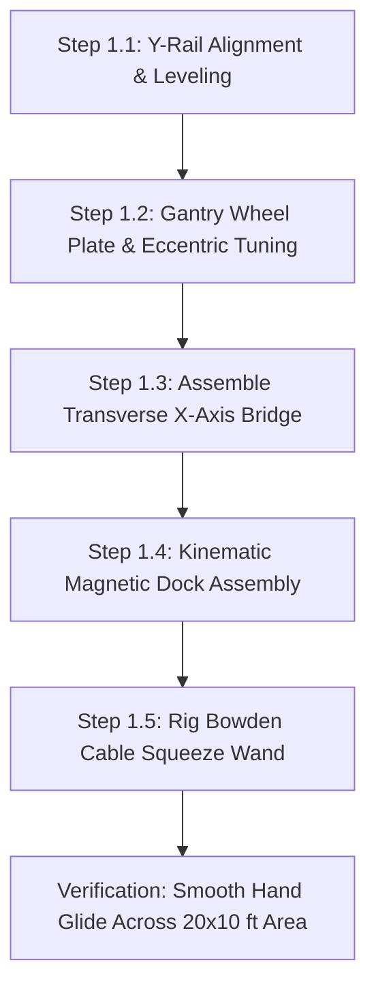

import { Card, CardGrid, LinkButton } from '@astrojs/starlight/components';

## Part 1: Stage Header & Executive Summary

> [!NOTE]
> **Stage Designation:** Stage 0 (Zero-Power Baseline)  
> **Operating Mode:** 100% Mechanical Manual Fallback  
> **Power Consumption:** 0 Watts (Zero Electrical Input Required)  
> **Resilience Rating:** Continuous Off-Grid / EMP / Submersion Proof  
> **Decoupling Standard:** Friction Slip-Clutch / Quick-Release Cam Linkage  

The Stage 0 baseline build of the **2-Axis Overhead Precision Gantry** is a **100% mechanical, zero-power agricultural machine**. It operates entirely by human leverage, manual hand cranks, counterweights, and gravity flows—providing complete food security and operational continuity during total grid blackouts.

---

## Part 2: Capability Delta (Features Introduced)

* **Zero-Power Resilience**: Operates indefinitely without batteries, solar controllers, or power supplies.
* **Direct Mechanical Leverage**: All actuation performed via hand cranks, manual levers, counterweights, or gravity siphoning.
* **Inherent Decoupling**: Built from the ground up with mechanical slip-clutches, quick-release clamps, or bypass valves to ensure motor upgrades never bind.

---

## Part 3: Isolated Stage 0 Bill of Materials (BOM)

### Base Machine Bill of Materials (BOM)

| Item | Component Description | Sourcing / Part Reference | Qty | Unit Cost | Total Cost |
| :--- | :--- | :--- | :--- | :--- | :--- |
| **O-01** | 2040 V-Slot Aluminum Rails (3000mm segments, 4x total) | Standard extrusion supplier | 4 | $19.50 | $78.00 |
| **O-02** | 4040 V-Slot Transverse Bridge Beam (3048mm length) | Heavy-duty extrusion store | 1 | $32.00 | $32.00 |
| **O-03** | Laser-Cut 4mm 6061 Aluminum Gantry Wheel End-Plates | SendCutSend / local fab | 4 | $8.00 | $32.00 |
| **O-04** | Dual POM V-Wheels with 625-2RS Bearings + Eccentrics | 3D printer motion kit | 16 | $1.40 | $22.40 |
| **O-05** | Kinematic Magnetic Toolhead Base (N52 Magnets + Steel Balls) | DIY 3D print + hardware | 1 | $14.00 | $14.00 |
| **O-06** | Manual Carbon-Fiber Tool Wand + Bowden Bicycle Lever | Carbon tube + bike parts | 1 | $15.00 | $15.00 |
| **Total** | **Base Zero-Power Cartesian Gantry Build** | **Complete off-grid manual gantry** | | | **$193.40** |

---

---

## Part 4: Standalone Full SVG Blueprint


---

## Part 5: Step-by-Step Assembly & Operating Protocol

The foundational build of the 2-Axis Precision Overhead Gantry is a **100% mechanical, zero-power Cartesian rolling bridge**. Utilizing low-friction polyoxymethylene (POM) dual V-wheels running on 2040 aluminum extrusions, it allows a grower to glide an inspection bridge effortlessly across a 20 × 10 ft canopy with $< 2$ N of manual hand effort. A magnetic kinematic dock holds interchangeable manual wands and optical lenses.

### Mechanical Architecture & Decoupling Standard
1. **Cartesian Rail Structure**: Two parallel longitudinal Y-rails (2040 V-slot, up to 6 m) support a transverse X-axis bridge beam (4040 V-slot, 3.1 m width) rolling on 16 heavy-duty POM V-wheels with dual 625-2RS bearings.
2. **Kinematic 3-Point Toolhead Dock**: Three pairs of hardened stainless steel ball bearings seated against 4 mm neodymium N52 magnets provide exact kinematic repeatability ($< 0.05$ mm positional repeat).
3. **Manual Toolhead Wand**: A lightweight carbon-fiber wand with an integrated bicycle Bowden cable transmits hand-squeeze force to actuate bypass pruners, soil probes, or seeding tubes at bed level.
4. **Mechanical Decoupling Standard**: Quick-release cam-lever belt clamps anchor the timing belts to the carriage plates. Flipping the cam levers releases belt tension instantly, allowing the entire gantry bridge and carriage to be pushed and pulled by hand with zero motor drag.

```
       OVERHEAD CARTESIAN GANTRY — BASE MECHANICAL ELEVATION
  =================================================================
       [Y-Axis Rail: 2040 V-Slot]               [Y-Axis Rail: 2040 V-Slot]
             ||                                           ||
       (POM V-Wheels)                               (POM V-Wheels)
          [===O===]                                    [===O===]
             ||                                           ||
             +============================================+
             |         [X-Axis Bridge Beam: 4040 V-Slot]   |
             +============================================+
                                   ||
                             (POM V-Wheels)
                                [===O===]
                                   ||
                       [X-Carriage Plate: 4mm Al]
                                   ||
                       [Kinematic Magnetic Dock]
                                (N52)
                                   ||
                        [Manual Toolhead Wand]
                                   ||
                         [Bypass Hand Pruner]
                                   v
                         (Delicate Grow Bed)
```

### Step-by-Step Fabrication & Assembly Protocol

#### Step 1.1: Rail Cutting & Frame Alignment
1. Cut four 3,000 mm segments of 2040 V-slot black anodized aluminum extrusion for the longitudinal Y-axis tracks.
2. Join segments end-to-end using hidden straight internal joint connectors and M5 set screws, creating two continuous 6,000 mm guide rails.
3. Clamp and level the Y-rails atop perimeter garden posts or greenhouse walls at $Z = 1,200$ mm height. Verify parallel rail spacing across both ends ($3,050\text{ mm} \pm 1.0\text{ mm}$).

#### Step 1.2: Gantry Wheel Plates & Eccentric Spacer Tuning
1. CNC-mill or waterjet cut four 4.0 mm 6061-T6 aluminum gantry end-plates.
2. Press 625-2RS sealed ball bearings into eight POM dual V-wheels per side plate.
3. Install wheels using M5 grade 10.9 button-head screws: use standard round spacers on top wheels and eccentric spacers on bottom wheels.
4. Mount wheel plates onto the Y-rails and rotate eccentric hex spacers with a 10 mm wrench until all play is eliminated without wheel binding (wheels should be skidded only with moderate finger force).

#### Step 1.3: Transverse X-Axis Bridge Assembly
1. Span the 3,048 mm 4040 V-slot extrusion between the two Y-axis gantry end plates.
2. Fasten using 90° heavy-duty cast aluminum corner brackets and M5 roll-in T-nuts.
3. Square the bridge to the Y-rails using a 1-meter framing square. Diagonal variance across the bridge must measure $< 1.5$ mm over 3 meters.

#### Step 1.4: Kinematic Magnetic Toolhead Base Fabrication
1. 3D-print the kinematic toolhead receiver plate in carbon-fiber reinforced PETG.
2. Press three pairs of 6 mm hardened stainless steel ball bearings into the triangular radial V-grooves at 120° intervals.
3. Epoxy three 15 × 5 mm N52 neodymium disc magnets into the recessed pockets.
4. Verify kinematic seating: snapping the toolhead dock on and off 10 times must repeat physical position within $\pm 0.05$ mm measured by dial indicator.

#### Step 1.5: Manual Squeeze Wand & Cable Rigging
1. Mount a 1.2 m rigid carbon-fiber extension tube to the kinematic toolhead mating plate.
2. Route a 1.2 mm stainless steel Bowden cable down the center of the tube.
3. Clamp an ergonomic bicycle hand lever to the upper wand handle.
4. Attach spring-loaded micro-bypass snip blades to the lower wand tip, verifying that a hand squeeze cleanly snips a 4 mm test stem.



### Step-by-Step Operating Runbook (Manual Mode)

1. **Pre-Glide Rail Inspection**: Wipe down the upper V-slot tracks with a microfiber cloth to remove dust, sap, or fallen leaves that could cause wheel bumps.
2. **Positioning the Gantry Bridge**: Grasp the transverse aluminum cross-beam and push it along the length of the garden bed. The bridge glides smoothly on its 16 sealed POM wheels with under 2 N of pushing force.
3. **Traverse Carriage Positioning**: Slide the central toolhead carriage along the X-beam to align over the target crop row or individual plant.
4. **Kinematic Toolhead Insertion**: Snap the desired manual toolhead (magnifying inspection lens, micro-snips, or soil core sampler) into the magnetic base until all three ball pairs click solidly into their seats.
5. **Executing Manual Selective Harvest**: Aim the wand tip at the target stem (e.g. ripe saffron flower or succulent purslane shoot). Squeeze the bicycle hand lever firmly to snip the pedicel cleanly.
6. **Canopy-Wide Stepped Inspection**: Push the bridge forward in 500 mm increments, methodically inspecting each grow zone without stepping on bed soil or reaching across trellises.
7. **End-of-Run Parking**: Push the gantry bridge to the South datum parking stop ($Y = 0$). Engage the manual thumb-screw track locks to secure the bridge against wind movement.

---

## Part 6: Guided Stage Navigation

<CardGrid>
  <Card title="Subsystem Overview" icon="left-arrow">
    Return to the machine overview, crop affinity matrix, and multi-stage comparison.
    <br/><br/>
    <LinkButton href="/open-biosphere/hardware/overhead-gantry-system/" variant="minimal">← Return to Overview</LinkButton>
  </Card>
  <Card title="Stage 1: BLE Electromechanical Pack" icon="right-arrow">
    Ready to motorize this machine? Upgrade with DC actuation and Flutter BLE Virtual Panel controls.
    <br/><br/>
    <LinkButton href="/open-biosphere/hardware/overhead-gantry-system/stage-1/" variant="primary">Proceed to Stage 1 Upgrade →</LinkButton>
  </Card>
</CardGrid>
