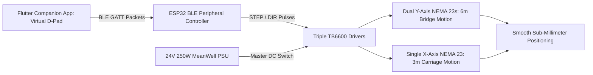

import { Card, CardGrid, LinkButton } from '@astrojs/starlight/components';

## Part 1: Stage Header & Executive Summary

> [!NOTE]
> **Stage Designation:** Stage 1 (Semi-Autonomous Electromechanical Pack)  
> **Operating Mode:** DC Motorized Continuous Duty with Ephemeral BLE Virtual Panel  
> **Power Requirement:** 12V / 24V DC Industrial Bus  
> **Physical Interlocks:** Strict Two-Control Standard (Master DC Cut + Recessed SD Factory Restore)  
> **Operator Interface:** Ephemeral Flutter Mobile Companion App over BLE GATT  

The Stage 1 electromechanical pack motorizes the **2-Axis Overhead Precision Gantry**, adding continuous DC motor/pump drive governed by the **Strict Two-Control Physical Standard** (RFC-0005) and an ephemeral **Flutter Companion App Virtual Panel** over direct local BLE.

---

## Part 2: Capability Delta (Features Introduced)

* **Continuous Motorized Actuation**: Replaces human manual cranking with high-efficiency DC gearmotors, steppers, or booster pumps.
* **Strict Two-Control Physical Standard**: Eliminates physical jog buttons and potentiometer dials to prevent moisture breach and priority race conditions. Only Master DC Switch and Recessed SD Reset Button are permitted on hardware.
* **Ephemeral BLE Virtual Panel**: Jogging, speed sliders, and priming pulses execute via the Flutter companion app over direct local BLE GATT.
* **100% Preserved Manual Fallback**: Slip-clutches, bypass valves, or belt releases guarantee instant zero-power manual hand operation without disassembly.

---

## Part 3: Isolated Stage 1 Bill of Materials (BOM)

### Add-On 1 Bill of Materials (BOM)

| Item | Component Description | Sourcing / Part Reference | Qty | Unit Cost | Total Cost |
| :--- | :--- | :--- | :--- | :--- | :--- |
| **A1-01** | NEMA 23 High-Torque Stepper Motors (2.8 N·m, 2.8A) | StepperOnline / CNC store | 3 | $23.00 | $69.00 |
| **A1-02** | GT2 9mm Steel-Core Timing Belt (20m spool) + Pulleys | CNC timing belt supplier | 1 | $26.00 | $26.00 |
| **A1-03** | TB6600 Microstepping Stepper Drivers (4.0A max) | Industrial stepper controls | 3 | $11.00 | $33.00 |
| **A1-04** | Two-Control Physical Interface & BLE Virtual Panel Pack (Master DC Switch, Recessed Tactile SD Button, Micro-SD Module + 16GB Golden Card, 0.91" I2C OLED) | Industrial switch / maker shop | 1 | $28.00 | $28.00 |
| **A1-05** | 24V 10.4A (250W) MeanWell LRS Industrial Power Supply | Mean Well authorized dealer | 1 | $36.00 | $36.00 |
| **A1-06** | 15x30mm Heavy-Duty Nylon Drag Chains (8m total) | CNC cable carrier maker | 1 | $24.00 | $24.00 |
| **Total** | **Add-On 1 Electromechanical Pack** | **Retrofits directly to Base** | | | **+$216.00** |
| **Cumul.** | **Operational BLE Virtual-Panel Gantry** | **Base ($193.40) + Add-On 1 ($216)** | | | **$409.40** |

---

---

## Part 4: Standalone Full SVG Blueprint


---

## Part 5: Step-by-Step Retrofit, Wiring & Operating Protocol

Under [RFC-0005](/rfcs/rfc-0005-hardware-interlocks-ble-virtual-panel), physical control panels with dedicated jog buttons, dials, potentiometers, and wired CNC pendants are banned across all machine tiers to eliminate water ingress and control priority contention.

Add-On 1 motorizes Cartesian locomotion governed by the **Strict Two-Control Physical Standard**:
1. **Master Hardware DC Power Switch**: Heavy-duty inline toggle switch directly isolating the 24V DC power rail.
2. **"Nuke & Pave" SD Factory Restore Button**: Dedicated recessed tactile switch wired to trigger an automatic secondary bootloader re-flash from micro-SD storage.

All manual jogging ($X+, X-, Y+, Y-, Z+, Z-$), feed-rate adjustments, and toolhead solenoid test pulses are conducted via the **Flutter Companion App Virtual Panel** over direct local BLE GATT.

### Electromechanical Actuation Architecture & Decoupling
- **Drive Powertrain**: Three NEMA 23 high-torque stepper motors (2.8 N·m holding torque, 2.8A RMS) driving GT2 9 mm steel-reinforced timing belts (20T pulleys, 40 mm travel per revolution).
- **Dual Y-Axis Synchronization**: Both longitudinal sides are driven by independent NEMA 23 motors electronically locked in phase to prevent gantry racking.
- **Mechanical Decoupling**: Quick-release belt clamp blocks on both end plates allow releasing belt tension with a single lever flip, enabling 100% manual hand sliding if power is unavailable.
- **Strict Two-Control Enclosure**: An IP65 sealed enclosure mounted at the South datum post contains:
  - Heavy-duty 2-pole master toggle switch directly breaking the 24V positive supply line.
  - Recessed tactile button next to the 0.91" I2C OLED display (`[GANTRY-A1 | BLE READY]`) for 5-second SD recovery reflash.
  - Micro-SD card slot module pre-loaded with golden recovery `firmware.bin` and `config.default`.
- **Ephemeral BLE Virtual Panel**: When nearby, an operator opens the Flutter companion app on their phone or tablet. The app auto-discovers the gantry over BLE GATT and displays real-time virtual touch controls: 6-way directional D-pad, feed-rate slider (10 to 150 mm/s), and toolhead solenoid test trigger.

```
       ELECTROMECHANICAL WIRING & BLE VIRTUAL PANEL SCHEMATIC
  =================================================================
  [24V 250W MeanWell PSU]
         |
         +----[Master DC Switch 15A]----+----(OLED: [GANTRY-A1 | BLE READY])
                                        |
         +------------------------------+---------------------------+
         |                              |                           |
         v                              v                           v
  [TB6600 Driver Y1]             [TB6600 Driver Y2]          [TB6600 Driver X]
         |                              |                           |
         v                              v                           v
  [NEMA 23 Motor Y1]             [NEMA 23 Motor Y2]          [NEMA 23 Motor X]
  (Left Rail Drive)              (Right Rail Drive)          (Carriage Drive)
         ^                              ^                           ^
         |                              |                           |
         +------------------------------+---------------------------+
                                        |
                     [ESP32 BLE Peripheral Controller]
                     (Recessed SD Reset Button + Micro-SD Golden Bin)
                                        ^
                                        : Direct BLE GATT (No Contention)
                                        v
                     [Flutter Companion App Virtual Panel]
                     (Virtual 6-Way D-Pad, Feed-Rate Slider, Aux Fire)
```

### Step-by-Step Retrofit Protocol

#### Step 2.1: NEMA 23 Motor Bracket Installation
1. Bolt cast aluminum NEMA 23 motor mounting brackets to the outer faces of both Y-axis gantry end plates.
2. Mount the X-axis motor bracket atop the central carriage plate.
3. Install 20T GT2 9 mm aluminum pulleys onto the 6.35 mm motor D-shafts, tightening dual M4 set screws on the flats.

#### Step 2.2: Steel-Core GT2 Timing Belt Installation
1. Route 9 mm steel-reinforced neoprene timing belts along both 6-meter Y-axis extrusions and across the 3-meter X-bridge.
2. Anchor belt ends to the extrusion ends using slotted aluminum belt tensioning clamps.
3. Tension belts until fundamental resonance vibrates at 65 Hz (approx 150 N static belt tension).

#### Step 2.3: Heavy-Duty Drag Chain Cable Management
1. Mount 15 × 30 mm nylon drag chains along the outer Y-rail and across the X-bridge beam.
2. Route 18 AWG 4-conductor shielded motor cables through the drag chains to the central electronics box.
3. Ensure adequate loop bend radius (R ≥ 45 mm) to prevent internal copper fatigue over thousands of cycles.

#### Step 2.4: Two-Control Enclosure & TB6600 Driver Carrier
1. Mount an IP65 ventilated steel enclosure (300 × 250 × 120 mm) at the South datum post.
2. Install the heavy-duty inline 24V master switch, recessed SD reset tactile button, micro-SD slot module, and 0.91" I2C OLED display.
3. Install three TB6600 microstepping drivers set to 8 microsteps (1,600 pulses/rev) and 2.8A peak current, wired to the ESP32 BLE peripheral controller.
4. Wire the 24V 250W MeanWell power supply through the master switch.

#### Step 2.5: BLE Virtual Panel Pairing & Axis Verification
1. Power on the gantry; verify the 0.91" OLED displays `[GANTRY-A1 | BLE READY]`.
2. Open the Flutter companion app on mobile; select `GANTRY-A1` from discovered BLE peripherals.
3. Verify jog response on the virtual D-pad: pressing $X+$ moves the carriage right; pressing $Y+$ moves the entire bridge forward smoothly with zero racking.



### Step-by-Step BLE Virtual Panel Operating Runbook

1. **Power Initialization**: Flip the heavy-duty 24V master DC power switch to ON. The onboard 0.91" OLED illuminates: `[GANTRY-A1 | BLE STANDBY]`.
2. **Walk-Up BLE Virtual Panel Connection**: Open the Flutter companion app on mobile device. Select `GANTRY-A1` from discovered BLE peripherals. The app instantly renders the Cartesian Virtual Panel.
3. **Feed-Rate Selection**: Adjust the virtual feed-rate slider in the app: set to RAPID ($120$ mm/s) for long travel across beds, or CREEP ($8$ mm/s) for final alignment over delicate blooms.
4. **Jogging to Target Bed**: Press and hold the virtual $Y+$ pad to motor the gantry bridge forward along the rails. Release pad to stop instantly (stepper holding torque locks position).
5. **Carriage Traverse**: Tap $X+$ or $X-$ to center the magnetic toolhead directly over the target plant cluster.
6. **Toolhead Action Trigger**: Tap the virtual AUX trigger button in the app; this fires an onboard 24V solenoid on the toolhead, executing a micro-snip or core sample.
7. **"Nuke & Pave" SD Recovery Protocol**: If firmware hangs or configuration deadlocks, hold the physical recessed reset button for 5 seconds during power-on. The bootloader reflashes factory baseline firmware from micro-SD in 4 seconds.
8. **Immediate Zero-Power Mechanical Fallback**: If power is severed, flip the quick-release cam levers on both gantry plates to slacken the belts. The bridge can immediately be pushed smoothly by hand.

---

## Part 6: Guided Stage Navigation

<CardGrid>
  <Card title="Stage 0: Zero-Power Baseline" icon="left-arrow">
    Review the underlying manual chassis, fabrication tolerances, and mechanical fallback linkage.
    <br/><br/>
    <LinkButton href="/open-biosphere/hardware/overhead-gantry-system/stage-0/" variant="minimal">← Previous: Stage 0 Baseline</LinkButton>
  </Card>
  <Card title="Stage 2: Agentic Autonomous AI Pack" icon="right-arrow">
    Ready for full closed-loop autonomy? Integrate the Controller-Node-Tool mesh and local neural vision.
    <br/><br/>
    <LinkButton href="/open-biosphere/hardware/overhead-gantry-system/stage-2/" variant="primary">Proceed to Stage 2 Upgrade →</LinkButton>
  </Card>
</CardGrid>
