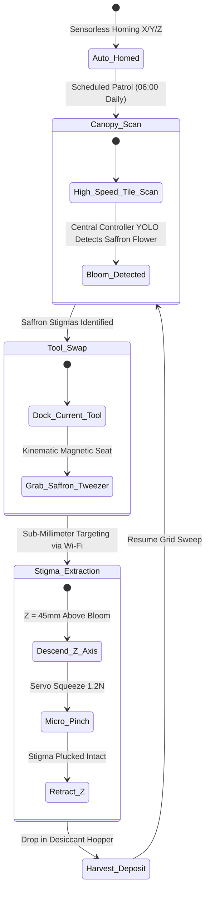

import { Card, CardGrid, LinkButton } from '@astrojs/starlight/components';

## Part 1: Stage Header & Executive Summary

> [!NOTE]
> **Stage Designation:** Stage 2 (Agentic Autonomous AI Pack)  
> **Operating Mode:** 24/7 Closed-Loop Autonomous Neural Telemetry & Robotics  
> **Network Mesh:** Encrypted Isolated Farm Wi-Fi (<code>POTFRM-4096</code> on 192.168.42.0/24) + BLE Tool Downlinks  
> **Safety Interlocks:** 250ms Hardware Deadman Watchdogs on all Edge Tools  
> **Edge AI Engine:** <code>llama-cpp-python</code> Local GGUF Multimodal Vision (Zero Cloud Dependence)  

The Stage 2 agentic pack elevates the **2-Axis Overhead Precision Gantry** into a fully autonomous cyber-physical robotics cell operating under the **Controller-Node-Tool (CNT)** standard (RFC-0004) and **Agnostic Controller Runtime** (RFC-0006).

---

## Part 2: Capability Delta (Features Introduced)

* **Controller-Node-Tool (CNT) Hierarchy**: Heavy neural perception runs on the Central Biosphere Controller; the Machine Node coordinates local kinematics; tiny Edge Tools drive motors 1:1.
* **Isolated Farm AP Mesh**: Secure, air-gapped local Wi-Fi (<code>POTFRM-&lt;CLUSTER_ID&gt;</code> on <code>192.168.42.0/24</code>) with WebSocket node registration at <code>ws://192.168.42.1:8443/register</code>.
* **250ms Hardware Deadman Watchdogs**: Every Tool trips into safe, high-Z, zero-power state within 250 ms if signal is interrupted.
* **Local Zero-Cloud Edge AI**: Multi-agent perception via <code>llama-cpp-python</code> local vision models without internet dependencies.

---

## Part 3: Isolated Stage 2 Bill of Materials (BOM)


### Add-On 2 Bill of Materials (BOM)

| Item | Part ID & Registry Link | Component & Specification | Sourcing / Supplier | Fab Type | Qty | Unit Cost | CAD Asset | Total Cost |
| :--- | :--- | :--- | :--- | :--- | :--- | :--- | :--- | :--- |
| **A2-01** | [`PART-ELEC-ESP32-S3-NODE`](/open-biosphere/parts/electrical/PART-ELEC-ESP32-S3-NODE/) | Gantry Machine Node: ESP32-S3 (8MB PSRAM) + 0.96" OLED + Setup Button | [Espressif distributor](https://mouser.com/espressif) | Stock Electronics | 1 | $16.00 | [Download .3DS](/open-biosphere/assets/parts/PART-ELEC-ESP32-S3-NODE/model.3ds) | $16.00 |
| **A2-02** | [`PART-ELEC-ESP32-C3-TOOL`](/open-biosphere/parts/electrical/PART-ELEC-ESP32-C3-TOOL/) | 3x ESP32-C3 Modular Tools with 0.42" OLED & 250ms Watchdog (X, Y, Toolhead) | [Microcontroller supplier](https://seeedstudio.com) | Stock Electronics | 3 | $7.00 | [Download .3DS](/open-biosphere/assets/parts/PART-ELEC-ESP32-C3-TOOL/model.3ds) | $21.00 |
| **A2-03** | [`PART-ELEC-CAM-4K-IMX519`](/open-biosphere/parts/electrical/PART-ELEC-CAM-4K-IMX519/) | Macro 4K RGB Camera Module + 850nm NIR Ring + Wi-Fi RTSP Transmitter | [Precision camera supplier](https://arducam.com) | Stock Sensor | 1 | $42.00 | [Download .3DS](/open-biosphere/assets/parts/PART-ELEC-CAM-4K-IMX519/model.3ds) | $42.00 |
| **A2-04** | [`PART-ELEC-ENC-AS5600-MAG`](/open-biosphere/parts/electrical/PART-ELEC-ENC-AS5600-MAG/) | AS5600 12-bit High-Resolution Magnetic Encoders (3x) | [Magnetic sensor shop](https://mouser.com) | Stock Sensor | 3 | $7.00 | [Download .3DS](/open-biosphere/assets/parts/PART-ELEC-ENC-AS5600-MAG/model.3ds) | $21.00 |
| **A2-05** | [`PART-FAB-TOOL-TWEEZER-SAFFRON`](/open-biosphere/parts/custom-fab/PART-FAB-TOOL-TWEEZER-SAFFRON/) | Saffron Micro-Tweezer Kinematic Toolhead (Coreless Servo) | [Custom micro-assembly kit](https://open-biosphere.org) | Precision SLA / FDM Hybrid | 1 | $26.00 | [Download .3DS](/open-biosphere/assets/parts/PART-FAB-TOOL-TWEEZER-SAFFRON/model.3ds) | $26.00 |
| **A2-06** | [`PART-FAB-TOOL-SHEAR-PURSLANE`](/open-biosphere/parts/custom-fab/PART-FAB-TOOL-SHEAR-PURSLANE/) | Purslane Reciprocating Lateral Shear Toolhead (12V Motor) | [Custom micro-trimmer kit](https://open-biosphere.org) | 3D Print + Steel Blades | 1 | $28.00 | [Download .3DS](/open-biosphere/assets/parts/PART-FAB-TOOL-SHEAR-PURSLANE/model.3ds) | $28.00 |
| **A2-07** | [`PART-ELEC-TMC2209-DVR`](/open-biosphere/parts/electrical/PART-ELEC-TMC2209-DVR/) | TMC2209 Silent Stepper Driver Interface Pack (4x) | [3D printer electronics supplier](https://bigtree-tech.com) | Stock Electronics | 1 | $40.00 | [Download .3DS](/open-biosphere/assets/parts/PART-ELEC-TMC2209-DVR/model.3ds) | $40.00 |
| **Total** | **Add-On 2 Agentic Autonomous Pack (CNT Standard)** | **Expands Base + Add-On 1** | | | | | | **+$194.00** |
| **Full Build** | **Complete Autonomous Precision Cartesian Gantry** | **Base + Add-On 1 + Add-On 2** | | | | | | **$603.40** |

---

## Part 4: Standalone Full SVG Blueprint


---

## Part 5: Step-by-Step Commissioning, Provisioning & Autonomous Runbook

Under [RFC-0004](/rfcs/rfc-0004-controller-node-tool) and [RFC-0006](/rfcs/rfc-0006-agnostic-controller-runtime), the **Agentic Autonomous AI Pack** transforms the gantry into a hierarchical **Controller-Node-Tool (CNT)** sub-millimeter agricultural robot. Heavy neural vision processing is offloaded to the Central Biosphere Controller over Wi-Fi, while a dedicated **Gantry Node** coordinates Cartesian motion primitives and downlinks to modular **Edge Tools** over BLE with 250ms hardware deadman watchdogs.

### Autonomous Vision & Telemetry Architecture
- **Gantry Machine Node (ESP32-S3)**: Dual-Core Xtensa LX7 (240 MHz, 8 MB PSRAM) mounted inside the main electrical enclosure governed by the **Strict Two-Control Physical Standard** (Master DC Power Switch and Recessed SD Reset Button alongside 0.96" I2C OLED `[NODE: GANTRY-01 | LINK -> 4096]`). Uplinks to Central Controller via Wi-Fi; receives Cartesian path plans and coordinates downstream Tools via BLE Central.
- **Decoupled Down-Facing Macro Vision**: Sony IMX519 16MP / 4K RGB camera paired with an 850 nm NIR ring illuminator streams high-resolution video over Wi-Fi directly to the Central Controller (Agnostic Runtime, e.g. Raspberry Pi 5 + Hailo-8 or x86 Host), which executes YOLOv8 neural detection for saffron stigmas (*Crocus sativus*) and purslane trimming targets.
- **Dedicated Modular Edge Tools (ESP32-C3)**: Driven 1:1 by micro ESP32-C3 controllers equipped with 0.42" micro OLED displays and **250ms hardware deadman watchdogs**:
  - `DEV_X_AXIS`: Micro ESP32-C3 with 0.42" OLED (`TOOL: X_AXIS | LINK: OK`) + 250ms watchdog driving the X-axis NEMA 23 stepper driver and AS5600 magnetic rotary encoder.
  - `DEV_Y_AXIS`: Micro ESP32-C3 with 0.42" OLED (`TOOL: Y_AXIS | LINK: OK`) + 250ms watchdog driving dual Y-axis NEMA 23 stepper drivers and AS5600 encoder.
  - `DEV_TOOL_HEAD`: Micro ESP32-C3 with 0.42" OLED (`TOOL: TOOL_HEAD | LINK: OK`) + 250ms watchdog on the kinematic carriage, managing Z-axis stepper and end-effector actuators (saffron micro-tweezer / purslane reciprocating shear).
- **250ms Deadman Watchdog Fail-Safe**: If any Tool loses BLE connection to the Gantry Node for $> 250$ ms, it drops immediately into high-Z safe state: all stepper drivers cut holding torque to zero, and the toolhead freezes in safe stationary position.

```text
       CONTROLLER-NODE-TOOL (CNT) HIERARCHICAL EDGE ARCHITECTURE
  =================================================================
            CENTRAL BIOSPHERE CONTROLLER (Agnostic Runtime / POTFRM-4096)
            • Emits Isolated Farm AP: SSID [POTFRM-4096] (192.168.42.0/24)
            • YOLOv8 Macro Canopy Vision & Sub-Millimeter Targeting
                                  │
                                  │ Isolated Farm Wi-Fi (192.168.42.0/24)
                                  ▼
             ┌─────────────────────────────────────────┐
             │       GANTRY MACHINE NODE (ESP32-S3)    │
             │  • OLED Display: [NODE: GANTRY-01]      │
             │  • Setup Push-Button for Mobile BLE     │
             │  • Cartesian Trajectory & Kinematics    │
             └────────────────────┬────────────────────┘
                                  │
         ┌────────────────────────┼────────────────────────┐
         │ BLE Downlink           │ BLE Downlink           │ BLE Downlink
         ▼                        ▼                        ▼
 ┌───────────────┐        ┌───────────────┐        ┌───────────────┐
 │ TOOL:         │        │ TOOL:         │        │ TOOL:         │
 │ DEV_X_AXIS    │        │ DEV_Y_AXIS    │        │ DEV_TOOL_HEAD │
 │ ESP32-C3 Micro│        │ ESP32-C3 Micro│        │ ESP32-C3 Micro│
 │ 0.42" OLED    │        │ 0.42" OLED    │        │ 0.42" OLED    │
 │ 250ms Deadman │        │ 250ms Deadman │        │ 250ms Deadman │
 │ NEMA 23 Drive │        │ Dual NEMA 23  │        │ Z-Axis Servo  │
 │ AS5600 Encoder│        │ AS5600 Encoder│        │ Tweezer/Shear │
 └───────────────┘        └───────────────┘        └───────────────┘
```

### Step-by-Step Sensor Commissioning & Edge AI Protocol

#### Step 3.1: Gantry Node & Driver Carrier Assembly
1. Mount the ESP32-S3 Node with 0.96" I2C OLED display and physical setup push-button inside the main electrical enclosure.
2. Mount the TMC2209 silent stepper driver boards wired to `DEV_X_AXIS` and `DEV_Y_AXIS` tools for resonance-free motion.
3. Verify AS5600 magnetic rotary encoders on motor shafts report sub-0.05 mm positional feedback to the tool controllers.

#### Step 3.2: Kinematic Toolhead Board Assembly (`DEV_TOOL_HEAD`)
1. Mount the compact `DEV_TOOL_HEAD` board (ESP32-C3) directly onto the kinematic toolhead carriage plate with its 0.42" OLED.
2. Connect Z-axis coreless servo, micro-tweezer gripper, and reciprocating shear motor headers to tool outputs.
3. Wire toolhead status display: verify screen reports `[TOOL: TOOL_HEAD | LINK: OK]`.

#### Step 3.3: Down-Facing 4K Macro Camera Integration
1. Mount the Sony IMX519 camera on a 3-point leveling bracket alongside the kinematic toolhead dock.
2. Install the 850 nm infrared ring illuminator surrounding the lens.
3. Connect camera to Wi-Fi video streamer; calibrate pixel-to-Cartesian millimeter transform matrix (0.024 mm/pixel at 200 mm working distance).

#### Step 3.4: Saffron & Purslane Specialized Toolheads
1. Assemble the Saffron Micro-Tweezer toolhead: coreless digital micro-servo driving soft-silicone coated forceps tips.
2. Assemble the Purslane Reciprocating Shear toolhead: miniature 12V oscillating cutter.
3. Test automatic tool-docking: the gantry moves to the tool rack at $(X=0, Y=0)$, slides sideways into the slot, and uncouples the kinematic magnets cleanly.

#### Step 3.5: Provisioning & 250ms Watchdog Verification
1. Power on Central Controller; verify active Cluster ID on OLED, terminal stdout, or BLE beacon (`POTFRM-4096`).
2. Power on Gantry Node; display shows `[NODE UNPAIRED - PAIR VIA BLE]`.
3. Press physical setup button on Node; connect via mobile companion app over BLE, enter `4096`.
4. Node commits credentials to NVS, links to `POTFRM-4096`, registers at `ws://192.168.42.1:8443/register`, and updates display to `[ONLINE | LINK -> 4096]`.
5. Verify Node auto-discovers and binds all three BLE Tools.
6. Test fail-safe watchdog: drop BLE link to `DEV_X_AXIS`; verify stepper current drops to 0.0A in $< 250$ ms.



### Step-by-Step Autonomous Multi-Agent Runbook

1. **Pre-Flight Sensorless Homing**: At 06:00 daily, the Gantry Node wakes upon schedule from the Central Controller. Motor StallGuard detects hard physical stops at $(0,0,0)$, zeroing the coordinate datum.
2. **High-Speed Canopy Tile Survey**: The gantry sweeps the bed in a serpentine raster at 150 mm/s. The 4K camera captures overlapping tiles, streaming video to the Central Controller Hailo-8 NPU.
3. **Saffron Stigma Detection & Triangulation**: When a blooming *Crocus sativus* flower is classified, the Central Controller transmits target 3D coordinates ($X, Y, Z$) to the Gantry Node with $\pm 0.15$ mm precision.
4. **Autonomous Kinematic Tool Change**: If another tool is mounted, the gantry travels to the tool rack, docks the current tool, and magnetically couples the Saffron Micro-Tweezer.
5. **Precision Stigma Extraction**: The `DEV_TOOL_HEAD` tool descends along the Z-axis, inserts forceps between petals without tearing, squeezes at 1.2 N force, and lifts vertically, cleanly harvesting stigmas without damaging the flower.
6. **250ms Fail-Safe Watchdogs**: If BLE connection to `DEV_X_AXIS`, `DEV_Y_AXIS`, or `DEV_TOOL_HEAD` drops for $> 250$ ms, each tool cuts stepper current to zero. If Wi-Fi link to Central Controller is lost, the gantry halts motion safely in place.

---

## Part 6: Guided Stage Navigation

<CardGrid>
  <Card title="Stage 1: BLE Electromechanical Pack" icon="left-arrow">
    Review the motorized powertrain, Two-Control enclosure wiring, and BLE Virtual Panel.
    <br/><br/>
    <LinkButton href="/open-biosphere/hardware/overhead-gantry-system/stage-1/" variant="minimal">← Previous: Stage 1 Upgrade</LinkButton>
  </Card>
  <Card title="Subsystem Overview" icon="right-arrow">
    Return to the machine overview, crop affinity matrix, and master biosphere interlocks.
    <br/><br/>
    <LinkButton href="/open-biosphere/hardware/overhead-gantry-system/" variant="primary">Return to Overview →</LinkButton>
  </Card>
</CardGrid>
