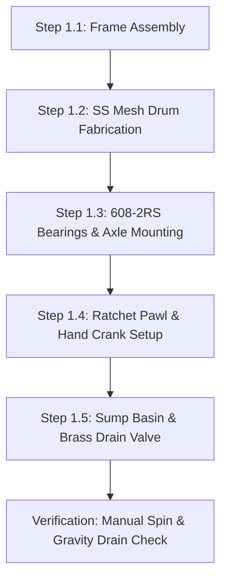
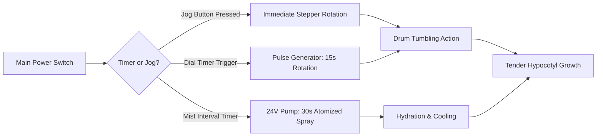
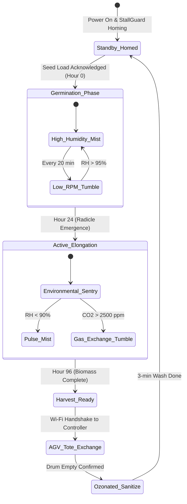

import { Card, CardGrid } from '@astrojs/starlight/components';

The **Revolving Dark-Chamber Sprout Bioreactor** is a modular, standalone agricultural appliance engineered for continuous, rapid vegetative protein generation. While designed to dock into the Perimeter Lower Tier of the master Open Biosphere assembly, it functions as an autonomous benchtop or cabin appliance for homesteaders and off-grid setups.

---

## 1. Standalone Homesteading & Off-Grid Utility

In off-grid and homestead scenarios, fresh bioavailable nutrients are often seasonally constrained. This machine produces **2.5 to 4.0 kg of crisp, high-protein mung bean or legume hypocotyls every 4 days** with zero soil, zero natural sunlight, and minimal water consumption:

<CardGrid>
  <Card title="Kitchen & Cabin Appliance" icon="star">
    Operates independently on a kitchen counter, root cellar, or pantry shelf. Requires zero electrical power in base manual configuration.
  </Card>
  <Card title="Closed Water Conservation" icon="droplet">
    Recirculating ultrasonic misting and scheduled drain cycles consume under 1.5 liters of fresh water per kilogram of fresh yield.
  </Card>
  <Card title="Photophobic Bioreaction" icon="moon">
    Complete light isolation eliminates bitter chlorophyll synthesis, yielding tender, sweet, restaurant-grade hypocotyls without manual rinsing.
  </Card>
  <Card title="Ozonated Auto-Sanitization" icon="shield">
    Integrated inline ozone generator executes an automated 3-minute sanitation wash between cycles, preventing fungal or bacterial mold.
  </Card>
</CardGrid>

---

## 2. Technical Specifications

| Parameter | Specification |
| :--- | :--- |
| **Footprint Dimensions** | 450 mm (W) × 600 mm (D) × 500 mm (H) |
| **Drum Geometry** | Cylindrical food-grade perforated drum: 300 mm diameter × 450 mm length |
| **Batch Capacity** | 800 g dry seed (yields ~3.5 kg wet hypocotyls per 96-hour run) |
| **Rotation Drive** | NEMA 17 planetary geared stepper motor (5.18:1 reduction) or manual crank |
| **Rotation Speed** | 0.5 to 2.0 RPM intermittent (rotates 15 seconds every 15 minutes) |
| **Irrigation System** | Dual high-pressure atomizing misting nozzles (50 µm droplet size) |
| **Sanitation Subsystem** | 200 mg/h corona-discharge ozone generator with gas diffuser stone |
| **Power Consumption** | 0W (Manual) / 18W average (Add-On 1) / 22W peak (Add-On 2) |
| **Controller Architecture** | Standalone manual / Dual-dial analog timer / ESP32-S3 FreeRTOS CAN node |

---

## 3. Instructions (Base Zero-Power Machine)

The foundational build of the Revolving Sprout Bioreactor requires **zero electricity, zero microcontrollers, and zero firmware**. It relies strictly on mechanical leverage, sealed ball bearings, a spring-loaded ratchet pawl, and manual gravity drainage. Anyone with basic hand tools can construct, operate, and harvest fresh protein off-grid.

### Mechanical Architecture & Decoupling Standard
1. **Perforated Cylinder & Flanges**: A 300 mm diameter by 450 mm long food-grade 304 stainless steel mesh cylinder (1.5 mm perforations) rotates inside an open 2020 T-slot aluminum frame.
2. **Bearing Support**: Both ends of the drum rest on grease-packed 608-2RS skate bearings housed in rigid pillow blocks, allowing effortless hand spinning even with a 4.0 kg saturated seed load.
3. **Ratchet Pawl Mechanism**: A 12-tooth mechanical ratchet wheel and spring-loaded Delrin pawl lock the drum against counter-rotation and hold it steadily at 45° tilt angles for optimal gravity drainage.
4. **Mechanical Decoupling**: The 8 mm precision ground D-shaft features an integrated ball-detent dog clutch. When motor add-ons are installed later, pulling the clutch pin completely disconnects the motor gearbox, allowing instant zero-drag hand cranking.

```
       REVOLVING SPROUT BIOREACTOR — BASE MECHANICAL ELEVATION
  =================================================================
                    Top Removable Lightproof Hood
         +---------------------------------------------------+
         |                                                   |
         |         [Perforated 304 SS Mesh Drum]             |
         |               (300 mm OD x 450 mm L)              |
         |        .---------------------------------.        |
         |       /                                   \       |
  [Hand] |======|    *   *   *   *   *   *   *   *    |======| [608-2RS]
  Crank  |  ||  |  *   *   (Seed Mass)   *   *   *   |  ||  | Bearing
  Pawl   |--++-- \                                   / --++--| Pillow
  Lock   |        '---------------------------------'        | Block
         |                         |                         |
         |                         v Droplets                |
         |           \---------------------------/           |
         |             \   Silicone Sump Basin /             |
         |               \                   /               |
         |                 +-------+-------+                 |
         |                         |                         |
         |                   [3/4" Brass]                    |
         |                    Ball Valve                     |
         |                         |                         |
         +-------------------------+-------------------------+
                              Gravity Drain
```

### Step-by-Step Fabrication & Assembly Protocol

#### Step 1.1: Chassis Cutting & Extrusion Assembly
1. Cut eight segments of 2020 black-anodized aluminum extrusion: four longitudinal rails at 500 mm and four upright stanchions at 400 mm.
2. Deburr all cut ends and tap center holes to M5 thread depth 15 mm.
3. Assemble the rectangular box chassis using 90° cast aluminum corner brackets and M5 button-head cap screws with roll-in T-nuts. Torque to 4.2 N·m.
4. Verify rectangular squareness using a machinist square across all internal corners ($< 0.5$ mm diagonal variance).

#### Step 1.2: Perforated Mesh Cylinder & Flange Assembly
1. Roll a 304 stainless steel 1.5 mm perforated mesh sheet into a 300 mm outer diameter cylinder (length 450 mm).
2. Lap the seam by 12 mm and secure with 316 stainless steel blind pop rivets spaced every 30 mm.
3. 3D-print or CNC-rout two 300 mm circular end flanges in PETG or food-grade HDPE with a 15 mm perimeter groove.
4. Seat the mesh cylinder into the endcap perimeter grooves using food-grade silicone RTV gasket sealant. Clamp longitudinally with four M4 threaded stainless tie-rods until cured (24 hours).
5. Cut a 150 mm × 100 mm access hatch in the mesh cylinder wall, installing two stainless steel miniature draw latches and a flexible silicone sealing gasket.

#### Step 1.3: Axle Spindle & 608-2RS Bearing Installation
1. Press-fit dual 608-2RS sealed ball bearings into machined aluminum pillow blocks mounted atop the 400 mm upright frame rails.
2. Slide an 8 mm precision-ground stainless steel D-profile shaft through the center flanged hubs of both drum endcaps.
3. Lock the shaft to the drum flanges using M4 stainless grub screws biting directly into the D-flat.
4. Slide shaft ends into the pillow-block bearings and clamp with 8 mm shaft collars, ensuring zero axial play while maintaining effortless rotational spin ($< 0.05$ N·m break-away torque).

#### Step 1.4: Hand Crank & Ratchet Pawl Alignment
1. Mount the 12-tooth Delrin ratchet wheel onto the drive-side D-shaft stub protruding 40 mm past the pillow block.
2. Pivot-mount the spring-loaded Delrin pawl onto the upper aluminum frame rail using an M5 shoulder bolt and torsion spring.
3. Attach the ergonomic detachable hand crank with internal ball-detent collar onto the 8 mm shaft stub.
4. Test crank rotation: clockwise motion must rotate smoothly with audible ratchet clicks; counter-clockwise rotation must lock solidly within 30° of travel.

#### Step 1.5: Sump Funnel & Gravity Drain Installation
1. Form a food-grade silicone or heat-molded PETG catch pan beneath the drum, angled at a 15° slope toward a central sump.
2. Drill a 26 mm hole at the lowest point and install a 3/4" bulkhead fitting with EPDM washers.
3. Thread a 3/4" manual brass full-port ball valve onto the bulkhead fitting.
4. Plumb a short length of food-grade 3/4" braided silicone tubing from the valve outlet to gravity-discharge into a wastewater bucket or garden bed.



### Step-by-Step Operating Runbook (Manual Mode)

1. **Pre-Soak & Seed Loading**: Weigh 800 g of dry, high-germination mung bean seeds. Rinse thoroughly in fresh water, then soak in a clean bowl for 6 to 8 hours. Open the drum's 150 mm access hatch, pour in the swollen seeds, close the hatch, and secure both draw latches.
2. **Morning Tumbling Cycle**: Rotate the hand crank clockwise 5 full revolutions at ~1 RPM. This gently tumbles the seed bed, uncurls tangles, and aerates the root zone without damaging tender hypocotyls. The ratchet pawl prevents the drum from rolling back.
3. **Manual Rinse Application**: Pour 2.0 liters of clean, dechlorinated water through the top lightproof access port directly onto the rotating drum. Crank 2 additional revolutions while pouring to ensure uniform wetting across all seeds.
4. **Gravity Drainage Discharge**: Open the 3/4" brass ball valve beneath the sump basin. Allow all excess rinse water to drain completely for 3 minutes. *Crucial: Never allow seeds to sit submerged in standing water, which induces anaerobic rot and fungal contamination.* Close the ball valve.
5. **Midday Inspection & Aeration**: Rotate the drum 3 revolutions at noon. The mechanical ratchet allows locking the drum at a 45° offset angle, promoting residual gravity drainage away from newly emerged shoots.
6. **Evening Tumbling & Rinse**: Repeat Step 2 and Step 3 at 18:00 (5 revolutions + 2.0 L rinse + full gravity drain).
7. **96-Hour Harvest Protocol**: On day 4, open the access hatch, position a clean food tote beneath the drum, rotate the drum 180° downward, and tap the mesh to release ~3.5 kg of crisp, sweet hypocotyls. Spray the empty drum with boiling water or 3% food-grade hydrogen peroxide before reloading.

### Base Machine Bill of Materials (BOM)

| Item | Component Description | Sourcing / Part Reference | Qty | Unit Cost | Total Cost |
| :--- | :--- | :--- | :--- | :--- | :--- |
| **B-01** | 2020 T-Slot Black Anodized Extrusion (500mm & 400mm) | Standard structural aluminum | 8 | $3.50 | $28.00 |
| **B-02** | 304 Stainless Steel Perforated Sheet (1.5mm holes, 300x450mm) | McMaster / local sheet supplier | 1 | $42.00 | $42.00 |
| **B-03** | Food-Grade PETG Drum End Flanges & Axle Hubs | 3D printed / local fab | 2 | $6.00 | $12.00 |
| **B-04** | 608-2RS Deep-Groove Sealed Skate Bearings | Precision skate hardware | 4 | $1.50 | $6.00 |
| **B-05** | 8 mm Precision Ground D-Profile Stainless Axle Shaft (550mm) | Motion hardware supplier | 1 | $14.00 | $14.00 |
| **B-06** | Detachable Hand Crank + Ratchet Wheel & Delrin Pawl | 3D printed + torsion spring | 1 | $11.00 | $11.00 |
| **B-07** | Food-Grade Silicone Sump Tray + 3/4" Bulkhead Fitting | Silicone pan + brass fitting | 1 | $12.00 | $12.00 |
| **B-08** | 3/4" Brass Full-Port Manual Ball Valve | Hardware / plumbing supply | 1 | $8.00 | $8.00 |
| **B-09** | Fasteners (M5 T-nuts, M5 corner brackets, M4 tie rods) | Standard stainless hardware pack | 1 | $12.00 | $12.00 |
| **Total** | **Base Zero-Power Machine Build** | **Complete off-grid appliance** | | | **$145.00** |

---

## 4. Add-On 1: Semi-Autonomous Electromechanical Pack (Buttons & Dials)

The **Semi-Autonomous Pack** retrofits onto the Base Machine in under 60 minutes. It automates repetitive tumbling and misting using robust electro-mechanical switchgear: an industrial planetary stepper motor, a 100 PSI diaphragm pump with brass atomizing nozzles, an analog countdown dial timer, and momentary jog push-buttons.

### Electromechanical Actuation Architecture & Decoupling
- **Drive Motor**: NEMA 17 planetary geared stepper motor (5.18:1 ratio, 1.8 N·m output torque) driving a GT2 6 mm timing belt (60T drum pulley, 20T motor pulley).
- **Mechanical Decoupling**: A spring-loaded dog clutch slides axially on the 8 mm D-shaft. Pulling the knurled collar disengages the motor drive dogs, allowing instant hand-crank manual operation without fighting motor cogging or back-powering drivers.
- **Pressurized Misting**: A 24V DC diaphragm pump pressurizes an inline manifold to 100 PSI, delivering a 50 µm atomized fog through two 0.3 mm brass orifice nozzles directly into the drum core.
- **Operator Interface**: Dual panel-mounted spring-wound countdown dial timers control mist interval (0–60 min) and mist duration (0–60 sec). A momentary green button provides instant manual jog rotation.

```
       ELECTROMECHANICAL WIRING & CONTROL PANEL SCHEMATIC
  =================================================================
  [24V DC 60W PSU]
        |
        +----[Main Toggle SW]----(Power LED Red)
        |
        +----[Jog Button NO]----+-----> [TMC Driver STEP/DIR Engine]
        |                       |                 |
        +----[Dial Timer 1]-----+                 v
        |    (Tumble Interval)            [NEMA 17 Geared Stepper]
        |                                         |
        |                                 (Dog Slip Clutch)
        |                                         |
        |                                         v
        |                                 [Perforated Drum]
        |
        +----[Dial Timer 2]-----------> [24V Diaphragm Mist Pump]
             (Mist Duration)                      |
                                                  v
                                      [Dual 0.3mm Brass Nozzles]
```

### Step-by-Step Retrofit Protocol

#### Step 2.1: Stepper Motor & Belt Drive Bracket Mounting
1. Bolt a slotted NEMA 17 motor bracket to the rear vertical 2020 extrusion using M5 drop-in T-nuts.
2. Mount the NEMA 17 planetary geared motor with its 20T GT2 aluminum pulley facing inward.
3. Slide the 60T GT2 drum pulley onto the 8 mm D-shaft between the pillow block and the drum endcap.
4. Route a 6 mm closed-loop GT2 neoprene timing belt between pulleys. Tension motor bracket until 5 mm belt deflection occurs at 2 N finger pressure.

#### Step 2.2: Dog Clutch Retrofit on Main D-Shaft
1. Install the sliding dog clutch sleeve between the 60T pulley hub and the axle shaft collar.
2. Verify axial sliding action: when engaged, the dog teeth lock the pulley to the shaft; when pulled outward, the shaft spins completely freely.
3. Retain the manual hand crank on the outer shaft stub for instant mechanical fallback.

#### Step 2.3: Diaphragm Misting Pump & Atomizing Manifold
1. Mount the 24V DC diaphragm mist pump (100 PSI, 1.2 L/min) to the lower chassis rail using vibration-dampening rubber grommets.
2. Plumb a 1/4" food-grade polyurethane pressure line from the pump outlet to a brass tee fitting mounted inside the top hood.
3. Install two 0.3 mm anti-drip brass atomizing misting nozzles angled at 45° across the seed bed.
4. Plumb the pump inlet to an external 5-gallon food-grade water reservoir with an inline 80-mesh stainless suction filter.

#### Step 2.4: IP65 Electrical Control Enclosure Installation
1. Mount an IP65 polycarbonate electrical junction box (160 × 160 × 90 mm) to the side frame rail.
2. Drill panel cutouts for:
   - One 22 mm red illuminated latching power rocker switch.
   - One 22 mm green momentary tactile jog push-button.
   - Two 48 mm panel-mount mechanical spring-wound countdown timers.
3. Snap a 24V-to-12V DC-DC buck converter and a standalone pulse-generator module onto internal DIN rail.

#### Step 2.5: Point-to-Point Wiring & Grounding Verification
1. Wire 24V DC positive through the main rocker switch to the pulse generator, timers, and pump relay.
2. Connect the green jog button directly across the manual pulse-trigger terminal on the stepper driver board.
3. Wire the chassis aluminum frame to earth ground through a 3-pin fused IEC power inlet.
4. Verify isolation: resistance between 24V DC negative and the aluminum frame must measure $> 10\text{ M}\Omega$.



### Step-by-Step Push-Button Operating Runbook

1. **System Power-Up & Dial Calibration**: Flip the red master toggle switch to ON. Set Dial Timer 1 (Tumble Interval) to 15 minutes. Set Dial Timer 2 (Mist Duration) to 30 seconds.
2. **Drum Loading via Green Jog Button**: Open the drum access hatch. Press and hold the green momentary jog button to rotate the drum until the hatch opening faces vertically upward. Release button (drum stops instantly). Load 800 g soaked seeds and latch hatch.
3. **Automated Continuous Cycling**: Leave the machine in automated dial mode. Every 15 minutes, the pulse generator triggers a 15-second rotation at 1.0 RPM. Simultaneously, the diaphragm pump pressurizes the misting nozzles for 30 seconds, maintaining 95% relative humidity inside the dark chamber.
4. **Mid-Cycle Observation & Manual Jog**: To inspect sprout progress without disrupting the schedule, press the green jog button to rotate the inspection port into view.
5. **Drain Flush Maintenance**: Open the lower brass ball valve twice daily for 2 minutes to discharge accumulated mist runoff from the sump.
6. **Zero-Power Fallback Override**: If off-grid power is lost, pull the dog clutch ring outward and slide the hand crank onto the shaft. Resume the 7-step manual runbook without dismounting the motor or belt.

### Add-On 1 Bill of Materials (BOM)

| Item | Component Description | Sourcing / Part Reference | Qty | Unit Cost | Total Cost |
| :--- | :--- | :--- | :--- | :--- | :--- |
| **A1-01** | NEMA 17 Planetary Geared Stepper (5.18:1, 1.8 N·m) | Standard motion supplier | 1 | $24.00 | $24.00 |
| **A1-02** | GT2 60T/20T Aluminum Pulley Set + 6mm Neoprene Belt | 3D printer drive hardware | 1 | $9.00 | $9.00 |
| **A1-03** | Axial Spring-Loaded Dog Clutch Sliding Mechanism | Machined aluminum / 3D PETG | 1 | $14.00 | $14.00 |
| **A1-04** | 24V DC 100 PSI Diaphragm Mist Pump (1.2 L/min) | Hydroponics mist supplier | 1 | $32.00 | $32.00 |
| **A1-05** | Brass 0.3mm Atomizing Misting Nozzles + 1/4" Fittings | High-pressure fogging kit | 2 | $5.00 | $10.00 |
| **A1-06** | Spring-Wound Mechanical Countdown Dial Timers | Industrial appliance controls | 2 | $12.00 | $24.00 |
| **A1-07** | IP65 Control Enclosure + Green Jog Button + Rocker Switch | Electrical enclosure kit | 1 | $16.00 | $16.00 |
| **A1-08** | 24V 2.5A (60W) Desktop Industrial Power Supply | Mean Well or equivalent | 1 | $18.00 | $18.00 |
| **Total** | **Add-On 1 Electromechanical Pack** | **Retrofits directly to Base** | | | **+$147.00** |
| **Cumul.** | **Operational Semi-Autonomous Bioreactor** | **Base ($145) + Add-On 1 ($147)** | | | **$292.00** |

---

## 5. Add-On 2: Agentic Autonomous AI Pack (Edge Vision & Closed Loop)

Under [RFC-0004](/rfcs/rfc-0004-controller-node-tool), the **Agentic Autonomous AI Pack** transforms the bioreactor into a hierarchical **Controller-Node-Tool (CNT)** production cell. The bioreactor operates as a dedicated **Sprout Node** commanding modular **Edge Tools** over BLE, receiving automated 96-hour growth recipes and sanitization cycles from the Central Biosphere Controller over encrypted Wi-Fi.

### Autonomous Vision & Telemetry Architecture
- **Sprout Machine Node (ESP32-S3)**: Dual-Core Xtensa LX7 (240 MHz, 8 MB PSRAM) with an onboard 0.96" I2C OLED screen (`[NODE: SPROUT-01 | LINK -> 4096]`) and physical setup button. It maintains a secure Wi-Fi client uplink to the Central Controller and acts as a local BLE Central manager.
- **Dedicated Modular Edge Tools (ESP32-C3)**: Actuators and sensors are driven 1:1 by tiny ESP32-C3 micro-controllers equipped with 0.42" micro OLED displays and **250ms hardware deadman watchdogs**:
  - `DEV_DRUM_STEP`: Micro ESP32-C3 with 0.42" OLED (`TOOL: DRUM_STEP | LINK: OK`) + 250ms watchdog driving a Trinamic TMC2209 silent driver in UART mode with Sensorless StallGuard homing.
  - `DEV_MIST_SOL`: Micro ESP32-C3 with 0.42" OLED (`TOOL: MIST_SOL | LINK: OK`) + 250ms watchdog governing misting pump and gravity drain solenoids.
  - `DEV_OZONE_GEN`: Micro ESP32-C3 with 0.42" OLED (`TOOL: OZONE_GEN | LINK: OK`) + 250ms watchdog driving the 12V 200 mg/h corona-discharge ozone generator.
  - `DEV_CLIMATE_SNS`: Micro ESP32-C3 with 0.42" OLED (`TOOL: CLIMATE_SNS | LINK: OK`) reading the Sensirion SHT40 relative humidity ($\pm 1.5\%$) and temperature ($\pm 0.1^\circ\text{C}$) exhaust probe.
- **250ms Deadman Watchdog Fail-Safe**: If any Tool loses BLE connection to the Sprout Node for $> 250$ ms, it drops immediately into high-Z safe state: stepper current cuts to zero holding torque, solenoids snap closed, and the ozone generator shuts off immediately.
- **Robotic Biosphere Interlock**: Magnetic alignment latch and retroreflective optical AprilTag fiducial marker for automated docking with the Ground Track AGV pod carrier.

```text
       CONTROLLER-NODE-TOOL (CNT) HIERARCHICAL EDGE ARCHITECTURE
  =================================================================
            CENTRAL BIOSPHERE CONTROLLER (Pi 5 + Hailo-8 M.2 HAT)
            • Emits Hidden WPA3 Wi-Fi Network | OLED: [CTRL_ID: 4096]
            • Global Growth Schedules & Multi-Agent AGV Logistics
                                  │
                                  │ Encrypted Wi-Fi Uplink
                                  ▼
             ┌─────────────────────────────────────────┐
             │       SPROUT MACHINE NODE (ESP32-S3)    │
             │  • OLED Display: [NODE: SPROUT-01]     │
             │  • Setup Push-Button for Mobile BLE     │
             │  • FreeRTOS Subsystem Orchestrator      │
             └────────────────────┬────────────────────┘
                                  │
         ┌────────────────────────┼────────────────────────┐
         │ BLE Downlink           │ BLE Downlink           │ BLE Downlink
         ▼                        ▼                        ▼
 ┌───────────────┐        ┌───────────────┐        ┌───────────────┐
 │ TOOL:         │        │ TOOL:         │        │ TOOL:         │
 │ DEV_DRUM_STEP │        │ DEV_MIST_SOL  │        │ DEV_OZONE_GEN │
 │ ESP32-C3 Micro│        │ ESP32-C3 Micro│        │ ESP32-C3 Micro│
 │ 0.42" OLED    │        │ 0.42" OLED    │        │ 0.42" OLED    │
 │ 250ms Deadman │        │ 250ms Deadman │        │ 250ms Deadman │
 │ TMC2209 Silent│        │ Mist Solenoid │        │ Corona Ozone  │
 └───────────────┘        └───────────────┘        └───────────────┘
                                  │
                                  ▼ (BLE Downlink)
                          ┌───────────────┐
                          │ TOOL:         │
                          │ DEV_CLIMATE   │
                          │ ESP32-C3 Micro│
                          │ 0.42" OLED    │
                          │ SHT40 Temp/RH │
                          └───────────────┘
```

### Step-by-Step Sensor Commissioning & Edge AI Protocol

#### Step 3.1: Sprout Node & Tool Carrier Board Assembly
1. Mount the ESP32-S3 Node with 0.96" I2C OLED and physical setup button onto the DIN rail carrier base inside the control enclosure.
2. Mount the modular ESP32-C3 Edge Tool boards (`DEV_DRUM_STEP`, `DEV_MIST_SOL`, `DEV_OZONE_GEN`, `DEV_CLIMATE`) with 0.42" micro OLED screens on the lower rail.
3. Wire the TMC2209 silent stepper driver to `DEV_DRUM_STEP` via UART (DIAG pin jumpered for sensorless StallGuard homing).

#### Step 3.2: SHT40 Environmental Probe Integration
1. Mount the Sensirion SHT40 probe inside an aspirated, lightproof flue adapter on the drum's exhaust vent.
2. Wire SHT40 via shielded 4-wire cable to `DEV_CLIMATE_SNS` tool I2C bus with $4.7\text{ k}\Omega$ pull-up resistors.
3. Verify telemetry readings on tool OLED screen: ambient RH and temperature report accurately.

#### Step 3.3: Corona Ozone Generator & Diffusion Loop
1. Mount the 12V 200 mg/h corona-discharge ozone generator module in an isolated compartment of the enclosure.
2. Route silicone ozone-rated tubing from the ozone discharge port through a check valve into the mist water reservoir's ceramic diffuser stone.
3. Wire the ozone module and internal aeration pump to `DEV_OZONE_GEN` tool output relay.

#### Step 3.4: Magnetic AGV Docking Latch & Optical Target
1. Bolt a neodymium magnetic alignment latch (150 N holding force) to the chassis front lower rail ($Z = 120$ mm datum).
2. Install a high-contrast AprilTag 36h11 fiducial marker directly above the access hatch for AGV machine vision recognition.
3. Wire the magnetic latch release solenoid to `DEV_MIST_SOL` tool secondary channel.

#### Step 3.5: Provisioning & 250ms Watchdog Verification
1. Power on Central Controller; note pairing ID on its OLED (`CTRL_ID: 4096`).
2. Power on Sprout Node; display shows `[NODE UNPAIRED - PAIR VIA BLE]`.
3. Press physical setup button on Node; connect via mobile companion app over BLE, enter `4096`.
4. Node commits credentials to NVS, links to hidden Wi-Fi, and updates display to `[ONLINE | LINK -> 4096]`.
5. Verify Node auto-discovers and binds all four BLE Tools.
6. Test fail-safe watchdog: drop BLE link to `DEV_DRUM_STEP`; verify stepper current immediately cuts to 0.0A in $< 250$ ms.



### Step-by-Step Autonomous Multi-Agent Runbook

1. **Pre-Flight Self-Test & StallGuard Homing**: On boot, the Sprout Node queries its bound BLE Tools. It commands `DEV_DRUM_STEP` to rotate the drum at 0.5 RPM until Trinamic StallGuard detects the mechanical stop, indexing the 150 mm hatch position precisely at $0.0^\circ$.
2. **Day 1 Adaptive Germination**: For the first 24 hours, the Node executes the dark photophobic recipe from the Central Controller. It signals `DEV_MIST_SOL` to pulse misting for 12 seconds every 18 minutes, and commands `DEV_DRUM_STEP` to tumble 1 revolution to coat seeds uniformly in an ultra-fine water film.
3. **Day 2–3 Closed-Loop Elongation Control**: `DEV_CLIMATE_SNS` continuously relays chamber humidity and transpiration rate. If relative humidity drops below 92%, the Node triggers immediate misting. If transpiration heat causes chamber temperature to rise $> 24.5^\circ\text{C}$, the Node commands a 3-revolution tumble and opens the exhaust damper for evaporative cooling.
4. **Automated AGV Handshake & Harvest**: At Hour 96, the Node flags harvest readiness to the Central Controller over Wi-Fi. The Central Controller dispatches the Ground Track AGV. When the AGV docks, the bioreactor rotates the hatch to $180^\circ$ (downward) and actuates the latch release solenoid, dumping ~3.5 kg of prime hypocotyls directly into the AGV transport tote.
5. **Post-Harvest Ozonated Sanitation Wash**: Immediately following harvest confirmation, the Node signals `DEV_OZONE_GEN`, running the corona ozone generator and mist pump for 3 minutes. Ozonated water (0.4 ppm dissolved $O_3$) blankets every mesh pore, destroying fungal spores and bacteria with zero chemical residue.
6. **250ms Fail-Safe Watchdog Protocol**: If BLE communication between Node and any Tool drops for $> 250$ ms, that Tool trips into high-Z safe state. If Wi-Fi link to Central Controller is lost, the Node continues the current 96-hour stage timer autonomously.

### Add-On 2 Bill of Materials (BOM)

| Item | Component Description | Sourcing / Part Reference | Qty | Unit Cost | Total Cost |
| :--- | :--- | :--- | :--- | :--- | :--- |
| **A2-01** | Sprout Machine Node: ESP32-S3 (8MB PSRAM) + 0.96" OLED + Setup Button | Espressif distributor | 1 | $14.00 | $14.00 |
| **A2-02** | Trinamic TMC2209 Silent Stepper Driver (UART/StallGuard) | 3D printer electronics supplier | 1 | $8.00 | $8.00 |
| **A2-03** | Sensirion SHT40 Temp/RH Probe + 1x ESP32-C3 Climate Tool | Precision sensor distributor | 1 | $15.00 | $15.00 |
| **A2-04** | 12V 200mg/h Corona Ozone Generator + Diffuser Stone | Compact ozone module supplier | 1 | $19.00 | $19.00 |
| **A2-05** | 2x ESP32-C3 Modular Tools with 0.42" OLED & 250ms Watchdog (Drum & Mist) | Microcontroller supplier | 2 | $7.00 | $14.00 |
| **A2-06** | Neodymium Magnetic Alignment Docking Latch + Solenoid | Robotics latch supplier | 1 | $14.00 | $14.00 |
| **A2-07** | Custom Wire Harness & AprilTag Optical Alignment Plate | 22 AWG silicone + laser target | 1 | $5.00 | $5.00 |
| **Total** | **Add-On 2 Agentic Autonomous Pack (CNT Standard)** | **Expands Base + Add-On 1** | | | **+$89.00** |
| **Full Build** | **Complete Autonomous Biosphere Bioreactor** | **Base + Add-On 1 + Add-On 2** | | | **$381.00** |

---

## 6. Staged Upgrade Progression & Cost Summary

The Sprout Bioreactor is intentionally designed so that **not a single bolt or bracket is thrown away** when upgrading from the zero-power manual build all the way to the full AI autonomous cyber-physical appliance.

### Build Tier Comparison

| Build Stage | Operational Capability | Direct Stage Cost | Cumulative Investment |
| :--- | :--- | :--- | :--- |
| **Base: Instructions** | 100% mechanical zero-electricity benchtop tumbler with hand crank and ratchet | $145.00 | **$145.00** |
| **Add-On 1: Semi-Auto** | Motorized planetary rotation, pressurized misting, and analog dial countdown timer | +$147.00 | **$292.00** |
| **Add-On 2: Agentic AI** | Controller-Node-Tool (CNT) automation, StallGuard homing, ozone sanitizing, & AGV interlock | +$89.00 | **$381.00** |

### Step-by-Step Zero-Waste Conversion Roadmap

#### Path 1: Base Machine $\rightarrow$ Add-On 1 (Semi-Autonomous Retrofit)
1. Mount the NEMA 17 motor bracket to the rear vertical extrusion using existing T-slot channels (no drilling required).
2. Slide the 60T GT2 pulley and axial dog clutch onto the protruding 8 mm D-shaft stub between the pillow block and hand crank.
3. Install the 24V diaphragm mist pump in the lower frame base, threading the 1/4" mist line through the pre-cast access grommets in the top hood.
4. Fasten the IP65 control box to the front rail with two M5 T-nuts, plug in the 24V desktop power supply, and enjoy automated timed tumbling and misting. The hand crank remains permanently installed for manual zero-power override.

#### Path 2: Add-On 1 $\rightarrow$ Add-On 2 (Agentic Autonomous CNT Upgrade)
1. Open the IP65 control enclosure. Unclip the mechanical spring-wound countdown timers and mount the Sprout Node (ESP32-S3 + OLED + Button) and modular ESP32-C3 Tools on the DIN rail.
2. Connect the stepper motor 4-wire lead to the TMC2209 driver governed by the `DEV_DRUM_STEP` tool with StallGuard homing.
3. Insert the SHT40 probe into the pre-molded exhaust flue socket and plug the 4-wire lead into the `DEV_CLIMATE_SNS` tool.
4. Mount the corona ozone module and connect its aeration tube to the reservoir stone, wired to the `DEV_OZONE_GEN` tool.
5. Bolt the magnetic alignment docking latch to the lower front rail, provision the Sprout Node with the Central Controller ID via mobile app BLE, and verify all four BLE Tools bind with active 250ms watchdogs.

---

## 7. Master Biosphere Assembly Interlock

When integrated into the centralized Open Biosphere facility (~20 × 10 ft footprint):

1. **Mechanical Docking**: The drum chassis features a standardized 2020 V-slot bottom dovetail rail that slides and locks into the Perimeter Lower Tier mounting brackets ($Z = 150$ mm above the central basin water line).
2. **Autonomous AGV Pod Carrier Exchange**: The Ground Track AGV uses an articulated pneumatic clamp to interface with the drum's magnetic docking latch, unlatching and shuttling spent canisters directly to the central harvest processing station.
3. **Plumbing Quick-Connect**: Magnetic-seat, dry-break fluid disconnects tap directly into the enclosure's centralized ozonated sanitizing loop and nutrient drain manifold.
4. **Communications Bus**: Communicates via CAN bus / ESPHome MQTT to the centralized master biosphere orchestrator, broadcasting chamber temperature, relative humidity, harvest countdown, and motor torque profiles.
