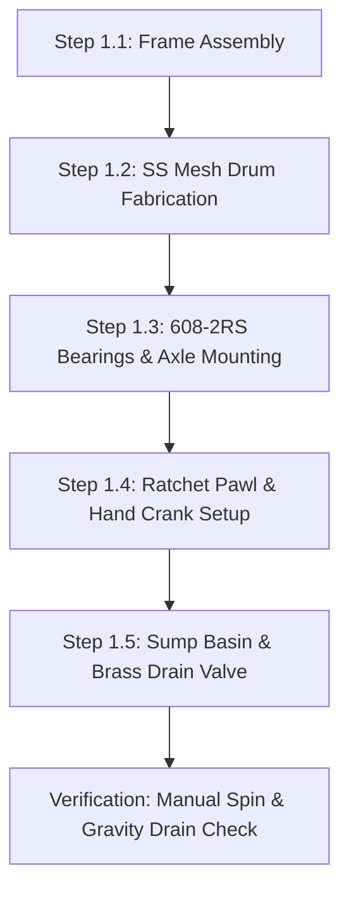

import { Card, CardGrid, LinkButton } from '@astrojs/starlight/components';

## Part 1: Stage Header & Executive Summary

> [!NOTE]
> **Stage Designation:** Stage 0 (Zero-Power Baseline)  
> **Operating Mode:** 100% Mechanical Manual Fallback  
> **Power Consumption:** 0 Watts (Zero Electrical Input Required)  
> **Resilience Rating:** Continuous Off-Grid / EMP / Submersion Proof  
> **Decoupling Standard:** Friction Slip-Clutch / Quick-Release Cam Linkage  

The Stage 0 baseline build of the **Revolving Sprout Bioreactor Drum** is a **100% mechanical, zero-power agricultural machine**. It operates entirely by human leverage, manual hand cranks, counterweights, and gravity flows—providing complete food security and operational continuity during total grid blackouts.

---

## Part 2: Capability Delta (Features Introduced)

* **Zero-Power Resilience**: Operates indefinitely without batteries, solar controllers, or power supplies.
* **Direct Mechanical Leverage**: All actuation performed via hand cranks, manual levers, counterweights, or gravity siphoning.
* **Inherent Decoupling**: Built from the ground up with mechanical slip-clutches, quick-release clamps, or bypass valves to ensure motor upgrades never bind.

---

## Part 3: Isolated Stage 0 Bill of Materials (BOM)

### Base Machine Bill of Materials (BOM)

| Item | Component Description | Sourcing / Part Reference | Qty | Unit Cost | Total Cost |
| :--- | :--- | :--- | :--- | :--- | :--- |
| **B-01** | 2020 T-Slot Black Anodized Extrusion (500mm & 400mm) | Standard structural aluminum | 8 | $3.50 | $28.00 |
| **B-02** | 304 Stainless Steel Perforated Sheet (1.5mm holes, 300x450mm) | McMaster / local sheet supplier | 1 | $42.00 | $42.00 |
| **B-03** | Food-Grade PETG Drum End Flanges & Axle Hubs | 3D printed / local fab | 2 | $6.00 | $12.00 |
| **B-04** | 608-2RS Deep-Groove Sealed Skate Bearings | Precision skate hardware | 4 | $1.50 | $6.00 |
| **B-05** | 8 mm Precision Ground D-Profile Stainless Axle Shaft (550mm) | Motion hardware supplier | 1 | $14.00 | $14.00 |
| **B-06** | Detachable Hand Crank + Ratchet Wheel & Delrin Pawl | 3D printed + torsion spring | 1 | $11.00 | $11.00 |
| **B-07** | Food-Grade Silicone Sump Tray + 3/4" Bulkhead Fitting | Silicone pan + brass fitting | 1 | $12.00 | $12.00 |
| **B-08** | 3/4" Brass Full-Port Manual Ball Valve | Hardware / plumbing supply | 1 | $8.00 | $8.00 |
| **B-09** | Fasteners (M5 T-nuts, M5 corner brackets, M4 tie rods) | Standard stainless hardware pack | 1 | $12.00 | $12.00 |
| **Total** | **Base Zero-Power Machine Build** | **Complete off-grid appliance** | | | **$145.00** |

---

---

## Part 4: Standalone Full SVG Blueprint


---

## Part 5: Step-by-Step Assembly & Operating Protocol

The foundational build of the Revolving Sprout Bioreactor requires **zero electricity, zero microcontrollers, and zero firmware**. It relies strictly on mechanical leverage, sealed ball bearings, a spring-loaded ratchet pawl, and manual gravity drainage. Anyone with basic hand tools can construct, operate, and harvest fresh protein off-grid.

### Mechanical Architecture & Decoupling Standard
1. **Perforated Cylinder & Flanges**: A 300 mm diameter by 450 mm long food-grade 304 stainless steel mesh cylinder (1.5 mm perforations) rotates inside an open 2020 T-slot aluminum frame.
2. **Bearing Support**: Both ends of the drum rest on grease-packed 608-2RS skate bearings housed in rigid pillow blocks, allowing effortless hand spinning even with a 4.0 kg saturated seed load.
3. **Ratchet Pawl Mechanism**: A 12-tooth mechanical ratchet wheel and spring-loaded Delrin pawl lock the drum against counter-rotation and hold it steadily at 45° tilt angles for optimal gravity drainage.
4. **Mechanical Decoupling**: The 8 mm precision ground D-shaft features an integrated ball-detent dog clutch. When motor add-ons are installed later, pulling the clutch pin completely disconnects the motor gearbox, allowing instant zero-drag hand cranking.

```
       REVOLVING SPROUT BIOREACTOR — BASE MECHANICAL ELEVATION
  =================================================================
                    Top Removable Lightproof Hood
         +---------------------------------------------------+
         |                                                   |
         |         [Perforated 304 SS Mesh Drum]             |
         |               (300 mm OD x 450 mm L)              |
         |        .---------------------------------.        |
         |       /                                   \       |
  [Hand] |======|    *   *   *   *   *   *   *   *    |======| [608-2RS]
  Crank  |  ||  |  *   *   (Seed Mass)   *   *   *   |  ||  | Bearing
  Pawl   |--++-- \                                   / --++--| Pillow
  Lock   |        '---------------------------------'        | Block
         |                         |                         |
         |                         v Droplets                |
         |           \---------------------------/           |
         |             \   Silicone Sump Basin /             |
         |               \                   /               |
         |                 +-------+-------+                 |
         |                         |                         |
         |                   [3/4" Brass]                    |
         |                    Ball Valve                     |
         |                         |                         |
         +-------------------------+-------------------------+
                              Gravity Drain
```

### Step-by-Step Fabrication & Assembly Protocol

#### Step 1.1: Chassis Cutting & Extrusion Assembly
1. Cut eight segments of 2020 black-anodized aluminum extrusion: four longitudinal rails at 500 mm and four upright stanchions at 400 mm.
2. Deburr all cut ends and tap center holes to M5 thread depth 15 mm.
3. Assemble the rectangular box chassis using 90° cast aluminum corner brackets and M5 button-head cap screws with roll-in T-nuts. Torque to 4.2 N·m.
4. Verify rectangular squareness using a machinist square across all internal corners ($< 0.5$ mm diagonal variance).

#### Step 1.2: Perforated Mesh Cylinder & Flange Assembly
1. Roll a 304 stainless steel 1.5 mm perforated mesh sheet into a 300 mm outer diameter cylinder (length 450 mm).
2. Lap the seam by 12 mm and secure with 316 stainless steel blind pop rivets spaced every 30 mm.
3. 3D-print or CNC-rout two 300 mm circular end flanges in PETG or food-grade HDPE with a 15 mm perimeter groove.
4. Seat the mesh cylinder into the endcap perimeter grooves using food-grade silicone RTV gasket sealant. Clamp longitudinally with four M4 threaded stainless tie-rods until cured (24 hours).
5. Cut a 150 mm × 100 mm access hatch in the mesh cylinder wall, installing two stainless steel miniature draw latches and a flexible silicone sealing gasket.

#### Step 1.3: Axle Spindle & 608-2RS Bearing Installation
1. Press-fit dual 608-2RS sealed ball bearings into machined aluminum pillow blocks mounted atop the 400 mm upright frame rails.
2. Slide an 8 mm precision-ground stainless steel D-profile shaft through the center flanged hubs of both drum endcaps.
3. Lock the shaft to the drum flanges using M4 stainless grub screws biting directly into the D-flat.
4. Slide shaft ends into the pillow-block bearings and clamp with 8 mm shaft collars, ensuring zero axial play while maintaining effortless rotational spin ($< 0.05$ N·m break-away torque).

#### Step 1.4: Hand Crank & Ratchet Pawl Alignment
1. Mount the 12-tooth Delrin ratchet wheel onto the drive-side D-shaft stub protruding 40 mm past the pillow block.
2. Pivot-mount the spring-loaded Delrin pawl onto the upper aluminum frame rail using an M5 shoulder bolt and torsion spring.
3. Attach the ergonomic detachable hand crank with internal ball-detent collar onto the 8 mm shaft stub.
4. Test crank rotation: clockwise motion must rotate smoothly with audible ratchet clicks; counter-clockwise rotation must lock solidly within 30° of travel.

#### Step 1.5: Sump Funnel & Gravity Drain Installation
1. Form a food-grade silicone or heat-molded PETG catch pan beneath the drum, angled at a 15° slope toward a central sump.
2. Drill a 26 mm hole at the lowest point and install a 3/4" bulkhead fitting with EPDM washers.
3. Thread a 3/4" manual brass full-port ball valve onto the bulkhead fitting.
4. Plumb a short length of food-grade 3/4" braided silicone tubing from the valve outlet to gravity-discharge into a wastewater bucket or garden bed.



### Step-by-Step Operating Runbook (Manual Mode)

1. **Pre-Soak & Seed Loading**: Weigh 800 g of dry, high-germination mung bean seeds. Rinse thoroughly in fresh water, then soak in a clean bowl for 6 to 8 hours. Open the drum's 150 mm access hatch, pour in the swollen seeds, close the hatch, and secure both draw latches.
2. **Morning Tumbling Cycle**: Rotate the hand crank clockwise 5 full revolutions at ~1 RPM. This gently tumbles the seed bed, uncurls tangles, and aerates the root zone without damaging tender hypocotyls. The ratchet pawl prevents the drum from rolling back.
3. **Manual Rinse Application**: Pour 2.0 liters of clean, dechlorinated water through the top lightproof access port directly onto the rotating drum. Crank 2 additional revolutions while pouring to ensure uniform wetting across all seeds.
4. **Gravity Drainage Discharge**: Open the 3/4" brass ball valve beneath the sump basin. Allow all excess rinse water to drain completely for 3 minutes. *Crucial: Never allow seeds to sit submerged in standing water, which induces anaerobic rot and fungal contamination.* Close the ball valve.
5. **Midday Inspection & Aeration**: Rotate the drum 3 revolutions at noon. The mechanical ratchet allows locking the drum at a 45° offset angle, promoting residual gravity drainage away from newly emerged shoots.
6. **Evening Tumbling & Rinse**: Repeat Step 2 and Step 3 at 18:00 (5 revolutions + 2.0 L rinse + full gravity drain).
7. **96-Hour Harvest Protocol**: On day 4, open the access hatch, position a clean food tote beneath the drum, rotate the drum 180° downward, and tap the mesh to release ~3.5 kg of crisp, sweet hypocotyls. Spray the empty drum with boiling water or 3% food-grade hydrogen peroxide before reloading.

---

## Part 6: Guided Stage Navigation

<CardGrid>
  <Card title="Subsystem Overview" icon="left-arrow">
    Return to the machine overview, crop affinity matrix, and multi-stage comparison.
    <br/><br/>
    <LinkButton href="/open-biosphere/hardware/revolving-sprout-bioreactor/" variant="minimal">← Return to Overview</LinkButton>
  </Card>
  <Card title="Stage 1: BLE Electromechanical Pack" icon="right-arrow">
    Ready to motorize this machine? Upgrade with DC actuation and Flutter BLE Virtual Panel controls.
    <br/><br/>
    <LinkButton href="/open-biosphere/hardware/revolving-sprout-bioreactor/stage-1/" variant="primary">Proceed to Stage 1 Upgrade →</LinkButton>
  </Card>
</CardGrid>
