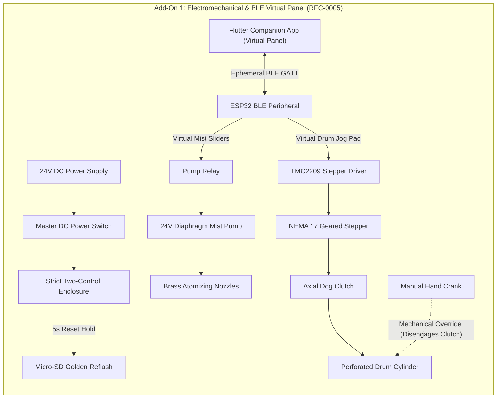

import { Card, CardGrid, LinkButton } from '@astrojs/starlight/components';

## Part 1: Stage Header & Executive Summary

> [!NOTE]
> **Stage Designation:** Stage 1 (Semi-Autonomous Electromechanical Pack)  
> **Operating Mode:** DC Motorized Continuous Duty with Ephemeral BLE Virtual Panel  
> **Power Requirement:** 12V / 24V DC Industrial Bus  
> **Physical Interlocks:** Strict Two-Control Standard (Master DC Cut + Recessed SD Factory Restore)  
> **Operator Interface:** Ephemeral Flutter Mobile Companion App over BLE GATT  

The Stage 1 electromechanical pack motorizes the **Revolving Sprout Bioreactor Drum**, adding continuous DC motor/pump drive governed by the **Strict Two-Control Physical Standard** (RFC-0005) and an ephemeral **Flutter Companion App Virtual Panel** over direct local BLE.

---

## Part 2: Capability Delta (Features Introduced)

* **Continuous Motorized Actuation**: Replaces human manual cranking with high-efficiency DC gearmotors, steppers, or booster pumps.
* **Strict Two-Control Physical Standard**: Eliminates physical jog buttons and potentiometer dials to prevent moisture breach and priority race conditions. Only Master DC Switch and Recessed SD Reset Button are permitted on hardware.
* **Ephemeral BLE Virtual Panel**: Jogging, speed sliders, and priming pulses execute via the Flutter companion app over direct local BLE GATT.
* **100% Preserved Manual Fallback**: Slip-clutches, bypass valves, or belt releases guarantee instant zero-power manual hand operation without disassembly.

---

## Part 3: Isolated Stage 1 Bill of Materials (BOM)

### Add-On 1 Bill of Materials (BOM)

| Item | Component Description | Sourcing / Part Reference | Qty | Unit Cost | Total Cost |
| :--- | :--- | :--- | :--- | :--- | :--- |
| **A1-01** | NEMA 17 Planetary Geared Stepper (5.18:1, 1.8 N·m) | Standard motion supplier | 1 | $24.00 | $24.00 |
| **A1-02** | GT2 60T/20T Aluminum Pulley Set + 6mm Neoprene Belt | 3D printer drive hardware | 1 | $9.00 | $9.00 |
| **A1-03** | Axial Spring-Loaded Dog Clutch Sliding Mechanism | Machined aluminum / 3D PETG | 1 | $14.00 | $14.00 |
| **A1-04** | 24V DC 100 PSI Diaphragm Mist Pump (1.2 L/min) | Hydroponics mist supplier | 1 | $32.00 | $32.00 |
| **A1-05** | Brass 0.3mm Atomizing Misting Nozzles + 1/4" Fittings | High-pressure fogging kit | 2 | $5.00 | $10.00 |
| **A1-06** | Strict Two-Control Enclosure (Master DC Switch + SD Reset + Micro-SD Module + 0.91" OLED) | Electrical enclosure kit | 1 | $22.00 | $22.00 |
| **A1-07** | ESP32 BLE Virtual Panel Controller + TMC2209 Driver | Standard maker electronics | 1 | $18.00 | $18.00 |
| **A1-08** | 24V 2.5A (60W) Desktop Industrial Power Supply | Mean Well or equivalent | 1 | $18.00 | $18.00 |
| **Total** | **Add-On 1 Electromechanical Pack** | **Retrofits directly to Base** | | | **+$147.00** |
| **Cumul.** | **Operational Semi-Autonomous Bioreactor** | **Base ($145) + Add-On 1 ($147)** | | | **$292.00** |

---

---

## Part 4: Standalone Full SVG Blueprint


### Add-On 1 Electromechanical Wiring & BLE Virtual Panel Blueprint

```text
========================================================================================
ADD-ON 1 ELECTROMECHANICAL SCHEMATIC & BLE VIRTUAL PANEL BLUEPRINT
Strict Two-Control Physical Standard (RFC-0005) with Ephemeral Flutter BLE Control
========================================================================================

   [24V DC 60W PSU] ──[Master DC Power Switch]──┬── (24V Power Bus)
                                                └── (GND Return Bus)
                                                          │
   ┌──────────────── STRICT TWO-CONTROL JUNCTION BOX ──────────────────┐│
   │                                                                   ││
   │  [Master DC Power Switch]      ["Nuke & Pave" SD Reset Button]    ││
   │   Inline Mechanical Cut         Recessed Tactile Switch (5s hold) ││
   │                                                                   ││
   │  [Micro-SD Card Slot Module]   [0.91" I2C Status OLED Display]    ││
   │   Preloaded golden .bin         Displays [SPROUT-A1 | BLE READY]  ││
   │                                                                   ││
   │  [ESP32 BLE GATT Peripheral] ◄─── (Ephemeral Mobile Link) ───────┼│
   └───────────────────┬───────────────────────────────────────────────┘│
                       │                                                │
                       ▼ (TMC Driver & Pump Relay Signals)              │
   ┌────────────────── DRIVE TRAIN & PUMP ─────────────────────────────┐│
   │                                                                   ││
   │  24V DC 100 PSI Diaphragm Pump ◄── High-Current Relay ────────────┘│
   │         │                                                          │
   │         ▼ (Pressure Line)                                          │
   │  [Dual 0.3mm Brass Mist Nozzles]                                   │
   │                                                                    │
   │  NEMA 17 Planetary Stepper Motor ◄── TMC2209 Silent Driver ────────┘
   │         │
   │         ▼ (Motor Output Shaft)
   │     ┌───────┐
   │     │ ░░░░░ │ Axial Sliding Dog Clutch
   │     └───────┘ [PULL TO DISENGAGE MOTOR FOR MANUAL HAND CRANK]
   │         │
   │         ▼ (Drum Axle)
   │   [Perforated Drum Cylinder]
   └───────────────────────────────────────────────────────────────────┘
========================================================================================
```

---

## Part 5: Step-by-Step Retrofit, Wiring & Operating Protocol

Under [RFC-0005](/rfcs/rfc-0005-hardware-interlocks-ble-virtual-panel), physical control panels with dedicated jog buttons, countdown dials, and switches are banned to prevent water ingress and control priority conflicts. 

The **Semi-Autonomous Pack** motorizes tumbling and misting under the **Strict Two-Control Physical Standard**:
1. **Master Hardware DC Power Switch**: Mechanically disconnects 24V power.
2. **"Nuke & Pave" SD Factory Restore Button**: Dedicated recessed tactile switch that triggers an automatic hardware re-flash from micro-SD storage.

All manual jogging, inspection rotations, and mist timing adjustments are executed via the **Flutter Companion App Virtual Panel** over direct local BLE.

### Electromechanical Actuation Architecture & Decoupling
- **Drive Motor**: NEMA 17 planetary geared stepper motor (5.18:1 ratio, 1.8 N·m output torque) driving a GT2 6 mm timing belt (60T drum pulley, 20T motor pulley).
- **Mechanical Decoupling**: A spring-loaded dog clutch slides axially on the 8 mm D-shaft. Pulling the knurled collar disengages the motor drive dogs, allowing instant hand-crank manual operation without back-powering drivers.
- **Pressurized Misting**: A 24V DC diaphragm pump pressurizes an inline manifold to 100 PSI, delivering a 50 µm atomized fog through two 0.3 mm brass orifice nozzles directly into the drum core.
- **Strict Two-Control Enclosure**: An IP65 junction box on the frame rail contains:
  - Heavy-duty toggle switch directly isolating 24V DC master power.
  - Recessed tactile button next to the 0.91" I2C OLED display for 5-second SD recovery reflash.
  - Micro-SD card slot module pre-loaded with golden recovery `firmware.bin` and `config.default`.
- **Ephemeral BLE Virtual Panel**: Operators open the Flutter companion app on their phone or tablet. The app auto-discovers the bioreactor over BLE GATT and presents virtual touch controls: Drum Jog Touch Pad, Mist Pulse Duration slider (5 to 60 sec), and Tumble Interval slider (5 to 60 min).

### Step-by-Step Retrofit Protocol

```text
Step 2.1: Stepper Motor & Belt Drive Bracket Mounting
  ├── Bolt slotted NEMA 17 motor bracket to rear vertical 2020 extrusion using M5 drop-in T-nuts.
  ├── Mount NEMA 17 planetary geared motor with its 20T GT2 aluminum pulley facing inward.
  ├── Slide 60T GT2 drum pulley onto 8mm D-shaft between pillow block and drum endcap.
  └── Route 6mm GT2 timing belt between pulleys; tension until 5mm deflection occurs at 2N pressure.

Step 2.2: Dog Clutch Retrofit on Main D-Shaft
  ├── Install sliding dog clutch sleeve between 60T pulley hub and axle shaft collar.
  ├── Verify axial sliding action: when engaged, teeth lock pulley to shaft; when pulled, shaft spins freely.
  └── Retain manual hand crank on outer shaft stub for instant mechanical fallback.

Step 2.3: Diaphragm Misting Pump & Atomizing Manifold
  ├── Mount 24V DC diaphragm mist pump (100 PSI, 1.2 L/min) to lower chassis rail with rubber grommets.
  ├── Plumb 1/4" polyurethane pressure line to brass tee fitting inside top hood.
  ├── Install two 0.3mm anti-drip brass atomizing misting nozzles angled at 45° across seed bed.
  └── Plumb pump inlet to external water reservoir with inline 80-mesh stainless suction filter.

Step 2.4: Two-Control Enclosure Assembly
  ├── Mount IP65 electrical junction box to side frame rail.
  ├── Install master heavy-duty DC power switch on positive power input lead.
  ├── Install recessed tactile button wired to secondary bootloader recovery GPIO pin.
  ├── Insert micro-SD slot module pre-loaded with golden firmware.bin and config.default.
  └── Mount 0.91" I2C OLED display showing [SPROUT-A1 | BLE READY].

Step 2.5: Driver, BLE Controller & Grounding Verification
  ├── Wire TMC2209 silent stepper driver and mist pump relay to ESP32 BLE peripheral controller.
  ├── Wire chassis aluminum frame to earth ground through fused IEC power inlet.
  ├── Verify BLE GATT service advertises [SPROUT-VIRTUAL-PANEL] upon power-up.
  └── Test dog clutch: pulling collar disengages motor, allowing smooth zero-power hand cranking.
```

### Step-by-Step BLE Virtual Panel Operating Runbook

1. **System Power-Up**: Flip the master DC power toggle to ON. The 0.91" OLED illuminates: `[SPROUT-A1 | BLE STANDBY]`.
2. **Walk-Up BLE Virtual Panel Connection**: Open Flutter companion app on mobile device. Connect to `SPROUT-A1`. The app renders the Bioreactor Virtual Panel.
3. **Drum Loading via Virtual Jog Pad**: Open drum access hatch. Tap and hold the **Virtual Jog Pad** to rotate drum until hatch faces vertically upward. Release pad (drum stops instantly). Load 800 g soaked seeds and latch hatch.
4. **Automated Tumbling & Misting Configuration**: Adjust virtual sliders in Flutter app: set Tumble Interval to 15 minutes, set Mist Duration to 30 seconds. The controller commits schedule to local memory.
5. **Mid-Cycle Observation Jog**: To inspect sprout development, open Flutter app and tap the Jog Pad to rotate inspection port into view without resetting cycle timers.
6. **"Nuke & Pave" SD Recovery Protocol**: If firmware hangs, hold the physical recessed reset button for 5 seconds during power-on. The bootloader reflashes factory baseline firmware from micro-SD in 4 seconds.
7. **Zero-Power Fallback Override**: If off-grid power is lost, pull dog clutch collar outward and slide hand crank onto shaft. Resume manual tumbling and misting without dismounting motor or belt.


### Add-On 1 Signal & Override Flow



---

## Part 6: Guided Stage Navigation

<CardGrid>
  <Card title="Stage 0: Zero-Power Baseline" icon="left-arrow">
    Review the underlying manual chassis, fabrication tolerances, and mechanical fallback linkage.
    <br/><br/>
    <LinkButton href="/open-biosphere/hardware/revolving-sprout-bioreactor/stage-0/" variant="minimal">← Previous: Stage 0 Baseline</LinkButton>
  </Card>
  <Card title="Stage 2: Agentic Autonomous AI Pack" icon="right-arrow">
    Ready for full closed-loop autonomy? Integrate the Controller-Node-Tool mesh and local neural vision.
    <br/><br/>
    <LinkButton href="/open-biosphere/hardware/revolving-sprout-bioreactor/stage-2/" variant="primary">Proceed to Stage 2 Upgrade →</LinkButton>
  </Card>
</CardGrid>
