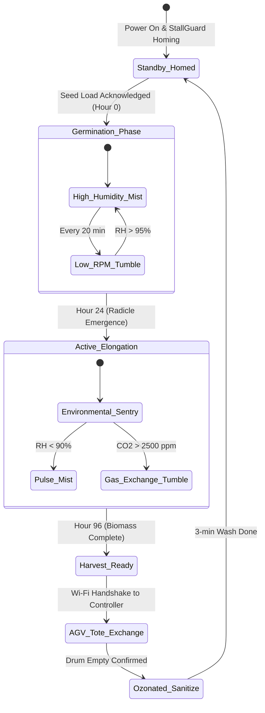

import { Card, CardGrid, LinkButton } from '@astrojs/starlight/components';

## Part 1: Stage Header & Executive Summary

> [!NOTE]
> **Stage Designation:** Stage 2 (Agentic Autonomous AI Pack)  
> **Operating Mode:** 24/7 Closed-Loop Autonomous Neural Telemetry & Robotics  
> **Network Mesh:** Encrypted Isolated Farm Wi-Fi (<code>POTFRM-4096</code> on 192.168.42.0/24) + BLE Tool Downlinks  
> **Safety Interlocks:** 250ms Hardware Deadman Watchdogs on all Edge Tools  
> **Edge AI Engine:** <code>llama-cpp-python</code> Local GGUF Multimodal Vision (Zero Cloud Dependence)  

The Stage 2 agentic pack elevates the **Revolving Sprout Bioreactor Drum** into a fully autonomous cyber-physical robotics cell operating under the **Controller-Node-Tool (CNT)** standard (RFC-0004) and **Agnostic Controller Runtime** (RFC-0006).

---

## Part 2: Capability Delta (Features Introduced)

* **Controller-Node-Tool (CNT) Hierarchy**: Heavy neural perception runs on the Central Biosphere Controller; the Machine Node coordinates local kinematics; tiny Edge Tools drive motors 1:1.
* **Isolated Farm AP Mesh**: Secure, air-gapped local Wi-Fi (<code>POTFRM-&lt;CLUSTER_ID&gt;</code> on <code>192.168.42.0/24</code>) with WebSocket node registration at <code>ws://192.168.42.1:8443/register</code>.
* **250ms Hardware Deadman Watchdogs**: Every Tool trips into safe, high-Z, zero-power state within 250 ms if signal is interrupted.
* **Local Zero-Cloud Edge AI**: Multi-agent perception via <code>llama-cpp-python</code> local vision models without internet dependencies.

---

## Part 3: Isolated Stage 2 Bill of Materials (BOM)

### Add-On 2 Bill of Materials (BOM)

| Item | Component Description | Sourcing / Part Reference | Qty | Unit Cost | Total Cost |
| :--- | :--- | :--- | :--- | :--- | :--- |
| **A2-01** | Sprout Machine Node: ESP32-S3 (8MB PSRAM) + 0.96" OLED + Master DC Cut + SD Reset & Micro-SD Module | Espressif distributor | 1 | $14.00 | $14.00 |
| **A2-02** | Trinamic TMC2209 Silent Stepper Driver (UART/StallGuard) | 3D printer electronics supplier | 1 | $8.00 | $8.00 |
| **A2-03** | Sensirion SHT40 Temp/RH Probe + 1x ESP32-C3 Climate Tool | Precision sensor distributor | 1 | $15.00 | $15.00 |
| **A2-04** | 12V 200mg/h Corona Ozone Generator + Diffuser Stone | Compact ozone module supplier | 1 | $19.00 | $19.00 |
| **A2-05** | 2x ESP32-C3 Modular Tools with 0.42" OLED & 250ms Watchdog (Drum & Mist) | Microcontroller supplier | 2 | $7.00 | $14.00 |
| **A2-06** | Neodymium Magnetic Alignment Docking Latch + Solenoid | Robotics latch supplier | 1 | $14.00 | $14.00 |
| **A2-07** | Custom Wire Harness & AprilTag Optical Alignment Plate | 22 AWG silicone + laser target | 1 | $5.00 | $5.00 |
| **Total** | **Add-On 2 Agentic Autonomous Pack (CNT Standard)** | **Expands Base + Add-On 1** | | | **+$89.00** |
| **Full Build** | **Complete Autonomous Biosphere Bioreactor** | **Base + Add-On 1 + Add-On 2** | | | **$381.00** |

---

---

## Part 4: Standalone Full SVG Blueprint


---

## Part 5: Step-by-Step Commissioning, Provisioning & Autonomous Runbook

Under [RFC-0004](/rfcs/rfc-0004-controller-node-tool) and [RFC-0006](/rfcs/rfc-0006-agnostic-controller-runtime), the **Agentic Autonomous AI Pack** transforms the bioreactor into a hierarchical **Controller-Node-Tool (CNT)** production cell. The bioreactor operates as a dedicated **Sprout Node** commanding modular **Edge Tools** over BLE, receiving automated 96-hour growth recipes and sanitization cycles from the Central Biosphere Controller over encrypted Wi-Fi.

### Autonomous Vision & Telemetry Architecture
- **Sprout Machine Node (ESP32-S3)**: Dual-Core Xtensa LX7 (240 MHz, 8 MB PSRAM) with an onboard 0.96" I2C OLED screen (`[NODE: SPROUT-01 | LINK -> 4096]`) and physical setup button. It maintains a secure Wi-Fi client uplink to the Central Controller and acts as a local BLE Central manager.
- **Dedicated Modular Edge Tools (ESP32-C3)**: Actuators and sensors are driven 1:1 by tiny ESP32-C3 micro-controllers equipped with 0.42" micro OLED displays and **250ms hardware deadman watchdogs**:
  - `DEV_DRUM_STEP`: Micro ESP32-C3 with 0.42" OLED (`TOOL: DRUM_STEP | LINK: OK`) + 250ms watchdog driving a Trinamic TMC2209 silent driver in UART mode with Sensorless StallGuard homing.
  - `DEV_MIST_SOL`: Micro ESP32-C3 with 0.42" OLED (`TOOL: MIST_SOL | LINK: OK`) + 250ms watchdog governing misting pump and gravity drain solenoids.
  - `DEV_OZONE_GEN`: Micro ESP32-C3 with 0.42" OLED (`TOOL: OZONE_GEN | LINK: OK`) + 250ms watchdog driving the 12V 200 mg/h corona-discharge ozone generator.
  - `DEV_CLIMATE_SNS`: Micro ESP32-C3 with 0.42" OLED (`TOOL: CLIMATE_SNS | LINK: OK`) reading the Sensirion SHT40 relative humidity ($\pm 1.5\%$) and temperature ($\pm 0.1^\circ\text{C}$) exhaust probe.
- **250ms Deadman Watchdog Fail-Safe**: If any Tool loses BLE connection to the Sprout Node for $> 250$ ms, it drops immediately into high-Z safe state: stepper current cuts to zero holding torque, solenoids snap closed, and the ozone generator shuts off immediately.
- **Robotic Biosphere Interlock**: Magnetic alignment latch and retroreflective optical AprilTag fiducial marker for automated docking with the Ground Track AGV pod carrier.

```text
       CONTROLLER-NODE-TOOL (CNT) HIERARCHICAL EDGE ARCHITECTURE
  =================================================================
            CENTRAL BIOSPHERE CONTROLLER (Agnostic Runtime / POTFRM-4096)
            • Emits Isolated Farm AP: SSID [POTFRM-4096] (192.168.42.0/24)
            • Global Growth Schedules & Multi-Agent AGV Logistics
                                  │
                                  │ Isolated Farm Wi-Fi (192.168.42.0/24)
                                  ▼
             ┌─────────────────────────────────────────┐
             │       SPROUT MACHINE NODE (ESP32-S3)    │
             │  • OLED Display: [NODE: SPROUT-01]     │
             │  • Setup Push-Button for Mobile BLE     │
             │  • FreeRTOS Subsystem Orchestrator      │
             └────────────────────┬────────────────────┘
                                  │
         ┌────────────────────────┼────────────────────────┐
         │ BLE Downlink           │ BLE Downlink           │ BLE Downlink
         ▼                        ▼                        ▼
 ┌───────────────┐        ┌───────────────┐        ┌───────────────┐
 │ TOOL:         │        │ TOOL:         │        │ TOOL:         │
 │ DEV_DRUM_STEP │        │ DEV_MIST_SOL  │        │ DEV_OZONE_GEN │
 │ ESP32-C3 Micro│        │ ESP32-C3 Micro│        │ ESP32-C3 Micro│
 │ 0.42" OLED    │        │ 0.42" OLED    │        │ 0.42" OLED    │
 │ 250ms Deadman │        │ 250ms Deadman │        │ 250ms Deadman │
 │ TMC2209 Silent│        │ Mist Solenoid │        │ Corona Ozone  │
 └───────────────┘        └───────────────┘        └───────────────┘
                                  │
                                  ▼ (BLE Downlink)
                          ┌───────────────┐
                          │ TOOL:         │
                          │ DEV_CLIMATE   │
                          │ ESP32-C3 Micro│
                          │ 0.42" OLED    │
                          │ SHT40 Temp/RH │
                          └───────────────┘
```

### Step-by-Step Sensor Commissioning & Edge AI Protocol

#### Step 3.1: Sprout Node & Tool Carrier Board Assembly
1. Mount the ESP32-S3 Node with 0.96" I2C OLED and physical setup button onto the DIN rail carrier base inside the control enclosure.
2. Mount the modular ESP32-C3 Edge Tool boards (`DEV_DRUM_STEP`, `DEV_MIST_SOL`, `DEV_OZONE_GEN`, `DEV_CLIMATE`) with 0.42" micro OLED screens on the lower rail.
3. Wire the TMC2209 silent stepper driver to `DEV_DRUM_STEP` via UART (DIAG pin jumpered for sensorless StallGuard homing).

#### Step 3.2: SHT40 Environmental Probe Integration
1. Mount the Sensirion SHT40 probe inside an aspirated, lightproof flue adapter on the drum's exhaust vent.
2. Wire SHT40 via shielded 4-wire cable to `DEV_CLIMATE_SNS` tool I2C bus with $4.7\text{ k}\Omega$ pull-up resistors.
3. Verify telemetry readings on tool OLED screen: ambient RH and temperature report accurately.

#### Step 3.3: Corona Ozone Generator & Diffusion Loop
1. Mount the 12V 200 mg/h corona-discharge ozone generator module in an isolated compartment of the enclosure.
2. Route silicone ozone-rated tubing from the ozone discharge port through a check valve into the mist water reservoir's ceramic diffuser stone.
3. Wire the ozone module and internal aeration pump to `DEV_OZONE_GEN` tool output relay.

#### Step 3.4: Magnetic AGV Docking Latch & Optical Target
1. Bolt a neodymium magnetic alignment latch (150 N holding force) to the chassis front lower rail ($Z = 120$ mm datum).
2. Install a high-contrast AprilTag 36h11 fiducial marker directly above the access hatch for AGV machine vision recognition.
3. Wire the magnetic latch release solenoid to `DEV_MIST_SOL` tool secondary channel.

#### Step 3.5: Provisioning & 250ms Watchdog Verification
1. Power on Central Controller; verify active Cluster ID on OLED, terminal stdout, or BLE beacon (`POTFRM-4096`).
2. Power on Sprout Node; display shows `[NODE UNPAIRED - PAIR VIA BLE]`.
3. Press physical setup button on Node; connect via mobile companion app over BLE, enter `4096`.
4. Node commits credentials to NVS, links to `POTFRM-4096`, registers at `ws://192.168.42.1:8443/register`, and updates display to `[ONLINE | LINK -> 4096]`.
5. Verify Node auto-discovers and binds all four BLE Tools.
6. Test fail-safe watchdog: drop BLE link to `DEV_DRUM_STEP`; verify stepper current immediately cuts to 0.0A in $< 250$ ms.



### Step-by-Step Autonomous Multi-Agent Runbook

1. **Pre-Flight Self-Test & StallGuard Homing**: On boot, the Sprout Node queries its bound BLE Tools. It commands `DEV_DRUM_STEP` to rotate the drum at 0.5 RPM until Trinamic StallGuard detects the mechanical stop, indexing the 150 mm hatch position precisely at $0.0^\circ$.
2. **Day 1 Adaptive Germination**: For the first 24 hours, the Node executes the dark photophobic recipe from the Central Controller. It signals `DEV_MIST_SOL` to pulse misting for 12 seconds every 18 minutes, and commands `DEV_DRUM_STEP` to tumble 1 revolution to coat seeds uniformly in an ultra-fine water film.
3. **Day 2–3 Closed-Loop Elongation Control**: `DEV_CLIMATE_SNS` continuously relays chamber humidity and transpiration rate. If relative humidity drops below 92%, the Node triggers immediate misting. If transpiration heat causes chamber temperature to rise $> 24.5^\circ\text{C}$, the Node commands a 3-revolution tumble and opens the exhaust damper for evaporative cooling.
4. **Automated AGV Handshake & Harvest**: At Hour 96, the Node flags harvest readiness to the Central Controller over Wi-Fi. The Central Controller dispatches the Ground Track AGV. When the AGV docks, the bioreactor rotates the hatch to $180^\circ$ (downward) and actuates the latch release solenoid, dumping ~3.5 kg of prime hypocotyls directly into the AGV transport tote.
5. **Post-Harvest Ozonated Sanitation Wash**: Immediately following harvest confirmation, the Node signals `DEV_OZONE_GEN`, running the corona ozone generator and mist pump for 3 minutes. Ozonated water (0.4 ppm dissolved $O_3$) blankets every mesh pore, destroying fungal spores and bacteria with zero chemical residue.
6. **250ms Fail-Safe Watchdog Protocol**: If BLE communication between Node and any Tool drops for $> 250$ ms, that Tool trips into high-Z safe state. If Wi-Fi link to Central Controller is lost, the Node continues the current 96-hour stage timer autonomously.

---

## Part 6: Guided Stage Navigation

<CardGrid>
  <Card title="Stage 1: BLE Electromechanical Pack" icon="left-arrow">
    Review the motorized powertrain, Two-Control enclosure wiring, and BLE Virtual Panel.
    <br/><br/>
    <LinkButton href="/open-biosphere/hardware/revolving-sprout-bioreactor/stage-1/" variant="minimal">← Previous: Stage 1 Upgrade</LinkButton>
  </Card>
  <Card title="Subsystem Overview" icon="right-arrow">
    Return to the machine overview, crop affinity matrix, and master biosphere interlocks.
    <br/><br/>
    <LinkButton href="/open-biosphere/hardware/revolving-sprout-bioreactor/" variant="primary">Return to Overview →</LinkButton>
  </Card>
</CardGrid>
