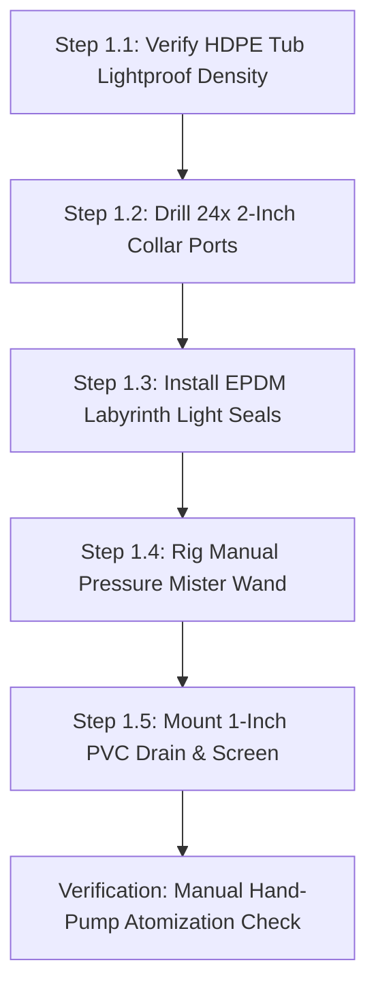
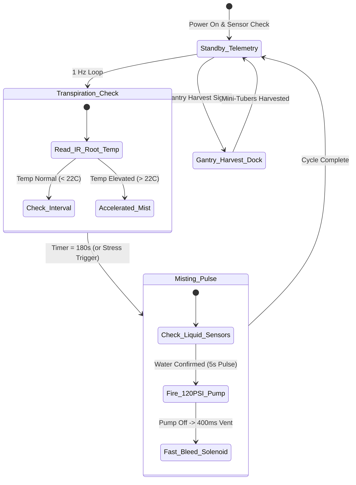

import { Card, CardGrid } from '@astrojs/starlight/components';

The **TPS Aeroponic Root-Zone Chamber** is a high-yield, disease-free mini-tuber production appliance. Engineered to eliminate soil pathogens and heavy substrate handling, it can be constructed as an independent homestead seed-potato propagator or integrated into the Central Basin of the master Open Biosphere assembly.

---

## 1. Standalone Homesteading & Off-Grid Utility

Traditional seed potatoes require disease-prone clonal tubers that degrade over generations and demand large soil footprints. This machine enables homesteaders to germinate **True Potato Seed (TPS)**—tiny botanical seeds weighing 1/1000th of a tuber—and produce clean, pathogen-free mini-tubers continuously in a compact footprint:

<CardGrid>
  <Card title="Botanical Seed Propagation" icon="seed">
    Grow clean potatoes from compact, indefinitely shelf-stable botanical seeds instead of hauling 50-pound bags of perishable seed tubers.
  </Card>
  <Card title="Non-Destructive Harvesting" icon="hands">
    Selective root chamber access allows pickers to harvest walnut-sized mini-tubers one at a time while leaving the vine productive for 120+ days.
  </Card>
  <Card title="Zero Chlorophyll / Solanine" icon="moon">
    Dual-labyrinth EPDM light seals keep root zones below 0.05 lux, completely preventing green solanine toxins from accumulating in growing tubers.
  </Card>
  <Card title="Closed Misting Conservation" icon="droplet">
    Ultrasonic atomizers suspend nutrient mist directly on bare roots, saving 95% of water compared to traditional in-ground potato hills.
  </Card>
</CardGrid>

---

## 2. Technical Specifications

| Parameter | Specification |
| :--- | :--- |
| **Chassis Dimensions** | 1,200 mm (L) × 800 mm (W) × 650 mm (H) |
| **Planting Density** | 12 to 18 TPS root collars per square meter (24 plants per chamber) |
| **Misting Cycle** | 5 seconds pulse every 3 minutes (closed-loop timer) or manual pump |
| **Droplet Size** | 30 to 50 µm high-pressure atomization |
| **Operating Pressure** | 80 to 120 PSI high-pressure line or manual hand-pump garden wand |
| **Light Ingress** | Less than 0.05 lux (tested via dual EPDM foam labyrinth seals) |
| **Harvest Yield** | 40 to 60 mini-tubers (15–35g each) per plant over a 120-day cycle |
| **Power Consumption** | 0W (Manual) / 45W avg (Add-On 1) / 58W peak (Add-On 2) |
| **Controller Architecture**| Manual Hand-Pump / Spring-Wound Dial Timer / ESP32-C3 Transpiration Node |

---

## 3. Instructions (Base Zero-Power Machine)

The foundational build of the TPS Aeroponic Root-Zone Chamber is a **100% mechanical, zero-power root-misting enclosure**. Using a heavy-duty food-grade 160L HDPE tote, pre-drilled neoprene clone collars, a manual 2-gallon pressure garden sprayer with brass atomizing wand, and dual-labyrinth EPDM light seals, it enables complete off-grid cultivation of disease-free seed potatoes without electrical pumps or timers.

### Mechanical Architecture & Decoupling Standard
1. **Opaque 160L HDPE Tub**: Black UV-stabilized virgin polyethylene prevents all external light transmission ($< 0.05$ lux interior), halting solanine toxin synthesis in developing tubers.
2. **Neoprene Clone Collar Lid**: 24 pre-drilled 50 mm ports fitted with slit neoprene collars support potato vines securely while allowing bare stolon roots to hang freely in air.
3. **Double-Labyrinth Light Seals**: EPDM foam weatherstripping and overlapping silicone light flaps line the lid rim and inspection side-hatch, allowing operators to reach in and pluck ripe mini-tubers without exposing roots to daylight.
4. **Mechanical Decoupling Standard**: Sidewall dual-port silicone pass-through grommets allow the manual garden wand to be inserted and operated even while electric misting lines are installed. If power fails, growers simply pump the garden sprayer by hand and mist roots without opening the lid.

```
       TPS AEROPONIC ROOT-ZONE CHAMBER — BASE MECHANICAL ELEVATION
  =================================================================
               [Potato Canopy Foliage in Ambient Light]
                     \         |         /
           ===========+========+========+===========
           [Lid: 24x 2" Neoprene Clonal Foam Collars]
           ===========+========+========+===========
                      | (Stolon Roots) |
         +------------+----------------+------------+
         |                                          |
         |         /--------------------\           |
  [Hand] |========|    *  (Mini-Tubers) * |          | [Side Access]
  Pump   |  Wand  |  *     (Bare Roots)   |          | Baffled Hatch
  Mister |        |   *    *    *    *    |          | (EPDM Labyrinth)
         |         \--------------------/           |
         |                   |                      |
         |                   v Droplets             |
         |                                          |
         |      \----------------------------/      |
         |        \   V-Bottom Drain Sump  /        |
         |          +------------+-------+          |
         |                       |                  |
         |                [1" PVC Bulkhead]         |
         |                   Drain Valve            |
         +-----------------------+------------------+
                            Gravity Drain
```

### Step-by-Step Fabrication & Assembly Protocol

#### Step 1.1: Tub Preparation & Lightproof Inspection
1. Select a heavy-duty, food-grade 160-liter opaque black HDPE storage tote (approx 1,200 × 800 × 650 mm).
2. Clean the interior thoroughly with hot water and baking soda to remove any mold release agents.
3. Place a 500-lumen inspection flashlight inside the sealed tub in a dark room; verify zero light leaks through the plastic walls or corners.

#### Step 1.2: Lid Hole-Sawing & Neoprene Collar Seating
1. Mark a 6 × 4 grid of 24 hole centers spaced 150 mm apart across the tote lid.
2. Cut 50 mm (2-inch) circular holes using a sharp bi-metal hole saw at low drill speed (300 RPM) to prevent plastic melting.
3. Deburr each hole edge with a swivel deburring blade.
4. Insert 2-inch slit neoprene cloning collars into each port, ensuring a snug friction fit that holds vine stems securely without pinching vascular tissue.

#### Step 1.3: EPDM Labyrinth Seal & Baffled Hatch Fabrication
1. Adhere high-density closed-cell EPDM rubber foam weatherstripping (12 mm wide × 8 mm thick) along the entire top rim of the tub.
2. Cut a 250 × 200 mm rectangular side-access inspection hatch in the front wall 300 mm above the base.
3. 3D-print or rivet a dual-baffle overlapping black silicone flap frame over the hatch, allowing human hand insertion while blocking light entry.

#### Step 1.4: Manual Pressure Sprayer & Wand Rigging
1. Assemble a standard 2-gallon hand-pump garden pressure sprayer with Viton chemical seals.
2. Install a fine brass atomizing misting nozzle (0.3 mm orifice, 45° hollow-cone spray) on the end of a rigid 600 mm wand.
3. Drill two 14 mm holes through the side wall at $Z = 350$ mm and install split-silicone pass-through grommets that seal snugly around the wand shaft.

#### Step 1.5: Bulkhead Drain & Sediment Trap Installation
1. Drill a 38 mm hole at the lowest point of the tub base.
2. Install a 1-inch PVC threaded bulkhead fitting with heavy-duty EPDM rubber sealing washers.
3. Thread a 1-inch manual PVC ball valve onto the bulkhead exterior, and clamp a fine 40-mesh stainless steel sediment catch screen over the interior drain inlet to trap sloughed root hairs.



### Step-by-Step Operating Runbook (Manual Mode)

1. **Seedling Germination & Collar Planting**: Germinate True Potato Seed (TPS) in rockwool plugs until seedlings develop 4 true leaves. Slip the rockwool plug into a 2-inch neoprene collar and seat firmly into the lid.
2. **Nutrient Solution Preparation**: Fill the 2-gallon manual sprayer with balanced vegetative nutrient solution (EC 1.4 mS/cm, pH 5.8). Pump the handle 20 strokes to pressurize the tank to 40 PSI.
3. **Morning Root Misting**: Insert the brass wand through the side silicone grommet. Depress the wand trigger, sweeping the atomizing mist across all 24 root zones for 30 seconds until bare roots are thoroughly coated with droplets.
4. **Midday Hydration & Aeration**: Repeat the 30-second misting sweep at 13:00. Inspect root tips through the side baffled hatch; healthy aeroponic roots should display crisp white elongation with dense absorbent root hairs.
5. **Evening Hydration**: Repeat the 30-second misting sweep at 18:00.
6. **Drain Sediment Check**: Open the 1-inch bottom PVC valve for 30 seconds to drain runoff liquid into a return reservoir; inspect the mesh screen for root hair buildup and rinse if needed.
7. **Non-Destructive Harvesting**: At Day 60–90, reach through the baffled side hatch. Locate mature walnut-sized mini-tubers (15–35 g) on lateral stolons; gently twist and detach them while leaving younger pea-sized tubers and the main root system completely intact for continuous production.

### Base Machine Bill of Materials (BOM)

| Item | Component Description | Sourcing / Part Reference | Qty | Unit Cost | Total Cost |
| :--- | :--- | :--- | :--- | :--- | :--- |
| **T-01** | Food-Grade Heavy-Duty Opaque Black HDPE Tote (160L) | Farm supply / hardware store | 1 | $38.00 | $38.00 |
| **T-02** | Pre-Slit 2-Inch Neoprene Cloning Collars (24x pack) | Hydroponics supply store | 1 | $18.00 | $18.00 |
| **T-03** | High-Density EPDM Foam Weatherstripping + Silicone Flaps | Automotive sealing supplier | 1 | $16.00 | $16.00 |
| **T-04** | 2-Gallon Hand-Pump Pressure Garden Sprayer + Brass Wand | Hardware / garden store | 1 | $19.00 | $19.00 |
| **T-05** | 1-Inch PVC Threaded Bulkhead + Full-Port Ball Valve | Plumbing / aquarium store | 1 | $14.00 | $14.00 |
| **Total** | **Base Zero-Power TPS Root Chamber** | **Complete off-grid seed-potato unit** | | | **$105.00** |

---

## 4. Add-On 1: Semi-Autonomous Electromechanical Pack (Buttons & Dials)

The **Semi-Autonomous Pack** motorizes aeroponic misting: a 24V DC 120 PSI diaphragm booster pump (1.2 GPM), six brass anti-drip atomizing misting nozzles (0.3 mm orifice), a spring-wound mechanical countdown dial timer, and an IP65 waterproof rocker switch with thermal fuse. The grower simply sets the timer dial for hands-free root hydration without manual pumping.

### Electromechanical Actuation Architecture & Decoupling
- **High-Pressure Booster Pump**: 24V DC diaphragm pump generating 120 PSI, atomizing nutrient water into a 30 to 50 µm fog that remains suspended in the root chamber for minutes.
- **Anti-Drip Atomizing Manifold**: Six 0.3 mm brass misting nozzles with spring-loaded silicone check valves (15 PSI crack pressure) mounted on a 1/4" push-connect loop, preventing nozzle dripping between cycles.
- **Operator Interface**: Spring-wound countdown dial timer (0–60 min) controlling mist sessions, paired with a waterproof rocker power switch and green status LED.
- **Mechanical Decoupling**: The Base sidewall silicone grommets remain open. If power is lost, the manual garden wand slides right back in, providing zero-downtime manual backup without altering the electric plumbing.

```
       ELECTROMECHANICAL WIRING & DIAL MISTING SCHEMATIC
  =================================================================
  [24V 3A DC Desktop Power Supply]
         |
         +----[Waterproof Rocker Switch]----+----(Power LED Green)
         |                                  |
         +----[Thermal Fuse 5A]             |
         |          |                       |
         |          v                       |
         |    [Spring-Wound Countdown]      |
         |    [Mechanical Dial Timer ]      |
         |          |                       |
         |          v                       |
         +----[24V 120 PSI Booster Pump]----+
                    |
                    v (120 PSI Line)
         +----------+----------+
         |                     |
         v                     v
  [Anti-Drip Manifold]  [Anti-Drip Manifold]
  (3x 0.3mm Brass)      (3x 0.3mm Brass)
         \                     /
          v                   v
      [Suspended 50 um Aeroponic Fog]
```

### Step-by-Step Retrofit Protocol

#### Step 2.1: 120 PSI Booster Pump Mounting
1. Bolt the 24V DC booster pump to the external rear wall of the tote using M4 stainless bolts and thick rubber vibration isolators.
2. Plumb the pump inlet to the nutrient reservoir using 3/8" reinforced braided silicone tubing and an inline 100-mesh suction strainer.
3. Plumb the pump discharge line to the internal mist manifold using 1/4" high-pressure nylon tubing.

#### Step 2.2: Internal Nozzle Manifold Assembly
1. Bend two parallel 1/4" polyethylene misting lines running along both long inner walls at $Z = 300$ mm height.
2. Install three 0.3 mm brass anti-drip misting nozzles per side (6 total) angled 30° upward directly toward the suspended root mass.
3. Secure tubing with stainless P-clips bolted through the tub sidewalls with silicone sealing washers.

#### Step 2.3: Mechanical Dial Timer Enclosure Installation
1. Mount a compact weatherproof ABS junction box (120 × 120 × 60 mm) on the front corner rail.
2. Install a spring-wound mechanical countdown dial timer (0–60 minutes) and an illuminated rocker power switch on the faceplate.
3. Snap an inline 5A thermal fuse into the 24V positive power lead.

#### Step 2.4: Point-to-Point Electrical Wiring
1. Wire 24V DC positive through the master switch, thermal fuse, and timer contacts directly to the booster pump motor.
2. Connect pump negative to 24V DC negative.
3. Verify insulation resistance: resistance between 24V wires and the tub chassis must measure $> 50\text{ M}\Omega$.

#### Step 2.5: High-Pressure Leak & Atomization Test
1. Fill reservoir with clean water. Turn dial timer to 5 minutes; the pump starts immediately, pressurizing the line to 110 PSI.
2. Verify that all six nozzles produce a dense, uniform 40 µm fog cone with zero dripping or spurting when the pump stops.


### Step-by-Step Push-Button Operating Runbook

1. **Morning Inspection & Reservoir Check**: Verify the external nutrient reservoir contains at least 3 gallons of balanced water (EC 1.6 mS/cm, pH 5.8).
2. **Setting the Dial Timer**: Twist the front mechanical dial timer clockwise to 15 minutes. The 120 PSI booster pump engages instantly with a gentle hum.
3. **Automated Aeroponic Fog Blanket**: The pump delivers continuous atomization for the set duration, filling the lightproof chamber with an ultra-dense nutrient fog blanket.
4. **Midday & Evening Runs**: Repeat by turning the dial to 15 minutes at 13:00 and 18:00.
5. **Side-Hatch Inspection**: Slide your hand through the baffled side hatch to feel roots. Roots should remain moist and cool without being dripping soaked.
6. **Zero-Power Backup Mode**: In the event of a power outage, grab the manual 2-gallon garden sprayer from Base, slide the wand into the side grommet, and resume manual misting immediately.

### Add-On 1 Bill of Materials (BOM)

| Item | Component Description | Sourcing / Part Reference | Qty | Unit Cost | Total Cost |
| :--- | :--- | :--- | :--- | :--- | :--- |
| **A1-01** | 24V DC High-Pressure Booster Pump (120 PSI, 1.2 GPM) | RO booster pump supplier | 1 | $48.00 | $48.00 |
| **A1-02** | Brass Anti-Drip Misting Nozzles (0.3mm orifice, 6x pack) | High-pressure fog supplier | 1 | $22.00 | $22.00 |
| **A1-03** | Spring-Wound Mechanical Countdown Dial Timer (0–60 min) | Industrial timer maker | 1 | $16.00 | $16.00 |
| **A1-04** | Waterproof Rocker Switch + Inline 5A Thermal Fuse | Marine electrical store | 1 | $10.00 | $10.00 |
| **A1-05** | 24V 3A (72W) DC Desktop Industrial Power Supply | Mean Well authorized dealer | 1 | $18.00 | $18.00 |
| **Total** | **Add-On 1 Electromechanical Pack** | **Retrofits directly to Base** | | | **+$114.00** |
| **Cumul.** | **Operational Dial-Controlled Aeroponic Chamber** | **Base ($105) + Add-On 1 ($114)** | | | **$219.00** |

---

## 5. Add-On 2: Agentic Autonomous AI Pack (Edge Vision & Closed Loop)

The **Agentic Autonomous AI Pack** transforms the chamber into an automated aeroponic production cell. Featuring an ESP32-C3 relay controller, dual optical dry-run liquid float sensors, an MLX90614 non-contact infrared root transpiration thermometer, a 24V fast-bleed depressurization solenoid, and a soft-silicone gantry harvest suction dock, it regulates root hydration dynamically and coordinates autonomous robotic mini-tuber extraction.

### Autonomous Vision & Telemetry Architecture
- **Root Zone Compute Core**: ESP32-C3 RISC-V microcontroller (160 MHz) running FreeRTOS with CAN bus transceiver and local MQTT logging.
- **Infrared Root Transpiration Sensing**: Melexis MLX90614 non-contact infrared pyrometer sensor mounted in the tub lid, measuring root-zone surface temperature to $\pm 0.2^\circ\text{C}$ to detect early plant transpiration stress.
- **Zero-Drip Depressurization Solenoid**: 24V electronic solenoid valve installed on the nozzle manifold line. When the pump stops, the solenoid opens for 0.5 seconds, instantly bleeding line pressure to 0 PSI to eliminate nozzle dripping.
- **Dual Optical Liquid Level Sensors**: Infrared optical prism sensors mounted at the pump intake line, immediately halting the booster pump if the nutrient supply runs dry.
- **Autonomous Gantry Docking Collar**: Molded silicone suction port on the tub lid, allowing the 2-Axis Overhead Gantry's tuber extraction toolhead to dock and pull mature mini-tubers non-destructively.

```
       CYBER-PHYSICAL EDGE AI ARCHITECTURE & ROOT TELEMETRY
  =================================================================
               +--------------------------------------+
               |    ESP32-C3 Root Zone Controller     |
               |  (FreeRTOS Duty Cycle + CAN Mesh)    |
               +---+--------------------+---------+---+
                   |                    |         |
         +---------+----+               | I2C     | GPIO
         v              v               v         v
   [CAN Bus Node] [Solid-State Relays] [MLX90614] [Dual Optical Floats]
   (To Master     |        |           (IR Root   (Dry-Run Safety Cut)
    Biosphere)    v        v            Temp)
           [120 PSI Pump] [Dump Valve]
           (5s Pulse)     (Anti-Drip)
```

### Step-by-Step Sensor Commissioning & Edge AI Protocol

#### Step 3.1: ESP32-C3 Carrier Board Installation
1. Mount the ESP32-C3 microcontroller and optocoupled solid-state relay module inside an IP65 enclosure on the tub exterior.
2. Connect pump and dump-valve 24V power lines through the solid-state relays.
3. Wire the CAN bus transceiver to ESP32 GPIO 4 (TX) and GPIO 5 (RX).

#### Step 3.2: MLX90614 Non-Contact Infrared Root Sensor
1. Drill an 18 mm hole in the center of the lid between the plant collars.
2. Mount the Melexis MLX90614 infrared temperature sensor in a 3D-printed light-shielded silicone grommet aiming downward at the root mass.
3. Wire sensor to ESP32 I2C bus (SDA: GPIO 8, SCL: GPIO 9). Verify root temperature reads accurately within 18.0°C to 24.0°C.

#### Step 3.3: 24V Fast-Bleed Depressurization Valve Installation
1. Tee a 24V DC normally-closed high-speed solenoid valve into the nozzle manifold pressure line, routing its exhaust port back into the drain.
2. Wire solenoid to Relay Channel 2.
3. Program cutoff sequence: when pump turns OFF, trigger solenoid for 400 ms. Manifold pressure drops from 120 PSI to 0 PSI in 80 ms, completely eliminating nozzle drip.

#### Step 3.4: Dual Optical Dry-Run Float Installation
1. Install two optical liquid level sensors in the suction line manifold: one at the 1-gallon warning mark and one at the critical intake port.
2. Wire sensor digital outputs to ESP32 GPIO 2 and GPIO 3.
3. Verify cutoff safety: removing liquid triggers pump shutdown within 25 milliseconds.

#### Step 3.5: Gantry Harvest Docking Collar Installation
1. Cut a 100 mm circular port in the lid center and mount a flexible silicone bellow seal.
2. Install a CAN bus trigger socket and magnetic docking latch that mates with the 2-Axis Overhead Gantry tuber toolhead.
3. Flash the autonomous firmware and calibrate closed-loop mist duty cycling.



### Step-by-Step Autonomous Multi-Agent Runbook

1. **Autonomous Boot & Sensor Health Check**: On power-up, the ESP32-C3 checks optical liquid sensors and verifies root-zone infrared temperature. It establishes CAN communication with the master biosphere controller.
2. **Transpiration-Driven Adaptive Pulse Misting**: The firmware executes a default 5-second mist pulse every 180 seconds. However, if the MLX90614 infrared sensor detects root-zone surface temperature rising above 22.5°C (indicating high crop transpiration demand under intense lighting), the agent dynamically shortens the mist interval to 120 seconds.
3. **Instant Zero-Drip Pressure Venting**: Immediately after each 5-second booster pump pulse, the controller energizes the fast-bleed solenoid valve for 400 ms. Line pressure collapses instantly, preventing the formation of large droplets that could waterlog roots.
4. **Optical Dry-Run Failsafe Interlock**: If the nutrient reservoir runs dry, the optical level sensors trigger an instantaneous hardware interrupt within 25 ms, halting the booster pump and broadcasting an emergency refill alert over CAN bus to prevent pump head burnout.
5. **Overhead Gantry Autonomous Harvest Coordination**: At Day 75, the biosphere master dispatches the 2-Axis Overhead Gantry with its potato extraction toolhead. The gantry descends into the silicone docking collar, applies soft pneumatic suction to pluck mature mini-tubers, and withdraws without disturbing the dark-sealed environment.
6. **Biofilter Gravity Return Cycling**: All drainage runoff drains continuously through the bottom 1-inch PVC bulkhead directly into the central biofiltration basin, creating a zero-waste, 100% closed-loop nutrient circuit.

### Add-On 2 Bill of Materials (BOM)

| Item | Component Description | Sourcing / Part Reference | Qty | Unit Cost | Total Cost |
| :--- | :--- | :--- | :--- | :--- | :--- |
| **A2-01** | ESP32-C3 RISC-V Relay Controller Module + CAN Transceiver | Maker electronics supplier | 1 | $14.00 | $14.00 |
| **A2-02** | Dual Optical Liquid Level Sensors (Infrared Prism) | Aquarium / maker level sensor | 2 | $6.00 | $12.00 |
| **A2-03** | MLX90614 Non-Contact Infrared Root Temperature Sensor | Precision sensor store | 1 | $16.00 | $16.00 |
| **A2-04** | 24V DC Fast-Bleed Solenoid Depressurization Valve | Pneumatics / solenoid supplier | 1 | $15.00 | $15.00 |
| **A2-05** | Molded Silicone Gantry Harvest Docking Collar + Latch | 3D printed + silicone mold | 1 | $14.00 | $14.00 |
| **Total** | **Add-On 2 Agentic Autonomous Pack** | **Expands Base + Add-On 1** | | | **+$71.00** |
| **Full Build** | **Complete Autonomous Biosphere TPS Root Chamber** | **Base + Add-On 1 + Add-On 2** | | | **$290.00** |

---

## 6. Staged Upgrade Progression & Cost Summary

### Build Tier Comparison

| Build Stage | Operational Capability | Direct Stage Cost | Cumulative Investment |
| :--- | :--- | :--- | :--- |
| **Base: Instructions** | 100% mechanical tote with hand-pump pressure sprayer and baffled access hatch | $105.00 | **$105.00** |
| **Add-On 1: Semi-Auto** | High-pressure 120 PSI misting pump with mechanical countdown dial timer | +$114.00 | **$219.00** |
| **Add-On 2: Agentic AI** | Transpiration-driven ultrasonic misting, IR root telemetry, and gantry harvest interlock | +$71.00 | **$290.00** |

### Step-by-Step Zero-Waste Conversion Roadmap

#### Path 1: Base Machine $\rightarrow$ Add-On 1 (Motorized Misting Chamber)
1. Mount the 24V 120 PSI booster pump to the rear wall of the HDPE tub.
2. Install the 1/4" nylon tubing and six brass anti-drip nozzles inside the tub at $Z = 300$ mm height.
3. Mount the mechanical dial timer junction box on the front rail and plug in the 24V desktop power supply. The manual garden wand pass-through grommets remain permanently accessible.

#### Path 2: Add-On 1 $\rightarrow$ Add-On 2 (Autonomous Transpiration Platform)
1. Mount the IP65 enclosure with the ESP32-C3 relay controller beside the pump.
2. Install the MLX90614 non-contact infrared sensor in the lid grommet and optical level sensors in the suction line.
3. Install the 24V fast-bleed depressurization valve, connect the CAN bus pair, and flash the autonomous transpiration duty-cycling firmware.

---

## 7. Master Biosphere Assembly Interlock

When integrated into the centralized Open Biosphere facility (~20 × 10 ft footprint):

1. **Sub-Surface Basin Suspension**: The chamber docks into the southern bay of the Central Basin, suspended over the nutrient reservoir at $Z = 0$ to $650$ mm.
2. **Overhead Gantry Toolhead**: The 2-Axis Overhead Gantry descends through the top silicone docking collar with a soft-silicone suction toolhead, harvesting mature mini-tubers non-destructively.
3. **Plumbing Integration**: Drains directly into the primary MBBR biofiltration sump, creating a continuous gravity return circuit with zero standing water.
4. **Biosphere Synchronized Dosing**: Communicates via CAN bus with the Microclimate & Automated Dosing Array, automatically requesting calcium and potassium nutrient replenishments during peak tuber bulking phases.
