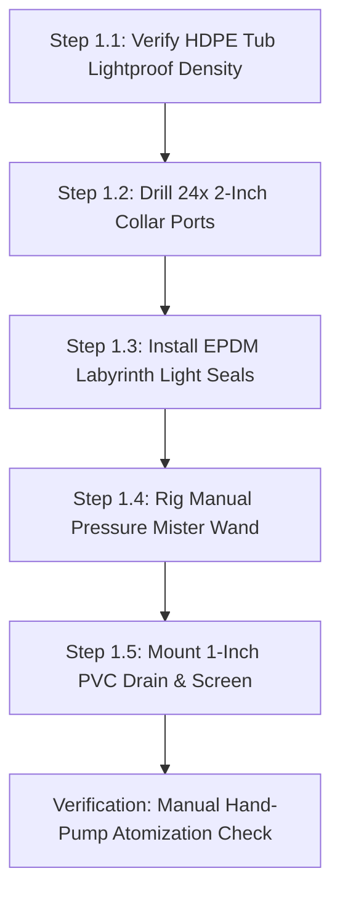
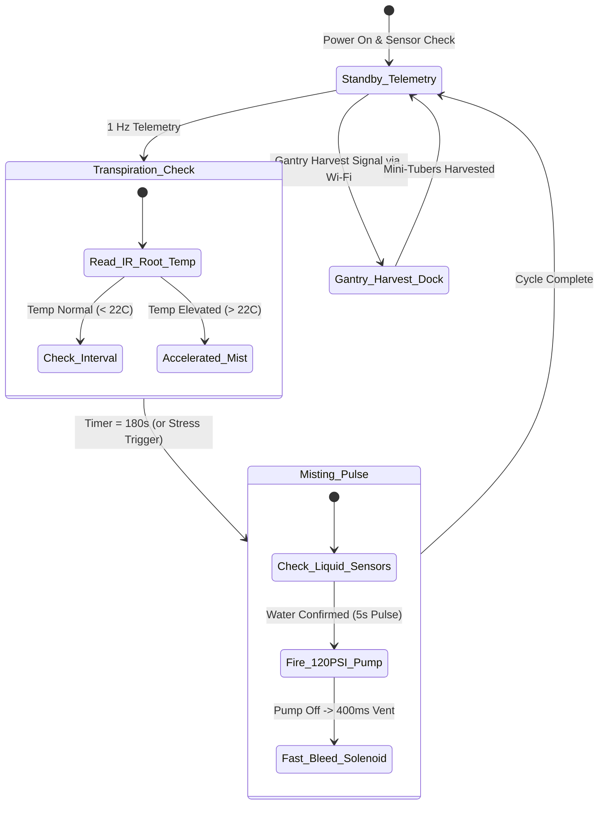

import { Card, CardGrid } from '@astrojs/starlight/components';

The **TPS Aeroponic Root-Zone Chamber** is a high-yield, disease-free mini-tuber production appliance. Engineered to eliminate soil pathogens and heavy substrate handling, it can be constructed as an independent homestead seed-potato propagator or integrated into the Central Basin of the master Open Biosphere assembly.

---

## 1. Standalone Homesteading & Off-Grid Utility

Traditional seed potatoes require disease-prone clonal tubers that degrade over generations and demand large soil footprints. This machine enables homesteaders to germinate **True Potato Seed (TPS)**—tiny botanical seeds weighing 1/1000th of a tuber—and produce clean, pathogen-free mini-tubers continuously in a compact footprint:

<CardGrid>
  <Card title="Botanical Seed Propagation" icon="seed">
    Grow clean potatoes from compact, indefinitely shelf-stable botanical seeds instead of hauling 50-pound bags of perishable seed tubers.
  </Card>
  <Card title="Non-Destructive Harvesting" icon="hands">
    Selective root chamber access allows pickers to harvest walnut-sized mini-tubers one at a time while leaving the vine productive for 120+ days.
  </Card>
  <Card title="Zero Chlorophyll / Solanine" icon="moon">
    Dual-labyrinth EPDM light seals keep root zones below 0.05 lux, completely preventing green solanine toxins from accumulating in growing tubers.
  </Card>
  <Card title="Closed Misting Conservation" icon="droplet">
    Ultrasonic atomizers suspend nutrient mist directly on bare roots, saving 95% of water compared to traditional in-ground potato hills.
  </Card>
</CardGrid>

---

## 2. Technical Specifications

| Parameter | Specification |
| :--- | :--- |
| **Chassis Dimensions** | 1,200 mm (L) × 800 mm (W) × 650 mm (H) |
| **Planting Density** | 12 to 18 TPS root collars per square meter (24 plants per chamber) |
| **Misting Cycle** | 5 seconds pulse every 3 minutes (closed-loop timer) or manual pump |
| **Droplet Size** | 30 to 50 µm high-pressure atomization |
| **Operating Pressure** | 80 to 120 PSI high-pressure line or manual hand-pump garden wand |
| **Light Ingress** | Less than 0.05 lux (tested via dual EPDM foam labyrinth seals) |
| **Harvest Yield** | 40 to 60 mini-tubers (15–35g each) per plant over a 120-day cycle |
| **Power Consumption** | 0W (Manual) / 45W avg (Add-On 1) / 58W peak (Add-On 2) |
| **Controller Architecture**| Manual Hand-Pump / Spring-Wound Dial Timer / ESP32-C3 Transpiration Node |

---

## 3. Instructions (Base Zero-Power Machine)

The foundational build of the TPS Aeroponic Root-Zone Chamber is a **100% mechanical, zero-power root-misting enclosure**. Using a heavy-duty food-grade 160L HDPE tote, pre-drilled neoprene clone collars, a manual 2-gallon pressure garden sprayer with brass atomizing wand, and dual-labyrinth EPDM light seals, it enables complete off-grid cultivation of disease-free seed potatoes without electrical pumps or timers.

### Mechanical Architecture & Decoupling Standard
1. **Opaque 160L HDPE Tub**: Black UV-stabilized virgin polyethylene prevents all external light transmission ($< 0.05$ lux interior), halting solanine toxin synthesis in developing tubers.
2. **Neoprene Clone Collar Lid**: 24 pre-drilled 50 mm ports fitted with slit neoprene collars support potato vines securely while allowing bare stolon roots to hang freely in air.
3. **Double-Labyrinth Light Seals**: EPDM foam weatherstripping and overlapping silicone light flaps line the lid rim and inspection side-hatch, allowing operators to reach in and pluck ripe mini-tubers without exposing roots to daylight.
4. **Mechanical Decoupling Standard**: Sidewall dual-port silicone pass-through grommets allow the manual garden wand to be inserted and operated even while electric misting lines are installed. If power fails, growers simply pump the garden sprayer by hand and mist roots without opening the lid.

```
       TPS AEROPONIC ROOT-ZONE CHAMBER — BASE MECHANICAL ELEVATION
  =================================================================
               [Potato Canopy Foliage in Ambient Light]
                     \         |         /
           ===========+========+========+===========
           [Lid: 24x 2" Neoprene Clonal Foam Collars]
           ===========+========+========+===========
                      | (Stolon Roots) |
         +------------+----------------+------------+
         |                                          |
         |         /--------------------\           |
  [Hand] |========|    *  (Mini-Tubers) * |          | [Side Access]
  Pump   |  Wand  |  *     (Bare Roots)   |          | Baffled Hatch
  Mister |        |   *    *    *    *    |          | (EPDM Labyrinth)
         |         \--------------------/           |
         |                   |                      |
         |                   v Droplets             |
         |                                          |
         |      \----------------------------/      |
         |        \   V-Bottom Drain Sump  /        |
         |          +------------+-------+          |
         |                       |                  |
         |                [1" PVC Bulkhead]         |
         |                   Drain Valve            |
         +-----------------------+------------------+
                            Gravity Drain
```

### Step-by-Step Fabrication & Assembly Protocol

#### Step 1.1: Tub Preparation & Lightproof Inspection
1. Select a heavy-duty, food-grade 160-liter opaque black HDPE storage tote (approx 1,200 × 800 × 650 mm).
2. Clean the interior thoroughly with hot water and baking soda to remove any mold release agents.
3. Place a 500-lumen inspection flashlight inside the sealed tub in a dark room; verify zero light leaks through the plastic walls or corners.

#### Step 1.2: Lid Hole-Sawing & Neoprene Collar Seating
1. Mark a 6 × 4 grid of 24 hole centers spaced 150 mm apart across the tote lid.
2. Cut 50 mm (2-inch) circular holes using a sharp bi-metal hole saw at low drill speed (300 RPM) to prevent plastic melting.
3. Deburr each hole edge with a swivel deburring blade.
4. Insert 2-inch slit neoprene cloning collars into each port, ensuring a snug friction fit that holds vine stems securely without pinching vascular tissue.

#### Step 1.3: EPDM Labyrinth Seal & Baffled Hatch Fabrication
1. Adhere high-density closed-cell EPDM rubber foam weatherstripping (12 mm wide × 8 mm thick) along the entire top rim of the tub.
2. Cut a 250 × 200 mm rectangular side-access inspection hatch in the front wall 300 mm above the base.
3. 3D-print or rivet a dual-baffle overlapping black silicone flap frame over the hatch, allowing human hand insertion while blocking light entry.

#### Step 1.4: Manual Pressure Sprayer & Wand Rigging
1. Assemble a standard 2-gallon hand-pump garden pressure sprayer with Viton chemical seals.
2. Install a fine brass atomizing misting nozzle (0.3 mm orifice, 45° hollow-cone spray) on the end of a rigid 600 mm wand.
3. Drill two 14 mm holes through the side wall at $Z = 350$ mm and install split-silicone pass-through grommets that seal snugly around the wand shaft.

#### Step 1.5: Bulkhead Drain & Sediment Trap Installation
1. Drill a 38 mm hole at the lowest point of the tub base.
2. Install a 1-inch PVC threaded bulkhead fitting with heavy-duty EPDM rubber sealing washers.
3. Thread a 1-inch manual PVC ball valve onto the bulkhead exterior, and clamp a fine 40-mesh stainless steel sediment catch screen over the interior drain inlet to trap sloughed root hairs.



### Step-by-Step Operating Runbook (Manual Mode)

1. **Seedling Germination & Collar Planting**: Germinate True Potato Seed (TPS) in rockwool plugs until seedlings develop 4 true leaves. Slip the rockwool plug into a 2-inch neoprene collar and seat firmly into the lid.
2. **Nutrient Solution Preparation**: Fill the 2-gallon manual sprayer with balanced vegetative nutrient solution (EC 1.4 mS/cm, pH 5.8). Pump the handle 20 strokes to pressurize the tank to 40 PSI.
3. **Morning Root Misting**: Insert the brass wand through the side silicone grommet. Depress the wand trigger, sweeping the atomizing mist across all 24 root zones for 30 seconds until bare roots are thoroughly coated with droplets.
4. **Midday Hydration & Aeration**: Repeat the 30-second misting sweep at 13:00. Inspect root tips through the side baffled hatch; healthy aeroponic roots should display crisp white elongation with dense absorbent root hairs.
5. **Evening Hydration**: Repeat the 30-second misting sweep at 18:00.
6. **Drain Sediment Check**: Open the 1-inch bottom PVC valve for 30 seconds to drain runoff liquid into a return reservoir; inspect the mesh screen for root hair buildup and rinse if needed.
7. **Non-Destructive Harvesting**: At Day 60–90, reach through the baffled side hatch. Locate mature walnut-sized mini-tubers (15–35 g) on lateral stolons; gently twist and detach them while leaving younger pea-sized tubers and the main root system completely intact for continuous production.

### Base Machine Bill of Materials (BOM)

| Item | Component Description | Sourcing / Part Reference | Qty | Unit Cost | Total Cost |
| :--- | :--- | :--- | :--- | :--- | :--- |
| **T-01** | Food-Grade Heavy-Duty Opaque Black HDPE Tote (160L) | Farm supply / hardware store | 1 | $38.00 | $38.00 |
| **T-02** | Pre-Slit 2-Inch Neoprene Cloning Collars (24x pack) | Hydroponics supply store | 1 | $18.00 | $18.00 |
| **T-03** | High-Density EPDM Foam Weatherstripping + Silicone Flaps | Automotive sealing supplier | 1 | $16.00 | $16.00 |
| **T-04** | 2-Gallon Hand-Pump Pressure Garden Sprayer + Brass Wand | Hardware / garden store | 1 | $19.00 | $19.00 |
| **T-05** | 1-Inch PVC Threaded Bulkhead + Full-Port Ball Valve | Plumbing / aquarium store | 1 | $14.00 | $14.00 |
| **Total** | **Base Zero-Power TPS Root Chamber** | **Complete off-grid seed-potato unit** | | | **$105.00** |

---

## 4. Add-On 1: Semi-Autonomous Electromechanical Pack (BLE Virtual Panel)

Under [RFC-0005](/rfcs/rfc-0005-hardware-interlocks-ble-virtual-panel), physical control panels with dedicated countdown dials, potentiometers, and push-button switches are banned across all machine tiers to eliminate water ingress and control priority contention.

Add-On 1 motorizes aeroponic misting governed by the **Strict Two-Control Physical Standard**:
1. **Master Hardware DC Power Switch**: Heavy-duty inline toggle switch directly isolating the 24V DC booster pump power line.
2. **"Nuke & Pave" SD Factory Restore Button**: Dedicated recessed tactile switch wired to trigger an automatic secondary bootloader re-flash from micro-SD storage.

All mist duty cycle adjustments, manual mist pulse triggers, and pump priming are conducted via the **Flutter Companion App Virtual Panel** over direct local BLE GATT.

### Electromechanical Actuation Architecture & Decoupling
- **High-Pressure Booster Pump**: 24V DC diaphragm pump generating 120 PSI, atomizing nutrient water into a 30 to 50 µm fog that remains suspended in the root chamber for minutes.
- **Anti-Drip Atomizing Manifold**: Six 0.3 mm brass misting nozzles with spring-loaded silicone check valves (15 PSI crack pressure) mounted on a 1/4" push-connect loop, preventing nozzle dripping between cycles.
- **Strict Two-Control Enclosure**: An IP65 waterproof ABS enclosure mounted on the front corner rail contains:
  - Heavy-duty toggle switch directly isolating the 24V DC supply line.
  - Recessed tactile button next to the 0.91" I2C OLED display (`[ROOT-A1 | BLE READY]`) for 5-second SD recovery reflash.
  - Micro-SD card slot module pre-loaded with golden recovery `firmware.bin` and `config.default`.
- **Ephemeral BLE Virtual Panel**: When nearby, an operator opens the Flutter companion app on mobile device. The app auto-discovers the root chamber over BLE GATT and displays real-time virtual touch controls: Mist Duration Slider (1 to 60 sec), Interval Timer (1 to 30 min), and a manual Instant Mist burst pad.
- **Mechanical Decoupling**: The Base sidewall silicone grommets remain open. If power is lost, the manual garden wand slides right back in, providing zero-downtime manual backup without altering the electric plumbing.

```
       ELECTROMECHANICAL WIRING & BLE VIRTUAL MISTING SCHEMATIC
  =================================================================
  [24V 3A DC Desktop Power Supply]
         |
         +----[Master DC Switch]----+----(OLED: [ROOT-A1 | BLE READY])
                                    |
         +--------------------------+
         |
         v
  [ESP32 BLE Controller]
  (Recessed SD Reset Button + Micro-SD Golden Bin)
         |
         v (Relay / MOSFET Output)
  [24V 120 PSI Booster Pump]
         |
         v (120 PSI Line)
  +------+------+
  |             |
  v             v
  [Anti-Drip Manifold]  [Anti-Drip Manifold]
  (3x 0.3mm Brass)      (3x 0.3mm Brass)
         \             /
          v           v
      [Suspended 50 um Aeroponic Fog]
         ^
         : Direct BLE GATT (No Contention)
         v
  [Flutter Companion App Virtual Panel]
  (Virtual Mist Duration Slider, Interval Selector, Instant Burst Pad)
```

### Step-by-Step Retrofit Protocol

#### Step 2.1: 120 PSI Booster Pump Mounting
1. Bolt the 24V DC booster pump to the external rear wall of the tote using M4 stainless bolts and thick rubber vibration isolators.
2. Plumb the pump inlet to the nutrient reservoir using 3/8" reinforced braided silicone tubing and an inline 100-mesh suction strainer.
3. Plumb the pump discharge line to the internal mist manifold using 1/4" high-pressure nylon tubing.

#### Step 2.2: Internal Nozzle Manifold Assembly
1. Bend two parallel 1/4" polyethylene misting lines running along both long inner walls at $Z = 300$ mm height.
2. Install three 0.3 mm brass anti-drip misting nozzles per side (6 total) angled 30° upward directly toward the suspended root mass.
3. Secure tubing with stainless P-clips bolted through the tub sidewalls with silicone sealing washers.

#### Step 2.3: Two-Control Enclosure Assembly
1. Mount a compact weatherproof ABS junction box (120 × 120 × 60 mm) on the front corner rail.
2. Install the heavy-duty inline 24V master switch, recessed SD reset tactile button, micro-SD slot module, and 0.91" I2C OLED display.
3. Mount the ESP32 BLE peripheral controller and high-current solid-state relay inside the box.
4. Snap an inline 5A thermal fuse into the 24V positive power lead.

#### Step 2.4: Point-to-Point Electrical Wiring
1. Wire 24V DC positive through the master switch, thermal fuse, and relay contacts directly to the booster pump motor.
2. Connect pump negative to 24V DC negative.
3. Flash the ESP32 with the Root Chamber Virtual Panel peripheral profile; verify OLED displays `[ROOT-A1 | BLE READY]`.

#### Step 2.5: High-Pressure Leak & Atomization Test
1. Fill reservoir with clean water. Open mobile companion app over BLE; tap the Instant Mist burst pad for 5 seconds.
2. The booster pump starts immediately, pressurizing the line to 110 PSI.
3. Verify that all six nozzles produce a dense, uniform 40 µm fog cone with zero dripping or spurting when the pump stops.


### Step-by-Step BLE Virtual Panel Operating Runbook

1. **Morning Inspection & Reservoir Check**: Verify the external nutrient reservoir contains at least 3 gallons of balanced water (EC 1.6 mS/cm, pH 5.8).
2. **Master Power Engagement**: Flip the master 24V DC toggle switch ON. The onboard 0.91" OLED illuminates: `[ROOT-A1 | BLE READY]`.
3. **Walk-Up BLE Virtual Panel Connection**: Open the Flutter companion app on mobile device. Select `ROOT-A1` from discovered BLE peripherals. The app instantly renders the Aeroponic Virtual Panel.
4. **Setting Mist Cycle Duration**: Drag the virtual mist duration slider to 15 seconds, and interval timer to 180 seconds. Tap "Apply Duty Cycle". The 120 PSI booster pump engages smoothly on schedule.
5. **Instant Root Hydration Burst**: When inspecting root health, tap the virtual "Instant Mist Burst" pad for a 5-second test pulse.
6. **"Nuke & Pave" SD Recovery Protocol**: If timer settings deadhead or controller locks up, hold the physical recessed reset button for 5 seconds during power-on. The secondary bootloader reflashes factory baseline firmware from micro-SD in 4 seconds.
7. **Side-Hatch Inspection**: Slide your hand through the baffled side hatch to feel roots. Roots should remain moist and cool without being dripping soaked.
8. **Zero-Power Backup Mode**: In the event of a power outage, grab the manual 2-gallon garden sprayer from Base, slide the wand into the side grommet, and resume manual misting immediately.

### Add-On 1 Bill of Materials (BOM)

| Item | Component Description | Sourcing / Part Reference | Qty | Unit Cost | Total Cost |
| :--- | :--- | :--- | :--- | :--- | :--- |
| **A1-01** | 24V DC High-Pressure Booster Pump (120 PSI, 1.2 GPM) | RO booster pump supplier | 1 | $48.00 | $48.00 |
| **A1-02** | Brass Anti-Drip Misting Nozzles (0.3mm orifice, 6x pack) | High-pressure fog supplier | 1 | $22.00 | $22.00 |
| **A1-03** | Two-Control Physical Enclosure Pack (Heavy-Duty Master 24V DC Switch, Recessed Tactile SD Reset Button, Micro-SD Slot Module + 16GB Golden Card) | Industrial switch / maker shop | 1 | $16.00 | $16.00 |
| **A1-04** | 0.91" I2C Status OLED Display & BLE Peripheral Carrier | Microcontroller display store | 1 | $10.00 | $10.00 |
| **A1-05** | 24V 3A (72W) DC Desktop Industrial Power Supply | Mean Well authorized dealer | 1 | $18.00 | $18.00 |
| **Total** | **Add-On 1 Electromechanical Pack** | **Retrofits directly to Base** | | | **+$114.00** |
| **Cumul.** | **Operational BLE Virtual Aeroponic Chamber** | **Base ($105) + Add-On 1 ($114)** | | | **$219.00** |

---

## 5. Add-On 2: Agentic Autonomous AI Pack (Edge Vision & Closed Loop)

Under [RFC-0004](/rfcs/rfc-0004-controller-node-tool) and [RFC-0006](/rfcs/rfc-0006-agnostic-controller-runtime), the **Agentic Autonomous AI Pack** transforms the chamber into an automated **Controller-Node-Tool (CNT)** aeroponic production cell. Operating as a dedicated **Root Chamber Node** commanding modular **Edge Tools** over BLE, it dynamically regulates root hydration based on infrared transpiration telemetry and coordinates robotic mini-tuber extraction with the 2-Axis Overhead Gantry with 250ms watchdog protection.

### Autonomous Vision & Telemetry Architecture
- **Root Chamber Node (ESP32-S3)**: Dual-Core Xtensa LX7 (240 MHz, 8 MB PSRAM) mounted inside an IP65 enclosure on the tub exterior governed by the **Strict Two-Control Physical Standard** (Master DC Power Switch and Recessed SD Reset Button alongside 0.96" I2C OLED `[NODE: ROOT-01 | LINK -> 4096]`). Uplinks to Central Controller via Wi-Fi; downlinks to Tools via BLE Central.
- **Infrared Root Transpiration Sensing**: Melexis MLX90614 non-contact infrared pyrometer sensor mounted in the tub lid, measuring root-zone surface temperature to $\pm 0.2^\circ	ext{C}$ to detect crop transpiration stress in real time.
- **Dedicated Modular Edge Tools (ESP32-C3)**: Driven 1:1 by micro ESP32-C3 controllers equipped with 0.42" micro OLED displays and **250ms hardware deadman watchdogs**:
  - `DEV_PUMP_RELAY`: Micro ESP32-C3 with 0.42" OLED (`TOOL: PUMP_RELAY | LINK: OK`) + 250ms watchdog driving 24V 120 PSI booster pump and 24V fast-bleed depressurization solenoid with dry-run float interrupt.
  - `DEV_ROOT_TELE`: Micro ESP32-C3 with 0.42" OLED (`TOOL: ROOT_TELE | LINK: OK`) reading the MLX90614 infrared root surface thermometer and dual optical liquid level sensors.
  - `DEV_DOCK_LATCH`: Micro ESP32-C3 with 0.42" OLED (`TOOL: DOCK_LATCH | LINK: OK`) + 250ms watchdog governing the gantry harvest docking collar latch.
- **250ms Deadman Watchdog Fail-Safe**: If `DEV_PUMP_RELAY` loses BLE connection to the Root Chamber Node for $> 250$ ms, it cuts pump power immediately and opens the bleed valve, preventing root saturation or pump burnout.
- **Autonomous Gantry Docking Collar**: Molded silicone suction port on the tub lid, allowing the 2-Axis Overhead Gantry's tuber extraction toolhead to dock and pull mature mini-tubers non-destructively.

```text
       CONTROLLER-NODE-TOOL (CNT) HIERARCHICAL EDGE ARCHITECTURE
  =================================================================
            CENTRAL BIOSPHERE CONTROLLER (Agnostic Runtime / POTFRM-4096)
            • Emits Isolated Farm AP: SSID [POTFRM-4096] (192.168.42.0/24)
            • Crop Growth Recipes & Overhead Gantry Harvest Coordination
                                  │
                                  │ Isolated Farm Wi-Fi (192.168.42.0/24)
                                  ▼
             ┌─────────────────────────────────────────┐
             │    ROOT CHAMBER MACHINE NODE (ESP32-S3) │
             │  • OLED Display: [NODE: ROOT-01]        │
             │  • Setup Push-Button for Mobile BLE     │
             │  • FreeRTOS Duty Cycle & Transpiration  │
             └────────────────────┬────────────────────┘
                                  │
         ┌────────────────────────┼────────────────────────┐
         │ BLE Downlink           │ BLE Downlink           │ BLE Downlink
         ▼                        ▼                        ▼
 ┌───────────────┐        ┌───────────────┐        ┌───────────────┐
 │ TOOL:         │        │ TOOL:         │        │ TOOL:         │
 │ DEV_PUMP_RELAY│        │ DEV_ROOT_TELE │        │ DEV_DOCK_LATCH│
 │ ESP32-C3 Micro│        │ ESP32-C3 Micro│        │ ESP32-C3 Micro│
 │ 0.42" OLED    │        │ 0.42" OLED    │        │ 0.42" OLED    │
 │ 250ms Deadman │        │ MLX90614 IR   │        │ 250ms Deadman │
 │ 120 PSI Pump  │        │ Dual Optical  │        │ Gantry Dock   │
 │ Bleed Solenoid│        │ Float Sensors │        │ Silicone Latch│
 └───────────────┘        └───────────────┘        └───────────────┘
```

### Step-by-Step Sensor Commissioning & Edge AI Protocol

#### Step 3.1: Root Chamber Node & Relay Assembly
1. Mount the ESP32-S3 Node with 0.96" I2C OLED display and physical setup push-button inside the IP65 enclosure.
2. Mount the `DEV_PUMP_RELAY` tool board (ESP32-C3) connected to optocoupled solid-state relays for pump and bleed valve control.
3. Verify manual mechanical countdown timer remains connected in parallel for manual backup.

#### Step 3.2: MLX90614 Non-Contact Infrared Root Sensor (`DEV_ROOT_TELE`)
1. Mount the MLX90614 infrared temperature sensor in a 3D-printed light-shielded silicone grommet aiming downward at root mass.
2. Wire sensor to `DEV_ROOT_TELE` tool (ESP32-C3) over I2C (SDA: GPIO 8, SCL: GPIO 9).
3. Verify root temperature reads accurately on tool OLED within 18.0°C to 24.0°C.

#### Step 3.3: 24V Fast-Bleed Depressurization Valve Installation
1. Tee a 24V DC normally-closed high-speed solenoid valve into the nozzle manifold pressure line, routing its exhaust port back to drain.
2. Wire solenoid to `DEV_PUMP_RELAY` tool channel 2.
3. Program cutoff sequence: when pump turns OFF, trigger solenoid for 400 ms, dropping manifold pressure from 120 PSI to 0 PSI in 80 ms to eliminate nozzle dripping.

#### Step 3.4: Dual Optical Dry-Run Float Installation
1. Install two optical liquid level sensors in the suction line manifold: one at 1-gallon warning mark and one at critical intake port.
2. Wire sensors directly to `DEV_ROOT_TELE` tool digital interrupt inputs.
3. Verify cutoff safety: removing liquid triggers pump shutdown within 25 milliseconds.

#### Step 3.5: Provisioning & 250ms Watchdog Verification
1. Power on Central Controller; verify active Cluster ID on OLED, terminal stdout, or BLE beacon (`POTFRM-4096`).
2. Power on Root Chamber Node; display shows `[NODE UNPAIRED - PAIR VIA BLE]`.
3. Press physical setup button on Node; connect via mobile companion app over BLE, enter `4096`.
4. Node commits credentials to NVS, links to `POTFRM-4096`, registers at `ws://192.168.42.1:8443/register`, and updates display to `[ONLINE | LINK -> 4096]`.
5. Verify Node auto-discovers and binds all three BLE Tools.
6. Test fail-safe watchdog: drop BLE link to `DEV_PUMP_RELAY`; verify booster pump power cuts in $< 250$ ms.



### Step-by-Step Autonomous Multi-Agent Runbook

1. **Autonomous Boot & Sensor Health Check**: On power-up, the Root Chamber Node checks optical liquid sensors and verifies root-zone infrared temperature. It establishes Wi-Fi communication with the Central Controller.
2. **Transpiration-Driven Adaptive Pulse Misting**: The firmware executes a default 5-second mist pulse every 180 seconds. However, if the MLX90614 infrared sensor detects root-zone temperature rising above 22.5°C, the Node dynamically shortens the mist interval to 120 seconds.
3. **Instant Zero-Drip Pressure Venting**: Immediately after each 5-second booster pump pulse, `DEV_PUMP_RELAY` energizes the fast-bleed solenoid valve for 400 ms, collapsing line pressure instantly to prevent large droplets.
4. **Optical Dry-Run Failsafe Interlock**: If the nutrient reservoir runs dry, the optical level sensors trigger an instantaneous hardware interrupt within 25 ms, halting the booster pump and broadcasting an alert to Central Controller.
5. **Overhead Gantry Autonomous Harvest Coordination**: At Day 75, Central Controller dispatches the 2-Axis Overhead Gantry with its potato extraction toolhead. The gantry docks into the silicone collar, applies soft pneumatic suction to pluck mature mini-tubers, and withdraws non-destructively.
6. **250ms Fail-Safe Watchdogs**: If BLE connection to `DEV_PUMP_RELAY` drops for $> 250$ ms, pump power cuts instantly. If Wi-Fi link to Central Controller is lost, the Node continues the default 180s mist cycle safely.

### Add-On 2 Bill of Materials (BOM)

| Item | Component Description | Sourcing / Part Reference | Qty | Unit Cost | Total Cost |
| :--- | :--- | :--- | :--- | :--- | :--- |
| **A2-01** | Root Chamber Node: ESP32-S3 (8MB PSRAM) + 0.96" OLED + Setup Button | Espressif distributor | 1 | $16.00 | $16.00 |
| **A2-02** | Dual Optical Liquid Level Sensors (Infrared Prism) | Aquarium / maker level sensor | 2 | $6.00 | $12.00 |
| **A2-03** | MLX90614 Non-Contact Infrared Root Temperature Sensor | Precision sensor store | 1 | $16.00 | $16.00 |
| **A2-04** | 24V DC Fast-Bleed Solenoid Depressurization Valve | Pneumatics / solenoid supplier | 1 | $13.00 | $13.00 |
| **A2-05** | 2x ESP32-C3 Modular Tools with 0.42" OLED & 250ms Watchdog (Pump & Dock) | Microcontroller supplier | 2 | $7.00 | $14.00 |
| **Total** | **Add-On 2 Agentic Autonomous Pack (CNT Standard)** | **Expands Base + Add-On 1** | | | **+$71.00** |
| **Full Build** | **Complete Autonomous Biosphere TPS Root Chamber** | **Base + Add-On 1 + Add-On 2** | | | **$290.00** |

---

## 6. Staged Upgrade Progression & Cost Summary

### Build Tier Comparison

| Build Stage | Operational Capability | Direct Stage Cost | Cumulative Investment |
| :--- | :--- | :--- | :--- |
| **Base: Instructions** | 100% mechanical tote with hand-pump pressure sprayer and baffled access hatch | $105.00 | **$105.00** |
| **Add-On 1: Semi-Auto** | High-pressure 120 PSI misting pump with Flutter BLE Virtual Panel & Two-Control Standard | +$114.00 | **$219.00** |
| **Add-On 2: Agentic AI** | Controller-Node-Tool (CNT) automation, transpiration-driven misting, & 250ms watchdogs | +$71.00 | **$290.00** |

### Step-by-Step Zero-Waste Conversion Roadmap

#### Path 1: Base Machine $
ightarrow$ Add-On 1 (Motorized Misting Chamber)
1. Mount the 24V 120 PSI booster pump to the rear wall of the HDPE tub.
2. Install the 1/4" nylon tubing and six brass anti-drip nozzles inside the tub at $Z = 300$ mm height.
3. Mount the Two-Control junction box on the front rail, pair the Flutter Companion App BLE Virtual Panel, and plug in the 24V desktop power supply. The manual garden wand pass-through grommets remain permanently accessible.

#### Path 2: Add-On 1 $
ightarrow$ Add-On 2 (Autonomous Edge CNT Production Cell)
1. Mount the Root Chamber Node (ESP32-S3 + OLED + Button) and modular ESP32-C3 Tools inside the IP65 enclosure.
2. Connect `DEV_PUMP_RELAY` to the booster pump and 24V fast-bleed solenoid in parallel with the manual dial timer.
3. Mount the MLX90614 infrared root sensor in the tub lid and wire to `DEV_ROOT_TELE`.
4. Install dual optical liquid level sensors in the suction line manifold.
5. Provision the Root Chamber Node with Central Controller ID via mobile app BLE, and verify 250ms hardware watchdog trips immediately upon signal loss.

---

## 7. Master Biosphere Assembly Interlock

When integrated into the centralized Open Biosphere facility (~20 × 10 ft footprint):

1. **Sub-Surface Basin Suspension**: The chamber docks into the southern bay of the Central Basin, suspended over the nutrient reservoir at $Z = 0$ to $650$ mm.
2. **Overhead Gantry Toolhead**: The 2-Axis Overhead Gantry descends through the top silicone docking collar with a soft-silicone suction toolhead, harvesting mature mini-tubers non-destructively.
3. **Plumbing Integration**: Drains directly into the primary MBBR biofiltration sump, creating a continuous gravity return circuit with zero standing water.
4. **Biosphere Synchronized Dosing**: Communicates via CAN bus with the Microclimate & Automated Dosing Array, automatically requesting calcium and potassium nutrient replenishments during peak tuber bulking phases.
