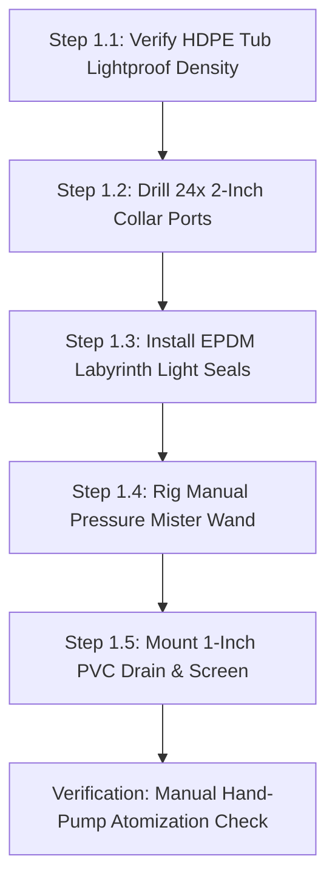

import { Card, CardGrid, LinkButton } from '@astrojs/starlight/components';

## Part 1: Stage Header & Executive Summary

> [!NOTE]
> **Stage Designation:** Stage 0 (Zero-Power Baseline)  
> **Operating Mode:** 100% Mechanical Manual Fallback  
> **Power Consumption:** 0 Watts (Zero Electrical Input Required)  
> **Resilience Rating:** Continuous Off-Grid / EMP / Submersion Proof  
> **Decoupling Standard:** Friction Slip-Clutch / Quick-Release Cam Linkage  

The Stage 0 baseline build of the **TPS Aeroponic Root-Zone Chamber** is a **100% mechanical, zero-power agricultural machine**. It operates entirely by human leverage, manual hand cranks, counterweights, and gravity flows—providing complete food security and operational continuity during total grid blackouts.

---

## Part 2: Capability Delta (Features Introduced)

* **Zero-Power Resilience**: Operates indefinitely without batteries, solar controllers, or power supplies.
* **Direct Mechanical Leverage**: All actuation performed via hand cranks, manual levers, counterweights, or gravity siphoning.
* **Inherent Decoupling**: Built from the ground up with mechanical slip-clutches, quick-release clamps, or bypass valves to ensure motor upgrades never bind.

---

## Part 3: Isolated Stage 0 Bill of Materials (BOM)

### Base Machine Bill of Materials (BOM)

| Item | Component Description | Sourcing / Part Reference | Qty | Unit Cost | Total Cost |
| :--- | :--- | :--- | :--- | :--- | :--- |
| **T-01** | Food-Grade Heavy-Duty Opaque Black HDPE Tote (160L) | Farm supply / hardware store | 1 | $38.00 | $38.00 |
| **T-02** | Pre-Slit 2-Inch Neoprene Cloning Collars (24x pack) | Hydroponics supply store | 1 | $18.00 | $18.00 |
| **T-03** | High-Density EPDM Foam Weatherstripping + Silicone Flaps | Automotive sealing supplier | 1 | $16.00 | $16.00 |
| **T-04** | 2-Gallon Hand-Pump Pressure Garden Sprayer + Brass Wand | Hardware / garden store | 1 | $19.00 | $19.00 |
| **T-05** | 1-Inch PVC Threaded Bulkhead + Full-Port Ball Valve | Plumbing / aquarium store | 1 | $14.00 | $14.00 |
| **Total** | **Base Zero-Power TPS Root Chamber** | **Complete off-grid seed-potato unit** | | | **$105.00** |

---

---

## Part 4: Standalone Full SVG Blueprint


---

## Part 5: Step-by-Step Assembly & Operating Protocol

The foundational build of the TPS Aeroponic Root-Zone Chamber is a **100% mechanical, zero-power root-misting enclosure**. Using a heavy-duty food-grade 160L HDPE tote, pre-drilled neoprene clone collars, a manual 2-gallon pressure garden sprayer with brass atomizing wand, and dual-labyrinth EPDM light seals, it enables complete off-grid cultivation of disease-free seed potatoes without electrical pumps or timers.

### Mechanical Architecture & Decoupling Standard
1. **Opaque 160L HDPE Tub**: Black UV-stabilized virgin polyethylene prevents all external light transmission ($< 0.05$ lux interior), halting solanine toxin synthesis in developing tubers.
2. **Neoprene Clone Collar Lid**: 24 pre-drilled 50 mm ports fitted with slit neoprene collars support potato vines securely while allowing bare stolon roots to hang freely in air.
3. **Double-Labyrinth Light Seals**: EPDM foam weatherstripping and overlapping silicone light flaps line the lid rim and inspection side-hatch, allowing operators to reach in and pluck ripe mini-tubers without exposing roots to daylight.
4. **Mechanical Decoupling Standard**: Sidewall dual-port silicone pass-through grommets allow the manual garden wand to be inserted and operated even while electric misting lines are installed. If power fails, growers simply pump the garden sprayer by hand and mist roots without opening the lid.

```
       TPS AEROPONIC ROOT-ZONE CHAMBER — BASE MECHANICAL ELEVATION
  =================================================================
               [Potato Canopy Foliage in Ambient Light]
                     \         |         /
           ===========+========+========+===========
           [Lid: 24x 2" Neoprene Clonal Foam Collars]
           ===========+========+========+===========
                      | (Stolon Roots) |
         +------------+----------------+------------+
         |                                          |
         |         /--------------------\           |
  [Hand] |========|    *  (Mini-Tubers) * |          | [Side Access]
  Pump   |  Wand  |  *     (Bare Roots)   |          | Baffled Hatch
  Mister |        |   *    *    *    *    |          | (EPDM Labyrinth)
         |         \--------------------/           |
         |                   |                      |
         |                   v Droplets             |
         |                                          |
         |      \----------------------------/      |
         |        \   V-Bottom Drain Sump  /        |
         |          +------------+-------+          |
         |                       |                  |
         |                [1" PVC Bulkhead]         |
         |                   Drain Valve            |
         +-----------------------+------------------+
                            Gravity Drain
```

### Step-by-Step Fabrication & Assembly Protocol

#### Step 1.1: Tub Preparation & Lightproof Inspection
1. Select a heavy-duty, food-grade 160-liter opaque black HDPE storage tote (approx 1,200 × 800 × 650 mm).
2. Clean the interior thoroughly with hot water and baking soda to remove any mold release agents.
3. Place a 500-lumen inspection flashlight inside the sealed tub in a dark room; verify zero light leaks through the plastic walls or corners.

#### Step 1.2: Lid Hole-Sawing & Neoprene Collar Seating
1. Mark a 6 × 4 grid of 24 hole centers spaced 150 mm apart across the tote lid.
2. Cut 50 mm (2-inch) circular holes using a sharp bi-metal hole saw at low drill speed (300 RPM) to prevent plastic melting.
3. Deburr each hole edge with a swivel deburring blade.
4. Insert 2-inch slit neoprene cloning collars into each port, ensuring a snug friction fit that holds vine stems securely without pinching vascular tissue.

#### Step 1.3: EPDM Labyrinth Seal & Baffled Hatch Fabrication
1. Adhere high-density closed-cell EPDM rubber foam weatherstripping (12 mm wide × 8 mm thick) along the entire top rim of the tub.
2. Cut a 250 × 200 mm rectangular side-access inspection hatch in the front wall 300 mm above the base.
3. 3D-print or rivet a dual-baffle overlapping black silicone flap frame over the hatch, allowing human hand insertion while blocking light entry.

#### Step 1.4: Manual Pressure Sprayer & Wand Rigging
1. Assemble a standard 2-gallon hand-pump garden pressure sprayer with Viton chemical seals.
2. Install a fine brass atomizing misting nozzle (0.3 mm orifice, 45° hollow-cone spray) on the end of a rigid 600 mm wand.
3. Drill two 14 mm holes through the side wall at $Z = 350$ mm and install split-silicone pass-through grommets that seal snugly around the wand shaft.

#### Step 1.5: Bulkhead Drain & Sediment Trap Installation
1. Drill a 38 mm hole at the lowest point of the tub base.
2. Install a 1-inch PVC threaded bulkhead fitting with heavy-duty EPDM rubber sealing washers.
3. Thread a 1-inch manual PVC ball valve onto the bulkhead exterior, and clamp a fine 40-mesh stainless steel sediment catch screen over the interior drain inlet to trap sloughed root hairs.



### Step-by-Step Operating Runbook (Manual Mode)

1. **Seedling Germination & Collar Planting**: Germinate True Potato Seed (TPS) in rockwool plugs until seedlings develop 4 true leaves. Slip the rockwool plug into a 2-inch neoprene collar and seat firmly into the lid.
2. **Nutrient Solution Preparation**: Fill the 2-gallon manual sprayer with balanced vegetative nutrient solution (EC 1.4 mS/cm, pH 5.8). Pump the handle 20 strokes to pressurize the tank to 40 PSI.
3. **Morning Root Misting**: Insert the brass wand through the side silicone grommet. Depress the wand trigger, sweeping the atomizing mist across all 24 root zones for 30 seconds until bare roots are thoroughly coated with droplets.
4. **Midday Hydration & Aeration**: Repeat the 30-second misting sweep at 13:00. Inspect root tips through the side baffled hatch; healthy aeroponic roots should display crisp white elongation with dense absorbent root hairs.
5. **Evening Hydration**: Repeat the 30-second misting sweep at 18:00.
6. **Drain Sediment Check**: Open the 1-inch bottom PVC valve for 30 seconds to drain runoff liquid into a return reservoir; inspect the mesh screen for root hair buildup and rinse if needed.
7. **Non-Destructive Harvesting**: At Day 60–90, reach through the baffled side hatch. Locate mature walnut-sized mini-tubers (15–35 g) on lateral stolons; gently twist and detach them while leaving younger pea-sized tubers and the main root system completely intact for continuous production.

---

## Part 6: Guided Stage Navigation

<CardGrid>
  <Card title="Subsystem Overview" icon="left-arrow">
    Return to the machine overview, crop affinity matrix, and multi-stage comparison.
    <br/><br/>
    <LinkButton href="/open-biosphere/hardware/tps-root-chamber/" variant="minimal">← Return to Overview</LinkButton>
  </Card>
  <Card title="Stage 1: BLE Electromechanical Pack" icon="right-arrow">
    Ready to motorize this machine? Upgrade with DC actuation and Flutter BLE Virtual Panel controls.
    <br/><br/>
    <LinkButton href="/open-biosphere/hardware/tps-root-chamber/stage-1/" variant="primary">Proceed to Stage 1 Upgrade →</LinkButton>
  </Card>
</CardGrid>
