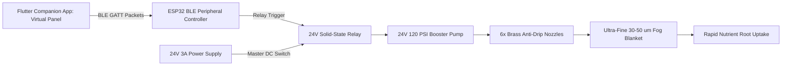

import { Card, CardGrid, LinkButton } from '@astrojs/starlight/components';

## Part 1: Stage Header & Executive Summary

> [!NOTE]
> **Stage Designation:** Stage 1 (Semi-Autonomous Electromechanical Pack)  
> **Operating Mode:** DC Motorized Continuous Duty with Ephemeral BLE Virtual Panel  
> **Power Requirement:** 12V / 24V DC Industrial Bus  
> **Physical Interlocks:** Strict Two-Control Standard (Master DC Cut + Recessed SD Factory Restore)  
> **Operator Interface:** Ephemeral Flutter Mobile Companion App over BLE GATT  

The Stage 1 electromechanical pack motorizes the **TPS Aeroponic Root-Zone Chamber**, adding continuous DC motor/pump drive governed by the **Strict Two-Control Physical Standard** (RFC-0005) and an ephemeral **Flutter Companion App Virtual Panel** over direct local BLE.

---

## Part 2: Capability Delta (Features Introduced)

* **Continuous Motorized Actuation**: Replaces human manual cranking with high-efficiency DC gearmotors, steppers, or booster pumps.
* **Strict Two-Control Physical Standard**: Eliminates physical jog buttons and potentiometer dials to prevent moisture breach and priority race conditions. Only Master DC Switch and Recessed SD Reset Button are permitted on hardware.
* **Ephemeral BLE Virtual Panel**: Jogging, speed sliders, and priming pulses execute via the Flutter companion app over direct local BLE GATT.
* **100% Preserved Manual Fallback**: Slip-clutches, bypass valves, or belt releases guarantee instant zero-power manual hand operation without disassembly.

---

## Part 3: Isolated Stage 1 Bill of Materials (BOM)

### Add-On 1 Bill of Materials (BOM)

| Item | Component Description | Sourcing / Part Reference | Qty | Unit Cost | Total Cost |
| :--- | :--- | :--- | :--- | :--- | :--- |
| **A1-01** | 24V DC High-Pressure Booster Pump (120 PSI, 1.2 GPM) | RO booster pump supplier | 1 | $48.00 | $48.00 |
| **A1-02** | Brass Anti-Drip Misting Nozzles (0.3mm orifice, 6x pack) | High-pressure fog supplier | 1 | $22.00 | $22.00 |
| **A1-03** | Two-Control Physical Enclosure Pack (Heavy-Duty Master 24V DC Switch, Recessed Tactile SD Reset Button, Micro-SD Slot Module + 16GB Golden Card) | Industrial switch / maker shop | 1 | $16.00 | $16.00 |
| **A1-04** | 0.91" I2C Status OLED Display & BLE Peripheral Carrier | Microcontroller display store | 1 | $10.00 | $10.00 |
| **A1-05** | 24V 3A (72W) DC Desktop Industrial Power Supply | Mean Well authorized dealer | 1 | $18.00 | $18.00 |
| **Total** | **Add-On 1 Electromechanical Pack** | **Retrofits directly to Base** | | | **+$114.00** |
| **Cumul.** | **Operational BLE Virtual Aeroponic Chamber** | **Base ($105) + Add-On 1 ($114)** | | | **$219.00** |

---

---

## Part 4: Standalone Full SVG Blueprint


---

## Part 5: Step-by-Step Retrofit, Wiring & Operating Protocol

Under [RFC-0005](/rfcs/rfc-0005-hardware-interlocks-ble-virtual-panel), physical control panels with dedicated countdown dials, potentiometers, and push-button switches are banned across all machine tiers to eliminate water ingress and control priority contention.

Add-On 1 motorizes aeroponic misting governed by the **Strict Two-Control Physical Standard**:
1. **Master Hardware DC Power Switch**: Heavy-duty inline toggle switch directly isolating the 24V DC booster pump power line.
2. **"Nuke & Pave" SD Factory Restore Button**: Dedicated recessed tactile switch wired to trigger an automatic secondary bootloader re-flash from micro-SD storage.

All mist duty cycle adjustments, manual mist pulse triggers, and pump priming are conducted via the **Flutter Companion App Virtual Panel** over direct local BLE GATT.

### Electromechanical Actuation Architecture & Decoupling
- **High-Pressure Booster Pump**: 24V DC diaphragm pump generating 120 PSI, atomizing nutrient water into a 30 to 50 µm fog that remains suspended in the root chamber for minutes.
- **Anti-Drip Atomizing Manifold**: Six 0.3 mm brass misting nozzles with spring-loaded silicone check valves (15 PSI crack pressure) mounted on a 1/4" push-connect loop, preventing nozzle dripping between cycles.
- **Strict Two-Control Enclosure**: An IP65 waterproof ABS enclosure mounted on the front corner rail contains:
  - Heavy-duty toggle switch directly isolating the 24V DC supply line.
  - Recessed tactile button next to the 0.91" I2C OLED display (`[ROOT-A1 | BLE READY]`) for 5-second SD recovery reflash.
  - Micro-SD card slot module pre-loaded with golden recovery `firmware.bin` and `config.default`.
- **Ephemeral BLE Virtual Panel**: When nearby, an operator opens the Flutter companion app on mobile device. The app auto-discovers the root chamber over BLE GATT and displays real-time virtual touch controls: Mist Duration Slider (1 to 60 sec), Interval Timer (1 to 30 min), and a manual Instant Mist burst pad.
- **Mechanical Decoupling**: The Base sidewall silicone grommets remain open. If power is lost, the manual garden wand slides right back in, providing zero-downtime manual backup without altering the electric plumbing.

```
       ELECTROMECHANICAL WIRING & BLE VIRTUAL MISTING SCHEMATIC
  =================================================================
  [24V 3A DC Desktop Power Supply]
         |
         +----[Master DC Switch]----+----(OLED: [ROOT-A1 | BLE READY])
                                    |
         +--------------------------+
         |
         v
  [ESP32 BLE Controller]
  (Recessed SD Reset Button + Micro-SD Golden Bin)
         |
         v (Relay / MOSFET Output)
  [24V 120 PSI Booster Pump]
         |
         v (120 PSI Line)
  +------+------+
  |             |
  v             v
  [Anti-Drip Manifold]  [Anti-Drip Manifold]
  (3x 0.3mm Brass)      (3x 0.3mm Brass)
         \             /
          v           v
      [Suspended 50 um Aeroponic Fog]
         ^
         : Direct BLE GATT (No Contention)
         v
  [Flutter Companion App Virtual Panel]
  (Virtual Mist Duration Slider, Interval Selector, Instant Burst Pad)
```

### Step-by-Step Retrofit Protocol

#### Step 2.1: 120 PSI Booster Pump Mounting
1. Bolt the 24V DC booster pump to the external rear wall of the tote using M4 stainless bolts and thick rubber vibration isolators.
2. Plumb the pump inlet to the nutrient reservoir using 3/8" reinforced braided silicone tubing and an inline 100-mesh suction strainer.
3. Plumb the pump discharge line to the internal mist manifold using 1/4" high-pressure nylon tubing.

#### Step 2.2: Internal Nozzle Manifold Assembly
1. Bend two parallel 1/4" polyethylene misting lines running along both long inner walls at $Z = 300$ mm height.
2. Install three 0.3 mm brass anti-drip misting nozzles per side (6 total) angled 30° upward directly toward the suspended root mass.
3. Secure tubing with stainless P-clips bolted through the tub sidewalls with silicone sealing washers.

#### Step 2.3: Two-Control Enclosure Assembly
1. Mount a compact weatherproof ABS junction box (120 × 120 × 60 mm) on the front corner rail.
2. Install the heavy-duty inline 24V master switch, recessed SD reset tactile button, micro-SD slot module, and 0.91" I2C OLED display.
3. Mount the ESP32 BLE peripheral controller and high-current solid-state relay inside the box.
4. Snap an inline 5A thermal fuse into the 24V positive power lead.

#### Step 2.4: Point-to-Point Electrical Wiring
1. Wire 24V DC positive through the master switch, thermal fuse, and relay contacts directly to the booster pump motor.
2. Connect pump negative to 24V DC negative.
3. Flash the ESP32 with the Root Chamber Virtual Panel peripheral profile; verify OLED displays `[ROOT-A1 | BLE READY]`.

#### Step 2.5: High-Pressure Leak & Atomization Test
1. Fill reservoir with clean water. Open mobile companion app over BLE; tap the Instant Mist burst pad for 5 seconds.
2. The booster pump starts immediately, pressurizing the line to 110 PSI.
3. Verify that all six nozzles produce a dense, uniform 40 µm fog cone with zero dripping or spurting when the pump stops.



### Step-by-Step BLE Virtual Panel Operating Runbook

1. **Morning Inspection & Reservoir Check**: Verify the external nutrient reservoir contains at least 3 gallons of balanced water (EC 1.6 mS/cm, pH 5.8).
2. **Master Power Engagement**: Flip the master 24V DC toggle switch ON. The onboard 0.91" OLED illuminates: `[ROOT-A1 | BLE READY]`.
3. **Walk-Up BLE Virtual Panel Connection**: Open the Flutter companion app on mobile device. Select `ROOT-A1` from discovered BLE peripherals. The app instantly renders the Aeroponic Virtual Panel.
4. **Setting Mist Cycle Duration**: Drag the virtual mist duration slider to 15 seconds, and interval timer to 180 seconds. Tap "Apply Duty Cycle". The 120 PSI booster pump engages smoothly on schedule.
5. **Instant Root Hydration Burst**: When inspecting root health, tap the virtual "Instant Mist Burst" pad for a 5-second test pulse.
6. **"Nuke & Pave" SD Recovery Protocol**: If timer settings deadhead or controller locks up, hold the physical recessed reset button for 5 seconds during power-on. The secondary bootloader reflashes factory baseline firmware from micro-SD in 4 seconds.
7. **Side-Hatch Inspection**: Slide your hand through the baffled side hatch to feel roots. Roots should remain moist and cool without being dripping soaked.
8. **Zero-Power Backup Mode**: In the event of a power outage, grab the manual 2-gallon garden sprayer from Base, slide the wand into the side grommet, and resume manual misting immediately.

---

## Part 6: Guided Stage Navigation

<CardGrid>
  <Card title="Stage 0: Zero-Power Baseline" icon="left-arrow">
    Review the underlying manual chassis, fabrication tolerances, and mechanical fallback linkage.
    <br/><br/>
    <LinkButton href="/open-biosphere/hardware/tps-root-chamber/stage-0/" variant="minimal">← Previous: Stage 0 Baseline</LinkButton>
  </Card>
  <Card title="Stage 2: Agentic Autonomous AI Pack" icon="right-arrow">
    Ready for full closed-loop autonomy? Integrate the Controller-Node-Tool mesh and local neural vision.
    <br/><br/>
    <LinkButton href="/open-biosphere/hardware/tps-root-chamber/stage-2/" variant="primary">Proceed to Stage 2 Upgrade →</LinkButton>
  </Card>
</CardGrid>
