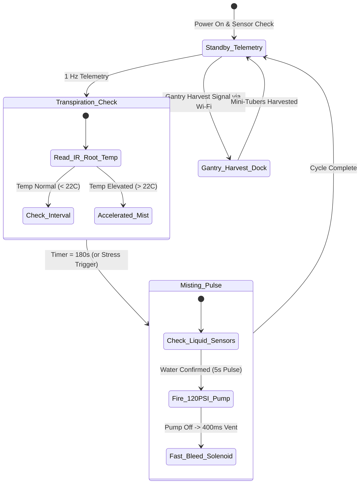

import { Card, CardGrid, LinkButton } from '@astrojs/starlight/components';

## Part 1: Stage Header & Executive Summary

> [!NOTE]
> **Stage Designation:** Stage 2 (Agentic Autonomous AI Pack)  
> **Operating Mode:** 24/7 Closed-Loop Autonomous Neural Telemetry & Robotics  
> **Network Mesh:** Encrypted Isolated Farm Wi-Fi (<code>POTFRM-4096</code> on 192.168.42.0/24) + BLE Tool Downlinks  
> **Safety Interlocks:** 250ms Hardware Deadman Watchdogs on all Edge Tools  
> **Edge AI Engine:** <code>llama-cpp-python</code> Local GGUF Multimodal Vision (Zero Cloud Dependence)  

The Stage 2 agentic pack elevates the **TPS Aeroponic Root-Zone Chamber** into a fully autonomous cyber-physical robotics cell operating under the **Controller-Node-Tool (CNT)** standard (RFC-0004) and **Agnostic Controller Runtime** (RFC-0006).

---

## Part 2: Capability Delta (Features Introduced)

* **Controller-Node-Tool (CNT) Hierarchy**: Heavy neural perception runs on the Central Biosphere Controller; the Machine Node coordinates local kinematics; tiny Edge Tools drive motors 1:1.
* **Isolated Farm AP Mesh**: Secure, air-gapped local Wi-Fi (<code>POTFRM-&lt;CLUSTER_ID&gt;</code> on <code>192.168.42.0/24</code>) with WebSocket node registration at <code>ws://192.168.42.1:8443/register</code>.
* **250ms Hardware Deadman Watchdogs**: Every Tool trips into safe, high-Z, zero-power state within 250 ms if signal is interrupted.
* **Local Zero-Cloud Edge AI**: Multi-agent perception via <code>llama-cpp-python</code> local vision models without internet dependencies.

---

## Part 3: Isolated Stage 2 Bill of Materials (BOM)

### Add-On 2 Bill of Materials (BOM)

| Item | Component Description | Sourcing / Part Reference | Qty | Unit Cost | Total Cost |
| :--- | :--- | :--- | :--- | :--- | :--- |
| **A2-01** | Root Chamber Node: ESP32-S3 (8MB PSRAM) + 0.96" OLED + Setup Button | Espressif distributor | 1 | $16.00 | $16.00 |
| **A2-02** | Dual Optical Liquid Level Sensors (Infrared Prism) | Aquarium / maker level sensor | 2 | $6.00 | $12.00 |
| **A2-03** | MLX90614 Non-Contact Infrared Root Temperature Sensor | Precision sensor store | 1 | $16.00 | $16.00 |
| **A2-04** | 24V DC Fast-Bleed Solenoid Depressurization Valve | Pneumatics / solenoid supplier | 1 | $13.00 | $13.00 |
| **A2-05** | 2x ESP32-C3 Modular Tools with 0.42" OLED & 250ms Watchdog (Pump & Dock) | Microcontroller supplier | 2 | $7.00 | $14.00 |
| **Total** | **Add-On 2 Agentic Autonomous Pack (CNT Standard)** | **Expands Base + Add-On 1** | | | **+$71.00** |
| **Full Build** | **Complete Autonomous Biosphere TPS Root Chamber** | **Base + Add-On 1 + Add-On 2** | | | **$290.00** |

---

---

## Part 4: Standalone Full SVG Blueprint


---

## Part 5: Step-by-Step Commissioning, Provisioning & Autonomous Runbook

Under [RFC-0004](/rfcs/rfc-0004-controller-node-tool) and [RFC-0006](/rfcs/rfc-0006-agnostic-controller-runtime), the **Agentic Autonomous AI Pack** transforms the chamber into an automated **Controller-Node-Tool (CNT)** aeroponic production cell. Operating as a dedicated **Root Chamber Node** commanding modular **Edge Tools** over BLE, it dynamically regulates root hydration based on infrared transpiration telemetry and coordinates robotic mini-tuber extraction with the 2-Axis Overhead Gantry with 250ms watchdog protection.

### Autonomous Vision & Telemetry Architecture
- **Root Chamber Node (ESP32-S3)**: Dual-Core Xtensa LX7 (240 MHz, 8 MB PSRAM) mounted inside an IP65 enclosure on the tub exterior governed by the **Strict Two-Control Physical Standard** (Master DC Power Switch and Recessed SD Reset Button alongside 0.96" I2C OLED `[NODE: ROOT-01 | LINK -> 4096]`). Uplinks to Central Controller via Wi-Fi; downlinks to Tools via BLE Central.
- **Infrared Root Transpiration Sensing**: Melexis MLX90614 non-contact infrared pyrometer sensor mounted in the tub lid, measuring root-zone surface temperature to $\pm 0.2^\circ	ext{C}$ to detect crop transpiration stress in real time.
- **Dedicated Modular Edge Tools (ESP32-C3)**: Driven 1:1 by micro ESP32-C3 controllers equipped with 0.42" micro OLED displays and **250ms hardware deadman watchdogs**:
  - `DEV_PUMP_RELAY`: Micro ESP32-C3 with 0.42" OLED (`TOOL: PUMP_RELAY | LINK: OK`) + 250ms watchdog driving 24V 120 PSI booster pump and 24V fast-bleed depressurization solenoid with dry-run float interrupt.
  - `DEV_ROOT_TELE`: Micro ESP32-C3 with 0.42" OLED (`TOOL: ROOT_TELE | LINK: OK`) reading the MLX90614 infrared root surface thermometer and dual optical liquid level sensors.
  - `DEV_DOCK_LATCH`: Micro ESP32-C3 with 0.42" OLED (`TOOL: DOCK_LATCH | LINK: OK`) + 250ms watchdog governing the gantry harvest docking collar latch.
- **250ms Deadman Watchdog Fail-Safe**: If `DEV_PUMP_RELAY` loses BLE connection to the Root Chamber Node for $> 250$ ms, it cuts pump power immediately and opens the bleed valve, preventing root saturation or pump burnout.
- **Autonomous Gantry Docking Collar**: Molded silicone suction port on the tub lid, allowing the 2-Axis Overhead Gantry's tuber extraction toolhead to dock and pull mature mini-tubers non-destructively.

```text
       CONTROLLER-NODE-TOOL (CNT) HIERARCHICAL EDGE ARCHITECTURE
  =================================================================
            CENTRAL BIOSPHERE CONTROLLER (Agnostic Runtime / POTFRM-4096)
            • Emits Isolated Farm AP: SSID [POTFRM-4096] (192.168.42.0/24)
            • Crop Growth Recipes & Overhead Gantry Harvest Coordination
                                  │
                                  │ Isolated Farm Wi-Fi (192.168.42.0/24)
                                  ▼
             ┌─────────────────────────────────────────┐
             │    ROOT CHAMBER MACHINE NODE (ESP32-S3) │
             │  • OLED Display: [NODE: ROOT-01]        │
             │  • Setup Push-Button for Mobile BLE     │
             │  • FreeRTOS Duty Cycle & Transpiration  │
             └────────────────────┬────────────────────┘
                                  │
         ┌────────────────────────┼────────────────────────┐
         │ BLE Downlink           │ BLE Downlink           │ BLE Downlink
         ▼                        ▼                        ▼
 ┌───────────────┐        ┌───────────────┐        ┌───────────────┐
 │ TOOL:         │        │ TOOL:         │        │ TOOL:         │
 │ DEV_PUMP_RELAY│        │ DEV_ROOT_TELE │        │ DEV_DOCK_LATCH│
 │ ESP32-C3 Micro│        │ ESP32-C3 Micro│        │ ESP32-C3 Micro│
 │ 0.42" OLED    │        │ 0.42" OLED    │        │ 0.42" OLED    │
 │ 250ms Deadman │        │ MLX90614 IR   │        │ 250ms Deadman │
 │ 120 PSI Pump  │        │ Dual Optical  │        │ Gantry Dock   │
 │ Bleed Solenoid│        │ Float Sensors │        │ Silicone Latch│
 └───────────────┘        └───────────────┘        └───────────────┘
```

### Step-by-Step Sensor Commissioning & Edge AI Protocol

#### Step 3.1: Root Chamber Node & Relay Assembly
1. Mount the ESP32-S3 Node with 0.96" I2C OLED display and physical setup push-button inside the IP65 enclosure.
2. Mount the `DEV_PUMP_RELAY` tool board (ESP32-C3) connected to optocoupled solid-state relays for pump and bleed valve control.
3. Verify manual mechanical countdown timer remains connected in parallel for manual backup.

#### Step 3.2: MLX90614 Non-Contact Infrared Root Sensor (`DEV_ROOT_TELE`)
1. Mount the MLX90614 infrared temperature sensor in a 3D-printed light-shielded silicone grommet aiming downward at root mass.
2. Wire sensor to `DEV_ROOT_TELE` tool (ESP32-C3) over I2C (SDA: GPIO 8, SCL: GPIO 9).
3. Verify root temperature reads accurately on tool OLED within 18.0°C to 24.0°C.

#### Step 3.3: 24V Fast-Bleed Depressurization Valve Installation
1. Tee a 24V DC normally-closed high-speed solenoid valve into the nozzle manifold pressure line, routing its exhaust port back to drain.
2. Wire solenoid to `DEV_PUMP_RELAY` tool channel 2.
3. Program cutoff sequence: when pump turns OFF, trigger solenoid for 400 ms, dropping manifold pressure from 120 PSI to 0 PSI in 80 ms to eliminate nozzle dripping.

#### Step 3.4: Dual Optical Dry-Run Float Installation
1. Install two optical liquid level sensors in the suction line manifold: one at 1-gallon warning mark and one at critical intake port.
2. Wire sensors directly to `DEV_ROOT_TELE` tool digital interrupt inputs.
3. Verify cutoff safety: removing liquid triggers pump shutdown within 25 milliseconds.

#### Step 3.5: Provisioning & 250ms Watchdog Verification
1. Power on Central Controller; verify active Cluster ID on OLED, terminal stdout, or BLE beacon (`POTFRM-4096`).
2. Power on Root Chamber Node; display shows `[NODE UNPAIRED - PAIR VIA BLE]`.
3. Press physical setup button on Node; connect via mobile companion app over BLE, enter `4096`.
4. Node commits credentials to NVS, links to `POTFRM-4096`, registers at `ws://192.168.42.1:8443/register`, and updates display to `[ONLINE | LINK -> 4096]`.
5. Verify Node auto-discovers and binds all three BLE Tools.
6. Test fail-safe watchdog: drop BLE link to `DEV_PUMP_RELAY`; verify booster pump power cuts in $< 250$ ms.



### Step-by-Step Autonomous Multi-Agent Runbook

1. **Autonomous Boot & Sensor Health Check**: On power-up, the Root Chamber Node checks optical liquid sensors and verifies root-zone infrared temperature. It establishes Wi-Fi communication with the Central Controller.
2. **Transpiration-Driven Adaptive Pulse Misting**: The firmware executes a default 5-second mist pulse every 180 seconds. However, if the MLX90614 infrared sensor detects root-zone temperature rising above 22.5°C, the Node dynamically shortens the mist interval to 120 seconds.
3. **Instant Zero-Drip Pressure Venting**: Immediately after each 5-second booster pump pulse, `DEV_PUMP_RELAY` energizes the fast-bleed solenoid valve for 400 ms, collapsing line pressure instantly to prevent large droplets.
4. **Optical Dry-Run Failsafe Interlock**: If the nutrient reservoir runs dry, the optical level sensors trigger an instantaneous hardware interrupt within 25 ms, halting the booster pump and broadcasting an alert to Central Controller.
5. **Overhead Gantry Autonomous Harvest Coordination**: At Day 75, Central Controller dispatches the 2-Axis Overhead Gantry with its potato extraction toolhead. The gantry docks into the silicone collar, applies soft pneumatic suction to pluck mature mini-tubers, and withdraws non-destructively.
6. **250ms Fail-Safe Watchdogs**: If BLE connection to `DEV_PUMP_RELAY` drops for $> 250$ ms, pump power cuts instantly. If Wi-Fi link to Central Controller is lost, the Node continues the default 180s mist cycle safely.

---

## Part 6: Guided Stage Navigation

<CardGrid>
  <Card title="Stage 1: BLE Electromechanical Pack" icon="left-arrow">
    Review the motorized powertrain, Two-Control enclosure wiring, and BLE Virtual Panel.
    <br/><br/>
    <LinkButton href="/open-biosphere/hardware/tps-root-chamber/stage-1/" variant="minimal">← Previous: Stage 1 Upgrade</LinkButton>
  </Card>
  <Card title="Subsystem Overview" icon="right-arrow">
    Return to the machine overview, crop affinity matrix, and master biosphere interlocks.
    <br/><br/>
    <LinkButton href="/open-biosphere/hardware/tps-root-chamber/" variant="primary">Return to Overview →</LinkButton>
  </Card>
</CardGrid>
